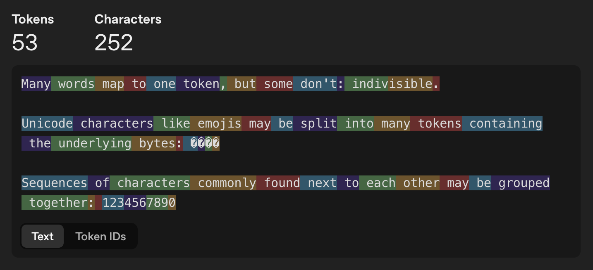
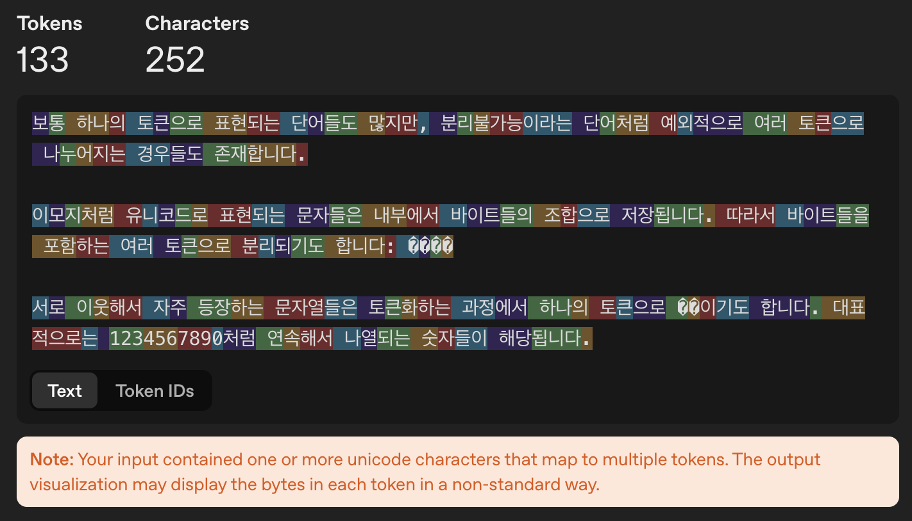
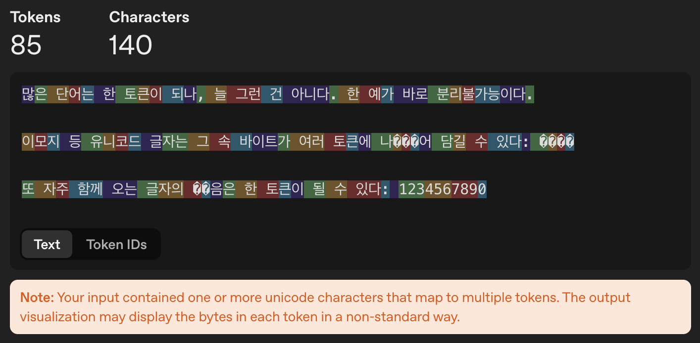
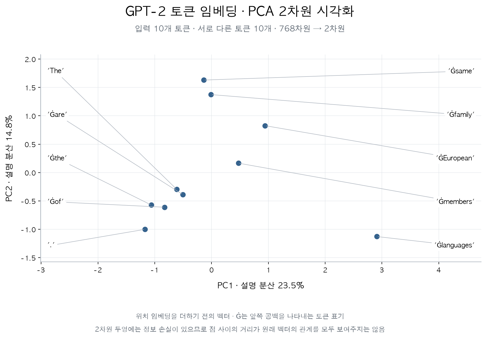

# 1. BPE 토크나이저 구현

## 1.1. tiktoken으로 한국어·영어 문장 토큰 수 비교

[이 문서](https://developers.openai.com/api/docs/guides/conversation-state#managing-context-for-text-generation)에 따라 OpenAI의 tiktoken 라이브러리를 사용할 수 있는 [tokenizer tool](https://platform.openai.com/tokenizer)에서 확인을 진행한다.

https://platform.openai.com/tokenizer

### 1.1.1. 영어 토큰화

입력어는 example에 명시되어있는 문장을 사용하였다.
```
Many words map to one token, but some don't: indivisible.

Unicode characters like emojis may be split into many tokens containing the underlying bytes: 🤚🏾

Sequences of characters commonly found next to each other may be grouped together: 1234567890
```




| 항목 | 개수 |
|---|---:|
| 원문 단어 수 (공백 기준) | 39개 |
| 원문 글자 수 (공백·줄바꿈 포함) | 252자 |
| 토큰 수 | 53개 |


### 1.1.2. 한글 토큰화 (예시1)

```
보통 하나의 토큰으로 표현되는 단어들도 많지만, 분리불가능이라는 단어처럼 예외적으로 여러 토큰으로 나누어지는 경우들도 존재합니다.

이모지처럼 유니코드로 표현되는 문자들은 내부에서 바이트들의 조합으로 저장됩니다. 따라서 바이트들을 포함하는 여러 토큰으로 분리되기도 합니다: 🤚🏾

서로 이웃해서 자주 등장하는 문자열들은 토큰화하는 과정에서 하나의 토큰으로 묶이기도 합니다. 대표적으로는 1234567890처럼 연속해서 나열되는 숫자들이 해당됩니다.
```



> 한국어는 글자 하나가 여러 토큰으로 나뉠 수 있다. '묶'이 ��로 표시된 이유다.


| 항목 | 개수 |
|---|---:|
| 원문 단어 수 (공백 기준) | 47개 |
| 원문 글자 수 (공백·줄바꿈 포함, 자모 분리X) | 252자 |
| 원문 글자 수 (공백·줄바꿈 포함, 자모 분리O) | 499자 |
| 토큰 수 | 133개 |

### 1.1.3. 한글 토큰화 (예시2)

```
많은 단어는 한 토큰이 되나, 늘 그런 건 아니다. 한 예가 바로 분리불가능이다.

이모지 등 유니코드 글자는 그 속 바이트가 여러 토큰에 나뉘어 담길 수 있다: 🤚🏾

또 자주 함께 오는 글자의 묶음은 한 토큰이 될 수 있다: 1234567890
```



| 항목 | 개수 |
|---|---:|
| 원문 단어 수 (공백 기준) | 39개 |
| 원문 글자 수 (공백·줄바꿈 포함, 자모 분리X) | 140자 |
| 원문 글자 수 (공백·줄바꿈 포함, 자모 분리O) | 252자 |
| 토큰 수 | 85개 |

### 1.1.4. 세 예시의 결과 비교

앞의 세 예시를 한 표로 모아 비교하였다. 단어 수는 공백을 기준으로 세었으며, 한국어에서는 어절 수에 해당한다.

<div class="bpe-comparison-table" role="region" aria-label="영어와 한국어 두 예시의 토큰화 결과 비교" tabindex="0">

| 비교 항목 | 영어 | 한국어 예시 1 | 한국어 예시 2 |
|---|---:|---:|---:|
| 단어 수 (공백 기준) | 39개 | 47개 | 39개 |
| 원문 글자 수 | 252자 | 252자 | 140자 |
| 자모 분리 후 글자 수 | 252자 | 499자 | 252자 |
| UTF-8 바이트 수 | 256 | 624 | 306 |
| **토큰 수** | **53개** | **133개** | **85개** |
| 원문 100자당 토큰 수 | 21.0개 | 52.8개 | 60.7개 |
| 영어 대비 전체 토큰 수 | 1.00배 | 2.51배 | 1.60배 |

</div>

글자 수는 사이트와 같은 UTF-16 단위로 계산하였다. 공백과 줄바꿈을 포함하고, 이모지 `🤚🏾`는 4자로 센다. 비율은 소수점 둘째 자리, 100자당 토큰 수는 소수점 첫째 자리까지 반올림하였다.

<div class="bpe-token-comparison">
<figure aria-labelledby="bpe-total-title">
<figcaption id="bpe-total-title">전체 토큰 수 <span>단위: 개</span></figcaption>
<div class="bpe-bar-row"><span class="bpe-bar-label">영어</span><span class="bpe-bar-track"><span class="bpe-bar-fill" style="width:35.3333%"></span></span><strong>53</strong></div>
<div class="bpe-bar-row"><span class="bpe-bar-label">한국어 1</span><span class="bpe-bar-track"><span class="bpe-bar-fill" style="width:88.6667%"></span></span><strong>133</strong></div>
<div class="bpe-bar-row"><span class="bpe-bar-label">한국어 2</span><span class="bpe-bar-track"><span class="bpe-bar-fill" style="width:56.6667%"></span></span><strong>85</strong></div>
<div class="bpe-bar-axis" aria-hidden="true"><span>0</span><span>50</span><span>100</span><span>150</span></div>
<p class="bpe-chart-note">각 문장 전체를 입력했을 때의 결과다. 원문 길이는 각각 252자, 252자, 140자로 다르다.</p>
</figure>
<figure aria-labelledby="bpe-density-title">
<figcaption id="bpe-density-title">원문 100자당 토큰 수 <span>단위: 개</span></figcaption>
<div class="bpe-bar-row"><span class="bpe-bar-label">영어</span><span class="bpe-bar-track"><span class="bpe-bar-fill" style="width:30.0454%"></span></span><strong>21.0</strong></div>
<div class="bpe-bar-row"><span class="bpe-bar-label">한국어 1</span><span class="bpe-bar-track"><span class="bpe-bar-fill" style="width:75.3968%"></span></span><strong>52.8</strong></div>
<div class="bpe-bar-row"><span class="bpe-bar-label">한국어 2</span><span class="bpe-bar-track"><span class="bpe-bar-fill" style="width:86.7347%"></span></span><strong>60.7</strong></div>
<div class="bpe-bar-axis" aria-hidden="true"><span>0</span><span>35</span><span>70</span></div>
<p class="bpe-chart-note">토큰 수 ÷ 원문 글자 수 × 100으로 계산했다. 자모 분리 후 길이는 분모로 사용하지 않았다.</p>
</figure>
</div>

## 1.2. BPE 구현

앞에서는 기존 토크나이저가 문장을 어떻게 나누는지 확인했다. 이번에는 [Hugging Face의 BPE 설명](https://huggingface.co/learn/llm-course/chapter6/5)을 참고해, 자주 등장하는 토큰 쌍을 찾아 합치는 과정을 직접 구현했다.

구현의 흐름은 다음과 같다.

```text
학습 문서 읽기 → 단어별 등장 횟수 계산 → 문자 단위로 분리
→ 인접한 토큰 쌍의 빈도 계산 → 가장 빈번한 쌍 하나 병합
→ 목표 어휘 크기까지 반복 → 병합 규칙을 새 문장에 적용
```

빈도 계산과 병합 함수를 먼저 작성하고, 인덱스와 반복문 제어를 고치며 학습 흐름을 연결했다. 데이터 파일 연결, 선택한 쌍만 병합하도록 정리하는 부분, 병합 순서 저장과 새 문장 토큰화 함수, 실행 검증은 AI의 도움을 받았다.

여기서는 **문자 기반 BPE**를 구현한다. 앞에서 사용한 `tiktoken`의 byte-level BPE처럼 바이트에서 시작하는 구현과는 시작 단위가 다르다.

### 1.2.1. 학습할 텍스트 가져오기

처음에는 같은 문장이 반복되는 짧은 예시를 사용했다. 서로 다른 단어가 91개뿐이어서, 학습에 사용한 문장을 다시 넣으면 단어 전체가 토큰이 되는 경우가 많았다. 더 다양한 문장을 사용하기 위해 [Project Gutenberg의 『셜록 홈스의 모험』](https://www.gutenberg.org/ebooks/48320) 텍스트로 바꿨다.

[학습에 사용한 텍스트 파일 내려받기](./sherlock_holmes.txt)

구텐베르크의 배포 안내문은 제외하고 책 텍스트를 파일로 저장했다. 표지·목차·삽화 설명은 포함되어 있다. 다음 코드는 파일을 읽은 뒤 줄바꿈과 연속 공백을 공백 하나로 정리한다.

```python
from pathlib import Path

# Arthur Conan Doyle, Adventures of Sherlock Holmes
# 원문: https://www.gutenberg.org/ebooks/48320
text_path = Path("sherlock_holmes.txt")
if not text_path.exists():
    text_path = Path("BPE") / "sherlock_holmes.txt"

text = text_path.read_text(encoding="utf-8")
text = " ".join(text.split())
```

노트북과 텍스트 파일이 같은 폴더에 있으면 첫 번째 경로로 읽고, 프로젝트 루트에서 실행하면 `BPE` 폴더 안에서 찾는다. `" ".join(text.split())`으로 공백을 정리했으므로, 다음 단계에서 `split(" ")`을 사용해도 줄바꿈이 단어 안에 남지 않는다.

| 학습 데이터 항목 | 값 |
|---|---:|
| 공백 기준 전체 단어 수 | 106,404개 |
| 공백 기준 서로 다른 단어 형태 | 15,288개 |
| 초기 어휘 크기 | 93개 |

여기서 서로 다른 단어 형태는 대소문자와 문장부호를 구분한다. `Holmes`, `Holmes,`, `Holmes.`은 다른 키로 센다.

### 1.2.2. 단어를 나누고 등장 횟수 세기

먼저 공백으로 단어를 나누고 `Counter`로 등장 횟수를 센다. 같은 단어를 매번 처리하는 대신, 한 번만 저장하고 빈도를 가중치로 사용하기 위해서다.

```python
#pre-tokenizer(공백기준분리)

pre_tokenizer_text = text.split(" ")

pre_tokenizer_text

#중복 없애고 등장빈도 나타내기

from collections import Counter

pre_tokenizer_word_frequency = dict(Counter(pre_tokenizer_text))

pre_tokenizer_word_frequency = {tuple(word):count for word,count in pre_tokenizer_word_frequency.items()}

pre_tokenizer_word_frequency
```

딕셔너리의 키를 문자열에서 튜플로 바꿨다. 처음에는 `"the"`가 `("t", "h", "e")`가 되고, 병합이 진행되면 `("th", "e")`, `("the",)`처럼 바뀐다. 튜플은 딕셔너리 키로 사용할 수 있으면서 현재 토큰 경계도 표현할 수 있다.

이후에 사용하는 자료구조는 다음과 같다.

<div class="bpe-comparison-table" role="region" aria-label="BPE 구현의 자료구조" tabindex="0">

| 변수 | 저장하는 내용 |
|---|---|
| `pre_tokenizer_word_frequency` | 처음 문자로 나눈 단어와 등장 횟수 |
| `word_frequency` | 병합이 반영된 현재 토큰 튜플과 등장 횟수 |
| `base_vocabulary` | 사용할 수 있는 문자와 학습으로 추가한 토큰 |
| `merges` | 선택한 토큰 쌍을 학습 순서대로 저장한 목록 |

</div>

### 1.2.3. 초기 어휘와 병합 후보 만들기

초기 어휘는 텍스트에 등장한 서로 다른 문자로 구성했다. `set`은 중복을 제거하지만 순서를 보장하지 않으므로, 이 목록에 표시되는 문자 순서는 학습 순서와 관계없다.

현재 코드의 초기 어휘에는 공백도 포함되지만, 단어를 공백으로 먼저 분리하므로 단어 사이를 합치는 데 사용하지는 않는다.

```python
#base_vocabulary 초기화
base_vocabulary = list(set(text))
base_vocabulary

#symbol 만들기 함수

def make_symbol(base_vocabulary:list) -> dict[str, tuple]:
    symbols = {}
    for first_text in base_vocabulary:
        for second_text in base_vocabulary:
            symbols[first_text+second_text] = (first_text, second_text)
    return symbols

symbols = make_symbol(base_vocabulary)
symbols
```

`make_symbol()`은 현재 어휘의 토큰 두 개를 이어 붙여 후보 문자열을 만든다. 이 딕셔너리는 후보 문자열이 존재하는지 확인할 때 사용한다. **실제로 어떤 두 토큰을 병합할지는 현재 단어의 인접 쌍을 튜플로 따로 저장해 결정한다.**

어휘가 커지면 모든 조합을 만드는 비용도 커진다. 현재는 동작을 확인하기 위한 구현으로 두었고, 실제 학습에 등장한 인접 쌍만 후보로 모으는 최적화는 적용하지 않았다.

### 1.2.4. 선택한 토큰 쌍 하나만 병합하기

병합 함수는 현재 단어 빈도와 `selected_pair`를 받는다. 어휘에 있는 토큰을 전부 찾아 합치는 대신, 전달받은 쌍과 정확히 일치하는 위치만 합친다.

```python
#word_frequency 재구성

def symbolic_word_frequency(prev_word_frequency:dict[tuple, int], selected_pair:tuple[str, str]) -> dict[tuple, int]:
    new_word_frequency = {}
    for word, score in prev_word_frequency.items():
        new_words = []
        i = 0
        while True:
            if i >= len(word):
                break

            if i + 1 < len(word) and (word[i], word[i+1]) == selected_pair:
                new_words.append(word[i]+word[i+1])
                i += 2
            else:
                new_words.append(word[i])
                i += 1
        new_word_frequency[tuple(new_words)] = score

    return new_word_frequency

word_frequency = dict(pre_tokenizer_word_frequency)
word_frequency
```

`i`는 현재 토큰 위치다. 두 토큰이 선택한 쌍과 같으면 합친 토큰을 넣고 두 칸 이동한다. 일치하지 않으면 현재 토큰을 그대로 넣고 한 칸 이동한다. `i + 1 < len(word)`는 마지막 토큰에서 다음 원소를 읽지 않도록 하는 조건이다.

<div class="llm-example" role="note" aria-label="반복되는 토큰 쌍의 병합 예시">

**예시**

`selected_pair = ("a", "a")`일 때 다음처럼 처리한다.

```text
현재 토큰: a · a · a · a
첫 병합:  aa · a · a
최종 결과: aa · aa
```

병합에 사용한 토큰을 다시 사용하지 않도록 두 칸씩 이동한다. `a · a · a`처럼 마지막에 하나가 남으면 `aa · a`로 보존한다.

</div>

여기서 `score`는 해당 단어의 등장 횟수다. 토큰을 합쳐도 단어가 등장한 횟수는 바뀌지 않으므로 결과 딕셔너리에 그대로 옮긴다. 학습을 시작할 때는 원본 빈도 딕셔너리를 복사해 `word_frequency`로 사용한다.

### 1.2.5. 인접한 쌍의 빈도 계산하기

병합할 쌍을 고르기 위해 현재 토큰 튜플을 순회한다. 단어가 여러 번 등장했다면 그 횟수만큼 쌍의 빈도를 더한다.

```python
def score_symbol(word_frequency:dict[tuple, int], symbols:dict):
    scores = {}
    for words, score in word_frequency.items():
        for i in range(len(words)-1):
            pair = (words[i], words[i+1])
            sum_text = words[i] + words[i+1]
            if sum_text in symbols.keys():
                scores[pair] = scores.get(pair, 0) + score
    return scores

scores = score_symbol(word_frequency, symbols)
sorted(scores.items(), key=lambda x: x[1], reverse=True)
```

`pair`는 실제로 이웃한 두 토큰이고, `sum_text`는 둘을 합친 문자열이다. 점수 딕셔너리의 키에는 문자열 대신 `pair`를 사용했다. `("ab", "c")`와 `("a", "bc")`는 합친 문자열이 모두 `"abc"`이지만 서로 다른 병합 규칙이기 때문이다.

빈도를 셀 때는 겹치는 인접 위치도 모두 확인한다. 예를 들어 `("a", "a", "a", "a")`가 2번 등장했다면 `("a", "a")`의 빈도는 `3 × 2 = 6`이다. 앞의 병합 함수에서 두 번 합치는 것과는 세는 기준이 다르다.

이번 문서의 초기 쌍 빈도 상위 항목은 다음과 같았다.

| 인접 쌍 | 빈도 |
|---|---:|
| `('t', 'h')` | 11,921 |
| `('h', 'e')` | 11,588 |
| `('i', 'n')` | 7,710 |
| `('e', 'r')` | 7,193 |
| `('a', 'n')` | 6,559 |

이 표는 첫 병합 전의 빈도다. 병합할 때마다 점수가 바뀌므로 실제 병합 순서는 이 표의 순위와 달라질 수 있다.

정렬할 때 `key=lambda x: x[1]`을 넣어 점수 기준으로 비교했다. 이것을 생략하면 `(쌍, 점수)` 중 앞의 쌍부터 비교하므로 빈도순 정렬이 되지 않는다.

### 1.2.6. 어휘를 늘리고 병합 순서 저장하기

새 토큰은 기존 어휘에 추가한다. 아래 함수의 길이순 정렬은 어휘를 보기 편하게 나열하기 위한 것이며, 병합 우선순위를 정하는 기준은 아니다.

```python
def update_base_vocab(new:str, base_vocabulary:list):
    new_base_vocabulary = base_vocabulary
    new_base_vocabulary.append(new)
    new_base_vocabulary.sort(reverse=True, key=lambda x: len(x))
    return new_base_vocabulary

new = "".join(sorted(scores.items(), key=lambda x: x[1], reverse=True)[0][0])
update_base_vocab(new, base_vocabulary.copy())
```

함수 아래의 호출은 첫 후보를 추가해 보는 예시다. `.copy()`로 어휘의 복사본을 넘겨, 실제 학습 전에 첫 토큰이 미리 추가되지 않게 했다.

이제 쌍의 점수를 계산하고, 가장 빈번한 쌍을 하나 골라 병합하는 과정을 반복한다.

```python
merges = []

while True:
    symbols = make_symbol(base_vocabulary)
    scores = score_symbol(word_frequency, symbols)
    if not scores:
        break
    selected_pair = sorted(scores.items(), key=lambda x: x[1], reverse=True)[0][0]
    new = "".join(selected_pair)
    word_frequency = symbolic_word_frequency(word_frequency, selected_pair)
    merges.append(selected_pair)
    if new not in base_vocabulary:
        base_vocabulary = update_base_vocab(new, base_vocabulary)
    if len(base_vocabulary) >= 800:
        break

base_vocabulary
```

한 번 병합할 때마다 인접한 토큰 관계가 바뀌므로 다음 반복에서는 점수를 다시 계산한다. 이때 `pre_tokenizer_word_frequency`를 매번 넣으면 초기 문자 상태로 돌아가 버린다. 직전 결과인 `word_frequency`를 다음 병합에 넘겨야 더 긴 토큰으로 이어진다.

`scores`가 비면 더 병합할 인접 쌍이 없다는 뜻이므로 종료한다. 목표 어휘 크기 800개에 도달한 경우에도 종료한다. 새 토큰은 중복 추가하지 않고, 선택한 쌍은 `merges.append(selected_pair)`로 기록한다. 빈도가 같을 때는 현재 단어 순회에서 먼저 발견된 쌍을 선택한다.

==yellow:최종 어휘 목록과 병합 순서는 따로 보관해야 한다.== 어휘는 사용 가능한 토큰을 알려주고, `merges`는 그 토큰들이 어떤 순서로 만들어졌는지 알려준다.

### 1.2.7. 저장한 규칙으로 새 문장 토큰화하기

새 문장에서는 점수를 다시 계산하거나 병합 규칙을 추가하지 않는다. 학습 때처럼 단어를 나누고 문자 튜플로 만든 다음, `merges`의 규칙을 처음부터 순서대로 적용한다.

```python
def tokenize(text: str, merges: list) -> list[str]:
    result = []

    for word in text.split(" "):
        if not word:
            continue

        word_state = {tuple(word): 1}

        for pair in merges:
            word_state = symbolic_word_frequency(word_state, pair)

        tokens = list(word_state.keys())[0]
        result.extend(tokens)

    return result
```

기존 병합 함수를 재사용하기 위해 단어 하나를 `{tuple(word): 1}` 형태로 넣었다. 여기서 `1`은 함수의 입력 형식을 맞추기 위한 값이며, 새 문장의 학습 빈도로 쓰이지 않는다.

모든 규칙을 적용한 뒤 딕셔너리의 키를 꺼내면 그 단어의 토큰 튜플을 얻는다. `result.extend(tokens)`로 토큰을 하나씩 결과 리스트에 붙인다. 문장 전체를 `Counter`로 묶지 않고 단어를 입력 순서대로 처리하므로, 같은 단어가 반복돼도 빠지지 않는다.

### 1.2.8. 실행 결과 확인하기

이전 실행 상태가 섞이지 않도록 위 코드를 처음부터 실행한 결과를 정리했다. 현재 텍스트 파일과 목표 어휘 크기 800개를 사용한 결과다.

| 확인 항목 | 결과 |
|---|---:|
| 초기 어휘 크기 | 93개 |
| 최종 어휘 크기 | 800개 |
| 저장한 병합 규칙 | 707개 |

처음 학습한 규칙은 다음 순서였다.

```text
1. ('t', 'h') → 'th'
2. ('i', 'n') → 'in'
3. ('e', 'r') → 'er'
4. ('a', 'n') → 'an'
5. ('th', 'e') → 'the'
```

노트북의 테스트 문장에도 적용했다.

```python
new_text = "The European languages are members of the same family."

tokens = tokenize(new_text, merges)

print(tokens)
print("토큰 수:", len(tokens))
```

```text
['The', 'E', 'u', 'ro', 'pe', 'an', 'l', 'ang', 'u', 'ag', 'es', 'are', 'me', 'm', 'b', 'ers', 'of', 'the', 'sa', 'me', 'f', 'am', 'i', 'ly.']
토큰 수: 24
```

처음의 반복 문장으로 학습했을 때는 이 문장의 단어들이 통째로 토큰이 되어, 띄어쓰기로 나눈 결과와 같아 보였다. 학습에 없던 단어를 넣으면 배운 조각을 조합하는 차이가 더 잘 보인다. 이번 텍스트로 학습한 결과도 함께 확인했다.

<div class="bpe-comparison-table" role="region" aria-label="학습에 없는 단어의 토큰화 결과" tabindex="0">

| 입력 단어 | 학습 데이터에 같은 단어 형태가 있었는가 | BPE 결과 |
|---|---|---|
| `tokenization` | 없음 | `['to', 'k', 'en', 'i', 'z', 'ation']` |
| `Europeanization` | 없음 | `['E', 'u', 'ro', 'pe', 'an', 'i', 'z', 'ation']` |

</div>

`the the`도 같은 단어를 두 번 토큰화한 결과와 일치했다. 단어를 빈도 딕셔너리로 묶어 처리하던 학습 단계와 달리, 새 문장에서는 입력 순서와 반복을 유지한 것이다.

### 1.2.9. 현재 구현의 범위

이번에는 문자에서 시작하는 BPE 학습과, 저장한 병합 규칙을 새 문장에 적용하는 부분까지 구현했다. 다음 항목은 포함하지 않았다.

| 항목 | 현재 동작 |
|---|---|
| 공백과 줄바꿈 복원 | 전처리에서 정리·분리하므로 원문 그대로 복원하지 못한다. |
| 학습에 없던 문자 | 별도의 `[UNK]` 처리가 없어 어휘에 없는 문자도 결과에 남을 수 있다. |
| 모델에 넣을 정수 토큰 ID | 이 단계에서는 토큰 문자열을 반환한다. 아래 임베딩 단계에서는 GPT-2의 토크나이저와 ID를 사용한다. |
| Byte-level BPE | UTF-8 바이트가 아닌 문자에서 시작한다. |

따라서 앞의 `tiktoken` 사이트와 토큰 수가 같아지는 것을 목표로 하지는 않았다. 같은 BPE 원리라도 학습 데이터, 초기 어휘, 사전 토큰화와 병합 규칙이 달라지면 결과도 달라진다.

## 1.3. 임베딩 결합 구현

토크나이징을 한 각각의 토큰들은 임베딩 과정을 거쳐 고차원의 벡터로 나타낸다. 이 글에선 미리 학습된 GPT-2의 토큰 임베딩과 위치 임베딩을 사용한다.

### 1.3.1. GPT-2의 토크나이저를 사용하는 이유

앞에서는 BPE의 병합 과정을 이해하기 위해 토크나이저를 직접 구현했다. 임베딩 과정에서는 **GPT-2의 토크나이저와 임베딩 테이블을 함께 사용**하기로 했다.

GPT-2의 토큰 임베딩 테이블은 **50,257개 토큰**을 다루지만, 내가 만든 BPE의 어휘는 **800개**다. 또한 내 구현은 문자를 시작 단위로 삼아 문자열을 합치는 문자 기반 BPE다. [GPT-2의 토크나이저](https://huggingface.co/docs/transformers/en/model_doc/gpt2#transformers.GPT2Tokenizer)는 UTF-8 바이트를 시작 단위로 사용하는 byte-level BPE이므로, 토큰을 구성하는 기준도 다르다.

현재 구현으로 어휘를 50,257개까지 늘리려면 많은 시간이 필요하다. 병합할 때마다 현재 어휘의 모든 토큰 쌍으로 후보를 만들고, 단어들을 순회하며 빈도를 다시 계산하기 때문이다. 어휘가 커질수록 후보를 구성하는 비용도 커진다.

어휘 수를 같게 늘리더라도 같은 ID가 같은 토큰을 가리키는 것은 아니다. 임베딩 테이블의 각 행은 GPT-2의 토큰 ID에 맞춰 학습되어 있으므로, 이번에는 **그 테이블과 대응하는 GPT-2 토큰 ID를 그대로 사용**한다.

### 1.3.2. GPT-2의 두 임베딩 표 가져오기

임베딩 표는 토큰마다 벡터 하나를 행으로 저장한 배열이다. ==blue:토큰 ID는 이 배열에서 어느 행을 꺼낼지 알려주는 번호==이다.

GPT-2의 토큰 임베딩은 `wte`, 위치 임베딩은 `wpe`에 저장되어 있다. [Hugging Face의 GPT-2 구현](https://github.com/huggingface/transformers/blob/main/src/transformers/models/gpt2/modeling_gpt2.py)에서도 두 표에서 벡터를 조회한 뒤 더한다.

```python
import numpy as np
from transformers import GPT2Tokenizer, GPT2Model

model_name = "openai-community/gpt2"
gpt2_tokenizer = GPT2Tokenizer.from_pretrained(model_name)
gpt2_model = GPT2Model.from_pretrained(model_name)
gpt2_model.eval()

token_embedding_table = (
    gpt2_model.wte.weight.detach().cpu().numpy()
)
position_embedding_table = (
    gpt2_model.wpe.weight.detach().cpu().numpy().copy()
)
```

모델과 가중치를 불러오는 데는 PyTorch 기반 라이브러리를 사용하고, 가져온 표를 NumPy 배열로 바꿔 이후 계산에 사용한다. 처음 실행할 때는 GPT-2 모델 가중치를 다운로드한다.

| 가져온 표 | 크기 |
|---|---|
| 토큰 임베딩 `wte` | `(50257, 768)` |
| 위치 임베딩 `wpe` | `(1024, 768)` |

이 임베딩 테이블에는 50,257개 토큰에 대한 벡터값과 1,024개 위치에 대한 벡터값이 각각 저장되어 있다. 두 표 모두 벡터의 길이가 768이므로 원소끼리 더할 수 있다. 위치 임베딩도 이 모델이 학습한 값을 가져온다.

### 1.3.3. 문장을 GPT-2 토큰 ID로 변환하기

앞에서 사용한 예제 문장을 GPT-2 토크나이저에 넣는다. `encode()`의 결과는 문자열 조각이 아닌 정수 ID 목록이다. 이 ID로 토큰 임베딩 테이블을 바로 조회할 수 있다.

```python
new_text = "The European languages are members of the same family."

token_ids = np.array(
    gpt2_tokenizer.encode(new_text, add_special_tokens=False),
    dtype=np.int64,
)
tokens = gpt2_tokenizer.convert_ids_to_tokens(token_ids.tolist())

print("GPT-2 토큰:", tokens)
print("토큰 ID:", token_ids)
print("토큰 수:", len(token_ids))
```

실행 결과는 다음과 같다.

```text
GPT-2 토큰: ['The', 'ĠEuropean', 'Ġlanguages', 'Ġare', 'Ġmembers', 'Ġof', 'Ġthe', 'Ġsame', 'Ġfamily', '.']
토큰 ID: [ 464 3427 8950  389 1866  286  262  976 1641   13]
토큰 수: 10
```

`Ġ`는 토큰 표기에서 앞쪽 공백을 나타낸다. 예를 들어 `ĠEuropean`은 앞에 공백이 붙은 ` European`에 해당한다. 직접 만든 BPE에서는 같은 문장이 24개 토큰으로 나뉘었지만, 이번에는 10개 토큰으로 나뉘었다. 두 토크나이저의 어휘와 분리 기준이 다르기 때문이다.

### 1.3.4. 위치 벡터를 더해 입력 만들기

토큰 ID로 벡터를 꺼내면 같은 토큰은 어느 위치에 등장해도 같은 벡터를 가져온다. 여기에 문장 안에서의 순서를 반영하기 위해 위치별 벡터를 더한다. 위치 번호는 **GPT-2로 나눈 토큰 순서에 따라 0부터** 부여한다.

```python
seq_len = len(token_ids)
if seq_len > len(position_embedding_table):
    raise ValueError("위치 임베딩의 최대 길이를 초과했습니다.")

position_ids = np.arange(seq_len)

token_vectors = token_embedding_table[token_ids]
position_vectors = position_embedding_table[position_ids]

x = token_vectors + position_vectors

print("토큰 임베딩 크기:", token_vectors.shape)
print("위치 임베딩 크기:", position_vectors.shape)
print("최종 입력 크기:", x.shape)
```

핵심 연산은 `x[i] = token_embedding_table[token_ids[i]] + position_embedding_table[i]`이다. 두 벡터를 이어 붙이는 것이 아니라 같은 차원의 값끼리 더하므로, 벡터의 길이는 768로 유지된다.

### 1.3.5. 실행 결과 확인하기

문장이 10개 토큰으로 나뉘었으므로 각 임베딩과 최종 입력은 다음 크기가 된다.

```text
토큰 임베딩 크기: (10, 768)
위치 임베딩 크기: (10, 768)
최종 입력 크기: (10, 768)
```

첫 토큰 `The`의 벡터와 위치 0의 벡터에서 앞의 네 값만 보면, 실제로 원소별 덧셈이 이루어진 것을 확인할 수 있다. 아래 값은 실행 결과를 소수점 여덟 자리로 반올림한 것이다.

| 차원 | 토큰 임베딩 | 위치 임베딩 | 결합 결과 |
|---|---:|---:|---:|
| 0 | -0.06862289 | -0.01882072 | -0.08744361 |
| 1 | -0.02029774 | -0.19741860 | -0.21771634 |
| 2 | 0.06447055 | 0.00402672 | 0.06849728 |
| 3 | -0.06208458 | 0.01134686 | -0.05073772 |

문장 전체가 벡터 하나로 합쳐지는 것은 아니다. **토큰마다 벡터 하나가 남아 있는 `(10, 768)` 행렬**이 다음 계산의 입력이 된다.

### 1.3.6. 토큰 임베딩을 2차원으로 표시하기



