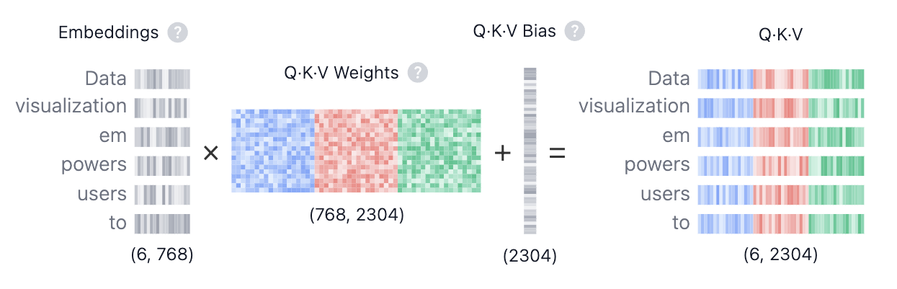
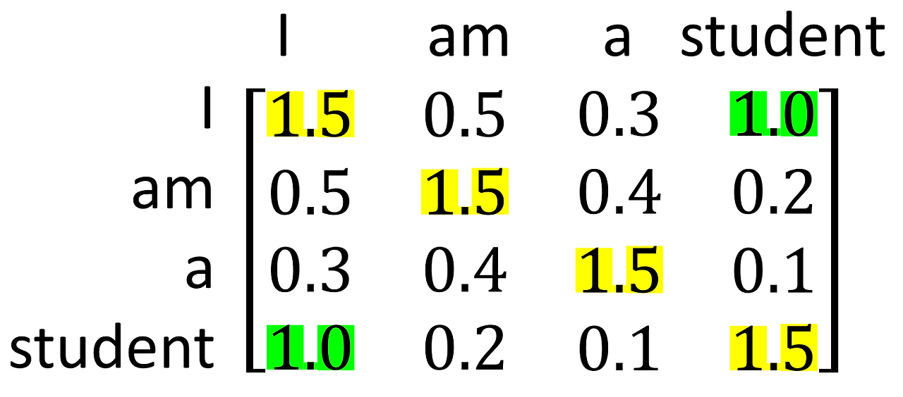
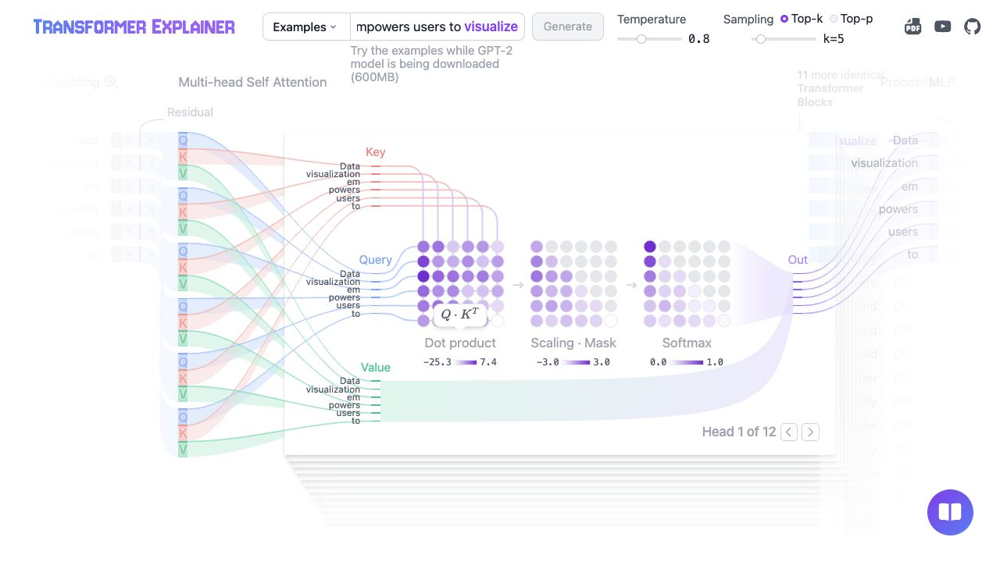
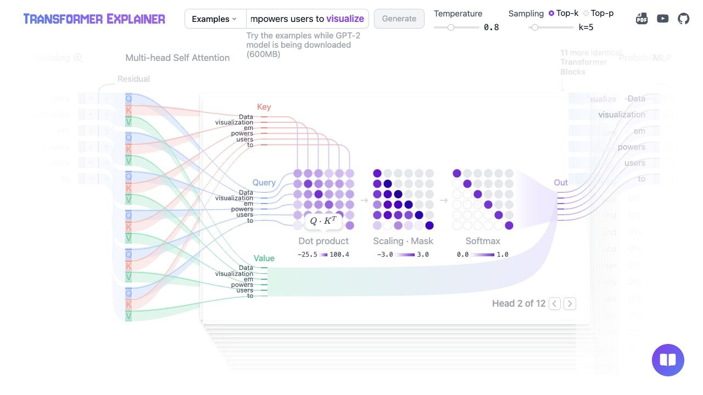
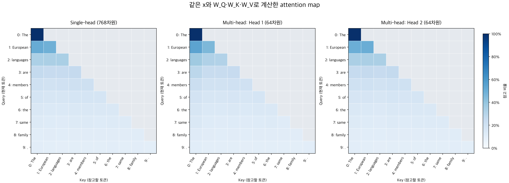

[앞 글](/Numpy2GPT-2/2_implement%20from%20scratch/#13-임베딩-결합-구현)에서는 토큰 임베딩과 위치 임베딩을 더해 입력 벡터를 만들었다. 이번에는 **각 토큰이 다른 위치를 얼마나 참고할지 정하고, 그 비율로 정보를 섞어 새 벡터를 만드는 과정**을 구현했다.

Q·K·V와 가중치의 관계가 헷갈렸는데, [코딩 오페라의 설명](https://codingopera.tistory.com/43)을 그림과 함께 읽으며 이해하는 데 도움을 받았다. 아래는 `SelfAttention.ipynb`와 `multiHeadSelfAttention.ipynb`의 코드를 바탕으로 정리한 내용이다. 개념 설명과 코드 예시, 실행 검증에는 AI의 도움을 받았다.

[Transformer Explainer](https://poloclub.github.io/transformer-explainer/)의 기본 예제에서 Attention을 펼치고 head를 바꾼 화면도 캡처해 넣었다. 사이트는 학습된 GPT-2를 사용한다. 무작위 가중치를 쓴 내 코드와 수치는 다르지만, 각 계산이 무엇을 바꾸는지 볼 수 있다.

- [1. Single-head: 참고 비율로 V 섞기](#1-single-head-self-attention-구현)
- [2. Multi-head: 여러 비율로 계산하고 조합하기](#2-multi-head-self-attention-구현)
- [3. 어텐션 맵으로 Single-head와 Multi-head 비교](#3-어텐션-맵으로-single-head와-multi-head-비교)

## 1. Single-head self-attention 구현

입력 문장은 `The European languages are members of the same family.`다. GPT-2 토크나이저로 나눈 토큰 10개를 각각 768차원으로 임베딩해, 입력 `x`의 크기는 `(10, 768)`이다. 아래 코드는 앞 단계에서 저장한 임베딩을 `x`로 불러온 상태에서 이어진다.

### 1.1. 같은 입력에서 Q·K·V 만들기

같은 입력에 서로 다른 가중치를 곱해 세 가지 표현을 만든다. Q와 K는 참고할 대상을 비교하는 데, V는 실제 정보를 전달하는 데 사용한다.

<div class="llm-equation" role="region" aria-label="Q K V를 만드는 수식" tabindex="0">
<math xmlns="http://www.w3.org/1998/Math/MathML" display="block" aria-label="Q = X W_Q, K = X W_K, V = X W_V">
  <mtable columnalign="left">
    <mtr><mtd><mi>Q</mi><mo>=</mo><mi>X</mi><msub><mi>W</mi><mi>Q</mi></msub></mtd></mtr>
    <mtr><mtd><mi>K</mi><mo>=</mo><mi>X</mi><msub><mi>W</mi><mi>K</mi></msub></mtd></mtr>
    <mtr><mtd><mi>V</mi><mo>=</mo><mi>X</mi><msub><mi>W</mi><mi>V</mi></msub></mtd></mtr>
  </mtable>
</math>
</div>

| 구분 | 기호 · 코드 | 의미 |
|---|---|---|
| 입력 | X · `x` | 토큰·위치 임베딩을 더한 벡터들 |
| 가중치 | W_Q, W_K, W_V | 입력을 각 역할에 맞게 변환하는 행렬 |
| 출력 | Q · `Q` | 참고할 정보를 찾는 벡터들 |
| 출력 | K · `K` | Q와 비교할 벡터들 |
| 출력 | V · `V` | 가져와 섞을 특징 벡터들 |

[](https://poloclub.github.io/transformer-explainer/)

*그림 출처: Georgia Tech Polo Club, [Transformer Explainer](https://poloclub.github.io/transformer-explainer/). 사이트 제작진이 제공한 설명 그림이다.*

그림에서는 Q·K·V를 한 번에 계산해 `2304 = 768 × 3`차원으로 표시하고 bias도 더한다. 아래 코드는 세 행렬을 나누어 계산하며 bias는 생략했다.

```python
import numpy as np

seq_len, d_model = x.shape
rng = np.random.default_rng(42)
scale = 1 / np.sqrt(d_model)

W_Q = rng.normal(0, scale, size=(d_model, d_model))
W_K = rng.normal(0, scale, size=(d_model, d_model))
W_V = rng.normal(0, scale, size=(d_model, d_model))

Q = x @ W_Q
K = x @ W_K
V = x @ W_V
```

Q·K·V의 역할은 **질문, 답변을 찾기 위한 소개, 실제 답변 내용**에 비유해 이해할 수 있다.

**Q(Query)는 현재 토큰을 이해하기 위한 질문이다.** 어떤 토큰에 대해 “이 토큰이 무엇을 뜻하나요?”라고 질문하는 표현을 만든다고 생각할 수 있다. 토큰의 입력 벡터 `x`에 `W_Q`를 곱해 `Q`로 나타낸다. 여기서 `W_Q`는 입력을 **질문 형식으로 바꾸는 규칙**과 비슷하다.

**K(Key)는 질문과 비교할 수 있도록 자신이 가진 정보를 소개하는 표현이다.** “이 토큰은 ~을 뜻합니다”라는 답변 형식에 비유할 수 있다. 입력 벡터 `x`에 `W_K`를 곱해 `K`를 만든다. `W_K`는 입력을 **질문과 대조할 수 있는 답변 형식으로 바꾸는 규칙**과 비슷하다.

**V(Value)는 관련 있는 토큰에서 실제로 가져올 내용이다.** K가 “내가 이런 정보를 가지고 있습니다”라는 소개라면, V는 “참고할 내용은 이것입니다”라고 전달하는 실제 정보에 해당한다. 입력 벡터 `x`에 `W_V`를 곱해, 다른 토큰에 전달하고 섞을 정보를 만든다.

여기서 질문과 답변은 벡터의 역할을 설명하기 위한 비유다. 실제 모델에서 `W_Q`, `W_K`, `W_V`는 학습을 통해 각 역할에 필요한 표현을 만드는 변환 행렬이다. 위 예제에서는 계산 흐름을 확인하기 위해 무작위 값으로 초기화했다.

==blue:같은 층의 모든 토큰은 같은 가중치 행렬을 사용한다.== `Q[0] = x[0] @ W_Q`, `Q[1] = x[1] @ W_Q`처럼 변환 규칙은 같고 입력이 달라 결과도 달라진다. 다른 층은 일반적으로 자신의 가중치를 따로 가진다.

가중치의 크기는 `(768, 768)`, Q·K·V는 각각 `(10, 768)`이다. `@`는 행렬곱이다. 같은 위치의 원소끼리 곱하는 `*`와는 다르다.

### 1.2. Q와 K를 비교해 점수 계산하기

현재 토큰의 질문 `q_i`와 다른 토큰의 답변 소개 `k_j`를 내적으로 비교한다. 같은 질문을 기준으로 내적값이 클수록, 모델이 두 표현의 관련성을 높게 평가한 것이다. 질문·답변 비유로 보면 **“이 질문에는 어떤 답변이 더 관련 있는가?”를 점수로 나타내는 과정**이다. 이를 모든 토큰 쌍에 대해 계산한 결과가 점수 행렬이다.

이 점수를 스케일링하고 mask와 softmax를 적용해 참고 비율을 구한다. 그 비율로 각 토큰의 **실제 내용인 V를 가져와 섞는다.**

<div class="llm-equation" role="region" aria-label="Q와 K로 점수를 계산하는 수식" tabindex="0">
<math xmlns="http://www.w3.org/1998/Math/MathML" display="block" aria-label="S = Q K의 전치 / 루트 d_k">
  <mrow><mi>S</mi><mo>=</mo><mfrac><mrow><mi>Q</mi><msup><mi>K</mi><mi mathvariant="normal">T</mi></msup></mrow><msqrt><msub><mi>d</mi><mi>k</mi></msub></msqrt></mfrac></mrow>
</math>
</div>

| 구분 | 기호 · 코드 | 의미 |
|---|---|---|
| 입력 | Q, K | 토큰 사이의 관련성을 비교할 벡터들 |
| 차원 | dₖ · `d_k` | 내적하는 벡터의 길이. 여기서는 768 |
| 출력 | S · `scores` | 각 토큰이 다른 토큰을 참고할 점수 |

```python
scores = Q @ K.T

d_k = Q.shape[-1]
scores = scores / np.sqrt(d_k)

print(scores.shape)  # (10, 10)
```

`K.T`는 K의 각 행에 있던 토큰 벡터를 열로 세운다. Q의 각 행과 K의 각 열을 내적하므로 `(10, 768) @ (768, 10)`의 결과는 `(10, 10)`이다.

`scores[i, j]`는 i번째 토큰이 j번째 토큰을 참고할 점수다. **행은 정보를 가져오는 쪽, 열은 정보를 제공하는 쪽**으로 읽으면 된다.

내적 차원이 커질수록 점수의 크기도 커지기 쉽다. 이때 softmax가 한쪽에 지나치게 쏠릴 수 있어 `sqrt(d_k)`로 나눠 크기를 조절한다.



*그림 출처: 코딩 오페라, [4-1. Transformer(Self Attention)](https://codingopera.tistory.com/43). 설명용 점수이며 이 코드의 실행 결과는 아니다.*

그림에서 `I` 행과 `student` 열의 `1.0`은 `I`가 `student`를 참고할 점수다. 노란 대각선은 자기 자신과의 점수, 초록색은 두 위치 사이의 점수를 강조한다.

==orange:아직 softmax를 적용하지 않았으므로 점수는 확률이 아니다.== 이 예시는 대칭이고 대각선 값이 가장 크지만, 실제 Q와 K는 서로 다른 가중치로 만들어져 그런 성질이 보장되지는 않는다.

### 1.3. Causal mask로 미래 위치 차단하기

다음 토큰을 예측할 때는 현재 위치까지의 정보만 사용해야 한다. 현재 위치의 출력으로 **그다음 토큰을 예측**하므로 자기 자신은 볼 수 있고, 미래 위치는 볼 수 없다.

```python
future_mask = np.triu(
    np.ones((seq_len, seq_len), dtype=bool),
    k=1,
)
masked_scores = np.where(future_mask, -np.inf, scores)
```

`np.triu(..., k=1)`은 대각선 바로 위부터 `True`로 만든다. `np.where`는 그 위치의 점수를 `-inf`로 바꾸고 나머지는 유지한다. 앞의 그림에서는 `I → student`가 차단되고 `student → I`는 허용된다.

0이 아니라 `-inf`를 넣는 이유는 다음 softmax 계산에 있다. `exp(-inf)`는 0이 되지만 `exp(0)`은 1이다. 점수를 0으로 바꾸는 것만으로는 그 위치를 차단할 수 없다.

### 1.4. Softmax로 참고 비율 구하기

각 행의 점수를 softmax에 넣어 합이 1인 참고 비율로 바꾼다. 수식에서는 허용 위치가 0이고 차단 위치가 −∞인 mask M을 점수에 더한다. 위 코드의 `np.where`도 같은 효과를 낸다.

<div class="llm-equation" role="region" aria-label="점수와 mask로 참고 비율을 계산하는 수식" tabindex="0">
<math xmlns="http://www.w3.org/1998/Math/MathML" display="block" aria-label="A = softmax(S + M)">
  <mrow><mi>A</mi><mo>=</mo><mi mathvariant="normal">softmax</mi><mo>(</mo><mi>S</mi><mo>+</mo><mi>M</mi><mo>)</mo></mrow>
</math>
</div>

| 구분 | 기호 · 코드 | 의미 |
|---|---|---|
| 입력 | S · `scores` | 토큰 사이의 점수 |
| mask | M | 허용 위치는 0, 미래 위치는 −∞ |
| 출력 | A · `weights` | 각 토큰에서 정보를 가져올 비율 |

```python
shifted_scores = masked_scores - np.max(
    masked_scores,
    axis=-1,
    keepdims=True,
)
exp_scores = np.exp(shifted_scores)
weights = exp_scores / np.sum(
    exp_scores,
    axis=-1,
    keepdims=True,
)
```

먼저 각 행의 최댓값을 빼 지수 계산이 너무 커지는 것을 줄인다. 같은 행에서 같은 값을 빼도 최종 softmax 비율은 바뀌지 않는다. 이후 지수 함수를 적용하고, 각 값을 그 행의 합으로 나눈다.

`axis=-1`은 마지막 축을 따라 계산한다는 뜻이다. 여기서는 한 Query가 참고할 Key들의 점수를 대상으로 한다. `keepdims=True`는 행별 최댓값과 합을 `(10, 1)`로 유지한다. 덕분에 `(10, 10)` 배열의 각 행에 맞춰 빼거나 나눌 수 있다.

<div class="llm-example" role="note" aria-label="softmax 계산 예시">

**예시**

토큰 세 개에 대한 가상 점수 한 행을 계산하면 다음과 같다. 값은 소수점 넷째 자리까지 반올림했다.

```text
점수             [2,      1,     -inf]
최댓값 빼기      [0,     -1,     -inf]
지수 함수 적용   [1,      0.3679, 0   ]
행의 합으로 나눔 [0.7311, 0.2689, 0   ]
```

첫 번째 토큰을 약 73.1%, 두 번째 토큰을 약 26.9% 참고한다. 차단된 세 번째 위치의 비율은 0이다.

</div>

실제 입력에서 세 번째 토큰의 비율 `weights[2]`는 다음과 같았다.

```text
[0.3296048  0.33390219 0.33649301 0. 0. 0. 0. 0. 0. 0.]
```

앞의 두 토큰과 자기 자신에게만 비율이 배정됐다. 미래 위치는 모두 0이고, `weights.sum(axis=-1)`로 확인한 각 행의 합은 약 1이었다.



*화면 출처: [Transformer Explainer](https://poloclub.github.io/transformer-explainer/). AI 도구로 기본 예제의 Attention을 펼쳐 캡처했다. 내 NumPy 코드의 실행 결과는 아니다.*

세 행렬을 왼쪽부터 보면 코드의 흐름과 같다. `Dot product`는 Q·K의 내적 점수다. `Scaling · Mask`에서는 점수 크기를 조절하고 오른쪽 위의 미래 위치를 차단한다. `Softmax`는 이를 0~1의 참고 비율로 바꾼다. 이 head는 여러 행에서 첫 번째 토큰을 많이 참고한다.

### 1.5. 비율로 V를 섞어 새 벡터 만들기

처음에는 `weights`에 이미 문맥이 반영되어 있는데 왜 V를 곱하는지 헷갈렸다. `weights`에는 **참고 비율**이, V에는 그 비율을 적용할 **특징값**이 들어 있다.

<div class="llm-equation" role="region" aria-label="참고 비율로 V를 가중합하는 수식" tabindex="0">
<math xmlns="http://www.w3.org/1998/Math/MathML" display="block" aria-label="Z = A V, z_i = j가 1부터 T까지인 A_ij v_j의 합">
  <mtable columnalign="left">
    <mtr><mtd><mi>Z</mi><mo>=</mo><mi>A</mi><mi>V</mi></mtd></mtr>
    <mtr><mtd><msub><mi>z</mi><mi>i</mi></msub><mo>=</mo><munderover><mo>∑</mo><mrow><mi>j</mi><mo>=</mo><mn>1</mn></mrow><mi>T</mi></munderover><msub><mi>A</mi><mrow><mi>i</mi><mi>j</mi></mrow></msub><msub><mi>v</mi><mi>j</mi></msub></mtd></mtr>
  </mtable>
</math>
</div>

| 구분 | 기호 · 코드 | 의미 |
|---|---|---|
| 입력 | A · `weights` | 토큰별 참고 비율. 한 행에 10개 |
| 입력 | V · `V` | 토큰별 특징 벡터. 한 행에 768개 성분 |
| 출력 | Z · `context` | 비율에 따라 특징을 섞은 토큰별 새 벡터 |

아래쪽 식은 i번째 출력 하나를 풀어 쓴 것이다. T는 토큰 수이며, 각 토큰의 V에 그 토큰을 참고할 비율을 곱해 더한다.

```python
context = weights @ V
print(context.shape)  # (10, 768)
```

위에서 구한 세 번째 토큰의 비율을 적용하면 다음 세 항만 남는다. 미래 위치의 비율은 0이므로 결과에 영향을 주지 않는다.

```text
context[2] ≈ 0.3296048  × V[0]
           + 0.33390219 × V[1]
           + 0.33649301 × V[2]
```

`weights @ V`는 이 가중합을 모든 토큰에 대해 한꺼번에 계산한다. 새로운 참고 비율을 정하는 것이 아니라, Q와 K로 정한 비율을 V의 특징값에 적용하는 것이다.

==yellow:비율은 벡터 일부를 고르는 것이 아니라 전체 벡터의 기여량을 조절한다.== 25%를 참고한다면 해당 V의 768개 성분 모두에 0.25를 곱한다.

K와 V를 따로 만드는 이유는 비교할 특징과 전달할 특징을 각각 학습하기 위해서다. `W_K`는 관련성을 비교할 표현을, `W_V`는 다른 토큰에 전달할 표현을 만든다.

## 2. Multi-head self-attention 구현

Single-head에서는 한 토큰의 참고 비율을 V의 768개 성분 전체에 적용했다. Multi-head는 같은 입력에서 여러 특징 묶음을 만들고 **묶음마다 별도의 참고 비율**을 계산한다. 어떤 묶음은 한 토큰을, 다른 묶음은 다른 토큰을 더 많이 반영할 수 있다.

각 head의 역할을 미리 지정하지는 않는다. 어떤 관계와 특징을 사용할지는 학습으로 정해진다.

### 2.1. Q·K·V를 head별로 나누기

앞에서 만든 `(10, 768)` 크기의 Q·K·V를 사용한다. Head 수를 12개로 정하면 head 하나의 차원은 `768 / 12 = 64`다. **토큰 수가 아니라, 변환된 Q·K·V의 특징 차원을 나눈다.**

```python
num_heads = 12
assert d_model % num_heads == 0
d_head = d_model // num_heads

Q_heads = Q.reshape(seq_len, num_heads, d_head)
print(Q_heads.shape)  # (10, 12, 64)
```

현재 축 순서는 `(토큰, head, 성분)`이다. `Q_heads[0, 0]`은 첫 번째 토큰의 첫 번째 head Q이고, `Q_heads[0, 1]`은 같은 토큰의 두 번째 head Q다.

Head별로 계산하기 편하도록 head 축을 앞으로 옮긴다. K와 V에도 같은 변환을 적용한다.

```python
Q_heads = Q_heads.transpose(1, 0, 2)
K_heads = K.reshape(seq_len, num_heads, d_head).transpose(1, 0, 2)
V_heads = V.reshape(seq_len, num_heads, d_head).transpose(1, 0, 2)

print(Q_heads.shape)  # (12, 10, 64)
```

이제 축 순서는 `(head, 토큰, 성분)`이다. `Q_heads[0]`에는 첫 번째 head가 사용할 토큰 10개의 Q가 `(10, 64)` 배열로 들어 있다. 모든 head가 모든 토큰을 대상으로 계산한다.

Head별 가중치는 큰 `W_Q`의 출력 열에 나뉘어 있다. `W_Q[:, :64]`는 첫 번째 head, `W_Q[:, 64:128]`은 두 번째 head에 해당한다. 따라서 `Q_heads[0]`은 `x @ W_Q[:, :64]`와 같다.

**각 head는 입력의 768개 성분 전체를 보고 자기 64차원 표현을 만든다.** 입력 `x`를 64개씩 잘라 쓰는 구조가 아니다. K와 V도 같은 방식이다.

### 2.2. Head마다 점수와 참고 비율 계산하기

Single-head와 같은 계산을 12개 head에 대해 수행한다.

```python
head_scores = Q_heads @ K_heads.swapaxes(-1, -2)
head_scores = head_scores / np.sqrt(d_head)

print(head_scores.shape)  # (12, 10, 10)
```

`swapaxes(-1, -2)`는 K의 마지막 두 축만 바꾼다. `(12, 10, 64)`가 `(12, 64, 10)`이 되어 각 head 안에서 행렬곱을 수행할 수 있다. 3차원 배열에 `.T`를 쓰면 모든 축 순서가 뒤집히므로 여기서는 사용하지 않는다.

`head_scores[h, i, j]`는 h번째 head에서 i번째 토큰이 j번째 토큰을 참고할 점수다. 내적 차원도 head 하나의 길이인 64를 사용한다.

같은 `(10, 10)` mask를 모든 head에 적용하고, 마지막 축으로 softmax를 계산한다.

```python
head_masked_scores = np.where(future_mask, -np.inf, head_scores)
shifted_scores = head_masked_scores - np.max(
    head_masked_scores,
    axis=-1,
    keepdims=True,
)
exp_scores = np.exp(shifted_scores)
head_weights = exp_scores / np.sum(
    exp_scores,
    axis=-1,
    keepdims=True,
)

print(head_weights.shape)  # (12, 10, 10)
```

Mask는 broadcasting으로 12개 head에 각각 적용된다. 각 head의 각 행은 합이 1인 참고 비율이다. Single-head의 `(10, 10)` 행렬이 이제 head별로 하나씩 생긴 것이다.

### 2.3. 각 head의 비율로 V 섞기

```python
head_context = head_weights @ V_heads
print(head_context.shape)  # (12, 10, 64)
```

각 head가 자기 참고 비율로 자기 V를 가중합한다. 이때 **해당 head의 V에 있는 64개 성분 전체에 같은 비율**을 적용한다. 다른 head는 자신의 Q·K로 계산한 다른 비율을 사용할 수 있다.

결과적으로 같은 토큰에 대해 head별로 64차원 벡터가 하나씩 만들어진다.



*같은 기본 예제에서 Head 2로 바꾸고 Attention을 펼쳐 캡처했다. 화면 출처: [Transformer Explainer](https://poloclub.github.io/transformer-explainer/).*

앞의 Head 1과 달리 Head 2의 `Softmax`는 대각선이 진하다. 자기 위치를 많이 참고한다는 뜻이다. **같은 입력이어도 head마다 참고 비율이 다르다.** 아래쪽 초록색 `Value`가 보라색 `Out`으로 이어지는 흐름은 그 비율로 V를 섞는 `head_weights @ V_heads`에 대응한다.

### 2.4. 같은 토큰의 head 결과끼리 이어 붙이기

현재 배열은 `(head, 토큰, 성분)` 순서다. 같은 토큰의 결과끼리 모이도록 토큰 축을 앞으로 옮긴 뒤 마지막 두 축을 합친다.

```python
merged_context = head_context.transpose(1, 0, 2)
print(merged_context.shape)  # (10, 12, 64)

merged_context = merged_context.reshape(seq_len, d_model)
print(merged_context.shape)  # (10, 768)
```

토큰 하나의 벡터는 `[head 1의 64개 | head 2의 64개 | ... | head 12의 64개]`로 이어진다. **transpose 후 reshape** 순서를 지켜야 서로 다른 토큰의 결과가 섞이지 않는다.

### 2.5. W_O로 head들의 특징 조합하기

Head 결과를 합쳤으니 끝난 것 아닌가 싶었는데, 이어 붙이기는 결과를 나란히 놓는 연산이다. `W_O`는 **여러 head가 만든 성분을 어떻게 조합할지 학습하는 행렬**이다.

<div class="llm-equation" role="region" aria-label="head 연결과 출력 투영 수식" tabindex="0">
<math xmlns="http://www.w3.org/1998/Math/MathML" display="block" aria-label="C = Concat(Z_1, ..., Z_H), Y = C W_O">
  <mtable columnalign="left">
    <mtr><mtd><mi>C</mi><mo>=</mo><mi mathvariant="normal">Concat</mi><mo>(</mo><msub><mi>Z</mi><mn>1</mn></msub><mo>,</mo><mo>…</mo><mo>,</mo><msub><mi>Z</mi><mi>H</mi></msub><mo>)</mo></mtd></mtr>
    <mtr><mtd><mi>Y</mi><mo>=</mo><mi>C</mi><msub><mi>W</mi><mi>O</mi></msub></mtd></mtr>
  </mtable>
</math>
</div>

| 구분 | 기호 · 코드 | 의미 |
|---|---|---|
| 입력 | Z₁ … Z_H · `head_context` | H개 head가 만든 결과. 여기서는 H = 12 |
| 중간 결과 | C · `merged_context` | 같은 토큰의 head 결과를 이어 붙인 벡터 |
| 가중치 | W_O · `W_O` | head들의 특징을 조합하는 행렬 |
| 출력 | Y · `output` | 특징을 조합한 최종 토큰 벡터들 |

```python
W_O = rng.normal(0, 1 / np.sqrt(d_model), size=(d_model, d_model))
output = merged_context @ W_O

print(output.shape)  # (10, 768)
```

<div class="llm-example" role="note" aria-label="W_O로 head 결과를 조합하는 예시">

**예시**

Head 두 개의 결과가 각각 `[2]`, `[5]`라고 가정하면, 이어 붙인 값은 `[2, 5]`다. 여기에 아래 행렬을 곱하면 두 head의 값을 더하거나 빼서 새 특징을 만든다.

```python
np.array([2, 5]) @ np.array([[1, 1], [1, -1]])  # [7, -3]
```

설명용 숫자이며 노트북의 실제 출력은 아니다.

</div>

`head_weights`는 **토큰 사이의 정보**를 섞고, `W_O`는 **head들이 만든 특징 성분**을 섞는다. `W_O`는 참고 확률이 아니므로 음수도 가능하고 합이 1일 필요도 없다. 다른 가중치처럼 한 번 초기화하고 같은 층의 모든 토큰과 다음 입력에 재사용한다.

### 2.6. 실행 결과

코드를 처음부터 실행했을 때 배열 크기는 다음과 같았다.

| 단계 | 크기 | 각 축의 의미 |
|---|---|---|
| Q, K, V | 각각 `(10, 768)` | 토큰, 전체 특징 |
| head별 Q, K, V | 각각 `(12, 10, 64)` | head, 토큰, head의 특징 |
| head별 점수와 참고 비율 | `(12, 10, 10)` | head, 참고하는 토큰, 참고할 토큰 |
| head별 V 가중합 | `(12, 10, 64)` | head, 토큰, head의 특징 |
| 이어 붙인 결과와 최종 출력 | 각각 `(10, 768)` | 토큰, 특징 |

Head별 참고 비율의 행 합은 약 1이고 미래 위치의 비율은 0이었다. 최종 출력에는 NaN이나 무한대가 없었다. 입력과 출력의 크기는 같지만, 출력은 다른 토큰의 정보를 반영한 새 표현이다.

Transformer 블록을 구성할 LayerNorm·잔차 연결·FFN과, 다음 토큰 점수를 만드는 어휘 출력층은 아직 구현하지 않았다.

## 3. 어텐션 맵으로 Single-head와 Multi-head 비교

`AttentionMapComparison.ipynb`에서 같은 `x`, `W_Q`, `W_K`, `W_V`로 계산한 참고 비율을 비교했다. 비교 코드와 시각화는 AI의 도움을 받아 작성했다.



*왼쪽은 Single-head, 가운데와 오른쪽은 Multi-head의 Head 1·2다. 행은 현재 토큰, 열은 참고할 토큰이며, 진한 파란색일수록 참고 비율이 높다. 회색은 차단된 미래 위치다.*

Single-head는 768차원 전체로 하나의 참고 비율 맵을 만든다. Multi-head는 64차원씩 나눠 head마다 따로 계산하므로, **같은 입력과 가중치라도 참고 비율이 달라진다.**

현재 가중치는 랜덤값이라, 이 차이를 학습된 의미 관계로 해석할 수는 없다. `family`가 `members`를 많이 참고해야 하는 것도 아니다. **추후에는 GPT-2의 학습된 가중치를 적용해 어텐션 맵을 비교해볼 계획이다.**

## 참고 자료

- [코딩 오페라 — 4-1. Transformer(Self Attention)](https://codingopera.tistory.com/43): Q·K·V와 점수 행렬을 이해할 때 참고한 글과 그림 출처.
- [Georgia Tech Polo Club — Transformer Explainer](https://poloclub.github.io/transformer-explainer/): Q·K·V, attention 행렬, head별 계산을 직접 조작해 볼 수 있는 시각화와 설명 그림.
