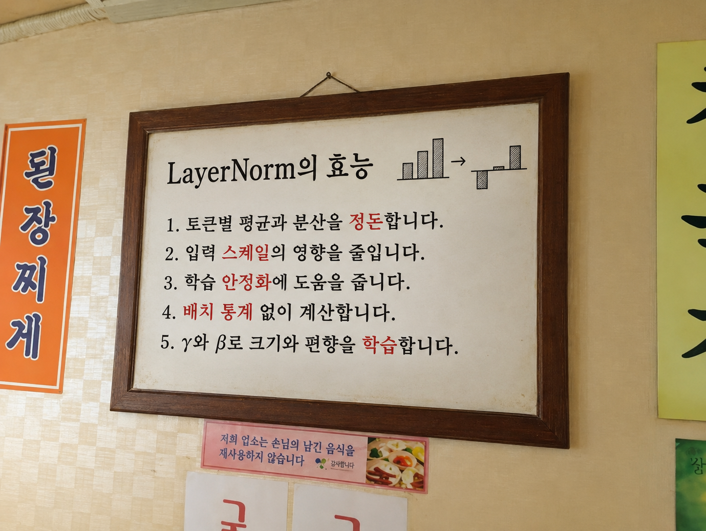
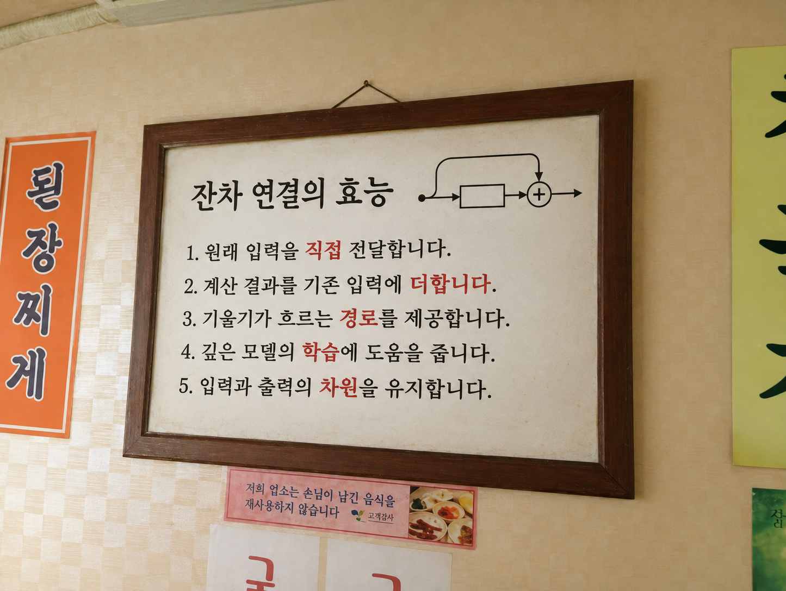
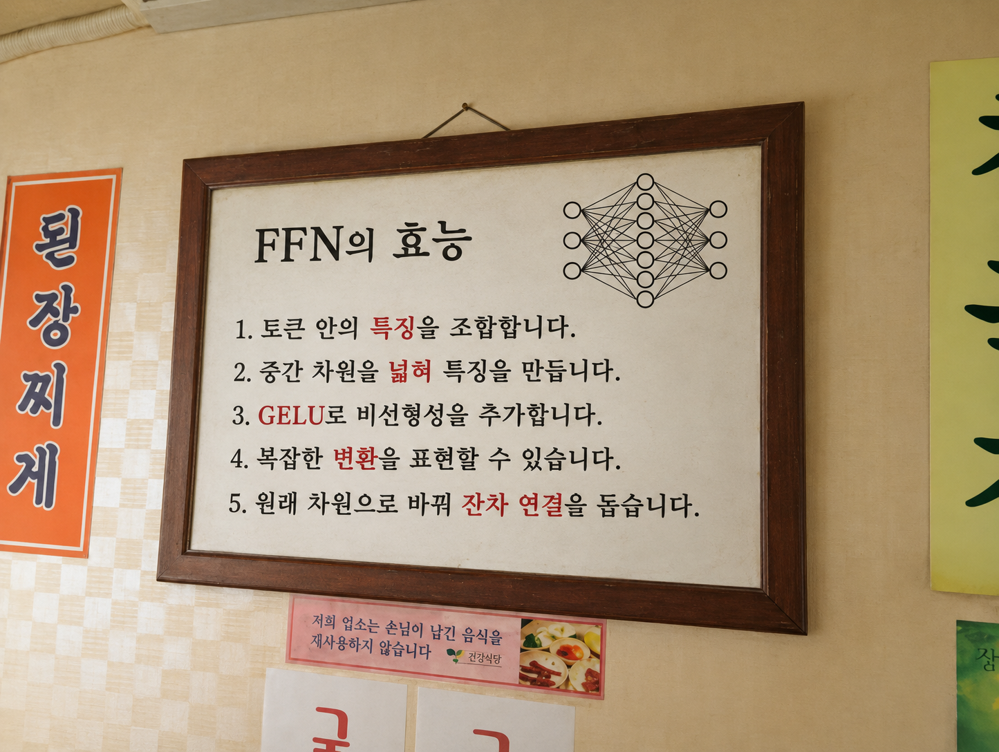

[앞 글](/Numpy2GPT-2/3_attention/)에서는 Multi-Head Masked Self-Attention까지 구현했다. 전체 순전파를 조립하기 전에, 블록을 구성하는 나머지 연산인 LayerNorm, 잔차 연결, FFN의 원리와 코드를 정리한다.


## 1. LayerNorm

LayerNorm은 입력을 정규화하기 위해 사용한다. 입력 `x`의 크기가 `(seq_len, 768)`이라면, 토큰 하나를 나타내는 **각 행의 768개 성분 안에서 평균과 분산을 계산**한다.

<div class="llm-equation">
<math xmlns="http://www.w3.org/1998/Math/MathML" display="block" aria-label="정규화된 x_i = (x_i - 평균) / 루트(분산 + 엡실론)">
  <mrow><msub><mover><mi>x</mi><mo>^</mo></mover><mi>i</mi></msub><mo>=</mo><mfrac><mrow><msub><mi>x</mi><mi>i</mi></msub><mo>−</mo><mi>μ</mi></mrow><msqrt><mrow><msup><mi>σ</mi><mn>2</mn></msup><mo>+</mo><mi>ϵ</mi></mrow></msqrt></mfrac></mrow>
</math>
</div>

`μ`는 해당 토큰 벡터의 평균, `σ²`는 분산이다. 평균을 빼서 중심을 0으로 옮기고, 표준편차로 나눠 값이 퍼진 정도를 조절한다. `ϵ`는 분산이 0이거나 아주 작을 때도 나눗셈을 안정적으로 계산하기 위한 작은 값이다.

이렇게 하면 벡터의 전체적인 크기와 평균을 정돈해, 다음 층이 입력 스케일의 변화에 지나치게 영향받지 않도록 돕는다. 다른 토큰과 평균을 내는 연산은 아니다.



GPT-2의 LayerNorm은 여기서 끝나지 않고, 정규화한 값에 **학습 가능한 `γ`를 곱하고 `β`를 더한다.**


<div class="llm-equation">
<math xmlns="http://www.w3.org/1998/Math/MathML" display="block" aria-label="LayerNorm(x)_i = 감마_i 곱하기 정규화된 x_i + 베타_i">
  <mrow><mi mathvariant="normal">LayerNorm</mi><mo>(</mo><mi>x</mi><msub><mo>)</mo><mi>i</mi></msub><mo>=</mo><msub><mi>γ</mi><mi>i</mi></msub><msub><mover><mi>x</mi><mo>^</mo></mover><mi>i</mi></msub><mo>+</mo><msub><mi>β</mi><mi>i</mi></msub></mrow>
</math>
</div>

`γ`와 `β`의 크기는 각각 `(768,)`이고, 같은 LayerNorm을 지나는 모든 토큰이 공유한다. 평균과 분산은 입력마다 다시 계산하지만, `γ`와 `β`는 학습 파라미터다. 따라서 최종 출력의 평균과 분산이 항상 0과 1인 것은 아니다.

```python
import numpy as np

def layer_norm(x, gamma, beta, eps=1e-5):
    mean = np.mean(x, axis=-1, keepdims=True)
    var = np.var(x, axis=-1, keepdims=True)

    normalized = (x - mean) / np.sqrt(var + eps)
    return gamma * normalized + beta


# x: 앞 단계에서 만든 (seq_len, d_model) 입력
d_model = x.shape[-1]
gamma_1 = np.ones(d_model)
beta_1 = np.zeros(d_model)

x_norm = layer_norm(x, gamma_1, beta_1)
```

`axis=-1`로 마지막 차원인 벡터 성분 방향을 계산한다. `keepdims=True`를 쓰면 평균과 분산의 크기가 `(seq_len, 1)`로 유지돼 각 행에 맞춰 뺄셈과 나눗셈이 적용된다. `np.var`는 기본값인 `ddof=0`을 사용한다.

## 2. 잔차연결

<div class="llm-equation">
<math xmlns="http://www.w3.org/1998/Math/MathML" display="block" aria-label="y = x + F(x)">
  <mrow><mi>y</mi><mo>=</mo><mi>x</mi><mo>+</mo><mi>F</mi><mo>(</mo><mi>x</mi><mo>)</mo></mrow>
</math>
</div>

잔차 연결은 계산 결과 `F(x)`와 원래 입력 `x`를 더하는 것이다. 입력을 그대로 전달하는 것이 유리한 상황에서도, 매번 새로운 변환만 거치게 되면 필요한 표현이 달라질 수 있다. 잔차 연결은 **입력이 직접 전달되는 경로를 두고, 그 위에 계산한 변화를 더하도록 한다.**

`F(x)`가 0에 가까우면 입력이 거의 그대로 전달된다. 다만 원래 입력이 별도로 저장되는 것은 아니며, 더한 결과도 입력과 달라질 수 있다.

<div class="llm-example" role="note" aria-label="사진 보정으로 이해하는 잔차 연결 예시">

**예시**

사진의 밝기만 조금 높이는 상황에 비유할 수 있다.

- **잔차 연결 없음:** 모델이 보정된 사진 전체를 만들어야 하므로, 밝기를 바꾸려다 원래 모습까지 달라질 수 있다.
- **잔차 연결 있음:** 원본 사진을 직접 전달하고 밝기 보정량만 더하도록 학습할 수 있다.

</div>

GPT-2에서는 LayerNorm을 거친 입력으로 Attention을 계산하고, 그 결과를 **정규화하기 전의 입력** `x`에 더한다.

<div class="llm-equation">
<math xmlns="http://www.w3.org/1998/Math/MathML" display="block" aria-label="h = x + Attention(LayerNorm_1(x))">
  <mrow><mi>h</mi><mo>=</mo><mi>x</mi><mo>+</mo><mi mathvariant="normal">Attention</mi><mo>(</mo><msub><mi mathvariant="normal">LayerNorm</mi><mn>1</mn></msub><mo>(</mo><mi>x</mi><mo>)</mo><mo>)</mo></mrow>
</math>
</div>

```python
# output: x_norm으로 Q, K, V부터 계산한 어텐션 출력
# x는 정규화하기 전의 입력으로 유지한다.
assert x.shape == output.shape
h = x + output
```

입력과 출력 크기를 확인하는 것은 NumPy의 브로드캐스팅으로 의도와 다른 덧셈이 일어나는 것을 막기 위해서다. 잔차 연결 자체에는 별도의 학습 파라미터가 없다.

입력에서 출력으로 직접 이어지는 경로는 역전파 때 기울기가 전달될 경로도 제공하므로, 깊은 모델의 학습을 돕는다.



## 3. FFN

FFN은 토큰 벡터의 성분들을 조합하고 **비선형적으로 변환**한다. Attention이 토큰 사이에서 정보를 가져왔다면, FFN은 그 정보가 반영된 각 토큰 벡터를 가공한다. 모든 토큰에 같은 가중치를 적용하지만, FFN 내부에서 토큰끼리 직접 정보를 섞지는 않는다.

<div class="llm-equation">
<math xmlns="http://www.w3.org/1998/Math/MathML" display="block" aria-label="FFN(z) = GELU(z W_1 + b_1) W_2 + b_2">
  <mrow><mi mathvariant="normal">FFN</mi><mo>(</mo><mi>z</mi><mo>)</mo><mo>=</mo><mi mathvariant="normal">GELU</mi><mo>(</mo><mi>z</mi><msub><mi>W</mi><mn>1</mn></msub><mo>+</mo><msub><mi>b</mi><mn>1</mn></msub><mo>)</mo><msub><mi>W</mi><mn>2</mn></msub><mo>+</mo><msub><mi>b</mi><mn>2</mn></msub></mrow>
</math>
</div>

여기서 `z`는 두 번째 LayerNorm을 통과한 FFN 입력이다. GPT-2 small을 기준으로 계산 순서와 차원은 다음과 같다.

<div class="llm-equation">
<math xmlns="http://www.w3.org/1998/Math/MathML" display="block" aria-label="z = LayerNorm_2(h)">
  <mrow><mi>z</mi><mo>=</mo><msub><mi mathvariant="normal">LayerNorm</mi><mn>2</mn></msub><mo>(</mo><mi>h</mi><mo>)</mo></mrow>
</math>
</div>

앞선 잔차 연결의 결과 `h`를 정규화해 FFN의 입력 `z`를 만든다.

<div class="llm-equation">
<math xmlns="http://www.w3.org/1998/Math/MathML" display="block" aria-label="a = z W_1 + b_1">
  <mrow><mi>a</mi><mo>=</mo><mi>z</mi><msub><mi>W</mi><mn>1</mn></msub><mo>+</mo><msub><mi>b</mi><mn>1</mn></msub></mrow>
</math>
</div>

가중치 `W₁`과 편향 `b₁`로 입력 성분을 조합해, 768차원을 3072차원으로 넓힌다.

<div class="llm-equation">
<math xmlns="http://www.w3.org/1998/Math/MathML" display="block" aria-label="u = GELU(a)">
  <mrow><mi>u</mi><mo>=</mo><mi mathvariant="normal">GELU</mi><mo>(</mo><mi>a</mi><mo>)</mo></mrow>
</math>
</div>

각 성분에 GELU를 적용해 비선형으로 변환한다. 차원은 3072로 유지된다.

<div class="llm-equation">
<math xmlns="http://www.w3.org/1998/Math/MathML" display="block" aria-label="FFN(z) = u W_2 + b_2">
  <mrow><mi mathvariant="normal">FFN</mi><mo>(</mo><mi>z</mi><mo>)</mo><mo>=</mo><mi>u</mi><msub><mi>W</mi><mn>2</mn></msub><mo>+</mo><msub><mi>b</mi><mn>2</mn></msub></mrow>
</math>
</div>

가중치 `W₂`와 편향 `b₂`로 중간 특징을 다시 조합해, 원래의 768차원으로 돌려놓는다.

| 단계 | 벡터 크기 | 하는 일 |
| --- | --- | --- |
| 입력 `z` | `(seq_len, 768)` | 토큰별 입력 벡터 |
| 첫 번째 선형 변환 `a` | `(seq_len, 3072)` | 성분들을 조합해 차원 확장 |
| GELU 적용 `u` | `(seq_len, 3072)` | 비선형 변환 |
| 두 번째 선형 변환 | `(seq_len, 768)` | 원래 차원으로 변환 |

3072차원으로 늘리는 것은 입력을 네 번 복사하는 것이 아니다. 서로 다른 가중치로 입력 성분을 조합해 더 많은 중간 특징을 만들고, 마지막 변환에서 다시 768차원으로 모은다.

중간에 적용하는 GELU의 GPT-2 근사식은 다음과 같다.

<div class="llm-equation">
<math xmlns="http://www.w3.org/1998/Math/MathML" display="block" aria-label="GELU(t)는 0.5 t 곱하기 [1 + tanh(루트(2/파이) 곱하기 (t + 0.044715 t의 세제곱))]로 근사한다">
  <mrow><mi mathvariant="normal">GELU</mi><mo>(</mo><mi>t</mi><mo>)</mo><mo>≈</mo><mfrac><mi>t</mi><mn>2</mn></mfrac><mo>[</mo><mn>1</mn><mo>+</mo><mi mathvariant="normal">tanh</mi><mo>(</mo><msqrt><mfrac><mn>2</mn><mi>π</mi></mfrac></msqrt><mo>(</mo><mi>t</mi><mo>+</mo><mn>0.044715</mn><msup><mi>t</mi><mn>3</mn></msup><mo>)</mo><mo>)</mo><mo>]</mo></mrow>
</math>
</div>

<figure>
<svg style="color:var(--content-text-color, #37352f);max-width:100%;height:auto" role="img" aria-label="GPT-2 근사 GELU 그래프. 음수 입력에서는 작은 음수가 남고, 큰 양수에서는 y=t에 가까워진다." xmlns:xlink="http://www.w3.org/1999/xlink" width="100%" viewBox="0 0 532.8 316.8" xmlns="http://www.w3.org/2000/svg" version="1.1">
 
 <defs>
  <style type="text/css">*{stroke-linejoin: round; stroke-linecap: butt}</style>
 </defs>
 <g id="figure_1">
  <g id="patch_1">
   <path d="M 0 316.8 
L 532.8 316.8 
L 532.8 0 
L 0 0 
L 0 316.8 
z
" style="fill: none; opacity: 0"/>
  </g>
  <g id="axes_1">
   <g id="patch_2">
    <path d="M 45.08399 278.79976 
L 525.98226 278.79976 
L 525.98226 3.00024 
L 45.08399 3.00024 
L 45.08399 278.79976 
z
" style="fill: none"/>
   </g>
   <g id="matplotlib.axis_1">
    <g id="xtick_1">
     <g id="line2d_1">
      <path d="M 45.08399 278.79976 
L 45.08399 3.00024 
" clip-path="url(#p8895820bcd)" style="fill: none; stroke: currentColor; stroke-opacity: 0.16; stroke-width: 0.8; stroke-linecap: square"/>
     </g>
     <g id="line2d_2">
      <defs>
       <path id="m678034c6ba" d="M 0 0 
L 0 3.5 
" style="stroke: currentColor; stroke-width: 0.8"/>
      </defs>
      <g>
       <use xlink:href="#m678034c6ba" x="45.08399" y="278.79976" style="fill: currentColor; stroke: currentColor; stroke-width: 0.8"/>
      </g>
     </g>
     <g id="text_1">
      <text style="font-size: 12px; font-family: 'DejaVu Sans'; text-anchor: middle; fill: currentColor" x="45.08399" y="294.916947" transform="rotate(-0 45.08399 294.916947)">−3</text>
     </g>
    </g>
    <g id="xtick_2">
     <g id="line2d_3">
      <path d="M 125.233702 278.79976 
L 125.233702 3.00024 
" clip-path="url(#p8895820bcd)" style="fill: none; stroke: currentColor; stroke-opacity: 0.16; stroke-width: 0.8; stroke-linecap: square"/>
     </g>
     <g id="line2d_4">
      <g>
       <use xlink:href="#m678034c6ba" x="125.233702" y="278.79976" style="fill: currentColor; stroke: currentColor; stroke-width: 0.8"/>
      </g>
     </g>
     <g id="text_2">
      <text style="font-size: 12px; font-family: 'DejaVu Sans'; text-anchor: middle; fill: currentColor" x="125.233702" y="294.916947" transform="rotate(-0 125.233702 294.916947)">−2</text>
     </g>
    </g>
    <g id="xtick_3">
     <g id="line2d_5">
      <path d="M 205.383413 278.79976 
L 205.383413 3.00024 
" clip-path="url(#p8895820bcd)" style="fill: none; stroke: currentColor; stroke-opacity: 0.16; stroke-width: 0.8; stroke-linecap: square"/>
     </g>
     <g id="line2d_6">
      <g>
       <use xlink:href="#m678034c6ba" x="205.383413" y="278.79976" style="fill: currentColor; stroke: currentColor; stroke-width: 0.8"/>
      </g>
     </g>
     <g id="text_3">
      <text style="font-size: 12px; font-family: 'DejaVu Sans'; text-anchor: middle; fill: currentColor" x="205.383413" y="294.916947" transform="rotate(-0 205.383413 294.916947)">−1</text>
     </g>
    </g>
    <g id="xtick_4">
     <g id="line2d_7">
      <path d="M 285.533125 278.79976 
L 285.533125 3.00024 
" clip-path="url(#p8895820bcd)" style="fill: none; stroke: currentColor; stroke-opacity: 0.16; stroke-width: 0.8; stroke-linecap: square"/>
     </g>
     <g id="line2d_8">
      <g>
       <use xlink:href="#m678034c6ba" x="285.533125" y="278.79976" style="fill: currentColor; stroke: currentColor; stroke-width: 0.8"/>
      </g>
     </g>
     <g id="text_4">
      <text style="font-size: 12px; font-family: 'DejaVu Sans'; text-anchor: middle; fill: currentColor" x="285.533125" y="294.916947" transform="rotate(-0 285.533125 294.916947)">0</text>
     </g>
    </g>
    <g id="xtick_5">
     <g id="line2d_9">
      <path d="M 365.682837 278.79976 
L 365.682837 3.00024 
" clip-path="url(#p8895820bcd)" style="fill: none; stroke: currentColor; stroke-opacity: 0.16; stroke-width: 0.8; stroke-linecap: square"/>
     </g>
     <g id="line2d_10">
      <g>
       <use xlink:href="#m678034c6ba" x="365.682837" y="278.79976" style="fill: currentColor; stroke: currentColor; stroke-width: 0.8"/>
      </g>
     </g>
     <g id="text_5">
      <text style="font-size: 12px; font-family: 'DejaVu Sans'; text-anchor: middle; fill: currentColor" x="365.682837" y="294.916947" transform="rotate(-0 365.682837 294.916947)">1</text>
     </g>
    </g>
    <g id="xtick_6">
     <g id="line2d_11">
      <path d="M 445.832548 278.79976 
L 445.832548 3.00024 
" clip-path="url(#p8895820bcd)" style="fill: none; stroke: currentColor; stroke-opacity: 0.16; stroke-width: 0.8; stroke-linecap: square"/>
     </g>
     <g id="line2d_12">
      <g>
       <use xlink:href="#m678034c6ba" x="445.832548" y="278.79976" style="fill: currentColor; stroke: currentColor; stroke-width: 0.8"/>
      </g>
     </g>
     <g id="text_6">
      <text style="font-size: 12px; font-family: 'DejaVu Sans'; text-anchor: middle; fill: currentColor" x="445.832548" y="294.916947" transform="rotate(-0 445.832548 294.916947)">2</text>
     </g>
    </g>
    <g id="xtick_7">
     <g id="line2d_13">
      <path d="M 525.98226 278.79976 
L 525.98226 3.00024 
" clip-path="url(#p8895820bcd)" style="fill: none; stroke: currentColor; stroke-opacity: 0.16; stroke-width: 0.8; stroke-linecap: square"/>
     </g>
     <g id="line2d_14">
      <g>
       <use xlink:href="#m678034c6ba" x="525.98226" y="278.79976" style="fill: currentColor; stroke: currentColor; stroke-width: 0.8"/>
      </g>
     </g>
     <g id="text_7">
      <text style="font-size: 12px; font-family: 'DejaVu Sans'; text-anchor: middle; fill: currentColor" x="525.98226" y="294.916947" transform="rotate(-0 525.98226 294.916947)">3</text>
     </g>
    </g>
    <g id="text_8">
     <text style="font-size: 12px; font-family: 'DejaVu Sans'; text-anchor: middle; fill: currentColor" x="285.533125" y="310.916947" transform="rotate(-0 285.533125 310.916947)">Input t</text>
    </g>
   </g>
   <g id="matplotlib.axis_2">
    <g id="ytick_1">
     <g id="line2d_15">
      <path d="M 45.08399 243.839257 
L 525.98226 243.839257 
" clip-path="url(#p8895820bcd)" style="fill: none; stroke: currentColor; stroke-opacity: 0.16; stroke-width: 0.8; stroke-linecap: square"/>
     </g>
     <g id="line2d_16">
      <defs>
       <path id="m897485e0c8" d="M 0 0 
L -3.5 0 
" style="stroke: currentColor; stroke-width: 0.8"/>
      </defs>
      <g>
       <use xlink:href="#m897485e0c8" x="45.08399" y="243.839257" style="fill: currentColor; stroke: currentColor; stroke-width: 0.8"/>
      </g>
     </g>
     <g id="text_9">
      <text style="font-size: 12px; font-family: 'DejaVu Sans'; text-anchor: end; fill: currentColor" x="38.08399" y="248.397851" transform="rotate(-0 38.08399 248.397851)">0.0</text>
     </g>
    </g>
    <g id="ytick_2">
     <g id="line2d_17">
      <path d="M 45.08399 204.994255 
L 525.98226 204.994255 
" clip-path="url(#p8895820bcd)" style="fill: none; stroke: currentColor; stroke-opacity: 0.16; stroke-width: 0.8; stroke-linecap: square"/>
     </g>
     <g id="line2d_18">
      <g>
       <use xlink:href="#m897485e0c8" x="45.08399" y="204.994255" style="fill: currentColor; stroke: currentColor; stroke-width: 0.8"/>
      </g>
     </g>
     <g id="text_10">
      <text style="font-size: 12px; font-family: 'DejaVu Sans'; text-anchor: end; fill: currentColor" x="38.08399" y="209.552848" transform="rotate(-0 38.08399 209.552848)">0.5</text>
     </g>
    </g>
    <g id="ytick_3">
     <g id="line2d_19">
      <path d="M 45.08399 166.149252 
L 525.98226 166.149252 
" clip-path="url(#p8895820bcd)" style="fill: none; stroke: currentColor; stroke-opacity: 0.16; stroke-width: 0.8; stroke-linecap: square"/>
     </g>
     <g id="line2d_20">
      <g>
       <use xlink:href="#m897485e0c8" x="45.08399" y="166.149252" style="fill: currentColor; stroke: currentColor; stroke-width: 0.8"/>
      </g>
     </g>
     <g id="text_11">
      <text style="font-size: 12px; font-family: 'DejaVu Sans'; text-anchor: end; fill: currentColor" x="38.08399" y="170.707846" transform="rotate(-0 38.08399 170.707846)">1.0</text>
     </g>
    </g>
    <g id="ytick_4">
     <g id="line2d_21">
      <path d="M 45.08399 127.304249 
L 525.98226 127.304249 
" clip-path="url(#p8895820bcd)" style="fill: none; stroke: currentColor; stroke-opacity: 0.16; stroke-width: 0.8; stroke-linecap: square"/>
     </g>
     <g id="line2d_22">
      <g>
       <use xlink:href="#m897485e0c8" x="45.08399" y="127.304249" style="fill: currentColor; stroke: currentColor; stroke-width: 0.8"/>
      </g>
     </g>
     <g id="text_12">
      <text style="font-size: 12px; font-family: 'DejaVu Sans'; text-anchor: end; fill: currentColor" x="38.08399" y="131.862843" transform="rotate(-0 38.08399 131.862843)">1.5</text>
     </g>
    </g>
    <g id="ytick_5">
     <g id="line2d_23">
      <path d="M 45.08399 88.459246 
L 525.98226 88.459246 
" clip-path="url(#p8895820bcd)" style="fill: none; stroke: currentColor; stroke-opacity: 0.16; stroke-width: 0.8; stroke-linecap: square"/>
     </g>
     <g id="line2d_24">
      <g>
       <use xlink:href="#m897485e0c8" x="45.08399" y="88.459246" style="fill: currentColor; stroke: currentColor; stroke-width: 0.8"/>
      </g>
     </g>
     <g id="text_13">
      <text style="font-size: 12px; font-family: 'DejaVu Sans'; text-anchor: end; fill: currentColor" x="38.08399" y="93.01784" transform="rotate(-0 38.08399 93.01784)">2.0</text>
     </g>
    </g>
    <g id="ytick_6">
     <g id="line2d_25">
      <path d="M 45.08399 49.614243 
L 525.98226 49.614243 
" clip-path="url(#p8895820bcd)" style="fill: none; stroke: currentColor; stroke-opacity: 0.16; stroke-width: 0.8; stroke-linecap: square"/>
     </g>
     <g id="line2d_26">
      <g>
       <use xlink:href="#m897485e0c8" x="45.08399" y="49.614243" style="fill: currentColor; stroke: currentColor; stroke-width: 0.8"/>
      </g>
     </g>
     <g id="text_14">
      <text style="font-size: 12px; font-family: 'DejaVu Sans'; text-anchor: end; fill: currentColor" x="38.08399" y="54.172837" transform="rotate(-0 38.08399 54.172837)">2.5</text>
     </g>
    </g>
    <g id="ytick_7">
     <g id="line2d_27">
      <path d="M 45.08399 10.769241 
L 525.98226 10.769241 
" clip-path="url(#p8895820bcd)" style="fill: none; stroke: currentColor; stroke-opacity: 0.16; stroke-width: 0.8; stroke-linecap: square"/>
     </g>
     <g id="line2d_28">
      <g>
       <use xlink:href="#m897485e0c8" x="45.08399" y="10.769241" style="fill: currentColor; stroke: currentColor; stroke-width: 0.8"/>
      </g>
     </g>
     <g id="text_15">
      <text style="font-size: 12px; font-family: 'DejaVu Sans'; text-anchor: end; fill: currentColor" x="38.08399" y="15.327834" transform="rotate(-0 38.08399 15.327834)">3.0</text>
     </g>
    </g>
    <g id="text_16">
     <text style="font-size: 12px; font-family: 'DejaVu Sans'; text-anchor: middle; fill: currentColor" x="12.117428" y="140.9" transform="rotate(-90 12.117428 140.9)">GELU(t)</text>
    </g>
   </g>
   <g id="line2d_29">
    <path d="M 209.230747 317.8 
L 525.98226 10.769241 
L 525.98226 10.769241 
" clip-path="url(#p8895820bcd)" style="fill: none; stroke-dasharray: 4.44,1.92; stroke-dashoffset: 0; stroke: currentColor; stroke-opacity: 0.65; stroke-width: 1.2"/>
   </g>
   <g id="line2d_30">
    <path d="M 45.08399 244.121846 
L 66.724412 244.474191 
L 83.9566 244.967589 
L 99.185045 245.624506 
L 112.810496 246.429962 
L 126.035199 247.433872 
L 139.259901 248.663659 
L 153.286101 250.19341 
L 172.522032 252.540724 
L 192.960208 254.9858 
L 203.379671 256.010182 
L 211.79539 256.627646 
L 219.409613 256.965587 
L 226.222338 257.047109 
L 232.634315 256.898894 
L 238.645544 256.534221 
L 244.256023 255.974947 
L 249.866503 255.18529 
L 255.076235 254.230749 
L 260.285966 253.050416 
L 265.495697 251.63348 
L 270.705428 249.970868 
L 275.514411 248.211869 
L 280.323394 246.233326 
L 285.533125 243.839257 
L 290.742856 241.183476 
L 295.952588 238.26709 
L 301.162319 235.093404 
L 306.37205 231.667854 
L 311.98253 227.705732 
L 317.59301 223.471955 
L 323.604238 218.650307 
L 330.016215 213.203627 
L 336.82894 207.102475 
L 344.042415 200.327472 
L 351.656637 192.871333 
L 360.473105 183.913519 
L 370.491819 173.407052 
L 383.315773 159.617195 
L 408.162184 132.479361 
L 429.001109 109.887272 
L 445.4318 92.408552 
L 461.060994 76.104652 
L 477.491684 59.287288 
L 495.52537 41.149969 
L 517.165792 19.712906 
L 525.98226 11.05183 
L 525.98226 11.05183 
" clip-path="url(#p8895820bcd)" style="fill: none; stroke: #438fbb; stroke-width: 3; stroke-linecap: square"/>
   </g>
   <g id="line2d_31">
    <path d="M 45.08399 243.839257 
L 525.98226 243.839257 
" clip-path="url(#p8895820bcd)" style="fill: none; stroke: currentColor; stroke-opacity: 0.75; stroke-width: 0.8; stroke-linecap: square"/>
   </g>
   <g id="line2d_32">
    <path d="M 285.533125 278.79976 
L 285.533125 3.00024 
" clip-path="url(#p8895820bcd)" style="fill: none; stroke: currentColor; stroke-opacity: 0.75; stroke-width: 0.8; stroke-linecap: square"/>
   </g>
   <g id="line2d_33">
    <path d="M 225.420841 257.049623 
" clip-path="url(#p8895820bcd)" style="fill: none; stroke: #438fbb; stroke-width: 1.5; stroke-linecap: square"/>
    <defs>
     <path id="m3e14066ce2" d="M 0 2.5 
C 0.663008 2.5 1.29895 2.236584 1.767767 1.767767 
C 2.236584 1.29895 2.5 0.663008 2.5 0 
C 2.5 -0.663008 2.236584 -1.29895 1.767767 -1.767767 
C 1.29895 -2.236584 0.663008 -2.5 0 -2.5 
C -0.663008 -2.5 -1.29895 -2.236584 -1.767767 -1.767767 
C -2.236584 -1.29895 -2.5 -0.663008 -2.5 0 
C -2.5 0.663008 -2.236584 1.29895 -1.767767 1.767767 
C -1.29895 2.236584 -0.663008 2.5 0 2.5 
z
" style="stroke: #438fbb"/>
    </defs>
    <g clip-path="url(#p8895820bcd)">
     <use xlink:href="#m3e14066ce2" x="225.420841" y="257.049623" style="fill: #438fbb; stroke: #438fbb"/>
    </g>
   </g>
   <g id="patch_3">
    <path d="M 45.08399 278.79976 
L 45.08399 3.00024 
" style="fill: none; opacity: 0.5; stroke: currentColor; stroke-width: 0.8; stroke-linejoin: miter; stroke-linecap: square"/>
   </g>
   <g id="patch_4">
    <path d="M 525.98226 278.79976 
L 525.98226 3.00024 
" style="fill: none; opacity: 0.5; stroke: currentColor; stroke-width: 0.8; stroke-linejoin: miter; stroke-linecap: square"/>
   </g>
   <g id="patch_5">
    <path d="M 45.08399 278.79976 
L 525.98226 278.79976 
" style="fill: none; opacity: 0.5; stroke: currentColor; stroke-width: 0.8; stroke-linejoin: miter; stroke-linecap: square"/>
   </g>
   <g id="patch_6">
    <path d="M 45.08399 3.00024 
L 525.98226 3.00024 
" style="fill: none; opacity: 0.5; stroke: currentColor; stroke-width: 0.8; stroke-linejoin: miter; stroke-linecap: square"/>
   </g>
   <g id="patch_7">
    <path d="M 161.85894 206.753672 
Q 192.85429 231.280009 222.972889 255.112581 
" style="fill: none; stroke: currentColor; stroke-linecap: round"/>
    <path d="M 221.077176 251.062115 
L 222.972889 255.112581 
L 218.595089 254.198872 
" style="fill: none; stroke: currentColor; stroke-linecap: round"/>
   </g>
   <g id="text_17">
    <text style="font-size: 10px; font-family: 'DejaVu Sans'; text-anchor: start; fill: currentColor" x="77.143875" y="201.109754" transform="rotate(-0 77.143875 201.109754)">Small negative values remain</text>
   </g>
   <g id="legend_1">
    <g id="line2d_34">
     <path d="M 54.08399 16.098678 
L 64.08399 16.098678 
L 74.08399 16.098678 
" style="fill: none; stroke-dasharray: 4.44,1.92; stroke-dashoffset: 0; stroke: currentColor; stroke-opacity: 0.65; stroke-width: 1.2"/>
    </g>
    <g id="text_18">
     <text style="font-size: 10px; font-family: 'DejaVu Sans'; text-anchor: start; fill: currentColor" x="82.08399" y="19.598678" transform="rotate(-0 82.08399 19.598678)">y = x</text>
    </g>
    <g id="line2d_35">
     <path d="M 54.08399 31.099459 
L 64.08399 31.099459 
L 74.08399 31.099459 
" style="fill: none; stroke: #438fbb; stroke-width: 3; stroke-linecap: square"/>
    </g>
    <g id="text_19">
     <text style="font-size: 10px; font-family: 'DejaVu Sans'; text-anchor: start; fill: currentColor" x="82.08399" y="34.599459" transform="rotate(-0 82.08399 34.599459)">GELU (GPT-2 approximation)</text>
    </g>
   </g>
  </g>
 </g>
 <defs>
  <clipPath id="p8895820bcd">
   <rect x="45.08399" y="3.00024" width="480.89827" height="275.79952"/>
  </clipPath>
 </defs>
</svg>

<figcaption>가로축은 입력 t, 세로축은 GELU(t)다. 점선은 y=t이며, 실선은 위 근사식을 직접 계산한 결과다. 음수 영역의 작은 굴곡도 남는다.</figcaption>
</figure>

GELU는 큰 양수는 거의 그대로 통과시키고, 큰 음수는 0에 가깝게 만든다. 0 근처에서는 부드럽게 변하며, 음수를 모두 정확히 0으로 만드는 함수는 아니다.

이 함수를 중간에 넣는 이유는 선형 변환만 반복하면 하나의 선형 변환으로 합쳐지기 때문이다.

<div class="llm-equation">
<math xmlns="http://www.w3.org/1998/Math/MathML" display="block" aria-label="(z W_1) W_2 = z (W_1 W_2)">
  <mrow><mo>(</mo><mi>z</mi><msub><mi>W</mi><mn>1</mn></msub><mo>)</mo><msub><mi>W</mi><mn>2</mn></msub><mo>=</mo><mi>z</mi><mo>(</mo><msub><mi>W</mi><mn>1</mn></msub><msub><mi>W</mi><mn>2</mn></msub><mo>)</mo></mrow>
</math>
</div>

편향이 있어도 하나의 선형 변환과 편향으로 묶을 수 있다. **GELU로 비선형성을 추가해야 입력에 따라 달라지는 더 복잡한 변환을 표현할 수 있다.**

```python
def gelu(x):
    return 0.5 * x * (
        1 + np.tanh(
            np.sqrt(2 / np.pi) * (x + 0.044715 * x**3)
        )
    )


d_model = h.shape[-1]
d_ff = 4 * d_model
rng = np.random.default_rng(42)

W_1 = rng.normal(0, 0.02, size=(d_model, d_ff))
b_1 = np.zeros(d_ff)
W_2 = rng.normal(0, 0.02, size=(d_ff, d_model))
b_2 = np.zeros(d_model)

# 두 번째 LayerNorm은 별도의 gamma, beta를 사용한다.
gamma_2 = np.ones(d_model)
beta_2 = np.zeros(d_model)
h_norm = layer_norm(h, gamma_2, beta_2)

ffn_hidden = h_norm @ W_1 + b_1
ffn_activated = gelu(ffn_hidden)
ffn_output = ffn_activated @ W_2 + b_2

# FFN 결과도 정규화하기 전의 입력에 더한다.
assert h.shape == ffn_output.shape
y = h + ffn_output
```

코드의 FFN 가중치는 학습 전의 무작위 값이다. `h → 두 번째 LayerNorm → FFN`으로 계산한 결과를 다시 `h`에 더하면 블록의 두 번째 잔차 연결까지 이어진다.



## 4. 결합

이제 앞에서 만든 연산을 연결할 차례다. GPT-2의 구조를 정하는 설정은 Hugging Face의 [config.json](https://huggingface.co/openai-community/gpt2/blob/main/config.json)에 있었다. 여기서는 이 저장소의 GPT-2 small을 기준으로 조립한다.

### 4.1. GPT-2의 헤드 구조

설정의 `n_embd`는 **768**, `n_head`는 **12**다. 따라서 Q·K·V를 각각 12개의 헤드로 나누면, 헤드 하나가 다루는 차원은 `768 / 12 = 64`가 된다.

각 헤드가 계산한 결과는 이어 붙여 다시 768차원으로 만든다. 이 과정은 [앞 글의 Multi-head self-attention 구현](/Numpy2GPT-2/3_attention/#2-multi-head-self-attention-구현)에서 정리했다.

### 4.2. GPT-2의 블록 구조

블록 내부의 연산 순서는 [GPT-2 원본 구현의 `block()`](https://github.com/openai/gpt-2/blob/master/src/model.py#L111-L118)에서 확인했다. GPT-2는 Attention과 FFN **앞에 LayerNorm을 적용**하며, 각 계산 결과에 정규화하기 전의 입력을 더한다.

```text
입력 x
  ↓
LayerNorm ①
  ↓
Masked Multi-Head Attention
  ↓
원래 입력 x와 더하기 → h
  ↓
LayerNorm ②
  ↓
FFN: 768 → 3072 → GELU → 768
  ↓
FFN에 들어가기 전의 h와 더하기 → 블록 출력
```

토큰 수가 `seq_len`이라면 블록의 입력과 출력은 모두 `(seq_len, 768)`이다. FFN에서 중간 차원을 넓혔다가 다시 768차원으로 돌려놓기 때문에 잔차 연결을 이어갈 수 있다.

### 4.3. GPT-2의 블록 개수

`n_layer`는 **12**다. 위 구조의 블록을 12개 쌓고, 앞 블록의 출력을 다음 블록의 입력으로 전달한다. 블록의 계산 구조는 같지만 **가중치는 블록마다 따로 가진다.**

즉, 12개 블록 각각의 Attention 안에 12개 헤드가 있다.

### 4.4. 전체적인 구조

토큰 임베딩과 위치 임베딩을 더한 입력에서 시작해, 12개 블록을 통과한 뒤 마지막 LayerNorm과 어휘 출력층을 연결한다.

```text
토큰 ID
  ↓
토큰 임베딩 + 위치 임베딩
  ↓
Transformer 블록 × 12
  ↓
마지막 LayerNorm
  ↓
토큰 임베딩 표의 전치와 곱하기
  ↓
logits: (seq_len, 50257)
  ↓
Softmax → 다음 토큰의 확률
```

출력층은 입력에 사용한 토큰 임베딩 표를 공유한다. 각 위치의 logits은 **그 위치 다음에 올 토큰**의 점수다. 전체 흐름은 원본 구현의 [`model()`](https://github.com/openai/gpt-2/blob/master/src/model.py#L133-L157)에서도 확인할 수 있다.

### 4.5. 순전파를 구성하는 핵심 함수

조립한 코드의 핵심 함수는 다음과 같다. 여기서는 함수의 역할과 입출력만 정리하고, 내부 계산은 앞에서 설명한 부분으로 연결한다. 아래 타입 표기는 함수의 입출력을 보여주기 위해 덧붙였다.

공통으로 `x`는 NumPy 배열, `weights`는 가중치 딕셔너리, `config`는 모델 설정이다. `prefix`와 `layer_index`는 사용할 가중치의 위치를 지정한다. `return_trace` 인자가 있는 함수는 이를 `True`로 설정하면 중간 계산값도 함께 반환한다. 기본값에서는 중간값 대신 `None`을 반환한다.

#### `layer_norm()` — 토큰별 정규화

```python
def layer_norm(
    x: np.ndarray,
    gamma: np.ndarray,
    beta: np.ndarray,
    eps: float = 1e-5,
) -> np.ndarray:
    ...
```

각 토큰 벡터를 정규화하고 `gamma`, `beta`를 적용한 배열을 반환한다. 입력과 출력의 크기는 같다. 원리와 코드는 [이 글의 1. LayerNorm](#1-layernorm)에 정리했다.

#### `softmax()` — 점수를 확률로 변환

```python
def softmax(x: np.ndarray) -> np.ndarray:
    ...
```

마지막 차원의 점수를 합이 1인 확률로 바꿔 반환한다. Attention의 참고 비율과 마지막 어휘별 확률을 구할 때 사용한다. 계산은 [앞 글의 Softmax로 참고 비율 구하기](/Numpy2GPT-2/3_attention/#14-softmax로-참고-비율-구하기), 출력층에서의 역할은 [1편의 확률로 만들기](/Numpy2GPT-2/1_understand_LLM/#6-확률로-만들기softmax)에 설명했다.

#### `masked_self_attention()` — 앞의 토큰 정보를 모으기

```python
def masked_self_attention(
    x: np.ndarray,
    weights: dict,
    prefix: str,
    num_heads: int,
    return_trace: bool = False,
) -> tuple[np.ndarray, dict | None]:
    ...
```

Q·K·V 계산부터 미래 토큰 마스킹, 헤드 결합과 출력 투영까지 수행한다. `(어텐션 출력, 중간 계산값)`을 반환하며, 출력 크기는 입력과 같다. 세부 연산은 [앞 글의 Multi-head self-attention 구현](/Numpy2GPT-2/3_attention/#2-multi-head-self-attention-구현)에 있다.

#### `gelu()` — 비선형 변환

```python
def gelu(x: np.ndarray) -> np.ndarray:
    ...
```

배열의 각 성분에 GPT-2의 GELU 근사식을 적용한 결과를 반환한다. 배열의 크기는 유지된다. 수식과 그래프는 [이 글의 3. FFN](#3-ffn)에 정리했다.

#### `feed_forward()` — 토큰 안의 특징 가공

```python
def feed_forward(
    x: np.ndarray,
    weights: dict,
    prefix: str,
    return_trace: bool = False,
) -> tuple[np.ndarray, dict | None]:
    ...
```

차원 확장, GELU, 차원 축소를 연결해 `(FFN 출력, 중간 계산값)`을 반환한다. 각 토큰에 같은 연산을 적용하며 출력은 다시 768차원이다. 계산 순서는 [이 글의 3. FFN](#3-ffn)에 있다.

#### `transformer_block()` — 블록 하나 조립

```python
def transformer_block(
    x: np.ndarray,
    weights: dict,
    config: GPT2Config,
    layer_index: int,
    return_trace: bool = False,
) -> tuple[np.ndarray, dict | None]:
    ...
```

두 번의 LayerNorm, Attention, FFN과 두 잔차 연결을 묶어 `(블록 출력, 중간 계산값)`을 반환한다. 잔차 연결은 [이 글의 2. 잔차연결](#2-잔차연결), 조립 순서는 [4.2. 블록 구조](#42-gpt-2의-블록-구조)를 따른다.

#### `forward()` — 전체 순전파 연결

```python
def forward(
    token_ids: np.ndarray,
    weights: dict,
    config: GPT2Config,
    return_trace: bool = False,
) -> dict:
    ...
```

토큰 ID에서 시작해 임베딩, 12개 블록, 마지막 LayerNorm, 출력층과 Softmax를 연결한다. `logits`, `probabilities`, 마지막 LayerNorm의 출력인 `hidden_state`, 중간 계산값인 `trace`를 담은 딕셔너리를 반환한다. `trace`는 기본값에서 `None`이다.

입력 구성은 [2편의 임베딩 결합 구현](/Numpy2GPT-2/2_implement%20from%20scratch/#13-임베딩-결합-구현), 출력 점수와 확률은 [1편의 logits 출력](/Numpy2GPT-2/1_understand_LLM/#5-logits-출력)과 [Softmax](/Numpy2GPT-2/1_understand_LLM/#6-확률로-만들기softmax)를 연결한 것이다.

<small>수식과 연산 순서는 [GPT-2 원본 구현](https://github.com/openai/gpt-2/blob/master/src/model.py)의 `norm`, `block`, `mlp`, `gelu`를 참고했다.</small>
