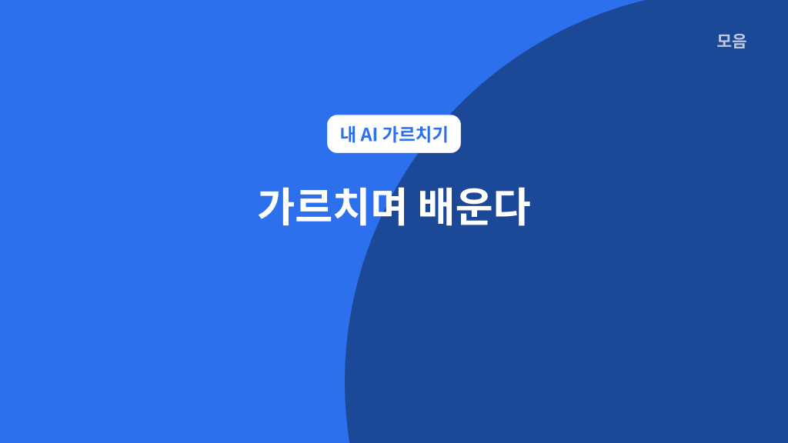
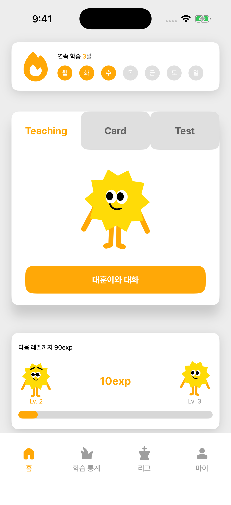
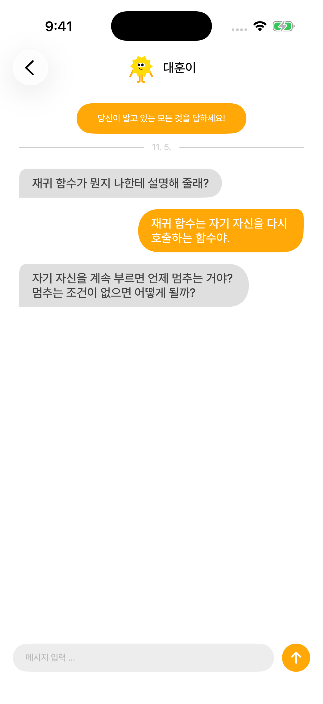
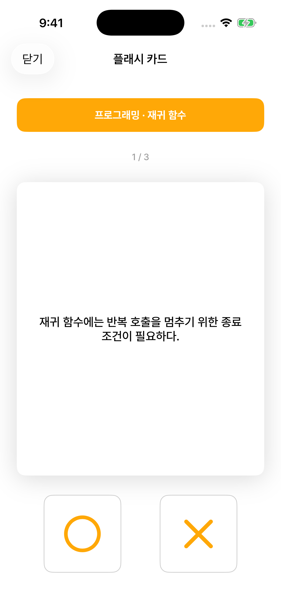
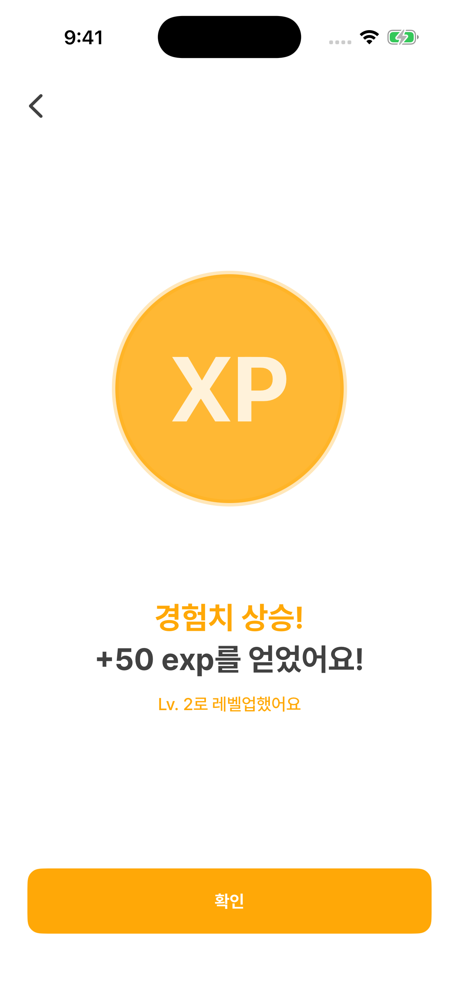

## 1. AI와 함께 공부하는 MOEUM

Geeks 해커톤 2026에 **백엔드 개발을 맡아 참가했고, 대상**을 받았다. 우리가 만든 **MOEUM**은 **‘양질의 교육’을 주제로, AI가 함께 공부하는 파트너가 되는 앱**이다.



AI가 질문하면 사용자가 자신의 말로 설명한다. AI는 그 설명에서 부족한 부분을 찾아 다음 질문을 건네고, 사용자는 다시 답하면서 앞선 설명의 빈틈을 스스로 발견하고 채워간다.

> ==**설명하고 질문받는 과정에서 이해를 넓히는 것**==이 MOEUM의 핵심이다.

카드·퀴즈로 복습하고, 캐릭터의 경험치와 레벨을 올리는 요소도 함께 넣었다.

[백엔드 GitHub](https://github.com/MOEUM1/MOEUM-backend) · [서비스·디자인 자료](https://www.figma.com/design/4CFwJ6szx3Yfdr7auilrpy/Geeks-13?node-id=0-1)

---

## 2. 개발 환경과 맡은 부분

| 구분 | 사용 기술과 역할 |
| --- | --- |
| 서버 | Node.js, TypeScript, Express |
| 데이터베이스 | PostgreSQL, Prisma |
| 검증·타입 | Zod 스키마와 `z.infer` |
| 인증 | JWT, Passport, bcryptjs |
| AI | OpenAI Responses API, Conversations API |
| 임시 데이터 | Redis |
| 개발·실행 구성 | pnpm, tsx, Docker, Docker Compose |

내가 맡은 부분은 다음과 같다.

- **직접 작성·판단:** 스키마 재설계, 서비스·타입과 기본 컨트롤러 작성, 디자인에서 필요한 기능 찾기
- **AI를 활용한 구현:** 기존 서비스·타입을 바탕으로 엔드포인트와 추가 컨트롤러 제작

## 3. 과했던 스키마를 학습 기록 중심으로 줄이기

초반에는 스키마를 AI에게 맡겼는데, 해커톤과 서비스 규모에 비해 구조가 너무 컸다. 문제집·문제·시험·답안·카드가 각각 나뉘고, 리그 시즌이나 작업 큐까지 포함돼 있었다. 그래서 **당장 구현할 학습 흐름에 맞게 스키마를 직접 다시 작성**했다.

| 초기 구조 | 다시 정리한 방향 |
| --- | --- |
| `Field`, `Topic`, `UserField`로 학습 분야와 주제 관리 | 사용자 모델의 `category` 문자열 배열로 학습 분야 표현 |
| 문제집·문제·시험·답안·카드·복습 기록을 별도 테이블로 관리 | `StudyHistory`에서 학습 유형, 문제, 결과를 함께 관리 |
| 캐릭터 프리셋·능력치·분야별 레벨 등 세분화 | `Character`와 `CharacterLevel`로 캐릭터와 성장 정보 관리 |
| 대화 세션·메시지·보고서를 각각 관리 | 학습 기록에 연결한 `AIConversation`에 대화 ID와 메시지 보관 |
| 리그 시즌·그룹, 작업 큐 등 넓은 범위의 모델 | 해당 테이블을 걷어내고 필요한 기능부터 구현 |

### 기존 구조 정리

실제로 기존 구조를 걷어낸 마이그레이션에는 다음과 같은 삭제 코드가 남아 있다. 삭제한 테이블 중 일부만 발췌했다.

```sql
DROP TABLE "QuestionSet";
DROP TABLE "Question";
DROP TABLE "Exam";
DROP TABLE "ExamAnswer";
DROP TABLE "Deck";
DROP TABLE "Card";
```

### 변경 후 학습 기록

학습별로 나뉘었던 문제와 결과는 **`StudyHistory`로 모았다.** 아래는 변경 후 실제 모델이다.

- **`type`:** `CARD`, `QUIZ`, `CHAT`으로 학습 유형 구분
- **`question` · `result`:** 유형마다 달라지는 문제와 결과를 JSON으로 저장

```prisma
model StudyHistory {
  id        String    @id @default(cuid())
  type      GameType
  userId    String
  user      User      @relation(fields: [userId], references: [id], onDelete: Cascade)

  question  Json?
  result    Json?

  createdAt DateTime @default(now())
  updatedAt DateTime @updatedAt

  @@index([userId, createdAt])
  aiconversations AIConversation?
}
```

캐릭터와 레벨은 `Character`, `CharacterLevel`로, 대화 연결 정보는 `AIConversation`으로 관리했다. 학습 기록을 공통으로 처리하면서도 필요한 정보는 구분하는 방향으로 줄였다.

[스키마 재설계 이력](https://github.com/MOEUM1/MOEUM-backend/commit/97072393e195d27f9fbefcb2683666d2b120bebe)

## 4. AI가 내 의도를 이해하도록 기반 만들기

처음부터 API와 엔드포인트를 충분히 정해 놓고 시작한 것은 아니었다. 그래서 **나중에 필요한 기능이 구체화되면 AI를 활용해 빠르게 추가하는 방식이 좋겠다고 생각**했다.

그렇게 하려면 내가 구조를 이해하고 정확하게 명령할 수 있어야 하고, 이후 사용할 AI도 내 의도를 파악할 수 있어야 했다.

> 서비스와 타입을 직접 작성한 가장 큰 이유는 ==green:**AI가 내 의도를 정확히 파악할 수 있는 기반을 만드는 것**==이었다.

우선 각 스키마에 대한 CRUD를 만들고, 기본적으로 정해진 기능과 컨트롤러를 구현했다. 예를 들어 학습 기록을 만드는 서비스는 사용자와 학습 유형을 받아 기록을 생성하도록 작성했다.

**학습 기록 생성 서비스 — `games/index.service.ts`**

```ts
export const createGameHistory = async (userId: string, type: GameType) => {
    return await prisma.studyHistory.create({
        data: {
            userId,
            type,
        }
    })
}
```

문제 데이터도 어떤 형태로 사용할지 코드로 정했다. 다음은 퀴즈 문제의 Zod 스키마와 여기서 추론한 타입이다.

**퀴즈 문제 스키마와 타입 — `types/schema.ts`**

```ts
export const QuizGameQuestionSchema = z.array(z.object({
    index: z.number(),
    question: z.string(),
}))

export type QuizGameQuestionType = z.infer<typeof QuizGameQuestionSchema>
```

이후 구현은 다음 순서로 이어갔다.

1. **기반 직접 작성:** 스키마별 CRUD와 서비스·타입, 기본 기능을 구현한다.
2. **디자인에서 필요한 기능 찾기:** 디자이너가 만든 프론트엔드 디자인을 보고, 필요한 데이터와 기능을 내가 직접 찾는다.
3. **AI로 빠르게 확장:** 기존 서비스·타입과 어떻게 연결할지 정리한 뒤, AI에게 엔드포인트와 추가 컨트롤러 구현을 맡긴다.

서비스 함수와 타입은 실제로 동작하는 코드이면서, **AI에게 내가 의도한 구조를 전달하는 기준**이기도 했다.

| 사용자 행동 | API 예시 |
| --- | --- |
| 카드 학습 시작 | `POST /api/games/card` |
| 카드 학습 결과 제출 | `POST /api/games/card/:historyId/result` |
| 퀴즈 시작 | `POST /api/games/quiz` |
| 퀴즈 답안 제출 | `POST /api/games/quiz/result` |
| 대화형 학습 시작 | `POST /api/games/chat` |
| 대화 중 답변 전송 | `POST /api/games/chat/:historyId/answer` |
| 대화 종료와 분석 | `POST /api/games/chat/:historyId/end` |

[서비스·타입 작성 이력](https://github.com/MOEUM1/MOEUM-backend/commit/97072393e195d27f9fbefcb2683666d2b120bebe) · [라우트·컨트롤러 추가 이력](https://github.com/MOEUM1/MOEUM-backend/commit/3713ef6bf403770e4a82c1b6206c5753499c9468)

### 백엔드가 앱 화면에 연결된 모습

팀의 iOS 구현에서는 서버 응답을 받아 캐릭터와 학습 화면을 구성했다. 대화 화면은 시작 응답의 **`historyId`를 보관하고, 이후 답변에도 같은 ID를 전달**한다. 서버는 그 학습 기록에 연결된 conversation ID를 찾아 다음 질문을 이어간다.

아래는 [iOS 저장소의 SwiftUI 코드](https://github.com/MOEUM1/MOEUM-iOS/tree/3c67ffb79aecb8ecf7aef869bfd6bbb673ee0a41)에 **예시 데이터를 연결해 시뮬레이터에서 재현한 화면**이다. 이미지를 누르면 크게 볼 수 있다.

<div style="display:flex;flex-wrap:wrap;justify-content:center;gap:24px;margin:24px 0">
  <figure style="flex:1 1 240px;max-width:280px;min-width:0;margin:0">
    <a href="../GeeksHackathon/home.png" aria-label="홈 화면 크게 보기"></a>
    <figcaption style="margin-top:12px;font-size:0.88em;line-height:1.6"><strong>홈 · 캐릭터와 연속 학습</strong><br /><code>characters/me</code>와 <code>users/me/streak</code> 응답으로 레벨·경험치와 연속 학습 일수를 표시한다.</figcaption>
  </figure>
  <figure style="flex:1 1 240px;max-width:280px;min-width:0;margin:0">
    <a href="../GeeksHackathon/chat.png" aria-label="대화 학습 화면 크게 보기"></a>
    <figcaption style="margin-top:12px;font-size:0.88em;line-height:1.6"><strong>대화 · 설명에서 다음 질문으로</strong><br /><code>games/chat</code>으로 시작하고 <code>games/chat/:historyId/answer</code>로 답변을 보내 다음 질문을 받는다.</figcaption>
  </figure>
  <figure style="flex:1 1 240px;max-width:280px;min-width:0;margin:0">
    <a href="../GeeksHackathon/card.png" aria-label="카드 학습 화면 크게 보기"></a>
    <figcaption style="margin-top:12px;font-size:0.88em;line-height:1.6"><strong>카드 · 문제 응답을 학습 화면으로</strong><br /><code>games/card</code>의 문제 배열을 한 문항씩 보여주고, 선택한 문항 인덱스를 결과 API로 보낸다.</figcaption>
  </figure>
  <figure style="flex:1 1 240px;max-width:280px;min-width:0;margin:0">
    <a href="../GeeksHackathon/exp.png" aria-label="경험치 획득 화면 크게 보기"></a>
    <figcaption style="margin-top:12px;font-size:0.88em;line-height:1.6"><strong>학습 결과 · 파트너의 성장</strong><br />카드·퀴즈 제출 응답의 <code>levelUp</code>을 받아 획득 경험치와 레벨업 여부를 보여준다.</figcaption>
  </figure>
</div>

[iOS API 연결 코드](https://github.com/MOEUM1/MOEUM-iOS/blob/3c67ffb79aecb8ecf7aef869bfd6bbb673ee0a41/MOEUM/Networking/APIModels.swift) · [대화 화면 구현](https://github.com/MOEUM1/MOEUM-iOS/blob/3c67ffb79aecb8ecf7aef869bfd6bbb673ee0a41/MOEUM/Main/ChatView.swift)

## 5. Redis를 의도적으로 넣어보기

Redis는 **기술을 하나 더 보여주고 싶어서 의도적으로 도입**했다. 실제로는 최근 학습 기록을 잠깐 보관해 다음 카드·퀴즈 출제에 참고시키는 데 사용했다.

```ts
await redis.set(
    `gameHistory:${userId}:${(new Date()).toISOString()}`,
    JSON.stringify({ type, question, result }),
    { expiration: { type: "EX", value: 30 * 60 } },
);
```

학습 기록은 PostgreSQL에 남기고, Redis의 최근 기록은 **30분 뒤 만료**되도록 했다. 여기에 횟수와 만료 시간을 이용해 학습 분석이 매번 실행되지 않도록 조절하는 역할도 맡겼다.

[Redis 도입 이력](https://github.com/MOEUM1/MOEUM-backend/commit/228281041d77431f920c40f3bbcca90ee66c457e)

## 6. Conversation으로 앞선 설명을 이어가기

AI가 사용자의 설명에서 부족한 부분을 찾아 질문하려면 이전 대화의 맥락이 필요했다. 그래서 OpenAI의 `client.conversations.create()`로 대화를 만들고, 이후 요청에 같은 conversation ID를 전달했다. 다음은 초기 대화 서비스에서 작성한 답변 전송 코드다.

**같은 대화에 답변 이어 보내기 — `games/chat.service.ts`**

```ts
export const sendAnswerToExamGame = async (conversationId: string, answer: string) => {
    const response = await client.responses.create({
        model: env.OPENAI_MODEL,
        input: [
            {role: "user", content: answer}
        ],
        conversation: conversationId
    })
    return response
}
```

대화 ID는 학습 기록에 연결해 저장했다. 프롬프트에서는 AI가 사용자의 설명을 듣고, 부족한 개념을 다른 상황으로 바꿔 다시 질문하도록 역할을 정했다. **앞선 설명에 이어 질문하는 공부 파트너**를 구현하기 위한 기능이었다.

[대화 서비스 초기 구현](https://github.com/MOEUM1/MOEUM-backend/blob/97072393e195d27f9fbefcb2683666d2b120bebe/src/services/games/chat.service.ts)

---

## 7. 서비스 발표

[MOEUM 발표 자료 보기 (Figma)](https://www.figma.com/proto/4CFwJ6szx3Yfdr7auilrpy/Geeks-13?node-id=192-11242)

### 발표 전에 정리한 차별점과 비전

발표 전에는 다른 서비스와의 차이점, 우리가 어떻게 양질의 교육을 제공할 수 있을지, 앞으로 어떤 비전을 가질 수 있을지를 생각했다.

우리가 내세운 차별점은 **AI가 튜터가 아니라 함께 공부하는 파트너가 된다는 것**이었다. 발표에서는 이 차이가 만드는 학습 경험을 정리했다.

- **자기 주도적인 학습:** 내 파트너를 키우고 싶은 마음이 스스로 공부하는 동기로 이어진다.
- **내 수준에 맞춘 공부:** 질문과 답변을 통해 드러난 학습 수준에 맞춰 공부한다.
- **직접 정하는 학습 분야:** 정해진 분야에만 머무르지 않고, 사용자가 원하는 분야를 정해 학습한다.

**앞으로 추가하고 싶은 기능**도 준비했다.

- 각자가 학습을 통해 키운 **AI끼리 상식퀴즈를 겨루는 방식**
- 사용자가 어떻게 키우느냐에 따라 **AI의 커스터마이징이 달라지는 방식**

내가 설명하며 쌓아 온 학습 경험이 파트너의 개성과 다른 사람과의 교류로 이어질 수 있겠다고 생각했다.

### 말로 전달하지 못한 핵심을 시연으로 보여주다

발표는 내가 직접 맡았다. 우리 팀은 거의 마지막 순서였고, 앞선 팀들이 받는 날카로운 질문들을 보면서 솔직히 많이 긴장했다. 막상 발표를 시작하니 준비한 설명도 잘 나오지 않았다. 특히 핵심 기능을 얼버무리면서, 심사위원들에게 우리가 만든 서비스가 무엇인지 제대로 전달하지 못했다.

중간에는 말로 설명을 더 이어가는 것보다 실제로 구현한 서비스를 보여주는 것이 낫겠다고 판단해 ==blue:**시연으로 전환**==했다. 앞서 말했던 내용을 화면에서 직접 보여주자, 심사위원들도 내가 설명하려던 것이 무엇인지 이해하는 반응이었다.

> **설명은 서툴렀지만 서비스 자체에는 자신이 있었다.**

그 뒤에는 시연을 바탕으로 학습에 따라 AI 파트너가 어떻게 성장하는지 보여주고, 앞으로 추가하고 싶은 기능을 설명했다. 추상적으로 들렸을 수 있는 구상이 실제 동작과 연결되면서 반응도 긍정적으로 바뀌었다.

### 발표를 마치고 대상을 받기까지

걱정했던 질의응답 시간에는 별도의 질문보다 잘했다는 격려가 돌아왔다. 특히 **AI끼리 상식퀴즈를 한다는 구상이 매우 흥미롭다**는 반응이 기억에 남는다.

당시에는 서비스화 가능성과 수익 구조에 대한 구상에도 자신이 있었고, 우리가 생각한 확장 방향을 긍정적으로 받아들여 줬다는 점이 기뻤다.

그렇게 발표를 마치고, 우리는 **대상**을 받았다.

많이 떨었고 핵심을 말로 명확하게 전달하지 못한 아쉬움은 남았지만, 직접 만든 서비스의 동작으로 설명을 되짚어 보여줄 수 있었던 경험이었다.

---

## 8. 돌아보며

이번 해커톤에서는 **내가 이해한 구조를 코드로 먼저 만들고, 그 위에서 AI를 활용하는 방식**을 경험했다. 과한 스키마를 줄이는 판단과 디자인에서 필요한 기능을 찾는 일은 내가 맡고, 추가 구현에는 AI를 활용했다.

다음에는 핵심 API의 요청·응답도 초반에 더 명확하게 정리하고 싶다. 내가 의도한 동작과 데이터 형태가 분명할수록, AI에게 필요한 작업을 구체적으로 지시하고 결과도 확인하기 쉬울 것 같다.

발표도 더 준비하고 싶다. 다음에는 서비스의 핵심을 짧게 설명하는 문장과 그 내용을 바로 보여줄 시연 흐름을 함께 준비하려고 한다. 이번에 말로 충분히 전달하지 못했던 **왜 이 서비스를 만들었고, 사용자는 무엇을 경험하는지**를 더 분명하게 전하고 싶다.
