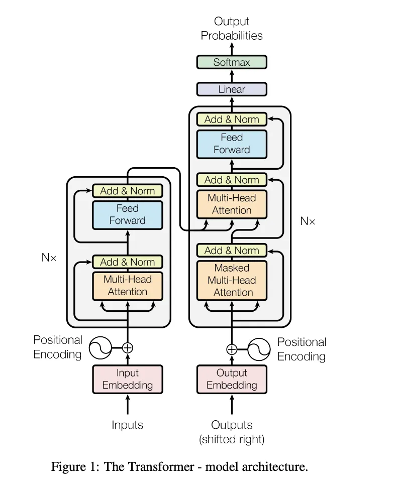

Numpy2GPT-2를 진행하면서 LLM의 전체 구조부터 이해해 보기로 했다. 자료를 읽고 GPT와 대화하면서 내가 이해한 내용을 짧게 정리했다.

## LLM의 전체적인 구조

앞의 문맥을 보고 뒤에 나올 토큰을 예측하는 것. 내가 이해한 생성형 LLM의 기본 동작이다.

예를 들어 “나는 밥을”까지 입력하면, 그 뒤에 올 “먹었다” 같은 토큰을 예측한다. 한 번에 문장 전체를 고르는 것이 아니라 다음 토큰을 하나씩 고른다.

> 토큰 → 임베딩·위치 정보 → 트랜스포머 블록 × N → logits → 다음 토큰

조금 더 나누면 다음 과정을 거친다.

1. 토큰화
2. 임베딩
3. 위치 인코딩
4. Transformer 연산
5. logits 출력
6. 확률로 만들기(Softmax)
7. 샘플링
8. 디코딩

Transformer 연산에서는 원래의 인코더·디코더 구조를 나눠 살펴보고, GPT의 구조와 연결해 본다.

아래의 토큰 분할, ID, 벡터, 점수와 확률은 이해를 돕기 위한 가상의 예시다. 실제 모델의 출력은 아니다.

## 1. 토큰화

텍스트를 모델이 다루는 단위인 토큰으로 쪼갠다. 토큰의 기준은 모델마다 다르며, 한 토큰이 꼭 한 단어인 것은 아니다.

**예시:** “나는 밥을 먹었다”를 `["나", "는", " 밥", "을", " 먹", "었다"]`처럼 나눌 수 있다. 각 토큰을 ID로 바꾸면 `[10, 11, 20, 21, 30, 31]`이 된다.

### 1.1. BPE

BPE는 문자나 바이트 같은 작은 단위에서 시작해, 학습 데이터에서 자주 나오는 **인접한 토큰 쌍**을 반복해서 병합하는 방식이다. 실제 입력을 나눌 때는 이렇게 학습한 병합 규칙을 사용한다.

**예시:** `c a t`에서 `c + a`, `ca + t` 순으로 병합 규칙을 배웠다면 `c a t → ca t → cat`이 된다. 처음에는 문자 단위였지만 자주 등장하는 조합이 하나의 토큰이 된 것이다. [BPE 동작 참고](https://huggingface.co/learn/llm-course/chapter6/5)

## 2. 임베딩

각 토큰에는 고유한 ID가 있다. 이 ID를 크기나 의미를 가진 수치로 쓰지는 않는다. 해당 ID의 실수 벡터를 가져오는 것을 임베딩이라고 한다.

**예시:** 토큰 “나”의 ID가 `10`이라면, 이를 `[0.2, -0.4, 0.7]` 같은 벡터로 바꾼다. ID가 `20`인 토큰이 ID가 `10`인 토큰보다 의미가 두 배 크다는 뜻은 아니다.

### 2.1. Embedding Table

토큰 ID마다 대응하는 벡터를 저장한 표다. 벡터는 학습을 통해 토큰의 특징이나 의미적 유사성 등을 담게 된다.

| 토큰 | 토큰 ID | 가져올 벡터        |
| ---- | ------- | ------------------ |
| 나   | 10      | `[0.2, -0.4, 0.7]` |
| 는   | 11      | `[0.1, 0.3, -0.2]` |
| 밥   | 20      | `[-0.5, 0.8, 0.1]` |

같은 토큰 ID라면 처음 가져오는 벡터도 같다. 예를 들어 “배”가 같은 ID로 토큰화됐다면, 탈것을 뜻하든 과일을 뜻하든 처음 임베딩은 같다. 문맥에 따른 차이는 이후 Transformer 연산에서 반영된다.

## 3. 위치 인코딩

토큰의 벡터만으로는 문장 안에서 어떤 순서로 놓였는지 알 수 없다. 그래서 위치 정보를 반영한다. 기본 Transformer나 GPT-2에서는 토큰 임베딩에 위치 벡터를 더한다.

**예시:** “내가 너를 불렀다”와 “너를 내가 불렀다”에서는 같은 토큰도 놓인 위치가 다르다. “내가”의 임베딩이 같더라도 위치 벡터를 더하면 Transformer에 들어가는 값은 달라진다.

```text
토큰 벡터   [0.2, -0.4, 0.7]
위치 벡터 + [0.0,  1.0, 0.0]
최종 입력   [0.2,  0.6, 0.7]
```

모든 모델이 위치 벡터를 더하는 것은 아니다. 위치 정보를 반영하는 방식은 모델마다 다르다.

“배를 탔다”와 “배를 먹었다”처럼 같은 단어의 뜻을 문맥 속에서 구분하는 일은 Transformer 연산과 연결된다. 위치 인코딩은 그 과정에 필요한 순서 정보를 준다. 다만 GPT에서 ‘배’ 위치의 표현은 뒤의 ‘탔다’나 ‘먹었다’를 미리 볼 수 없다.

## 4. Transformer 연산

핵심은 **Attention으로 문맥 관계를 반영하고, FFN으로 각 토큰의 표현을 가공하는 과정**이다. 이런 블록을 N번 반복한다.

아래 그림은 원래 Transformer의 인코더·디코더 구조다. 왼쪽이 입력을 처리하는 인코더, 오른쪽이 출력을 만드는 디코더다.



_이미지 출처: [카카오페이 기술 블로그 — 백엔드 개발자의 시선으로 풀어본 LLM 내부 동작 원리](https://tech.kakaopay.com/post/how-llm-works/). 해당 글에 실린 이미지를 그대로 사용했다. 원출처: Vaswani et al., [Attention Is All You Need, Figure 1](https://arxiv.org/html/1706.03762v7#S3.F1)._

### 4.1. 인코딩 — 인코더 레이어

입력 문장의 토큰들이 서로를 참고하도록 해서, 문맥이 반영된 벡터를 만든다.

**예시:** “나는 배를 탔다”를 처리할 때, 인코더는 “배”뿐 아니라 “탔다”도 함께 참고해 탈것이라는 문맥을 표현에 반영할 수 있다.

#### 4.1.1. Self-Attention

각 토큰이 같은 입력 안의 다른 토큰을 얼마나 참고할지 계산하고, 그 가중치에 따라 정보를 모은다.

**예시:** 세 토큰을 참고하는 가중치가 `[0.1, 0.2, 0.7]`이면, 각 토큰의 정보 벡터를 `0.1 × V₁ + 0.2 × V₂ + 0.7 × V₃`으로 모은다. 세 번째 토큰의 정보를 가장 많이 반영하는 셈이다.

#### 4.1.2. Multi-Head Attention

Attention 계산을 여러 head에서 수행한 뒤 결과를 합친다. 서로 다른 관계를 반영할 수 있다.

**예시:** “작은 고양이가 생선을 먹었다”에서 한 head는 “작은–고양이”, 다른 head는 “생선–먹었다” 관계에 더 집중할 수 있다. 각 head의 역할이 이렇게 미리 정해져 있다는 뜻은 아니다.

#### 4.1.3. Feed-Forward Neural Network

FFN은 Attention을 거친 각 토큰 벡터에 같은 신경망을 적용해 표현을 가공한다. 선형 변환과 비선형 활성화 함수를 사용한다.

**예시:** `[0.2, -0.4]`라는 벡터가 선형 변환을 거쳐 `[0.6, -0.3, 0.8]`이 됐다고 하자. 여기에 ReLU를 적용하면 음수가 0이 되어 `[0.6, 0, 0.8]`이 되고, 다시 선형 변환해 원래 차원으로 돌아온다.

토큰 사이의 정보를 모으는 역할은 Attention이 맡고, FFN은 그렇게 만들어진 각 토큰의 표현을 개별적으로 변환한다고 이해했다.

### 4.2. 디코딩 — 디코더 레이어

지금까지 생성한 토큰과 인코더의 출력을 참고해, 다음 토큰을 예측하는 데 쓸 표현을 만든다.

**예시:** “나는 밥을 먹었다”를 영어로 번역한다면, 인코더는 한국어 입력을 처리한다. 디코더는 이미 생성한 “I”와 인코더 출력을 참고해 “ate” 같은 다음 토큰을 예측한다.

#### 4.2.1. Masked Self-Attention

현재 위치보다 뒤에 있는 토큰을 참고하지 못하도록 하는 Self-Attention이다. 각 위치는 자신과 앞의 토큰만 참고한다.

**예시:** 학습 중 `[시작 토큰, I, ate]`를 입력했더라도, “I” 위치에서 다음 토큰을 예측할 때 뒤의 “ate”를 미리 보면 안 된다. 참고 가능한 위치를 간단히 나타내면 다음과 같다.

| 현재 위치 | 시작 토큰 참조 | I 참조 | ate 참조 |
| --------- | -------------- | ------ | -------- |
| 시작 토큰 | 가능           | 차단   | 차단     |
| I         | 가능           | 가능   | 차단     |
| ate       | 가능           | 가능   | 가능     |

차단할 위치의 점수를 Softmax 전에 `−∞`로 두면, Softmax 뒤의 가중치는 0이 된다.

> **궁금했던 점:** Masked Self-Attention에서 0이 나오면, 뒤의 Attention에서도 이 토큰에 대한 값이 0이 되는 걸까?

0이 되는 것은 미래 토큰을 **참고하는 가중치**다. 토큰 벡터 전체가 0이 되는 것은 아니다. 예를 들어 `0.4 × V₁ + 0.6 × V₂ + 0 × V₃`이면, 세 번째 토큰을 참고하지 않으면서도 앞의 두 토큰에서 정보를 가져온다.

#### 4.2.2. Cross-Attention

디코더 쪽 표현으로 인코더의 출력을 참고하는 과정이다. 같은 입력 안에서만 계산하는 Self-Attention과 구분된다.

**예시:** “I” 다음에 올 영어 토큰을 만들 때, 한국어 입력의 “먹었다”에 해당하는 정보를 참고할 수 있다. 이때 디코더 쪽에서 Query를 만들고, 인코더 출력에서 Key와 Value를 가져온다. Query는 찾을 정보, Key는 대조할 기준, Value는 가져올 정보라고 이해했다.

여기서는 Attention 가중치를 새로 계산한다. 앞의 Masked Self-Attention에서 0이었던 가중치를 그대로 곱해 이어가는 구조는 아니다.

#### 4.2.3. Feed-Forward Neural Network

앞선 Attention을 거친 각 토큰 벡터를 개별적으로 가공한다. 동작은 인코더에서 살펴본 FFN과 같다.

**예시:** “I” 위치에 이전 출력과 한국어 입력의 정보가 모였다면, FFN은 그 벡터를 변환한다. 다음 토큰의 점수는 이후 출력 선형층에서 계산한다.

### 4.3. 인코더·디코더의 공통 구성

그림의 `Add & Norm`은 잔차 연결과 Layer Normalization을 뜻한다.

#### 4.3.1. 잔차 연결

연산 결과에 기존 입력을 더하는 것이다. `x + F(x)`처럼 이전 정보를 이어주고, 깊은 신경망의 학습을 돕는다. ResNet을 찾아보며 이해한 부분이다.

**예시:** 입력이 `[1, 2]`이고 Attention의 결과가 `[0.1, -0.2]`이면, 둘을 더해 `[1.1, 1.8]`을 다음으로 넘긴다.

#### 4.3.2. Layer Normalization

각 토큰 벡터 내부의 값들을 평균과 분산을 기준으로 정규화해 학습을 안정시키는 역할이다. 정규화를 적용하는 위치는 모델마다 다를 수 있다.

**예시:** `[1, 2, 3]`은 평균이 2다. 평균을 빼면 `[-1, 0, 1]`이고, 표준편차로 나누면 약 `[-1.22, 0, 1.22]`가 된다. 실제 Layer Normalization에는 작은 안정화 상수와 학습 가능한 크기·이동 값도 들어간다.

### 4.4. GPT에서는 어떻게 다른가?

GPT의 기본 구조에는 별도 인코더와 그 출력을 참고하는 Cross-Attention이 없다. Masked Self-Attention과 FFN을 중심으로 디코더 블록을 반복한다.

**예시:** “나는 밥을”이라는 프롬프트를 디코더 쪽 입력으로 넣고 다음 토큰을 예측한다. 한국어를 인코더에 넣고 영어를 디코더에서 만드는 앞의 번역 예시와는 구조가 다르다.

블록이 12개라면 첫 블록에서 만든 표현을 두 번째 블록으로 넘기는 과정을 12번째 블록까지 이어간다. GPT에서는 각 블록마다 미래를 보지 못하도록 마스킹한다. [GPT-2 구조 참고](https://huggingface.co/docs/transformers/model_doc/gpt2)

## 5. logits 출력

Transformer 블록을 거친 벡터를 출력 선형층에 넣어, 모델의 전체 토큰 목록에 대한 점수를 만든다. 각 점수를 logit, 점수들을 모아 logits라고 한다.

다음 토큰을 생성할 때는 마지막 위치의 logits를 사용한다. 점수가 높을수록 다음 토큰 후보로 더 선호된다는 뜻이며, 아직 확률은 아니다.

**예시:** 후보가 세 개뿐인 모델을 가정하면, “먹었다”는 `2`, “먹는다”는 `1`, “잔다”는 `0`이라는 점수를 받을 수 있다. 점수의 합이 1일 필요도, 점수가 0~1 사이일 필요도 없다.

## 6. 확률로 만들기(Softmax)

logits를 Softmax에 넣어 각 토큰의 확률로 바꾼다. 전체 확률의 합은 1이다.

`토큰 하나의 확률 = exp(그 토큰의 logit) / 모든 토큰의 exp(logit) 합`

**예시:** `[2, 1, 0]`에 Softmax를 적용하면 약 `[0.665, 0.245, 0.090]`이 된다. 첫 토큰의 확률은 `e² / (e² + e¹ + e⁰)`으로 계산한다.

### 6.1. Temperature

Temperature는 샘플링할 확률 분포의 뾰족함을 조절하는 매개변수다. `T > 0`에서 logits를 T로 나눈 뒤 Softmax를 적용한다.

- **T = 1:** 원래 Softmax 결과를 사용한다.
- **T > 1:** 분포가 평평해져 낮은 점수의 후보도 뽑힐 여지가 커진다. 다양성을 높이는 쪽이다.
- **0 < T < 1:** 높은 점수의 후보에 확률이 더 몰린다. 선택이 보수적으로 바뀌는 쪽이다.

**예시:** 같은 logits `[2, 1, 0]`이어도 T에 따라 확률이 달라진다.

| Temperature | 첫 후보 | 둘째 후보 | 셋째 후보 |
| ----------- | ------- | --------- | --------- |
| T = 0.5     | 86.7%   | 11.7%     | 1.6%      |
| T = 1       | 66.5%   | 24.5%     | 9.0%      |
| T = 2       | 50.6%   | 30.7%     | 18.6%     |

반올림 때문에 표의 합은 정확히 100%가 아닐 수 있다.

## 7. 샘플링

만들어진 확률을 바탕으로 다음 토큰 하나를 고른다. 아래 네 후보를 예로 들어 방법을 비교해 봤다.

| 후보   | 확률 |
| ------ | ---- |
| 먹었다 | 50%  |
| 먹는다 | 30%  |
| 먹고   | 15%  |
| 잔다   | 5%   |

### 7.1. Greedy Decoding

확률이 가장 높은 토큰 하나를 고른다.

**예시:** 위에서는 50%인 “먹었다”를 선택한다. 확률에 따라 추첨하는 과정은 없다.

### 7.2. Random Sampling

확률 분포에 따라 무작위로 하나를 뽑는다. 확률을 기반으로 하는 가챠라고 이해했다.

**예시:** “먹었다”가 뽑힐 가능성이 가장 크지만, 5%인 “잔다”도 나올 수 있다.

### 7.3. Top-K Sampling

확률이 높은 K개만 후보로 남긴 뒤, 그 안에서 확률에 따라 하나를 뽑는다.

**예시:** `K = 2`이면 “먹었다”와 “먹는다”만 남긴다. 확률 합이 다시 1이 되도록 맞추면 각각 `50/80 = 62.5%`, `30/80 = 37.5%`가 된다. 두 토큰을 모두 출력하는 것은 아니다.

### 7.4. Top-P Sampling

확률이 높은 순으로 누적 합이 P 이상이 되는 최소 후보 집합을 남긴 뒤, 그 안에서 하나를 뽑는다.

**예시:** `P = 0.8`이면 “먹었다”의 50%에 “먹는다”의 30%를 더해 80%가 되므로 두 후보를 남긴다. `P = 0.9`이면 “먹고”까지 포함해야 95%가 되므로 세 후보를 남긴다. 이때도 남은 확률을 다시 맞춰서 뽑는다. [샘플링 설정 참고](https://huggingface.co/docs/transformers/main_classes/text_generation)

## 8. 디코딩

선택된 토큰 ID들을 토크나이저로 문자열로 복원한다. 4번의 디코더 레이어 연산과는 구분되는 과정이다.

**예시:** 선택된 ID가 `[30, 31]`이고 각각 “ 먹”, “었다”에 해당한다면, 이를 복원해 “ 먹었다”라는 문자열을 얻는다.

생성한 토큰은 다시 입력 뒤에 붙고, 모델은 이어질 다음 토큰을 예측한다. 예를 들어 “나는 밥을 먹었다”까지 만들었다면 다음에는 마침표를 고를 수 있다. 종료 토큰이 나오거나 설정한 길이에 도달할 때까지 반복하며 문장을 만든다.

## 이해하는 데 참고한 자료

주로 아래 두 글을 읽으며 전체 흐름을 이해했다.

- [calico — LLM Tokenizer와 Embedding](https://velog.io/@calico/LLM-Tokenizer와-Embedding)
- [카카오페이 기술 블로그 — 백엔드 개발자의 시선으로 풀어본 LLM 내부 동작 원리](https://tech.kakaopay.com/post/how-llm-works/)

설명이 더 필요했던 부분은 아래 자료를 참고했다.

- [FNN이란](https://wikidocs.net/176148)
- [ResNet이란](https://wikidocs.net/202619)
- [Layer Normalization이란](https://wikidocs.net/228097)
- [Temperature와 Top-P](https://wikidocs.net/333750)

GPT 대화 세션을 통해서도 이해하는 데 도움을 많이 받았다. 내용을 정리하며 구조와 용어를 점검한 부분에는 본문에 원문·공식 문서 링크를 덧붙였다.
