Numpy2GPT-2를 진행하면서 LLM이 문장을 받아 다음 토큰 하나를 내놓기까지의 과정을 따라가 봤다. 전체 구조를 이해하는 것에서 시작해 NumPy로 GPT-2 small의 순전파를 구현하고, 공개 가중치를 적용해 Hugging Face와 logits를 비교했다. 이어서 토크나이저·어텐션·샘플링과 구성 요소 제거 실험, 손실 계산까지 진행한 내용을 한 글로 정리했다.

**목차**

- [1. LLM의 전체 흐름 이해](#1-llm의-전체-흐름-이해)
- [2. BPE 토크나이저와 입력 임베딩 구현](#2-bpe-토크나이저와-입력-임베딩-구현)
- [3. Self-Attention과 Multi-Head Attention 구현](#3-self-attention과-multi-head-attention-구현)
- [4. Transformer 블록과 전체 순전파 구현](#4-transformer-블록과-전체-순전파-구현)
- [5. 공개 가중치 적용과 Hugging Face 비교, 샘플링](#5-공개-가중치-적용과-hugging-face-비교-샘플링)
- [6. 구성 요소 제거 실험과 학습 손실 계산](#6-구성-요소-제거-실험과-학습-손실-계산)

---

## 1. LLM의 전체 흐름 이해

먼저 자료를 읽고 GPT와 대화하면서 LLM의 전체 구조부터 이해해 보기로 했다.


==yellow:앞의 문맥을 보고 뒤에 나올 토큰을 예측하는 것.== 내가 이해한 생성형 LLM의 기본 동작이다.

> 토큰 → 임베딩·위치 정보 → 트랜스포머 블록 × N → logits → 다음 토큰

조금 더 나누면 다음 과정을 거친다.

1. [토큰화](#11-토큰화)
2. [임베딩](#12-임베딩)
3. [위치 인코딩](#13-위치-인코딩)
4. [Transformer 연산](#14-transformer-연산)
5. [logits 출력](#15-logits-출력)
6. [확률로 만들기(Softmax)](#16-확률로-만들기softmax)
7. [샘플링](#17-샘플링)
8. [디코딩](#18-디코딩)

Transformer 연산에서는 인코더와 디코더가 맡는 역할을 나눠 살펴본다.

아래의 토큰 분할, ID, 벡터, 점수와 확률은 이해를 돕기 위한 ==orange:가상의 예시==다. 실제 모델의 출력은 아니다.

### 1.1. 토큰화

텍스트를 모델이 다루는 단위인 ==blue:토큰==으로 쪼갠다. 토큰의 기준은 모델마다 다르며, 한 토큰이 꼭 한 단어인 것은 아니다.

<div class="llm-example" role="note" aria-label="예시">

**예시**

“나는 밥을 먹었다”를 쪼개고, 각 토큰을 ID로 바꾸면 다음처럼 나타낼 수 있다.

```text
문장    나는 밥을 먹었다
토큰    ["나", "는", " 밥", "을", " 먹", "었다"]
토큰 ID [10, 11, 20, 21, 30, 31]
```

</div>

#### 1.1.1. BPE

BPE는 문자나 바이트 같은 작은 단위에서 시작해, 학습 데이터에서 자주 나오는 **인접한 토큰 쌍**을 반복해서 병합하는 방식이다. 실제 입력을 나눌 때는 이렇게 학습한 병합 규칙을 사용한다.

<div class="llm-example" role="note" aria-label="예시">

**예시**

`c a t`에서 `c + a`, `ca + t` 순으로 병합 규칙을 배웠다면 `c a t → ca t → cat`이 된다. 처음에는 문자 단위였지만 자주 등장하는 조합이 하나의 토큰이 된 것이다. [BPE 동작 참고](https://huggingface.co/learn/llm-course/chapter6/5)

</div>

### 1.2. 임베딩

각 토큰에는 고유한 ID가 있다. 이 ID를 크기나 의미를 가진 수치로 쓰지는 않는다.

해당 ID에 대응하는 ==blue:실수 벡터를 가져오는 것==을 임베딩이라고 한다.

#### 1.2.1. Embedding Table

토큰 ID마다 대응하는 벡터를 저장한 표다. 벡터는 학습을 통해 토큰의 특징이나 의미적 유사성 등을 담게 된다.

<div class="llm-example" role="note" aria-label="예시">

**예시**

토큰 ID를 기준으로 아래 표에서 벡터를 가져온다.

| 토큰             | 토큰 ID | 가져올 벡터        |
| ---------------- | ------- | ------------------ |
| 나               | 10      | `[0.2, -0.4, 0.7]` |
| 는               | 11      | `[0.1, 0.3, -0.2]` |
| 밥(앞 공백 포함) | 20      | `[-0.5, 0.8, 0.1]` |

</div>

같은 토큰 ID라면 처음 가져오는 벡터도 같다. 문맥에 따른 차이는 이후 Transformer 연산에서 반영된다.

### 1.3. 위치 인코딩

토큰의 벡터만으로는 문장 안에서 어떤 순서로 놓였는지 알 수 없다. 그래서 ==blue:위치 정보==를 반영한다.

기본 Transformer에서는 토큰 임베딩에 위치 벡터를 더하는 방식을 사용한다.

<div class="llm-example" role="note" aria-label="예시">

**예시**

같은 토큰 벡터라도 놓인 위치에 따라 다른 위치 벡터를 더한다.

```text
토큰 벡터   [0.2, -0.4, 0.7]
위치 벡터 + [0.0,  1.0, 0.0]
최종 입력   [0.2,  0.6, 0.7]
```

</div>

모든 모델이 위치 벡터를 더하는 것은 아니다. 위치 정보를 반영하는 방식은 모델마다 다르다.

위치 인코딩은 순서 정보를 주는 것이고, 문맥에 따른 의미는 Transformer 연산에서 반영된다.

### 1.4. Transformer 연산

핵심은 두 가지다.

- **Attention:** 토큰 사이의 문맥 관계를 반영한다.
- **FFN:** 각 토큰의 표현을 가공한다.

이런 블록을 **N번 반복**한다.

아래 그림은 원래 Transformer의 인코더·디코더 구조다. 왼쪽이 입력을 처리하는 인코더, 오른쪽이 출력을 만드는 디코더다.

모델마다 구성은 다르지만, 여기서는 이 그림을 따라 각 부분의 역할을 살펴본다.

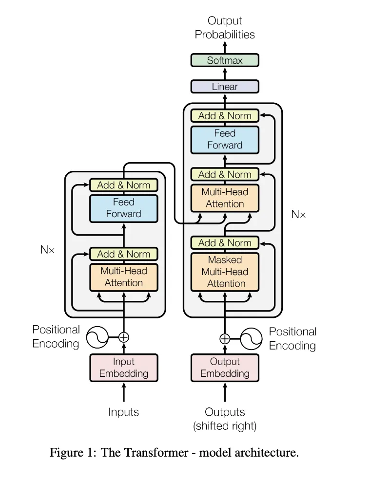

_이미지 출처: [카카오페이 기술 블로그](https://tech.kakaopay.com/post/how-llm-works/)에 실린 원본을 그대로 사용했다. 원출처: Vaswani et al., [Attention Is All You Need, Figure 1](https://arxiv.org/html/1706.03762v7#S3.F1)._

#### 1.4.1. 인코딩 — 인코더 레이어

입력 문장의 토큰들이 서로를 참고하도록 해서, 문맥이 반영된 벡터를 만든다.

##### 1.4.1.1. Self-Attention

각 토큰이 같은 입력 안의 다른 토큰을 ==blue:얼마나 참고할지== 계산하고, 그 가중치에 따라 정보를 모은다.

수식으로 쓰면 다음과 같다.

<div class="llm-equation" role="region" aria-label="Self-Attention 수식" tabindex="0">
<math xmlns="http://www.w3.org/1998/Math/MathML" display="block" aria-label="Attention(Q, K, V) = softmax(Q K의 전치 / 루트 d_k) V">
  <mrow>
    <mi mathvariant="normal">Attention</mi><mo stretchy="false">(</mo><mi>Q</mi><mo>,</mo><mi>K</mi><mo>,</mo><mi>V</mi><mo stretchy="false">)</mo>
    <mo>=</mo>
    <mi mathvariant="normal">softmax</mi><mo>(</mo>
    <mfrac>
      <mrow><mi>Q</mi><msup><mi>K</mi><mi mathvariant="normal">T</mi></msup></mrow>
      <msqrt><msub><mi>d</mi><mi>k</mi></msub></msqrt>
    </mfrac>
    <mo>)</mo><mi>V</mi>
  </mrow>
</math>
</div>

Q·K·V는 입력 토큰 벡터를 서로 다른 학습된 가중치로 변환해 만든 행렬이다. 각각의 역할은 다음처럼 이해했다.

- **Q(Query):** 찾을 정보
- **K(Key):** 대조할 기준
- **V(Value):** 가져올 정보

`Kᵀ`는 K를 전치한 행렬이고, `dₖ`는 Q와 K 벡터의 차원 수다.

`QKᵀ`로 토큰 사이의 관련 점수를 구하고, `√dₖ`로 나눠 점수의 크기를 조절한다. 각 Query에 대해 **Softmax로 참고 가중치를 만든 뒤 V를 곱해 정보를 가중합**한다. [Attention 수식 원문](https://arxiv.org/html/1706.03762v7#S3.SS2.SSS1)

<div class="llm-example" role="note" aria-label="예시">

**예시**

세 토큰을 참고하는 가중치가 `[0.1, 0.2, 0.7]`이면, 각 토큰의 정보 벡터를 `0.1 × V₁ + 0.2 × V₂ + 0.7 × V₃`으로 모은다. 세 번째 토큰의 정보를 가장 많이 반영하는 셈이다.

</div>

##### 1.4.1.2. Multi-Head Attention

Attention 계산을 여러 head에서 수행한 뒤 결과를 합친다. 서로 다른 관계를 반영할 수 있다.

##### 1.4.1.3. Feed-Forward Neural Network

FFN은 Attention을 거친 각 토큰 벡터에 같은 신경망을 적용해 표현을 가공한다. 선형 변환과 비선형 활성화 함수를 사용한다.

토큰 사이의 정보를 모으는 역할은 **Attention**이 맡고, **FFN**은 그렇게 만들어진 각 토큰의 표현을 개별적으로 변환한다고 이해했다.

#### 1.4.2. 디코딩 — 디코더 레이어

지금까지 생성한 토큰과 인코더의 출력을 참고해, 다음 토큰을 예측하는 데 쓸 표현을 만든다.

<div class="llm-example" role="note" aria-label="예시">

**예시**

“나는 밥을 먹었다”를 영어로 번역한다면, 인코더는 한국어 입력을 처리한다. 디코더는 이미 생성한 “I”와 인코더 출력을 참고해 “ate” 같은 다음 토큰을 예측한다.

</div>

##### 1.4.2.1. Masked Self-Attention

현재 위치보다 뒤에 있는 토큰을 참고하지 못하도록 하는 Self-Attention이다. 각 위치는 ==orange:자신과 앞의 토큰만 참고==한다.

<div class="llm-example" role="note" aria-label="예시">

**예시**

학습 중 `[시작 토큰, I, ate]`를 입력했더라도, “I” 위치에서 다음 토큰을 예측할 때 뒤의 “ate”를 미리 보면 안 된다. 참고 가능한 위치를 간단히 나타내면 다음과 같다.

| 현재 위치 | 시작 토큰 참조 | I 참조 | ate 참조 |
| --------- | -------------- | ------ | -------- |
| 시작 토큰 | 가능           | 차단   | 차단     |
| I         | 가능           | 가능   | 차단     |
| ate       | 가능           | 가능   | 가능     |

</div>

차단할 위치의 점수를 Softmax 전에 `−∞`로 두면, Softmax 뒤의 가중치는 0이 된다.

> **궁금했던 점**
>
> Masked Self-Attention에서 0이 나오면, 뒤의 Attention에서도 이 토큰에 대한 값이 0이 되는 걸까?

0이 되는 것은 미래 토큰을 **참고하는 가중치**다. 토큰 벡터 전체가 0이 되는 것은 아니다.

##### 1.4.2.2. Cross-Attention

디코더 쪽 표현으로 인코더의 출력을 참고하는 과정이다. 같은 입력 안에서만 계산하는 Self-Attention과 구분된다.

같은 Attention 수식을 사용하되, 디코더 쪽에서 **Query**를 만들고 인코더 출력에서 **Key와 Value**를 가져온다.

여기서는 Attention 가중치를 새로 계산한다. 앞의 Masked Self-Attention에서 0이었던 가중치를 그대로 곱해 이어가는 구조는 아니다.

##### 1.4.2.3. Feed-Forward Neural Network

앞선 Attention을 거친 각 토큰 벡터를 개별적으로 가공한다. 동작은 인코더에서 살펴본 FFN과 같다.

#### 1.4.3. 인코더·디코더의 공통 구성

그림의 `Add & Norm`은 잔차 연결과 Layer Normalization을 뜻한다.

##### 1.4.3.1. 잔차 연결

연산 결과에 기존 입력을 더하는 것이다. `x + F(x)`처럼 이전 정보를 이어주고, 깊은 신경망의 학습을 돕는다. ResNet을 찾아보며 이해한 부분이다.

##### 1.4.3.2. Layer Normalization

각 토큰 벡터 내부의 값들을 평균과 분산을 기준으로 정규화해 학습을 안정시키는 역할이다. 정규화를 적용하는 위치는 모델마다 다를 수 있다.

### 1.5. logits 출력

Transformer 블록을 거친 벡터를 출력 선형층에 넣어, 모델의 전체 토큰 목록에 대한 점수를 만든다. 각 점수를 logit, 점수들을 모아 logits라고 한다.

다음 토큰을 생성할 때는 마지막 위치의 logits를 사용한다. 점수가 높을수록 다음 토큰 후보로 더 선호된다는 뜻이며, ++아직 확률은 아니다++.

logits는 값이 0~1 사이이거나 합이 1일 필요가 없다.

### 1.6. 확률로 만들기(Softmax)

logits를 Softmax에 넣어 각 토큰의 확률로 바꾼다. ==yellow:전체 확률의 합은 1==이다.

<div class="llm-equation" role="region" aria-label="Softmax 수식" tabindex="0">
<math xmlns="http://www.w3.org/1998/Math/MathML" display="block" aria-label="p_i = e의 z_i승 / j가 1부터 n까지인 e의 z_j승의 합">
  <mrow>
    <msub><mi>p</mi><mi>i</mi></msub><mo>=</mo>
    <mfrac>
      <msup><mi>e</mi><msub><mi>z</mi><mi>i</mi></msub></msup>
      <mrow>
        <munderover><mo>∑</mo><mrow><mi>j</mi><mo>=</mo><mn>1</mn></mrow><mi>n</mi></munderover>
        <msup><mi>e</mi><msub><mi>z</mi><mi>j</mi></msub></msup>
      </mrow>
    </mfrac>
  </mrow>
</math>
</div>

`zᵢ`는 i번째 토큰의 logit, `pᵢ`는 그 토큰의 확률이고, `n`은 전체 토큰 종류의 수다. **한 토큰의 exp(logit)을 모든 토큰의 exp(logit) 합으로 나눈다.** 여기서 `exp(z)`는 `eᶻ`를 뜻한다. [Softmax 수식 참고](https://docs.scipy.org/doc/scipy/reference/generated/scipy.special.softmax.html)

<div class="llm-example" role="note" aria-label="예시">

**예시**

세 후보의 logits가 `[2, 1, 0]`이라면, Softmax를 적용했을 때 약 `[0.665, 0.245, 0.090]`이 된다. 첫 토큰의 확률은 `e² / (e² + e¹ + e⁰)`으로 계산한다.

</div>

#### 1.6.1. Temperature

Temperature는 샘플링할 확률 분포의 뾰족함을 조절하는 매개변수다. `T > 0`에서 logits를 T로 나눈 뒤 Softmax를 적용한다.

- **T = 1:** 원래 Softmax 결과를 사용한다.
- **T > 1:** 분포가 평평해져 낮은 점수의 후보도 뽑힐 여지가 커진다. 다양성을 높이는 쪽이다.
- **0 < T < 1:** 높은 점수의 후보에 확률이 더 몰린다. 선택이 보수적으로 바뀌는 쪽이다.

<div class="llm-example" role="note" aria-label="예시">

**예시**

같은 logits `[2, 1, 0]`이어도 T에 따라 확률이 달라진다.

| Temperature | 첫 후보 | 둘째 후보 | 셋째 후보 |
| ----------- | ------- | --------- | --------- |
| T = 0.5     | 86.7%   | 11.7%     | 1.6%      |
| T = 1       | 66.5%   | 24.5%     | 9.0%      |
| T = 2       | 50.6%   | 30.7%     | 18.6%     |

반올림 때문에 표의 합은 정확히 100%가 아닐 수 있다.

</div>

### 1.7. 샘플링

만들어진 확률을 바탕으로 ==blue:다음 토큰 하나를 고른다==.

#### 1.7.1. Greedy Decoding

확률이 가장 높은 토큰 하나를 고른다.

#### 1.7.2. Random Sampling

확률 분포에 따라 무작위로 하나를 뽑는다. 확률을 기반으로 하는 가챠라고 이해했다.

#### 1.7.3. Top-K Sampling

확률이 높은 K개만 후보로 남긴 뒤, 그 안에서 확률에 따라 하나를 뽑는다.

#### 1.7.4. Top-P Sampling

확률이 높은 순으로 누적 합이 P 이상이 되는 최소 후보 집합을 남긴 뒤, 그 안에서 하나를 뽑는다.

<div class="llm-example" role="note" aria-label="예시">

**예시**

후보가 “먹었다” 50%, “먹는다” 30%, “먹고” 15%, “잔다” 5%라면 다음처럼 달라진다.

| 방식           | 이 후보들에 적용하면                                                                |
| -------------- | ----------------------------------------------------------------------------------- |
| Greedy         | 가장 높은 “먹었다”를 고른다.                                                        |
| Random         | 네 후보 중 확률에 따라 하나를 뽑는다.                                               |
| Top-K, K = 2   | “먹었다”와 “먹는다”만 남겨 각각 62.5%, 37.5%로 뽑는다.                              |
| Top-P, P = 0.9 | 누적 확률이 95%가 되는 “먹고”까지 세 후보를 남기고, 확률을 다시 맞춰 하나를 뽑는다. |

</div>

[샘플링 설정 참고](https://huggingface.co/docs/transformers/main_classes/text_generation)

### 1.8. 디코딩

선택된 토큰 ID들을 토크나이저로 ==blue:문자열로 복원==한다. 1.4절의 디코더 레이어 연산과는 구분되는 과정이다.

<div class="llm-example" role="note" aria-label="예시">

**예시**

선택된 ID가 `[30, 31]`이고 각각 “ 먹”, “었다”에 해당한다면, 이를 복원해 “ 먹었다”라는 문자열을 얻는다.

</div>

**생성한 토큰은 다시 입력 뒤에 붙고**, 모델은 이어질 다음 토큰을 예측한다.

종료 토큰이 나오거나 설정한 길이에 도달할 때까지 반복하며 문장을 만든다.

### 1.9. 이해하는 데 참고한 자료

주로 아래 두 글을 읽으며 전체 흐름을 이해했다.

- [calico — LLM Tokenizer와 Embedding](https://velog.io/@calico/LLM-Tokenizer와-Embedding)
- [카카오페이 기술 블로그 — 백엔드 개발자의 시선으로 풀어본 LLM 내부 동작 원리](https://tech.kakaopay.com/post/how-llm-works/)

설명이 더 필요했던 부분은 아래 자료를 참고했다.

- [FNN이란](https://wikidocs.net/176148)
- [ResNet이란](https://wikidocs.net/202619)
- [Layer Normalization이란](https://wikidocs.net/228097)
- [Temperature와 Top-P](https://wikidocs.net/333750)

GPT 대화 세션을 통해서도 이해하는 데 도움을 많이 받았다. 내용을 정리하며 구조와 용어를 점검한 부분에는 본문에 원문·공식 문서 링크를 덧붙였다.

---

## 2. BPE 토크나이저와 입력 임베딩 구현

전체 흐름을 살펴본 뒤, 문장을 토큰으로 나누고 입력 벡터를 만드는 과정을 직접 따라가 봤다. 먼저 한국어와 영어의 토큰 수를 비교하고, BPE의 병합 과정을 구현했다. 이어서 GPT-2의 토큰·위치 임베딩을 더해 다음 연산에 넣을 입력을 만들었다.

### 2.1. tiktoken으로 한국어·영어 문장 토큰 수 비교

[이 문서](https://developers.openai.com/api/docs/guides/conversation-state#managing-context-for-text-generation)에 따라 OpenAI의 tiktoken 라이브러리를 사용할 수 있는 [tokenizer tool](https://platform.openai.com/tokenizer)에서 확인을 진행한다.

https://platform.openai.com/tokenizer

#### 2.1.1. 영어 토큰화

입력어는 example에 명시되어있는 문장을 사용하였다.
```
Many words map to one token, but some don't: indivisible.

Unicode characters like emojis may be split into many tokens containing the underlying bytes: 🤚🏾

Sequences of characters commonly found next to each other may be grouped together: 1234567890
```


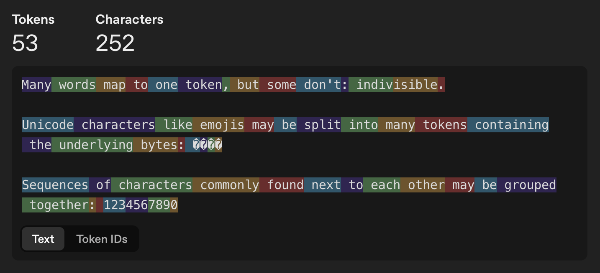

| 항목 | 개수 |
|---|---:|
| 원문 단어 수 (공백 기준) | 39개 |
| 원문 글자 수 (공백·줄바꿈 포함) | 252자 |
| 토큰 수 | 53개 |


#### 2.1.2. 한글 토큰화 (예시1)

```
보통 하나의 토큰으로 표현되는 단어들도 많지만, 분리불가능이라는 단어처럼 예외적으로 여러 토큰으로 나누어지는 경우들도 존재합니다.

이모지처럼 유니코드로 표현되는 문자들은 내부에서 바이트들의 조합으로 저장됩니다. 따라서 바이트들을 포함하는 여러 토큰으로 분리되기도 합니다: 🤚🏾

서로 이웃해서 자주 등장하는 문자열들은 토큰화하는 과정에서 하나의 토큰으로 묶이기도 합니다. 대표적으로는 1234567890처럼 연속해서 나열되는 숫자들이 해당됩니다.
```

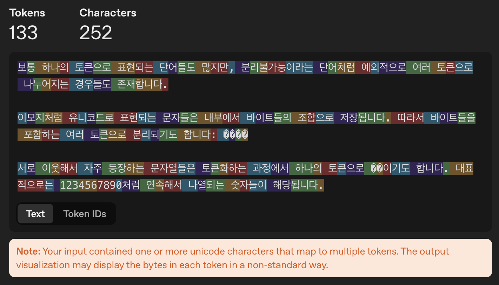

> 한국어는 글자 하나가 여러 토큰으로 나뉠 수 있다. '묶'이 ��로 표시된 이유다.


| 항목 | 개수 |
|---|---:|
| 원문 단어 수 (공백 기준) | 47개 |
| 원문 글자 수 (공백·줄바꿈 포함, 자모 분리X) | 252자 |
| 원문 글자 수 (공백·줄바꿈 포함, 자모 분리O) | 499자 |
| 토큰 수 | 133개 |

#### 2.1.3. 한글 토큰화 (예시2)

```
많은 단어는 한 토큰이 되나, 늘 그런 건 아니다. 한 예가 바로 분리불가능이다.

이모지 등 유니코드 글자는 그 속 바이트가 여러 토큰에 나뉘어 담길 수 있다: 🤚🏾

또 자주 함께 오는 글자의 묶음은 한 토큰이 될 수 있다: 1234567890
```

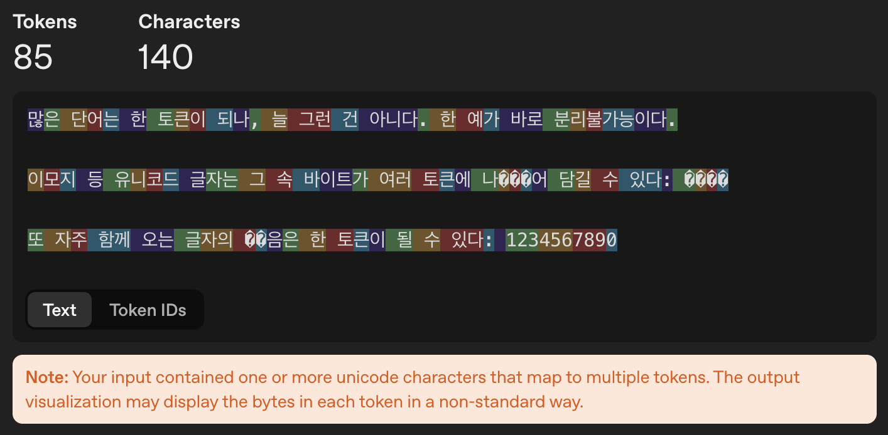

| 항목 | 개수 |
|---|---:|
| 원문 단어 수 (공백 기준) | 39개 |
| 원문 글자 수 (공백·줄바꿈 포함, 자모 분리X) | 140자 |
| 원문 글자 수 (공백·줄바꿈 포함, 자모 분리O) | 252자 |
| 토큰 수 | 85개 |

#### 2.1.4. 세 예시의 결과 비교

앞의 세 예시를 한 표로 모아 비교하였다. 단어 수는 공백을 기준으로 세었으며, 한국어에서는 어절 수에 해당한다.

<div class="bpe-comparison-table" role="region" aria-label="영어와 한국어 두 예시의 토큰화 결과 비교" tabindex="0">

| 비교 항목 | 영어 | 한국어 예시 1 | 한국어 예시 2 |
|---|---:|---:|---:|
| 단어 수 (공백 기준) | 39개 | 47개 | 39개 |
| 원문 글자 수 | 252자 | 252자 | 140자 |
| 자모 분리 후 글자 수 | 252자 | 499자 | 252자 |
| UTF-8 바이트 수 | 256 | 624 | 306 |
| **토큰 수** | **53개** | **133개** | **85개** |
| 원문 100자당 토큰 수 | 21.0개 | 52.8개 | 60.7개 |
| 영어 대비 전체 토큰 수 | 1.00배 | 2.51배 | 1.60배 |

</div>

글자 수는 사이트와 같은 UTF-16 단위로 계산하였다. 공백과 줄바꿈을 포함하고, 이모지 `🤚🏾`는 4자로 센다. 비율은 소수점 둘째 자리, 100자당 토큰 수는 소수점 첫째 자리까지 반올림하였다.

<div class="bpe-token-comparison">
<figure aria-labelledby="bpe-total-title">
<figcaption id="bpe-total-title">전체 토큰 수 <span>단위: 개</span></figcaption>
<div class="bpe-bar-row"><span class="bpe-bar-label">영어</span><span class="bpe-bar-track"><span class="bpe-bar-fill" style="width:35.3333%"></span></span><strong>53</strong></div>
<div class="bpe-bar-row"><span class="bpe-bar-label">한국어 1</span><span class="bpe-bar-track"><span class="bpe-bar-fill" style="width:88.6667%"></span></span><strong>133</strong></div>
<div class="bpe-bar-row"><span class="bpe-bar-label">한국어 2</span><span class="bpe-bar-track"><span class="bpe-bar-fill" style="width:56.6667%"></span></span><strong>85</strong></div>
<div class="bpe-bar-axis" aria-hidden="true"><span>0</span><span>50</span><span>100</span><span>150</span></div>
<p class="bpe-chart-note">각 문장 전체를 입력했을 때의 결과다. 원문 길이는 각각 252자, 252자, 140자로 다르다.</p>
</figure>
<figure aria-labelledby="bpe-density-title">
<figcaption id="bpe-density-title">원문 100자당 토큰 수 <span>단위: 개</span></figcaption>
<div class="bpe-bar-row"><span class="bpe-bar-label">영어</span><span class="bpe-bar-track"><span class="bpe-bar-fill" style="width:30.0454%"></span></span><strong>21.0</strong></div>
<div class="bpe-bar-row"><span class="bpe-bar-label">한국어 1</span><span class="bpe-bar-track"><span class="bpe-bar-fill" style="width:75.3968%"></span></span><strong>52.8</strong></div>
<div class="bpe-bar-row"><span class="bpe-bar-label">한국어 2</span><span class="bpe-bar-track"><span class="bpe-bar-fill" style="width:86.7347%"></span></span><strong>60.7</strong></div>
<div class="bpe-bar-axis" aria-hidden="true"><span>0</span><span>35</span><span>70</span></div>
<p class="bpe-chart-note">토큰 수 ÷ 원문 글자 수 × 100으로 계산했다. 자모 분리 후 길이는 분모로 사용하지 않았다.</p>
</figure>
</div>

### 2.2. BPE 구현

앞에서는 기존 토크나이저가 문장을 어떻게 나누는지 확인했다. 이번에는 [Hugging Face의 BPE 설명](https://huggingface.co/learn/llm-course/chapter6/5)을 참고해, 자주 등장하는 토큰 쌍을 찾아 합치는 과정을 직접 구현했다.

구현의 흐름은 다음과 같다.

```text
학습 문서 읽기 → 단어별 등장 횟수 계산 → 문자 단위로 분리
→ 인접한 토큰 쌍의 빈도 계산 → 가장 빈번한 쌍 하나 병합
→ 목표 어휘 크기까지 반복 → 병합 규칙을 새 문장에 적용
```

빈도 계산과 병합 함수를 먼저 작성하고, 인덱스와 반복문 제어를 고치며 학습 흐름을 연결했다. 데이터 파일 연결, 선택한 쌍만 병합하도록 정리하는 부분, 병합 순서 저장과 새 문장 토큰화 함수, 실행 검증은 AI의 도움을 받았다.

여기서는 **문자 기반 BPE**를 구현한다. 앞에서 사용한 `tiktoken`의 byte-level BPE처럼 바이트에서 시작하는 구현과는 시작 단위가 다르다.

#### 2.2.1. 학습할 텍스트 가져오기

처음에는 같은 문장이 반복되는 짧은 예시를 사용했다. 서로 다른 단어가 91개뿐이어서, 학습에 사용한 문장을 다시 넣으면 단어 전체가 토큰이 되는 경우가 많았다. 더 다양한 문장을 사용하기 위해 [Project Gutenberg의 『셜록 홈스의 모험』](https://www.gutenberg.org/ebooks/48320) 텍스트로 바꿨다.

[학습에 사용한 텍스트 파일 내려받기](./assets/chapter-2-sherlock_holmes.txt)

구텐베르크의 배포 안내문은 제외하고 책 텍스트를 파일로 저장했다. 표지·목차·삽화 설명은 포함되어 있다. 다음 코드는 파일을 읽은 뒤 줄바꿈과 연속 공백을 공백 하나로 정리한다.

```python
from pathlib import Path

# Arthur Conan Doyle, Adventures of Sherlock Holmes
# 원문: https://www.gutenberg.org/ebooks/48320
text_path = Path("sherlock_holmes.txt")
if not text_path.exists():
    text_path = Path("BPE") / "sherlock_holmes.txt"

text = text_path.read_text(encoding="utf-8")
text = " ".join(text.split())
```

노트북과 텍스트 파일이 같은 폴더에 있으면 첫 번째 경로로 읽고, 프로젝트 루트에서 실행하면 `BPE` 폴더 안에서 찾는다. `" ".join(text.split())`으로 공백을 정리했으므로, 다음 단계에서 `split(" ")`을 사용해도 줄바꿈이 단어 안에 남지 않는다.

| 학습 데이터 항목 | 값 |
|---|---:|
| 공백 기준 전체 단어 수 | 106,404개 |
| 공백 기준 서로 다른 단어 형태 | 15,288개 |
| 초기 어휘 크기 | 93개 |

여기서 서로 다른 단어 형태는 대소문자와 문장부호를 구분한다. `Holmes`, `Holmes,`, `Holmes.`은 다른 키로 센다.

#### 2.2.2. 단어를 나누고 등장 횟수 세기

먼저 공백으로 단어를 나누고 `Counter`로 등장 횟수를 센다. 같은 단어를 매번 처리하는 대신, 한 번만 저장하고 빈도를 가중치로 사용하기 위해서다.

```python
#pre-tokenizer(공백기준분리)

pre_tokenizer_text = text.split(" ")

pre_tokenizer_text

#중복 없애고 등장빈도 나타내기

from collections import Counter

pre_tokenizer_word_frequency = dict(Counter(pre_tokenizer_text))

pre_tokenizer_word_frequency = {tuple(word):count for word,count in pre_tokenizer_word_frequency.items()}

pre_tokenizer_word_frequency
```

딕셔너리의 키를 문자열에서 튜플로 바꿨다. 처음에는 `"the"`가 `("t", "h", "e")`가 되고, 병합이 진행되면 `("th", "e")`, `("the",)`처럼 바뀐다. 튜플은 딕셔너리 키로 사용할 수 있으면서 현재 토큰 경계도 표현할 수 있다.

이후에 사용하는 자료구조는 다음과 같다.

<div class="bpe-comparison-table" role="region" aria-label="BPE 구현의 자료구조" tabindex="0">

| 변수 | 저장하는 내용 |
|---|---|
| `pre_tokenizer_word_frequency` | 처음 문자로 나눈 단어와 등장 횟수 |
| `word_frequency` | 병합이 반영된 현재 토큰 튜플과 등장 횟수 |
| `base_vocabulary` | 사용할 수 있는 문자와 학습으로 추가한 토큰 |
| `merges` | 선택한 토큰 쌍을 학습 순서대로 저장한 목록 |

</div>

#### 2.2.3. 초기 어휘와 병합 후보 만들기

초기 어휘는 텍스트에 등장한 서로 다른 문자로 구성했다. `set`은 중복을 제거하지만 순서를 보장하지 않으므로, 이 목록에 표시되는 문자 순서는 학습 순서와 관계없다.

현재 코드의 초기 어휘에는 공백도 포함되지만, 단어를 공백으로 먼저 분리하므로 단어 사이를 합치는 데 사용하지는 않는다.

```python
#base_vocabulary 초기화
base_vocabulary = list(set(text))
base_vocabulary

#symbol 만들기 함수

def make_symbol(base_vocabulary:list) -> dict[str, tuple]:
    symbols = {}
    for first_text in base_vocabulary:
        for second_text in base_vocabulary:
            symbols[first_text+second_text] = (first_text, second_text)
    return symbols

symbols = make_symbol(base_vocabulary)
symbols
```

`make_symbol()`은 현재 어휘의 토큰 두 개를 이어 붙여 후보 문자열을 만든다. 이 딕셔너리는 후보 문자열이 존재하는지 확인할 때 사용한다. **실제로 어떤 두 토큰을 병합할지는 현재 단어의 인접 쌍을 튜플로 따로 저장해 결정한다.**

어휘가 커지면 모든 조합을 만드는 비용도 커진다. 현재는 동작을 확인하기 위한 구현으로 두었고, 실제 학습에 등장한 인접 쌍만 후보로 모으는 최적화는 적용하지 않았다.

#### 2.2.4. 선택한 토큰 쌍 하나만 병합하기

병합 함수는 현재 단어 빈도와 `selected_pair`를 받는다. 어휘에 있는 토큰을 전부 찾아 합치는 대신, 전달받은 쌍과 정확히 일치하는 위치만 합친다.

```python
#word_frequency 재구성

def symbolic_word_frequency(prev_word_frequency:dict[tuple, int], selected_pair:tuple[str, str]) -> dict[tuple, int]:
    new_word_frequency = {}
    for word, score in prev_word_frequency.items():
        new_words = []
        i = 0
        while True:
            if i >= len(word):
                break

            if i + 1 < len(word) and (word[i], word[i+1]) == selected_pair:
                new_words.append(word[i]+word[i+1])
                i += 2
            else:
                new_words.append(word[i])
                i += 1
        new_word_frequency[tuple(new_words)] = score

    return new_word_frequency

word_frequency = dict(pre_tokenizer_word_frequency)
word_frequency
```

`i`는 현재 토큰 위치다. 두 토큰이 선택한 쌍과 같으면 합친 토큰을 넣고 두 칸 이동한다. 일치하지 않으면 현재 토큰을 그대로 넣고 한 칸 이동한다. `i + 1 < len(word)`는 마지막 토큰에서 다음 원소를 읽지 않도록 하는 조건이다.

<div class="llm-example" role="note" aria-label="반복되는 토큰 쌍의 병합 예시">

**예시**

`selected_pair = ("a", "a")`일 때 다음처럼 처리한다.

```text
현재 토큰: a · a · a · a
첫 병합:  aa · a · a
최종 결과: aa · aa
```

병합에 사용한 토큰을 다시 사용하지 않도록 두 칸씩 이동한다. `a · a · a`처럼 마지막에 하나가 남으면 `aa · a`로 보존한다.

</div>

여기서 `score`는 해당 단어의 등장 횟수다. 토큰을 합쳐도 단어가 등장한 횟수는 바뀌지 않으므로 결과 딕셔너리에 그대로 옮긴다. 학습을 시작할 때는 원본 빈도 딕셔너리를 복사해 `word_frequency`로 사용한다.

#### 2.2.5. 인접한 쌍의 빈도 계산하기

병합할 쌍을 고르기 위해 현재 토큰 튜플을 순회한다. 단어가 여러 번 등장했다면 그 횟수만큼 쌍의 빈도를 더한다.

```python
def score_symbol(word_frequency:dict[tuple, int], symbols:dict):
    scores = {}
    for words, score in word_frequency.items():
        for i in range(len(words)-1):
            pair = (words[i], words[i+1])
            sum_text = words[i] + words[i+1]
            if sum_text in symbols.keys():
                scores[pair] = scores.get(pair, 0) + score
    return scores

scores = score_symbol(word_frequency, symbols)
sorted(scores.items(), key=lambda x: x[1], reverse=True)
```

`pair`는 실제로 이웃한 두 토큰이고, `sum_text`는 둘을 합친 문자열이다. 점수 딕셔너리의 키에는 문자열 대신 `pair`를 사용했다. `("ab", "c")`와 `("a", "bc")`는 합친 문자열이 모두 `"abc"`이지만 서로 다른 병합 규칙이기 때문이다.

빈도를 셀 때는 겹치는 인접 위치도 모두 확인한다. 예를 들어 `("a", "a", "a", "a")`가 2번 등장했다면 `("a", "a")`의 빈도는 `3 × 2 = 6`이다. 앞의 병합 함수에서 두 번 합치는 것과는 세는 기준이 다르다.

이번 문서의 초기 쌍 빈도 상위 항목은 다음과 같았다.

| 인접 쌍 | 빈도 |
|---|---:|
| `('t', 'h')` | 11,921 |
| `('h', 'e')` | 11,588 |
| `('i', 'n')` | 7,710 |
| `('e', 'r')` | 7,193 |
| `('a', 'n')` | 6,559 |

이 표는 첫 병합 전의 빈도다. 병합할 때마다 점수가 바뀌므로 실제 병합 순서는 이 표의 순위와 달라질 수 있다.

정렬할 때 `key=lambda x: x[1]`을 넣어 점수 기준으로 비교했다. 이것을 생략하면 `(쌍, 점수)` 중 앞의 쌍부터 비교하므로 빈도순 정렬이 되지 않는다.

#### 2.2.6. 어휘를 늘리고 병합 순서 저장하기

새 토큰은 기존 어휘에 추가한다. 아래 함수의 길이순 정렬은 어휘를 보기 편하게 나열하기 위한 것이며, 병합 우선순위를 정하는 기준은 아니다.

```python
def update_base_vocab(new:str, base_vocabulary:list):
    new_base_vocabulary = base_vocabulary
    new_base_vocabulary.append(new)
    new_base_vocabulary.sort(reverse=True, key=lambda x: len(x))
    return new_base_vocabulary

new = "".join(sorted(scores.items(), key=lambda x: x[1], reverse=True)[0][0])
update_base_vocab(new, base_vocabulary.copy())
```

함수 아래의 호출은 첫 후보를 추가해 보는 예시다. `.copy()`로 어휘의 복사본을 넘겨, 실제 학습 전에 첫 토큰이 미리 추가되지 않게 했다.

이제 쌍의 점수를 계산하고, 가장 빈번한 쌍을 하나 골라 병합하는 과정을 반복한다.

```python
merges = []

while True:
    symbols = make_symbol(base_vocabulary)
    scores = score_symbol(word_frequency, symbols)
    if not scores:
        break
    selected_pair = sorted(scores.items(), key=lambda x: x[1], reverse=True)[0][0]
    new = "".join(selected_pair)
    word_frequency = symbolic_word_frequency(word_frequency, selected_pair)
    merges.append(selected_pair)
    if new not in base_vocabulary:
        base_vocabulary = update_base_vocab(new, base_vocabulary)
    if len(base_vocabulary) >= 800:
        break

base_vocabulary
```

한 번 병합할 때마다 인접한 토큰 관계가 바뀌므로 다음 반복에서는 점수를 다시 계산한다. 이때 `pre_tokenizer_word_frequency`를 매번 넣으면 초기 문자 상태로 돌아가 버린다. 직전 결과인 `word_frequency`를 다음 병합에 넘겨야 더 긴 토큰으로 이어진다.

`scores`가 비면 더 병합할 인접 쌍이 없다는 뜻이므로 종료한다. 목표 어휘 크기 800개에 도달한 경우에도 종료한다. 새 토큰은 중복 추가하지 않고, 선택한 쌍은 `merges.append(selected_pair)`로 기록한다. 빈도가 같을 때는 현재 단어 순회에서 먼저 발견된 쌍을 선택한다.

==yellow:최종 어휘 목록과 병합 순서는 따로 보관해야 한다.== 어휘는 사용 가능한 토큰을 알려주고, `merges`는 그 토큰들이 어떤 순서로 만들어졌는지 알려준다.

#### 2.2.7. 저장한 규칙으로 새 문장 토큰화하기

새 문장에서는 점수를 다시 계산하거나 병합 규칙을 추가하지 않는다. 학습 때처럼 단어를 나누고 문자 튜플로 만든 다음, `merges`의 규칙을 처음부터 순서대로 적용한다.

```python
def tokenize(text: str, merges: list) -> list[str]:
    result = []

    for word in text.split(" "):
        if not word:
            continue

        word_state = {tuple(word): 1}

        for pair in merges:
            word_state = symbolic_word_frequency(word_state, pair)

        tokens = list(word_state.keys())[0]
        result.extend(tokens)

    return result
```

기존 병합 함수를 재사용하기 위해 단어 하나를 `{tuple(word): 1}` 형태로 넣었다. 여기서 `1`은 함수의 입력 형식을 맞추기 위한 값이며, 새 문장의 학습 빈도로 쓰이지 않는다.

모든 규칙을 적용한 뒤 딕셔너리의 키를 꺼내면 그 단어의 토큰 튜플을 얻는다. `result.extend(tokens)`로 토큰을 하나씩 결과 리스트에 붙인다. 문장 전체를 `Counter`로 묶지 않고 단어를 입력 순서대로 처리하므로, 같은 단어가 반복돼도 빠지지 않는다.

#### 2.2.8. 실행 결과 확인하기

이전 실행 상태가 섞이지 않도록 위 코드를 처음부터 실행한 결과를 정리했다. 현재 텍스트 파일과 목표 어휘 크기 800개를 사용한 결과다.

| 확인 항목 | 결과 |
|---|---:|
| 초기 어휘 크기 | 93개 |
| 최종 어휘 크기 | 800개 |
| 저장한 병합 규칙 | 707개 |

처음 학습한 규칙은 다음 순서였다.

```text
1. ('t', 'h') → 'th'
2. ('i', 'n') → 'in'
3. ('e', 'r') → 'er'
4. ('a', 'n') → 'an'
5. ('th', 'e') → 'the'
```

노트북의 테스트 문장에도 적용했다.

```python
new_text = "The European languages are members of the same family."

tokens = tokenize(new_text, merges)

print(tokens)
print("토큰 수:", len(tokens))
```

```text
['The', 'E', 'u', 'ro', 'pe', 'an', 'l', 'ang', 'u', 'ag', 'es', 'are', 'me', 'm', 'b', 'ers', 'of', 'the', 'sa', 'me', 'f', 'am', 'i', 'ly.']
토큰 수: 24
```

처음의 반복 문장으로 학습했을 때는 이 문장의 단어들이 통째로 토큰이 되어, 띄어쓰기로 나눈 결과와 같아 보였다. 학습에 없던 단어를 넣으면 배운 조각을 조합하는 차이가 더 잘 보인다. 이번 텍스트로 학습한 결과도 함께 확인했다.

<div class="bpe-comparison-table" role="region" aria-label="학습에 없는 단어의 토큰화 결과" tabindex="0">

| 입력 단어 | 학습 데이터에 같은 단어 형태가 있었는가 | BPE 결과 |
|---|---|---|
| `tokenization` | 없음 | `['to', 'k', 'en', 'i', 'z', 'ation']` |
| `Europeanization` | 없음 | `['E', 'u', 'ro', 'pe', 'an', 'i', 'z', 'ation']` |

</div>

`the the`도 같은 단어를 두 번 토큰화한 결과와 일치했다. 단어를 빈도 딕셔너리로 묶어 처리하던 학습 단계와 달리, 새 문장에서는 입력 순서와 반복을 유지한 것이다.

#### 2.2.9. 현재 구현의 범위

이번에는 문자에서 시작하는 BPE 학습과, 저장한 병합 규칙을 새 문장에 적용하는 부분까지 구현했다. 다음 항목은 포함하지 않았다.

| 항목 | 현재 동작 |
|---|---|
| 공백과 줄바꿈 복원 | 전처리에서 정리·분리하므로 원문 그대로 복원하지 못한다. |
| 학습에 없던 문자 | 별도의 `[UNK]` 처리가 없어 어휘에 없는 문자도 결과에 남을 수 있다. |
| 모델에 넣을 정수 토큰 ID | 이 단계에서는 토큰 문자열을 반환한다. 아래 임베딩 단계에서는 GPT-2의 토크나이저와 ID를 사용한다. |
| Byte-level BPE | UTF-8 바이트가 아닌 문자에서 시작한다. |

따라서 앞의 `tiktoken` 사이트와 토큰 수가 같아지는 것을 목표로 하지는 않았다. 같은 BPE 원리라도 학습 데이터, 초기 어휘, 사전 토큰화와 병합 규칙이 달라지면 결과도 달라진다.

### 2.3. 임베딩 결합 구현

토크나이징을 한 각각의 토큰들은 임베딩 과정을 거쳐 고차원의 벡터로 나타낸다. 이 글에선 미리 학습된 GPT-2의 토큰 임베딩과 위치 임베딩을 사용한다.

#### 2.3.1. GPT-2의 토크나이저를 사용하는 이유

앞에서는 BPE의 병합 과정을 이해하기 위해 토크나이저를 직접 구현했다. 임베딩 과정에서는 **GPT-2의 토크나이저와 임베딩 테이블을 함께 사용**하기로 했다.

GPT-2의 토큰 임베딩 테이블은 **50,257개 토큰**을 다루지만, 내가 만든 BPE의 어휘는 **800개**다. 또한 내 구현은 문자를 시작 단위로 삼아 문자열을 합치는 문자 기반 BPE다. [GPT-2의 토크나이저](https://huggingface.co/docs/transformers/en/model_doc/gpt2#transformers.GPT2Tokenizer)는 UTF-8 바이트를 시작 단위로 사용하는 byte-level BPE이므로, 토큰을 구성하는 기준도 다르다.

현재 구현으로 어휘를 50,257개까지 늘리려면 많은 시간이 필요하다. 병합할 때마다 현재 어휘의 모든 토큰 쌍으로 후보를 만들고, 단어들을 순회하며 빈도를 다시 계산하기 때문이다. 어휘가 커질수록 후보를 구성하는 비용도 커진다.

어휘 수를 같게 늘리더라도 같은 ID가 같은 토큰을 가리키는 것은 아니다. 임베딩 테이블의 각 행은 GPT-2의 토큰 ID에 맞춰 학습되어 있으므로, 이번에는 **그 테이블과 대응하는 GPT-2 토큰 ID를 그대로 사용**한다.

#### 2.3.2. GPT-2의 두 임베딩 표 가져오기

임베딩 표는 토큰마다 벡터 하나를 행으로 저장한 배열이다. ==blue:토큰 ID는 이 배열에서 어느 행을 꺼낼지 알려주는 번호==이다.

GPT-2의 토큰 임베딩은 `wte`, 위치 임베딩은 `wpe`에 저장되어 있다. [Hugging Face의 GPT-2 구현](https://github.com/huggingface/transformers/blob/main/src/transformers/models/gpt2/modeling_gpt2.py)에서도 두 표에서 벡터를 조회한 뒤 더한다.

```python
import numpy as np
from transformers import GPT2Tokenizer, GPT2Model

model_name = "openai-community/gpt2"
gpt2_tokenizer = GPT2Tokenizer.from_pretrained(model_name)
gpt2_model = GPT2Model.from_pretrained(model_name)
gpt2_model.eval()

token_embedding_table = (
    gpt2_model.wte.weight.detach().cpu().numpy()
)
position_embedding_table = (
    gpt2_model.wpe.weight.detach().cpu().numpy().copy()
)
```

모델과 가중치를 불러오는 데는 PyTorch 기반 라이브러리를 사용하고, 가져온 표를 NumPy 배열로 바꿔 이후 계산에 사용한다. 처음 실행할 때는 GPT-2 모델 가중치를 다운로드한다.

| 가져온 표 | 크기 |
|---|---|
| 토큰 임베딩 `wte` | `(50257, 768)` |
| 위치 임베딩 `wpe` | `(1024, 768)` |

이 임베딩 테이블에는 50,257개 토큰에 대한 벡터값과 1,024개 위치에 대한 벡터값이 각각 저장되어 있다. 두 표 모두 벡터의 길이가 768이므로 원소끼리 더할 수 있다. 위치 임베딩도 이 모델이 학습한 값을 가져온다.

#### 2.3.3. 문장을 GPT-2 토큰 ID로 변환하기

앞에서 사용한 예제 문장을 GPT-2 토크나이저에 넣는다. `encode()`의 결과는 문자열 조각이 아닌 정수 ID 목록이다. 이 ID로 토큰 임베딩 테이블을 바로 조회할 수 있다.

```python
new_text = "The European languages are members of the same family."

token_ids = np.array(
    gpt2_tokenizer.encode(new_text, add_special_tokens=False),
    dtype=np.int64,
)
tokens = gpt2_tokenizer.convert_ids_to_tokens(token_ids.tolist())

print("GPT-2 토큰:", tokens)
print("토큰 ID:", token_ids)
print("토큰 수:", len(token_ids))
```

실행 결과는 다음과 같다.

```text
GPT-2 토큰: ['The', 'ĠEuropean', 'Ġlanguages', 'Ġare', 'Ġmembers', 'Ġof', 'Ġthe', 'Ġsame', 'Ġfamily', '.']
토큰 ID: [ 464 3427 8950  389 1866  286  262  976 1641   13]
토큰 수: 10
```

`Ġ`는 토큰 표기에서 앞쪽 공백을 나타낸다. 예를 들어 `ĠEuropean`은 앞에 공백이 붙은 ` European`에 해당한다. 직접 만든 BPE에서는 같은 문장이 24개 토큰으로 나뉘었지만, 이번에는 10개 토큰으로 나뉘었다. 두 토크나이저의 어휘와 분리 기준이 다르기 때문이다.

#### 2.3.4. 위치 벡터를 더해 입력 만들기

토큰 ID로 벡터를 꺼내면 같은 토큰은 어느 위치에 등장해도 같은 벡터를 가져온다. 여기에 문장 안에서의 순서를 반영하기 위해 위치별 벡터를 더한다. 위치 번호는 **GPT-2로 나눈 토큰 순서에 따라 0부터** 부여한다.

```python
seq_len = len(token_ids)
if seq_len > len(position_embedding_table):
    raise ValueError("위치 임베딩의 최대 길이를 초과했습니다.")

position_ids = np.arange(seq_len)

token_vectors = token_embedding_table[token_ids]
position_vectors = position_embedding_table[position_ids]

x = token_vectors + position_vectors

print("토큰 임베딩 크기:", token_vectors.shape)
print("위치 임베딩 크기:", position_vectors.shape)
print("최종 입력 크기:", x.shape)
```

핵심 연산은 `x[i] = token_embedding_table[token_ids[i]] + position_embedding_table[i]`이다. 두 벡터를 이어 붙이는 것이 아니라 같은 차원의 값끼리 더하므로, 벡터의 길이는 768로 유지된다.

#### 2.3.5. 실행 결과 확인하기

문장이 10개 토큰으로 나뉘었으므로 각 임베딩과 최종 입력은 다음 크기가 된다.

```text
토큰 임베딩 크기: (10, 768)
위치 임베딩 크기: (10, 768)
최종 입력 크기: (10, 768)
```

첫 토큰 `The`의 벡터와 위치 0의 벡터에서 앞의 네 값만 보면, 실제로 원소별 덧셈이 이루어진 것을 확인할 수 있다. 아래 값은 실행 결과를 소수점 여덟 자리로 반올림한 것이다.

| 차원 | 토큰 임베딩 | 위치 임베딩 | 결합 결과 |
|---|---:|---:|---:|
| 0 | -0.06862289 | -0.01882072 | -0.08744361 |
| 1 | -0.02029774 | -0.19741860 | -0.21771634 |
| 2 | 0.06447055 | 0.00402672 | 0.06849728 |
| 3 | -0.06208458 | 0.01134686 | -0.05073772 |

문장 전체가 벡터 하나로 합쳐지는 것은 아니다. **토큰마다 벡터 하나가 남아 있는 `(10, 768)` 행렬**이 다음 계산의 입력이 된다.

#### 2.3.6. 토큰 임베딩을 2차원으로 표시하기


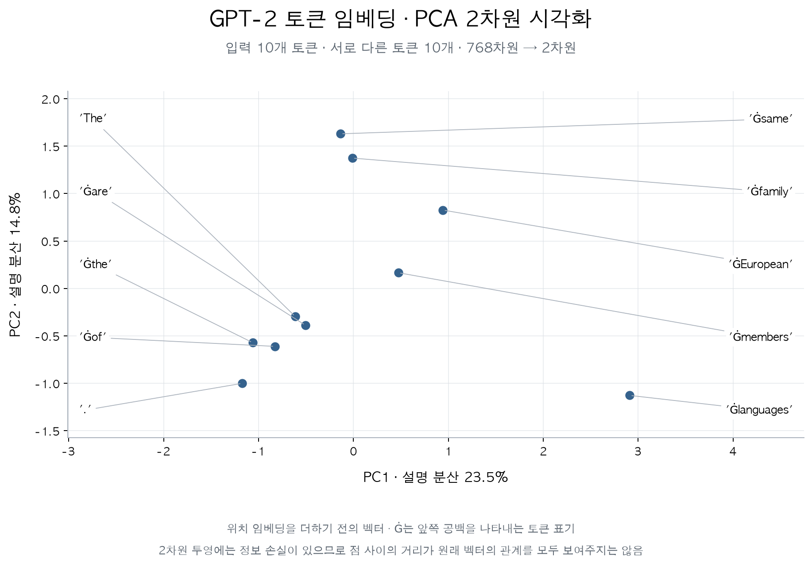

---

## 3. Self-Attention과 Multi-Head Attention 구현

[2.3절](#23-임베딩-결합-구현)에서는 토큰 임베딩과 위치 임베딩을 더해 입력 벡터를 만들었다. 이번에는 **각 토큰이 다른 위치를 얼마나 참고할지 정하고, 그 비율로 정보를 섞어 새 벡터를 만드는 과정**을 구현했다.

Q·K·V와 가중치의 관계가 헷갈렸는데, [코딩 오페라의 설명](https://codingopera.tistory.com/43)을 그림과 함께 읽으며 이해하는 데 도움을 받았다. 아래는 `SelfAttention.ipynb`와 `multiHeadSelfAttention.ipynb`의 코드를 바탕으로 정리한 내용이다. 개념 설명과 코드 예시, 실행 검증에는 AI의 도움을 받았다.

[Transformer Explainer](https://poloclub.github.io/transformer-explainer/)의 기본 예제에서 Attention을 펼치고 head를 바꾼 화면도 캡처해 넣었다. 사이트는 학습된 GPT-2를 사용한다. 무작위 가중치를 쓴 내 코드와 수치는 다르지만, 각 계산이 무엇을 바꾸는지 볼 수 있다.

- [3.1. Single-head: 참고 비율로 V 섞기](#31-single-head-self-attention-구현)
- [3.2. Multi-head: 여러 비율로 계산하고 조합하기](#32-multi-head-self-attention-구현)
- [3.3. 어텐션 맵으로 Single-head와 Multi-head 비교](#33-어텐션-맵으로-single-head와-multi-head-비교)

### 3.1. Single-head self-attention 구현

입력 문장은 `The European languages are members of the same family.`다. GPT-2 토크나이저로 나눈 토큰 10개를 각각 768차원으로 임베딩해, 입력 `x`의 크기는 `(10, 768)`이다. 아래 코드는 앞 단계에서 저장한 임베딩을 `x`로 불러온 상태에서 이어진다.

#### 3.1.1. 같은 입력에서 Q·K·V 만들기

같은 입력에 서로 다른 가중치를 곱해 세 가지 표현을 만든다. Q와 K는 참고할 대상을 비교하는 데, V는 실제 정보를 전달하는 데 사용한다.

<div class="llm-equation" role="region" aria-label="Q K V를 만드는 수식" tabindex="0">
<math xmlns="http://www.w3.org/1998/Math/MathML" display="block" aria-label="Q = X W_Q, K = X W_K, V = X W_V">
  <mtable columnalign="left">
    <mtr><mtd><mi>Q</mi><mo>=</mo><mi>X</mi><msub><mi>W</mi><mi>Q</mi></msub></mtd></mtr>
    <mtr><mtd><mi>K</mi><mo>=</mo><mi>X</mi><msub><mi>W</mi><mi>K</mi></msub></mtd></mtr>
    <mtr><mtd><mi>V</mi><mo>=</mo><mi>X</mi><msub><mi>W</mi><mi>V</mi></msub></mtd></mtr>
  </mtable>
</math>
</div>

| 구분 | 기호 · 코드 | 의미 |
|---|---|---|
| 입력 | X · `x` | 토큰·위치 임베딩을 더한 벡터들 |
| 가중치 | W_Q, W_K, W_V | 입력을 각 역할에 맞게 변환하는 행렬 |
| 출력 | Q · `Q` | 참고할 정보를 찾는 벡터들 |
| 출력 | K · `K` | Q와 비교할 벡터들 |
| 출력 | V · `V` | 가져와 섞을 특징 벡터들 |

[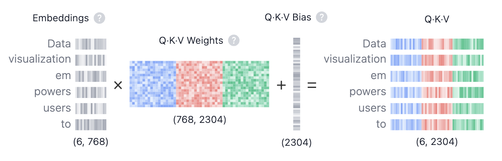](https://poloclub.github.io/transformer-explainer/)

*그림 출처: Georgia Tech Polo Club, [Transformer Explainer](https://poloclub.github.io/transformer-explainer/). 사이트 제작진이 제공한 설명 그림이다.*

그림에서는 Q·K·V를 한 번에 계산해 `2304 = 768 × 3`차원으로 표시하고 bias도 더한다. 아래 코드는 세 행렬을 나누어 계산하며 bias는 생략했다.

```python
import numpy as np

seq_len, d_model = x.shape
rng = np.random.default_rng(42)
scale = 1 / np.sqrt(d_model)

W_Q = rng.normal(0, scale, size=(d_model, d_model))
W_K = rng.normal(0, scale, size=(d_model, d_model))
W_V = rng.normal(0, scale, size=(d_model, d_model))

Q = x @ W_Q
K = x @ W_K
V = x @ W_V
```

Q·K·V의 역할은 **질문, 답변을 찾기 위한 소개, 실제 답변 내용**에 비유해 이해할 수 있다.

**Q(Query)는 현재 토큰을 이해하기 위한 질문이다.** 어떤 토큰에 대해 “이 토큰이 무엇을 뜻하나요?”라고 질문하는 표현을 만든다고 생각할 수 있다. 토큰의 입력 벡터 `x`에 `W_Q`를 곱해 `Q`로 나타낸다. 여기서 `W_Q`는 입력을 **질문 형식으로 바꾸는 규칙**과 비슷하다.

**K(Key)는 질문과 비교할 수 있도록 자신이 가진 정보를 소개하는 표현이다.** “이 토큰은 ~을 뜻합니다”라는 답변 형식에 비유할 수 있다. 입력 벡터 `x`에 `W_K`를 곱해 `K`를 만든다. `W_K`는 입력을 **질문과 대조할 수 있는 답변 형식으로 바꾸는 규칙**과 비슷하다.

**V(Value)는 관련 있는 토큰에서 실제로 가져올 내용이다.** K가 “내가 이런 정보를 가지고 있습니다”라는 소개라면, V는 “참고할 내용은 이것입니다”라고 전달하는 실제 정보에 해당한다. 입력 벡터 `x`에 `W_V`를 곱해, 다른 토큰에 전달하고 섞을 정보를 만든다.

여기서 질문과 답변은 벡터의 역할을 설명하기 위한 비유다. 실제 모델에서 `W_Q`, `W_K`, `W_V`는 학습을 통해 각 역할에 필요한 표현을 만드는 변환 행렬이다. 위 예제에서는 계산 흐름을 확인하기 위해 무작위 값으로 초기화했다.

==blue:같은 층의 모든 토큰은 같은 가중치 행렬을 사용한다.== `Q[0] = x[0] @ W_Q`, `Q[1] = x[1] @ W_Q`처럼 변환 규칙은 같고 입력이 달라 결과도 달라진다. 다른 층은 일반적으로 자신의 가중치를 따로 가진다.

가중치의 크기는 `(768, 768)`, Q·K·V는 각각 `(10, 768)`이다. `@`는 행렬곱이다. 같은 위치의 원소끼리 곱하는 `*`와는 다르다.

#### 3.1.2. Q와 K를 비교해 점수 계산하기

현재 토큰의 질문 `q_i`와 다른 토큰의 답변 소개 `k_j`를 내적으로 비교한다. 같은 질문을 기준으로 내적값이 클수록, 모델이 두 표현의 관련성을 높게 평가한 것이다. 질문·답변 비유로 보면 **“이 질문에는 어떤 답변이 더 관련 있는가?”를 점수로 나타내는 과정**이다. 이를 모든 토큰 쌍에 대해 계산한 결과가 점수 행렬이다.

이 점수를 스케일링하고 mask와 softmax를 적용해 참고 비율을 구한다. 그 비율로 각 토큰의 **실제 내용인 V를 가져와 섞는다.**

<div class="llm-equation" role="region" aria-label="Q와 K로 점수를 계산하는 수식" tabindex="0">
<math xmlns="http://www.w3.org/1998/Math/MathML" display="block" aria-label="S = Q K의 전치 / 루트 d_k">
  <mrow><mi>S</mi><mo>=</mo><mfrac><mrow><mi>Q</mi><msup><mi>K</mi><mi mathvariant="normal">T</mi></msup></mrow><msqrt><msub><mi>d</mi><mi>k</mi></msub></msqrt></mfrac></mrow>
</math>
</div>

| 구분 | 기호 · 코드 | 의미 |
|---|---|---|
| 입력 | Q, K | 토큰 사이의 관련성을 비교할 벡터들 |
| 차원 | dₖ · `d_k` | 내적하는 벡터의 길이. 여기서는 768 |
| 출력 | S · `scores` | 각 토큰이 다른 토큰을 참고할 점수 |

```python
scores = Q @ K.T

d_k = Q.shape[-1]
scores = scores / np.sqrt(d_k)

print(scores.shape)  # (10, 10)
```

`K.T`는 K의 각 행에 있던 토큰 벡터를 열로 세운다. Q의 각 행과 K의 각 열을 내적하므로 `(10, 768) @ (768, 10)`의 결과는 `(10, 10)`이다.

`scores[i, j]`는 i번째 토큰이 j번째 토큰을 참고할 점수다. **행은 정보를 가져오는 쪽, 열은 정보를 제공하는 쪽**으로 읽으면 된다.

내적 차원이 커질수록 점수의 크기도 커지기 쉽다. 이때 softmax가 한쪽에 지나치게 쏠릴 수 있어 `sqrt(d_k)`로 나눠 크기를 조절한다.

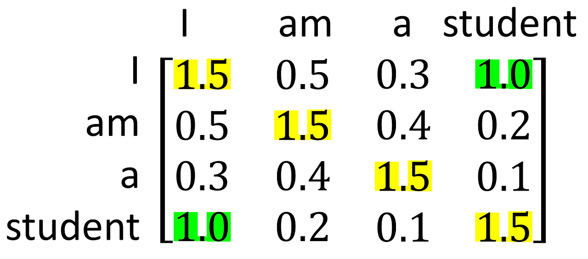

*그림 출처: 코딩 오페라, [4-1. Transformer(Self Attention)](https://codingopera.tistory.com/43). 설명용 점수이며 이 코드의 실행 결과는 아니다.*

그림에서 `I` 행과 `student` 열의 `1.0`은 `I`가 `student`를 참고할 점수다. 노란 대각선은 자기 자신과의 점수, 초록색은 두 위치 사이의 점수를 강조한다.

==orange:아직 softmax를 적용하지 않았으므로 점수는 확률이 아니다.== 이 예시는 대칭이고 대각선 값이 가장 크지만, 실제 Q와 K는 서로 다른 가중치로 만들어져 그런 성질이 보장되지는 않는다.

#### 3.1.3. Causal mask로 미래 위치 차단하기

다음 토큰을 예측할 때는 현재 위치까지의 정보만 사용해야 한다. 현재 위치의 출력으로 **그다음 토큰을 예측**하므로 자기 자신은 볼 수 있고, 미래 위치는 볼 수 없다.

```python
future_mask = np.triu(
    np.ones((seq_len, seq_len), dtype=bool),
    k=1,
)
masked_scores = np.where(future_mask, -np.inf, scores)
```

`np.triu(..., k=1)`은 대각선 바로 위부터 `True`로 만든다. `np.where`는 그 위치의 점수를 `-inf`로 바꾸고 나머지는 유지한다. 앞의 그림에서는 `I → student`가 차단되고 `student → I`는 허용된다.

0이 아니라 `-inf`를 넣는 이유는 다음 softmax 계산에 있다. `exp(-inf)`는 0이 되지만 `exp(0)`은 1이다. 점수를 0으로 바꾸는 것만으로는 그 위치를 차단할 수 없다.

#### 3.1.4. Softmax로 참고 비율 구하기

각 행의 점수를 softmax에 넣어 합이 1인 참고 비율로 바꾼다. 수식에서는 허용 위치가 0이고 차단 위치가 −∞인 mask M을 점수에 더한다. 위 코드의 `np.where`도 같은 효과를 낸다.

<div class="llm-equation" role="region" aria-label="점수와 mask로 참고 비율을 계산하는 수식" tabindex="0">
<math xmlns="http://www.w3.org/1998/Math/MathML" display="block" aria-label="A = softmax(S + M)">
  <mrow><mi>A</mi><mo>=</mo><mi mathvariant="normal">softmax</mi><mo>(</mo><mi>S</mi><mo>+</mo><mi>M</mi><mo>)</mo></mrow>
</math>
</div>

| 구분 | 기호 · 코드 | 의미 |
|---|---|---|
| 입력 | S · `scores` | 토큰 사이의 점수 |
| mask | M | 허용 위치는 0, 미래 위치는 −∞ |
| 출력 | A · `weights` | 각 토큰에서 정보를 가져올 비율 |

```python
shifted_scores = masked_scores - np.max(
    masked_scores,
    axis=-1,
    keepdims=True,
)
exp_scores = np.exp(shifted_scores)
weights = exp_scores / np.sum(
    exp_scores,
    axis=-1,
    keepdims=True,
)
```

먼저 각 행의 최댓값을 빼 지수 계산이 너무 커지는 것을 줄인다. 같은 행에서 같은 값을 빼도 최종 softmax 비율은 바뀌지 않는다. 이후 지수 함수를 적용하고, 각 값을 그 행의 합으로 나눈다.

`axis=-1`은 마지막 축을 따라 계산한다는 뜻이다. 여기서는 한 Query가 참고할 Key들의 점수를 대상으로 한다. `keepdims=True`는 행별 최댓값과 합을 `(10, 1)`로 유지한다. 덕분에 `(10, 10)` 배열의 각 행에 맞춰 빼거나 나눌 수 있다.

<div class="llm-example" role="note" aria-label="softmax 계산 예시">

**예시**

토큰 세 개에 대한 가상 점수 한 행을 계산하면 다음과 같다. 값은 소수점 넷째 자리까지 반올림했다.

```text
점수             [2,      1,     -inf]
최댓값 빼기      [0,     -1,     -inf]
지수 함수 적용   [1,      0.3679, 0   ]
행의 합으로 나눔 [0.7311, 0.2689, 0   ]
```

첫 번째 토큰을 약 73.1%, 두 번째 토큰을 약 26.9% 참고한다. 차단된 세 번째 위치의 비율은 0이다.

</div>

실제 입력에서 세 번째 토큰의 비율 `weights[2]`는 다음과 같았다.

```text
[0.3296048  0.33390219 0.33649301 0. 0. 0. 0. 0. 0. 0.]
```

앞의 두 토큰과 자기 자신에게만 비율이 배정됐다. 미래 위치는 모두 0이고, `weights.sum(axis=-1)`로 확인한 각 행의 합은 약 1이었다.

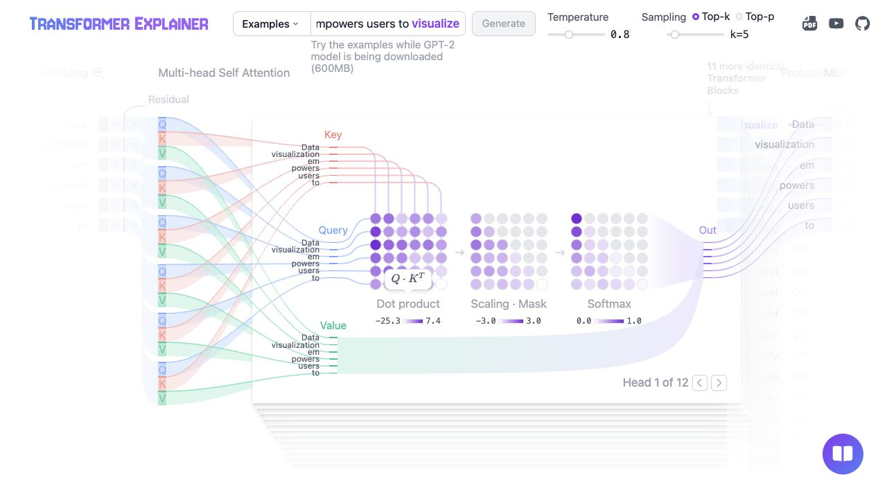

*화면 출처: [Transformer Explainer](https://poloclub.github.io/transformer-explainer/). AI 도구로 기본 예제의 Attention을 펼쳐 캡처했다. 내 NumPy 코드의 실행 결과는 아니다.*

세 행렬을 왼쪽부터 보면 코드의 흐름과 같다. `Dot product`는 Q·K의 내적 점수다. `Scaling · Mask`에서는 점수 크기를 조절하고 오른쪽 위의 미래 위치를 차단한다. `Softmax`는 이를 0~1의 참고 비율로 바꾼다. 이 head는 여러 행에서 첫 번째 토큰을 많이 참고한다.

#### 3.1.5. 비율로 V를 섞어 새 벡터 만들기

처음에는 `weights`에 이미 문맥이 반영되어 있는데 왜 V를 곱하는지 헷갈렸다. `weights`에는 **참고 비율**이, V에는 그 비율을 적용할 **특징값**이 들어 있다.

<div class="llm-equation" role="region" aria-label="참고 비율로 V를 가중합하는 수식" tabindex="0">
<math xmlns="http://www.w3.org/1998/Math/MathML" display="block" aria-label="Z = A V, z_i = j가 1부터 T까지인 A_ij v_j의 합">
  <mtable columnalign="left">
    <mtr><mtd><mi>Z</mi><mo>=</mo><mi>A</mi><mi>V</mi></mtd></mtr>
    <mtr><mtd><msub><mi>z</mi><mi>i</mi></msub><mo>=</mo><munderover><mo>∑</mo><mrow><mi>j</mi><mo>=</mo><mn>1</mn></mrow><mi>T</mi></munderover><msub><mi>A</mi><mrow><mi>i</mi><mi>j</mi></mrow></msub><msub><mi>v</mi><mi>j</mi></msub></mtd></mtr>
  </mtable>
</math>
</div>

| 구분 | 기호 · 코드 | 의미 |
|---|---|---|
| 입력 | A · `weights` | 토큰별 참고 비율. 한 행에 10개 |
| 입력 | V · `V` | 토큰별 특징 벡터. 한 행에 768개 성분 |
| 출력 | Z · `context` | 비율에 따라 특징을 섞은 토큰별 새 벡터 |

아래쪽 식은 i번째 출력 하나를 풀어 쓴 것이다. T는 토큰 수이며, 각 토큰의 V에 그 토큰을 참고할 비율을 곱해 더한다.

```python
context = weights @ V
print(context.shape)  # (10, 768)
```

위에서 구한 세 번째 토큰의 비율을 적용하면 다음 세 항만 남는다. 미래 위치의 비율은 0이므로 결과에 영향을 주지 않는다.

```text
context[2] ≈ 0.3296048  × V[0]
           + 0.33390219 × V[1]
           + 0.33649301 × V[2]
```

`weights @ V`는 이 가중합을 모든 토큰에 대해 한꺼번에 계산한다. 새로운 참고 비율을 정하는 것이 아니라, Q와 K로 정한 비율을 V의 특징값에 적용하는 것이다.

==yellow:비율은 벡터 일부를 고르는 것이 아니라 전체 벡터의 기여량을 조절한다.== 25%를 참고한다면 해당 V의 768개 성분 모두에 0.25를 곱한다.

K와 V를 따로 만드는 이유는 비교할 특징과 전달할 특징을 각각 학습하기 위해서다. `W_K`는 관련성을 비교할 표현을, `W_V`는 다른 토큰에 전달할 표현을 만든다.

### 3.2. Multi-head self-attention 구현

Single-head에서는 한 토큰의 참고 비율을 V의 768개 성분 전체에 적용했다. Multi-head는 같은 입력에서 여러 특징 묶음을 만들고 **묶음마다 별도의 참고 비율**을 계산한다. 어떤 묶음은 한 토큰을, 다른 묶음은 다른 토큰을 더 많이 반영할 수 있다.

각 head의 역할을 미리 지정하지는 않는다. 어떤 관계와 특징을 사용할지는 학습으로 정해진다.

#### 3.2.1. Q·K·V를 head별로 나누기

앞에서 만든 `(10, 768)` 크기의 Q·K·V를 사용한다. Head 수를 12개로 정하면 head 하나의 차원은 `768 / 12 = 64`다. **토큰 수가 아니라, 변환된 Q·K·V의 특징 차원을 나눈다.**

```python
num_heads = 12
assert d_model % num_heads == 0
d_head = d_model // num_heads

Q_heads = Q.reshape(seq_len, num_heads, d_head)
print(Q_heads.shape)  # (10, 12, 64)
```

현재 축 순서는 `(토큰, head, 성분)`이다. `Q_heads[0, 0]`은 첫 번째 토큰의 첫 번째 head Q이고, `Q_heads[0, 1]`은 같은 토큰의 두 번째 head Q다.

Head별로 계산하기 편하도록 head 축을 앞으로 옮긴다. K와 V에도 같은 변환을 적용한다.

```python
Q_heads = Q_heads.transpose(1, 0, 2)
K_heads = K.reshape(seq_len, num_heads, d_head).transpose(1, 0, 2)
V_heads = V.reshape(seq_len, num_heads, d_head).transpose(1, 0, 2)

print(Q_heads.shape)  # (12, 10, 64)
```

이제 축 순서는 `(head, 토큰, 성분)`이다. `Q_heads[0]`에는 첫 번째 head가 사용할 토큰 10개의 Q가 `(10, 64)` 배열로 들어 있다. 모든 head가 모든 토큰을 대상으로 계산한다.

Head별 가중치는 큰 `W_Q`의 출력 열에 나뉘어 있다. `W_Q[:, :64]`는 첫 번째 head, `W_Q[:, 64:128]`은 두 번째 head에 해당한다. 따라서 `Q_heads[0]`은 `x @ W_Q[:, :64]`와 같다.

**각 head는 입력의 768개 성분 전체를 보고 자기 64차원 표현을 만든다.** 입력 `x`를 64개씩 잘라 쓰는 구조가 아니다. K와 V도 같은 방식이다.

#### 3.2.2. Head마다 점수와 참고 비율 계산하기

Single-head와 같은 계산을 12개 head에 대해 수행한다.

```python
head_scores = Q_heads @ K_heads.swapaxes(-1, -2)
head_scores = head_scores / np.sqrt(d_head)

print(head_scores.shape)  # (12, 10, 10)
```

`swapaxes(-1, -2)`는 K의 마지막 두 축만 바꾼다. `(12, 10, 64)`가 `(12, 64, 10)`이 되어 각 head 안에서 행렬곱을 수행할 수 있다. 3차원 배열에 `.T`를 쓰면 모든 축 순서가 뒤집히므로 여기서는 사용하지 않는다.

`head_scores[h, i, j]`는 h번째 head에서 i번째 토큰이 j번째 토큰을 참고할 점수다. 내적 차원도 head 하나의 길이인 64를 사용한다.

같은 `(10, 10)` mask를 모든 head에 적용하고, 마지막 축으로 softmax를 계산한다.

```python
head_masked_scores = np.where(future_mask, -np.inf, head_scores)
shifted_scores = head_masked_scores - np.max(
    head_masked_scores,
    axis=-1,
    keepdims=True,
)
exp_scores = np.exp(shifted_scores)
head_weights = exp_scores / np.sum(
    exp_scores,
    axis=-1,
    keepdims=True,
)

print(head_weights.shape)  # (12, 10, 10)
```

Mask는 broadcasting으로 12개 head에 각각 적용된다. 각 head의 각 행은 합이 1인 참고 비율이다. Single-head의 `(10, 10)` 행렬이 이제 head별로 하나씩 생긴 것이다.

#### 3.2.3. 각 head의 비율로 V 섞기

```python
head_context = head_weights @ V_heads
print(head_context.shape)  # (12, 10, 64)
```

각 head가 자기 참고 비율로 자기 V를 가중합한다. 이때 **해당 head의 V에 있는 64개 성분 전체에 같은 비율**을 적용한다. 다른 head는 자신의 Q·K로 계산한 다른 비율을 사용할 수 있다.

결과적으로 같은 토큰에 대해 head별로 64차원 벡터가 하나씩 만들어진다.

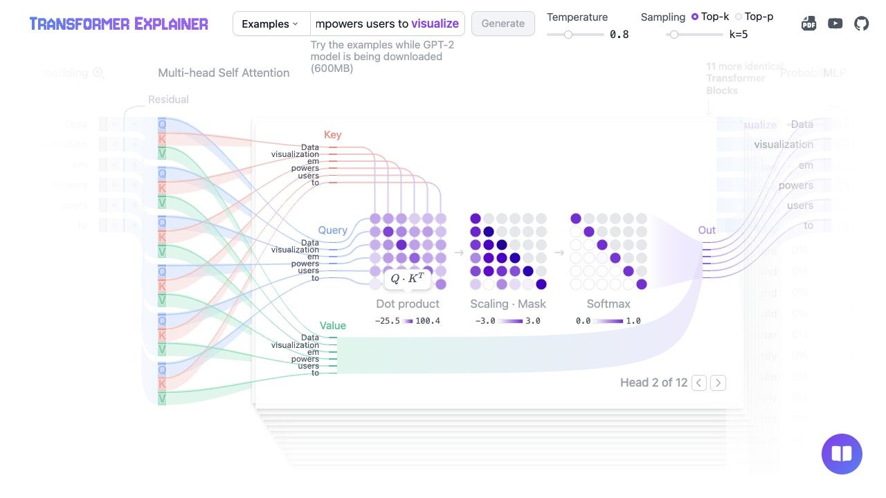

*같은 기본 예제에서 Head 2로 바꾸고 Attention을 펼쳐 캡처했다. 화면 출처: [Transformer Explainer](https://poloclub.github.io/transformer-explainer/).*

앞의 Head 1과 달리 Head 2의 `Softmax`는 대각선이 진하다. 자기 위치를 많이 참고한다는 뜻이다. **같은 입력이어도 head마다 참고 비율이 다르다.** 아래쪽 초록색 `Value`가 보라색 `Out`으로 이어지는 흐름은 그 비율로 V를 섞는 `head_weights @ V_heads`에 대응한다.

#### 3.2.4. 같은 토큰의 head 결과끼리 이어 붙이기

현재 배열은 `(head, 토큰, 성분)` 순서다. 같은 토큰의 결과끼리 모이도록 토큰 축을 앞으로 옮긴 뒤 마지막 두 축을 합친다.

```python
merged_context = head_context.transpose(1, 0, 2)
print(merged_context.shape)  # (10, 12, 64)

merged_context = merged_context.reshape(seq_len, d_model)
print(merged_context.shape)  # (10, 768)
```

토큰 하나의 벡터는 `[head 1의 64개 | head 2의 64개 | ... | head 12의 64개]`로 이어진다. **transpose 후 reshape** 순서를 지켜야 서로 다른 토큰의 결과가 섞이지 않는다.

#### 3.2.5. W_O로 head들의 특징 조합하기

Head 결과를 합쳤으니 끝난 것 아닌가 싶었는데, 이어 붙이기는 결과를 나란히 놓는 연산이다. `W_O`는 **여러 head가 만든 성분을 어떻게 조합할지 학습하는 행렬**이다.

<div class="llm-equation" role="region" aria-label="head 연결과 출력 투영 수식" tabindex="0">
<math xmlns="http://www.w3.org/1998/Math/MathML" display="block" aria-label="C = Concat(Z_1, ..., Z_H), Y = C W_O">
  <mtable columnalign="left">
    <mtr><mtd><mi>C</mi><mo>=</mo><mi mathvariant="normal">Concat</mi><mo>(</mo><msub><mi>Z</mi><mn>1</mn></msub><mo>,</mo><mo>…</mo><mo>,</mo><msub><mi>Z</mi><mi>H</mi></msub><mo>)</mo></mtd></mtr>
    <mtr><mtd><mi>Y</mi><mo>=</mo><mi>C</mi><msub><mi>W</mi><mi>O</mi></msub></mtd></mtr>
  </mtable>
</math>
</div>

| 구분 | 기호 · 코드 | 의미 |
|---|---|---|
| 입력 | Z₁ … Z_H · `head_context` | H개 head가 만든 결과. 여기서는 H = 12 |
| 중간 결과 | C · `merged_context` | 같은 토큰의 head 결과를 이어 붙인 벡터 |
| 가중치 | W_O · `W_O` | head들의 특징을 조합하는 행렬 |
| 출력 | Y · `output` | 특징을 조합한 최종 토큰 벡터들 |

```python
W_O = rng.normal(0, 1 / np.sqrt(d_model), size=(d_model, d_model))
output = merged_context @ W_O

print(output.shape)  # (10, 768)
```

<div class="llm-example" role="note" aria-label="W_O로 head 결과를 조합하는 예시">

**예시**

Head 두 개의 결과가 각각 `[2]`, `[5]`라고 가정하면, 이어 붙인 값은 `[2, 5]`다. 여기에 아래 행렬을 곱하면 두 head의 값을 더하거나 빼서 새 특징을 만든다.

```python
np.array([2, 5]) @ np.array([[1, 1], [1, -1]])  # [7, -3]
```

설명용 숫자이며 노트북의 실제 출력은 아니다.

</div>

`head_weights`는 **토큰 사이의 정보**를 섞고, `W_O`는 **head들이 만든 특징 성분**을 섞는다. `W_O`는 참고 확률이 아니므로 음수도 가능하고 합이 1일 필요도 없다. 다른 가중치처럼 한 번 초기화하고 같은 층의 모든 토큰과 다음 입력에 재사용한다.

#### 3.2.6. 실행 결과

코드를 처음부터 실행했을 때 배열 크기는 다음과 같았다.

| 단계 | 크기 | 각 축의 의미 |
|---|---|---|
| Q, K, V | 각각 `(10, 768)` | 토큰, 전체 특징 |
| head별 Q, K, V | 각각 `(12, 10, 64)` | head, 토큰, head의 특징 |
| head별 점수와 참고 비율 | `(12, 10, 10)` | head, 참고하는 토큰, 참고할 토큰 |
| head별 V 가중합 | `(12, 10, 64)` | head, 토큰, head의 특징 |
| 이어 붙인 결과와 최종 출력 | 각각 `(10, 768)` | 토큰, 특징 |

Head별 참고 비율의 행 합은 약 1이고 미래 위치의 비율은 0이었다. 최종 출력에는 NaN이나 무한대가 없었다. 입력과 출력의 크기는 같지만, 출력은 다른 토큰의 정보를 반영한 새 표현이다.

이 단계에서는 Attention까지 구현했다. Transformer 블록을 구성할 LayerNorm·잔차 연결·FFN과 다음 토큰 점수를 만드는 어휘 출력층은 4장에서 이어서 연결한다.

### 3.3. 어텐션 맵으로 Single-head와 Multi-head 비교

`AttentionMapComparison.ipynb`에서 같은 `x`, `W_Q`, `W_K`, `W_V`로 계산한 참고 비율을 비교했다. 비교 코드와 시각화는 AI의 도움을 받아 작성했다.

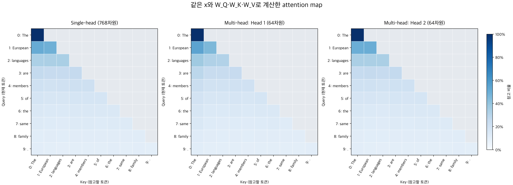

*왼쪽은 Single-head, 가운데와 오른쪽은 Multi-head의 Head 1·2다. 행은 현재 토큰, 열은 참고할 토큰이며, 진한 파란색일수록 참고 비율이 높다. 회색은 차단된 미래 위치다.*

Single-head는 768차원 전체로 하나의 참고 비율 맵을 만든다. Multi-head는 64차원씩 나눠 head마다 따로 계산하므로, **같은 입력과 가중치라도 참고 비율이 달라진다.**

현재 가중치는 랜덤값이라, 이 차이를 학습된 의미 관계로 해석할 수는 없다. `family`가 `members`를 많이 참고해야 하는 것도 아니다. **추후에는 GPT-2의 학습된 가중치를 적용해 어텐션 맵을 비교해볼 계획이다.**

### 3.4. 참고 자료

- [코딩 오페라 — 4-1. Transformer(Self Attention)](https://codingopera.tistory.com/43): Q·K·V와 점수 행렬을 이해할 때 참고한 글과 그림 출처.
- [Georgia Tech Polo Club — Transformer Explainer](https://poloclub.github.io/transformer-explainer/): Q·K·V, attention 행렬, head별 계산을 직접 조작해 볼 수 있는 시각화와 설명 그림.

---

## 4. Transformer 블록과 전체 순전파 구현

[3장](#3-self-attention과-multi-head-attention-구현)에서는 Multi-Head Masked Self-Attention까지 구현했다. 전체 순전파를 조립하기 전에, 블록을 구성하는 나머지 연산인 LayerNorm, 잔차 연결, FFN의 원리와 코드를 정리한다.


### 4.1. LayerNorm

LayerNorm은 입력을 정규화하기 위해 사용한다. 입력 `x`의 크기가 `(seq_len, 768)`이라면, 토큰 하나를 나타내는 **각 행의 768개 성분 안에서 평균과 분산을 계산**한다.

<div class="llm-equation">
<math xmlns="http://www.w3.org/1998/Math/MathML" display="block" aria-label="정규화된 x_i = (x_i - 평균) / 루트(분산 + 엡실론)">
  <mrow><msub><mover><mi>x</mi><mo>^</mo></mover><mi>i</mi></msub><mo>=</mo><mfrac><mrow><msub><mi>x</mi><mi>i</mi></msub><mo>−</mo><mi>μ</mi></mrow><msqrt><mrow><msup><mi>σ</mi><mn>2</mn></msup><mo>+</mo><mi>ϵ</mi></mrow></msqrt></mfrac></mrow>
</math>
</div>

`μ`는 해당 토큰 벡터의 평균, `σ²`는 분산이다. 평균을 빼서 중심을 0으로 옮기고, 표준편차로 나눠 값이 퍼진 정도를 조절한다. `ϵ`는 분산이 0이거나 아주 작을 때도 나눗셈을 안정적으로 계산하기 위한 작은 값이다.

이렇게 하면 벡터의 전체적인 크기와 평균을 정돈해, 다음 층이 입력 스케일의 변화에 지나치게 영향받지 않도록 돕는다. 다른 토큰과 평균을 내는 연산은 아니다.

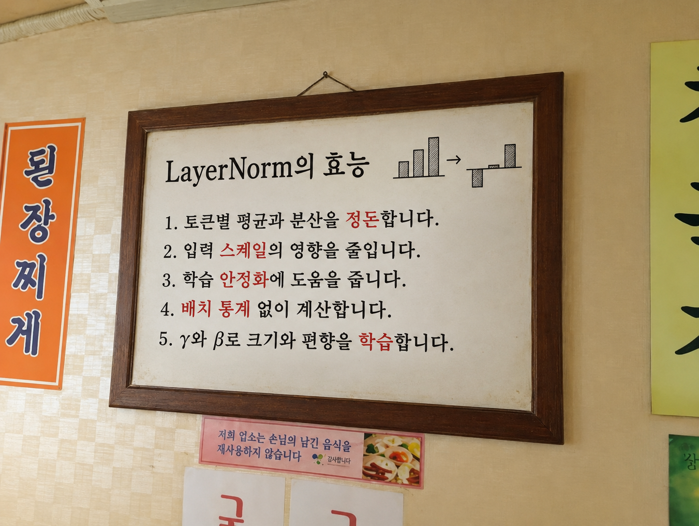

GPT-2의 LayerNorm은 여기서 끝나지 않고, 정규화한 값에 **학습 가능한 `γ`를 곱하고 `β`를 더한다.**


<div class="llm-equation">
<math xmlns="http://www.w3.org/1998/Math/MathML" display="block" aria-label="LayerNorm(x)_i = 감마_i 곱하기 정규화된 x_i + 베타_i">
  <mrow><mi mathvariant="normal">LayerNorm</mi><mo>(</mo><mi>x</mi><msub><mo>)</mo><mi>i</mi></msub><mo>=</mo><msub><mi>γ</mi><mi>i</mi></msub><msub><mover><mi>x</mi><mo>^</mo></mover><mi>i</mi></msub><mo>+</mo><msub><mi>β</mi><mi>i</mi></msub></mrow>
</math>
</div>

`γ`와 `β`의 크기는 각각 `(768,)`이고, 같은 LayerNorm을 지나는 모든 토큰이 공유한다. 평균과 분산은 입력마다 다시 계산하지만, `γ`와 `β`는 학습 파라미터다. 따라서 최종 출력의 평균과 분산이 항상 0과 1인 것은 아니다.

```python
import numpy as np

def layer_norm(x, gamma, beta, eps=1e-5):
    mean = np.mean(x, axis=-1, keepdims=True)
    var = np.var(x, axis=-1, keepdims=True)

    normalized = (x - mean) / np.sqrt(var + eps)
    return gamma * normalized + beta


# x: 앞 단계에서 만든 (seq_len, d_model) 입력
d_model = x.shape[-1]
gamma_1 = np.ones(d_model)
beta_1 = np.zeros(d_model)

x_norm = layer_norm(x, gamma_1, beta_1)
```

`axis=-1`로 마지막 차원인 벡터 성분 방향을 계산한다. `keepdims=True`를 쓰면 평균과 분산의 크기가 `(seq_len, 1)`로 유지돼 각 행에 맞춰 뺄셈과 나눗셈이 적용된다. `np.var`는 기본값인 `ddof=0`을 사용한다.

### 4.2. 잔차연결

<div class="llm-equation">
<math xmlns="http://www.w3.org/1998/Math/MathML" display="block" aria-label="y = x + F(x)">
  <mrow><mi>y</mi><mo>=</mo><mi>x</mi><mo>+</mo><mi>F</mi><mo>(</mo><mi>x</mi><mo>)</mo></mrow>
</math>
</div>

잔차 연결은 계산 결과 `F(x)`와 원래 입력 `x`를 더하는 것이다. 입력을 그대로 전달하는 것이 유리한 상황에서도, 매번 새로운 변환만 거치게 되면 필요한 표현이 달라질 수 있다. 잔차 연결은 **입력이 직접 전달되는 경로를 두고, 그 위에 계산한 변화를 더하도록 한다.**

`F(x)`가 0에 가까우면 입력이 거의 그대로 전달된다. 다만 원래 입력이 별도로 저장되는 것은 아니며, 더한 결과도 입력과 달라질 수 있다.

<div class="llm-example" role="note" aria-label="사진 보정으로 이해하는 잔차 연결 예시">

**예시**

사진의 밝기만 조금 높이는 상황에 비유할 수 있다.

- **잔차 연결 없음:** 모델이 보정된 사진 전체를 만들어야 하므로, 밝기를 바꾸려다 원래 모습까지 달라질 수 있다.
- **잔차 연결 있음:** 원본 사진을 직접 전달하고 밝기 보정량만 더하도록 학습할 수 있다.

</div>

GPT-2에서는 LayerNorm을 거친 입력으로 Attention을 계산하고, 그 결과를 **정규화하기 전의 입력** `x`에 더한다.

<div class="llm-equation">
<math xmlns="http://www.w3.org/1998/Math/MathML" display="block" aria-label="h = x + Attention(LayerNorm_1(x))">
  <mrow><mi>h</mi><mo>=</mo><mi>x</mi><mo>+</mo><mi mathvariant="normal">Attention</mi><mo>(</mo><msub><mi mathvariant="normal">LayerNorm</mi><mn>1</mn></msub><mo>(</mo><mi>x</mi><mo>)</mo><mo>)</mo></mrow>
</math>
</div>

```python
# output: x_norm으로 Q, K, V부터 계산한 어텐션 출력
# x는 정규화하기 전의 입력으로 유지한다.
assert x.shape == output.shape
h = x + output
```

입력과 출력 크기를 확인하는 것은 NumPy의 브로드캐스팅으로 의도와 다른 덧셈이 일어나는 것을 막기 위해서다. 잔차 연결 자체에는 별도의 학습 파라미터가 없다.

입력에서 출력으로 직접 이어지는 경로는 역전파 때 기울기가 전달될 경로도 제공하므로, 깊은 모델의 학습을 돕는다.


### 4.3. FFN

FFN은 토큰 벡터의 성분들을 조합하고 **비선형적으로 변환**한다. Attention이 토큰 사이에서 정보를 가져왔다면, FFN은 그 정보가 반영된 각 토큰 벡터를 가공한다. 모든 토큰에 같은 가중치를 적용하지만, FFN 내부에서 토큰끼리 직접 정보를 섞지는 않는다.

<div class="llm-equation">
<math xmlns="http://www.w3.org/1998/Math/MathML" display="block" aria-label="FFN(z) = GELU(z W_1 + b_1) W_2 + b_2">
  <mrow><mi mathvariant="normal">FFN</mi><mo>(</mo><mi>z</mi><mo>)</mo><mo>=</mo><mi mathvariant="normal">GELU</mi><mo>(</mo><mi>z</mi><msub><mi>W</mi><mn>1</mn></msub><mo>+</mo><msub><mi>b</mi><mn>1</mn></msub><mo>)</mo><msub><mi>W</mi><mn>2</mn></msub><mo>+</mo><msub><mi>b</mi><mn>2</mn></msub></mrow>
</math>
</div>

여기서 `z`는 두 번째 LayerNorm을 통과한 FFN 입력이다. GPT-2 small을 기준으로 계산 순서와 차원은 다음과 같다.

<div class="llm-equation">
<math xmlns="http://www.w3.org/1998/Math/MathML" display="block" aria-label="z = LayerNorm_2(h)">
  <mrow><mi>z</mi><mo>=</mo><msub><mi mathvariant="normal">LayerNorm</mi><mn>2</mn></msub><mo>(</mo><mi>h</mi><mo>)</mo></mrow>
</math>
</div>

앞선 잔차 연결의 결과 `h`를 정규화해 FFN의 입력 `z`를 만든다.

<div class="llm-equation">
<math xmlns="http://www.w3.org/1998/Math/MathML" display="block" aria-label="a = z W_1 + b_1">
  <mrow><mi>a</mi><mo>=</mo><mi>z</mi><msub><mi>W</mi><mn>1</mn></msub><mo>+</mo><msub><mi>b</mi><mn>1</mn></msub></mrow>
</math>
</div>

가중치 `W₁`과 편향 `b₁`로 입력 성분을 조합해, 768차원을 3072차원으로 넓힌다.

<div class="llm-equation">
<math xmlns="http://www.w3.org/1998/Math/MathML" display="block" aria-label="u = GELU(a)">
  <mrow><mi>u</mi><mo>=</mo><mi mathvariant="normal">GELU</mi><mo>(</mo><mi>a</mi><mo>)</mo></mrow>
</math>
</div>

각 성분에 GELU를 적용해 비선형으로 변환한다. 차원은 3072로 유지된다.

<div class="llm-equation">
<math xmlns="http://www.w3.org/1998/Math/MathML" display="block" aria-label="FFN(z) = u W_2 + b_2">
  <mrow><mi mathvariant="normal">FFN</mi><mo>(</mo><mi>z</mi><mo>)</mo><mo>=</mo><mi>u</mi><msub><mi>W</mi><mn>2</mn></msub><mo>+</mo><msub><mi>b</mi><mn>2</mn></msub></mrow>
</math>
</div>

가중치 `W₂`와 편향 `b₂`로 중간 특징을 다시 조합해, 원래의 768차원으로 돌려놓는다.

| 단계 | 벡터 크기 | 하는 일 |
| --- | --- | --- |
| 입력 `z` | `(seq_len, 768)` | 토큰별 입력 벡터 |
| 첫 번째 선형 변환 `a` | `(seq_len, 3072)` | 성분들을 조합해 차원 확장 |
| GELU 적용 `u` | `(seq_len, 3072)` | 비선형 변환 |
| 두 번째 선형 변환 | `(seq_len, 768)` | 원래 차원으로 변환 |

3072차원으로 늘리는 것은 입력을 네 번 복사하는 것이 아니다. 서로 다른 가중치로 입력 성분을 조합해 더 많은 중간 특징을 만들고, 마지막 변환에서 다시 768차원으로 모은다.

중간에 적용하는 GELU의 GPT-2 근사식은 다음과 같다.

<div class="llm-equation">
<math xmlns="http://www.w3.org/1998/Math/MathML" display="block" aria-label="GELU(t)는 0.5 t 곱하기 [1 + tanh(루트(2/파이) 곱하기 (t + 0.044715 t의 세제곱))]로 근사한다">
  <mrow><mi mathvariant="normal">GELU</mi><mo>(</mo><mi>t</mi><mo>)</mo><mo>≈</mo><mfrac><mi>t</mi><mn>2</mn></mfrac><mo>[</mo><mn>1</mn><mo>+</mo><mi mathvariant="normal">tanh</mi><mo>(</mo><msqrt><mfrac><mn>2</mn><mi>π</mi></mfrac></msqrt><mo>(</mo><mi>t</mi><mo>+</mo><mn>0.044715</mn><msup><mi>t</mi><mn>3</mn></msup><mo>)</mo><mo>)</mo><mo>]</mo></mrow>
</math>
</div>

<figure>
<svg style="color:var(--content-text-color, #37352f);max-width:100%;height:auto" role="img" aria-label="GPT-2 근사 GELU 그래프. 음수 입력에서는 작은 음수가 남고, 큰 양수에서는 y=t에 가까워진다." xmlns:xlink="http://www.w3.org/1999/xlink" width="100%" viewBox="0 0 532.8 316.8" xmlns="http://www.w3.org/2000/svg" version="1.1">
 
 <defs>
  <style type="text/css">*{stroke-linejoin: round; stroke-linecap: butt}</style>
 </defs>
 <g id="figure_1">
  <g id="patch_1">
   <path d="M 0 316.8 
L 532.8 316.8 
L 532.8 0 
L 0 0 
L 0 316.8 
z
" style="fill: none; opacity: 0"/>
  </g>
  <g id="axes_1">
   <g id="patch_2">
    <path d="M 45.08399 278.79976 
L 525.98226 278.79976 
L 525.98226 3.00024 
L 45.08399 3.00024 
L 45.08399 278.79976 
z
" style="fill: none"/>
   </g>
   <g id="matplotlib.axis_1">
    <g id="xtick_1">
     <g id="line2d_1">
      <path d="M 45.08399 278.79976 
L 45.08399 3.00024 
" clip-path="url(#p8895820bcd)" style="fill: none; stroke: currentColor; stroke-opacity: 0.16; stroke-width: 0.8; stroke-linecap: square"/>
     </g>
     <g id="line2d_2">
      <defs>
       <path id="m678034c6ba" d="M 0 0 
L 0 3.5 
" style="stroke: currentColor; stroke-width: 0.8"/>
      </defs>
      <g>
       <use xlink:href="#m678034c6ba" x="45.08399" y="278.79976" style="fill: currentColor; stroke: currentColor; stroke-width: 0.8"/>
      </g>
     </g>
     <g id="text_1">
      <text style="font-size: 12px; font-family: 'DejaVu Sans'; text-anchor: middle; fill: currentColor" x="45.08399" y="294.916947" transform="rotate(-0 45.08399 294.916947)">−3</text>
     </g>
    </g>
    <g id="xtick_2">
     <g id="line2d_3">
      <path d="M 125.233702 278.79976 
L 125.233702 3.00024 
" clip-path="url(#p8895820bcd)" style="fill: none; stroke: currentColor; stroke-opacity: 0.16; stroke-width: 0.8; stroke-linecap: square"/>
     </g>
     <g id="line2d_4">
      <g>
       <use xlink:href="#m678034c6ba" x="125.233702" y="278.79976" style="fill: currentColor; stroke: currentColor; stroke-width: 0.8"/>
      </g>
     </g>
     <g id="text_2">
      <text style="font-size: 12px; font-family: 'DejaVu Sans'; text-anchor: middle; fill: currentColor" x="125.233702" y="294.916947" transform="rotate(-0 125.233702 294.916947)">−2</text>
     </g>
    </g>
    <g id="xtick_3">
     <g id="line2d_5">
      <path d="M 205.383413 278.79976 
L 205.383413 3.00024 
" clip-path="url(#p8895820bcd)" style="fill: none; stroke: currentColor; stroke-opacity: 0.16; stroke-width: 0.8; stroke-linecap: square"/>
     </g>
     <g id="line2d_6">
      <g>
       <use xlink:href="#m678034c6ba" x="205.383413" y="278.79976" style="fill: currentColor; stroke: currentColor; stroke-width: 0.8"/>
      </g>
     </g>
     <g id="text_3">
      <text style="font-size: 12px; font-family: 'DejaVu Sans'; text-anchor: middle; fill: currentColor" x="205.383413" y="294.916947" transform="rotate(-0 205.383413 294.916947)">−1</text>
     </g>
    </g>
    <g id="xtick_4">
     <g id="line2d_7">
      <path d="M 285.533125 278.79976 
L 285.533125 3.00024 
" clip-path="url(#p8895820bcd)" style="fill: none; stroke: currentColor; stroke-opacity: 0.16; stroke-width: 0.8; stroke-linecap: square"/>
     </g>
     <g id="line2d_8">
      <g>
       <use xlink:href="#m678034c6ba" x="285.533125" y="278.79976" style="fill: currentColor; stroke: currentColor; stroke-width: 0.8"/>
      </g>
     </g>
     <g id="text_4">
      <text style="font-size: 12px; font-family: 'DejaVu Sans'; text-anchor: middle; fill: currentColor" x="285.533125" y="294.916947" transform="rotate(-0 285.533125 294.916947)">0</text>
     </g>
    </g>
    <g id="xtick_5">
     <g id="line2d_9">
      <path d="M 365.682837 278.79976 
L 365.682837 3.00024 
" clip-path="url(#p8895820bcd)" style="fill: none; stroke: currentColor; stroke-opacity: 0.16; stroke-width: 0.8; stroke-linecap: square"/>
     </g>
     <g id="line2d_10">
      <g>
       <use xlink:href="#m678034c6ba" x="365.682837" y="278.79976" style="fill: currentColor; stroke: currentColor; stroke-width: 0.8"/>
      </g>
     </g>
     <g id="text_5">
      <text style="font-size: 12px; font-family: 'DejaVu Sans'; text-anchor: middle; fill: currentColor" x="365.682837" y="294.916947" transform="rotate(-0 365.682837 294.916947)">1</text>
     </g>
    </g>
    <g id="xtick_6">
     <g id="line2d_11">
      <path d="M 445.832548 278.79976 
L 445.832548 3.00024 
" clip-path="url(#p8895820bcd)" style="fill: none; stroke: currentColor; stroke-opacity: 0.16; stroke-width: 0.8; stroke-linecap: square"/>
     </g>
     <g id="line2d_12">
      <g>
       <use xlink:href="#m678034c6ba" x="445.832548" y="278.79976" style="fill: currentColor; stroke: currentColor; stroke-width: 0.8"/>
      </g>
     </g>
     <g id="text_6">
      <text style="font-size: 12px; font-family: 'DejaVu Sans'; text-anchor: middle; fill: currentColor" x="445.832548" y="294.916947" transform="rotate(-0 445.832548 294.916947)">2</text>
     </g>
    </g>
    <g id="xtick_7">
     <g id="line2d_13">
      <path d="M 525.98226 278.79976 
L 525.98226 3.00024 
" clip-path="url(#p8895820bcd)" style="fill: none; stroke: currentColor; stroke-opacity: 0.16; stroke-width: 0.8; stroke-linecap: square"/>
     </g>
     <g id="line2d_14">
      <g>
       <use xlink:href="#m678034c6ba" x="525.98226" y="278.79976" style="fill: currentColor; stroke: currentColor; stroke-width: 0.8"/>
      </g>
     </g>
     <g id="text_7">
      <text style="font-size: 12px; font-family: 'DejaVu Sans'; text-anchor: middle; fill: currentColor" x="525.98226" y="294.916947" transform="rotate(-0 525.98226 294.916947)">3</text>
     </g>
    </g>
    <g id="text_8">
     <text style="font-size: 12px; font-family: 'DejaVu Sans'; text-anchor: middle; fill: currentColor" x="285.533125" y="310.916947" transform="rotate(-0 285.533125 310.916947)">Input t</text>
    </g>
   </g>
   <g id="matplotlib.axis_2">
    <g id="ytick_1">
     <g id="line2d_15">
      <path d="M 45.08399 243.839257 
L 525.98226 243.839257 
" clip-path="url(#p8895820bcd)" style="fill: none; stroke: currentColor; stroke-opacity: 0.16; stroke-width: 0.8; stroke-linecap: square"/>
     </g>
     <g id="line2d_16">
      <defs>
       <path id="m897485e0c8" d="M 0 0 
L -3.5 0 
" style="stroke: currentColor; stroke-width: 0.8"/>
      </defs>
      <g>
       <use xlink:href="#m897485e0c8" x="45.08399" y="243.839257" style="fill: currentColor; stroke: currentColor; stroke-width: 0.8"/>
      </g>
     </g>
     <g id="text_9">
      <text style="font-size: 12px; font-family: 'DejaVu Sans'; text-anchor: end; fill: currentColor" x="38.08399" y="248.397851" transform="rotate(-0 38.08399 248.397851)">0.0</text>
     </g>
    </g>
    <g id="ytick_2">
     <g id="line2d_17">
      <path d="M 45.08399 204.994255 
L 525.98226 204.994255 
" clip-path="url(#p8895820bcd)" style="fill: none; stroke: currentColor; stroke-opacity: 0.16; stroke-width: 0.8; stroke-linecap: square"/>
     </g>
     <g id="line2d_18">
      <g>
       <use xlink:href="#m897485e0c8" x="45.08399" y="204.994255" style="fill: currentColor; stroke: currentColor; stroke-width: 0.8"/>
      </g>
     </g>
     <g id="text_10">
      <text style="font-size: 12px; font-family: 'DejaVu Sans'; text-anchor: end; fill: currentColor" x="38.08399" y="209.552848" transform="rotate(-0 38.08399 209.552848)">0.5</text>
     </g>
    </g>
    <g id="ytick_3">
     <g id="line2d_19">
      <path d="M 45.08399 166.149252 
L 525.98226 166.149252 
" clip-path="url(#p8895820bcd)" style="fill: none; stroke: currentColor; stroke-opacity: 0.16; stroke-width: 0.8; stroke-linecap: square"/>
     </g>
     <g id="line2d_20">
      <g>
       <use xlink:href="#m897485e0c8" x="45.08399" y="166.149252" style="fill: currentColor; stroke: currentColor; stroke-width: 0.8"/>
      </g>
     </g>
     <g id="text_11">
      <text style="font-size: 12px; font-family: 'DejaVu Sans'; text-anchor: end; fill: currentColor" x="38.08399" y="170.707846" transform="rotate(-0 38.08399 170.707846)">1.0</text>
     </g>
    </g>
    <g id="ytick_4">
     <g id="line2d_21">
      <path d="M 45.08399 127.304249 
L 525.98226 127.304249 
" clip-path="url(#p8895820bcd)" style="fill: none; stroke: currentColor; stroke-opacity: 0.16; stroke-width: 0.8; stroke-linecap: square"/>
     </g>
     <g id="line2d_22">
      <g>
       <use xlink:href="#m897485e0c8" x="45.08399" y="127.304249" style="fill: currentColor; stroke: currentColor; stroke-width: 0.8"/>
      </g>
     </g>
     <g id="text_12">
      <text style="font-size: 12px; font-family: 'DejaVu Sans'; text-anchor: end; fill: currentColor" x="38.08399" y="131.862843" transform="rotate(-0 38.08399 131.862843)">1.5</text>
     </g>
    </g>
    <g id="ytick_5">
     <g id="line2d_23">
      <path d="M 45.08399 88.459246 
L 525.98226 88.459246 
" clip-path="url(#p8895820bcd)" style="fill: none; stroke: currentColor; stroke-opacity: 0.16; stroke-width: 0.8; stroke-linecap: square"/>
     </g>
     <g id="line2d_24">
      <g>
       <use xlink:href="#m897485e0c8" x="45.08399" y="88.459246" style="fill: currentColor; stroke: currentColor; stroke-width: 0.8"/>
      </g>
     </g>
     <g id="text_13">
      <text style="font-size: 12px; font-family: 'DejaVu Sans'; text-anchor: end; fill: currentColor" x="38.08399" y="93.01784" transform="rotate(-0 38.08399 93.01784)">2.0</text>
     </g>
    </g>
    <g id="ytick_6">
     <g id="line2d_25">
      <path d="M 45.08399 49.614243 
L 525.98226 49.614243 
" clip-path="url(#p8895820bcd)" style="fill: none; stroke: currentColor; stroke-opacity: 0.16; stroke-width: 0.8; stroke-linecap: square"/>
     </g>
     <g id="line2d_26">
      <g>
       <use xlink:href="#m897485e0c8" x="45.08399" y="49.614243" style="fill: currentColor; stroke: currentColor; stroke-width: 0.8"/>
      </g>
     </g>
     <g id="text_14">
      <text style="font-size: 12px; font-family: 'DejaVu Sans'; text-anchor: end; fill: currentColor" x="38.08399" y="54.172837" transform="rotate(-0 38.08399 54.172837)">2.5</text>
     </g>
    </g>
    <g id="ytick_7">
     <g id="line2d_27">
      <path d="M 45.08399 10.769241 
L 525.98226 10.769241 
" clip-path="url(#p8895820bcd)" style="fill: none; stroke: currentColor; stroke-opacity: 0.16; stroke-width: 0.8; stroke-linecap: square"/>
     </g>
     <g id="line2d_28">
      <g>
       <use xlink:href="#m897485e0c8" x="45.08399" y="10.769241" style="fill: currentColor; stroke: currentColor; stroke-width: 0.8"/>
      </g>
     </g>
     <g id="text_15">
      <text style="font-size: 12px; font-family: 'DejaVu Sans'; text-anchor: end; fill: currentColor" x="38.08399" y="15.327834" transform="rotate(-0 38.08399 15.327834)">3.0</text>
     </g>
    </g>
    <g id="text_16">
     <text style="font-size: 12px; font-family: 'DejaVu Sans'; text-anchor: middle; fill: currentColor" x="12.117428" y="140.9" transform="rotate(-90 12.117428 140.9)">GELU(t)</text>
    </g>
   </g>
   <g id="line2d_29">
    <path d="M 209.230747 317.8 
L 525.98226 10.769241 
L 525.98226 10.769241 
" clip-path="url(#p8895820bcd)" style="fill: none; stroke-dasharray: 4.44,1.92; stroke-dashoffset: 0; stroke: currentColor; stroke-opacity: 0.65; stroke-width: 1.2"/>
   </g>
   <g id="line2d_30">
    <path d="M 45.08399 244.121846 
L 66.724412 244.474191 
L 83.9566 244.967589 
L 99.185045 245.624506 
L 112.810496 246.429962 
L 126.035199 247.433872 
L 139.259901 248.663659 
L 153.286101 250.19341 
L 172.522032 252.540724 
L 192.960208 254.9858 
L 203.379671 256.010182 
L 211.79539 256.627646 
L 219.409613 256.965587 
L 226.222338 257.047109 
L 232.634315 256.898894 
L 238.645544 256.534221 
L 244.256023 255.974947 
L 249.866503 255.18529 
L 255.076235 254.230749 
L 260.285966 253.050416 
L 265.495697 251.63348 
L 270.705428 249.970868 
L 275.514411 248.211869 
L 280.323394 246.233326 
L 285.533125 243.839257 
L 290.742856 241.183476 
L 295.952588 238.26709 
L 301.162319 235.093404 
L 306.37205 231.667854 
L 311.98253 227.705732 
L 317.59301 223.471955 
L 323.604238 218.650307 
L 330.016215 213.203627 
L 336.82894 207.102475 
L 344.042415 200.327472 
L 351.656637 192.871333 
L 360.473105 183.913519 
L 370.491819 173.407052 
L 383.315773 159.617195 
L 408.162184 132.479361 
L 429.001109 109.887272 
L 445.4318 92.408552 
L 461.060994 76.104652 
L 477.491684 59.287288 
L 495.52537 41.149969 
L 517.165792 19.712906 
L 525.98226 11.05183 
L 525.98226 11.05183 
" clip-path="url(#p8895820bcd)" style="fill: none; stroke: #438fbb; stroke-width: 3; stroke-linecap: square"/>
   </g>
   <g id="line2d_31">
    <path d="M 45.08399 243.839257 
L 525.98226 243.839257 
" clip-path="url(#p8895820bcd)" style="fill: none; stroke: currentColor; stroke-opacity: 0.75; stroke-width: 0.8; stroke-linecap: square"/>
   </g>
   <g id="line2d_32">
    <path d="M 285.533125 278.79976 
L 285.533125 3.00024 
" clip-path="url(#p8895820bcd)" style="fill: none; stroke: currentColor; stroke-opacity: 0.75; stroke-width: 0.8; stroke-linecap: square"/>
   </g>
   <g id="line2d_33">
    <path d="M 225.420841 257.049623 
" clip-path="url(#p8895820bcd)" style="fill: none; stroke: #438fbb; stroke-width: 1.5; stroke-linecap: square"/>
    <defs>
     <path id="m3e14066ce2" d="M 0 2.5 
C 0.663008 2.5 1.29895 2.236584 1.767767 1.767767 
C 2.236584 1.29895 2.5 0.663008 2.5 0 
C 2.5 -0.663008 2.236584 -1.29895 1.767767 -1.767767 
C 1.29895 -2.236584 0.663008 -2.5 0 -2.5 
C -0.663008 -2.5 -1.29895 -2.236584 -1.767767 -1.767767 
C -2.236584 -1.29895 -2.5 -0.663008 -2.5 0 
C -2.5 0.663008 -2.236584 1.29895 -1.767767 1.767767 
C -1.29895 2.236584 -0.663008 2.5 0 2.5 
z
" style="stroke: #438fbb"/>
    </defs>
    <g clip-path="url(#p8895820bcd)">
     <use xlink:href="#m3e14066ce2" x="225.420841" y="257.049623" style="fill: #438fbb; stroke: #438fbb"/>
    </g>
   </g>
   <g id="patch_3">
    <path d="M 45.08399 278.79976 
L 45.08399 3.00024 
" style="fill: none; opacity: 0.5; stroke: currentColor; stroke-width: 0.8; stroke-linejoin: miter; stroke-linecap: square"/>
   </g>
   <g id="patch_4">
    <path d="M 525.98226 278.79976 
L 525.98226 3.00024 
" style="fill: none; opacity: 0.5; stroke: currentColor; stroke-width: 0.8; stroke-linejoin: miter; stroke-linecap: square"/>
   </g>
   <g id="patch_5">
    <path d="M 45.08399 278.79976 
L 525.98226 278.79976 
" style="fill: none; opacity: 0.5; stroke: currentColor; stroke-width: 0.8; stroke-linejoin: miter; stroke-linecap: square"/>
   </g>
   <g id="patch_6">
    <path d="M 45.08399 3.00024 
L 525.98226 3.00024 
" style="fill: none; opacity: 0.5; stroke: currentColor; stroke-width: 0.8; stroke-linejoin: miter; stroke-linecap: square"/>
   </g>
   <g id="patch_7">
    <path d="M 161.85894 206.753672 
Q 192.85429 231.280009 222.972889 255.112581 
" style="fill: none; stroke: currentColor; stroke-linecap: round"/>
    <path d="M 221.077176 251.062115 
L 222.972889 255.112581 
L 218.595089 254.198872 
" style="fill: none; stroke: currentColor; stroke-linecap: round"/>
   </g>
   <g id="text_17">
    <text style="font-size: 10px; font-family: 'DejaVu Sans'; text-anchor: start; fill: currentColor" x="77.143875" y="201.109754" transform="rotate(-0 77.143875 201.109754)">Small negative values remain</text>
   </g>
   <g id="legend_1">
    <g id="line2d_34">
     <path d="M 54.08399 16.098678 
L 64.08399 16.098678 
L 74.08399 16.098678 
" style="fill: none; stroke-dasharray: 4.44,1.92; stroke-dashoffset: 0; stroke: currentColor; stroke-opacity: 0.65; stroke-width: 1.2"/>
    </g>
    <g id="text_18">
     <text style="font-size: 10px; font-family: 'DejaVu Sans'; text-anchor: start; fill: currentColor" x="82.08399" y="19.598678" transform="rotate(-0 82.08399 19.598678)">y = x</text>
    </g>
    <g id="line2d_35">
     <path d="M 54.08399 31.099459 
L 64.08399 31.099459 
L 74.08399 31.099459 
" style="fill: none; stroke: #438fbb; stroke-width: 3; stroke-linecap: square"/>
    </g>
    <g id="text_19">
     <text style="font-size: 10px; font-family: 'DejaVu Sans'; text-anchor: start; fill: currentColor" x="82.08399" y="34.599459" transform="rotate(-0 82.08399 34.599459)">GELU (GPT-2 approximation)</text>
    </g>
   </g>
  </g>
 </g>
 <defs>
  <clipPath id="p8895820bcd">
   <rect x="45.08399" y="3.00024" width="480.89827" height="275.79952"/>
  </clipPath>
 </defs>
</svg>

<figcaption>가로축은 입력 t, 세로축은 GELU(t)다. 점선은 y=t이며, 실선은 위 근사식을 직접 계산한 결과다. 음수 영역의 작은 굴곡도 남는다.</figcaption>
</figure>

GELU는 큰 양수는 거의 그대로 통과시키고, 큰 음수는 0에 가깝게 만든다. 0 근처에서는 부드럽게 변하며, 음수를 모두 정확히 0으로 만드는 함수는 아니다.

이 함수를 중간에 넣는 이유는 선형 변환만 반복하면 하나의 선형 변환으로 합쳐지기 때문이다.

<div class="llm-equation">
<math xmlns="http://www.w3.org/1998/Math/MathML" display="block" aria-label="(z W_1) W_2 = z (W_1 W_2)">
  <mrow><mo>(</mo><mi>z</mi><msub><mi>W</mi><mn>1</mn></msub><mo>)</mo><msub><mi>W</mi><mn>2</mn></msub><mo>=</mo><mi>z</mi><mo>(</mo><msub><mi>W</mi><mn>1</mn></msub><msub><mi>W</mi><mn>2</mn></msub><mo>)</mo></mrow>
</math>
</div>

편향이 있어도 하나의 선형 변환과 편향으로 묶을 수 있다. **GELU로 비선형성을 추가해야 입력에 따라 달라지는 더 복잡한 변환을 표현할 수 있다.**

```python
def gelu(x):
    return 0.5 * x * (
        1 + np.tanh(
            np.sqrt(2 / np.pi) * (x + 0.044715 * x**3)
        )
    )


d_model = h.shape[-1]
d_ff = 4 * d_model
rng = np.random.default_rng(42)

W_1 = rng.normal(0, 0.02, size=(d_model, d_ff))
b_1 = np.zeros(d_ff)
W_2 = rng.normal(0, 0.02, size=(d_ff, d_model))
b_2 = np.zeros(d_model)

# 두 번째 LayerNorm은 별도의 gamma, beta를 사용한다.
gamma_2 = np.ones(d_model)
beta_2 = np.zeros(d_model)
h_norm = layer_norm(h, gamma_2, beta_2)

ffn_hidden = h_norm @ W_1 + b_1
ffn_activated = gelu(ffn_hidden)
ffn_output = ffn_activated @ W_2 + b_2

# FFN 결과도 정규화하기 전의 입력에 더한다.
assert h.shape == ffn_output.shape
y = h + ffn_output
```

코드의 FFN 가중치는 학습 전의 무작위 값이다. `h → 두 번째 LayerNorm → FFN`으로 계산한 결과를 다시 `h`에 더하면 블록의 두 번째 잔차 연결까지 이어진다.

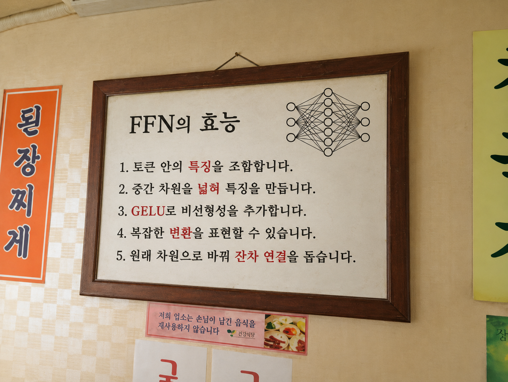

### 4.4. 결합

이제 앞에서 만든 연산을 연결할 차례다. GPT-2의 구조를 정하는 설정은 Hugging Face의 [config.json](https://huggingface.co/openai-community/gpt2/blob/main/config.json)에 있었다. 여기서는 이 저장소의 GPT-2 small을 기준으로 조립한다.

#### 4.4.1. GPT-2의 헤드 구조

설정의 `n_embd`는 **768**, `n_head`는 **12**다. 따라서 Q·K·V를 각각 12개의 헤드로 나누면, 헤드 하나가 다루는 차원은 `768 / 12 = 64`가 된다.

각 헤드가 계산한 결과는 이어 붙여 다시 768차원으로 만든다. 이 과정은 [3.2절의 Multi-head self-attention 구현](#32-multi-head-self-attention-구현)에서 정리했다.

#### 4.4.2. GPT-2의 블록 구조

블록 내부의 연산 순서는 [GPT-2 원본 구현의 `block()`](https://github.com/openai/gpt-2/blob/master/src/model.py#L111-L118)에서 확인했다. GPT-2는 Attention과 FFN **앞에 LayerNorm을 적용**하며, 각 계산 결과에 정규화하기 전의 입력을 더한다.

```text
입력 x
  ↓
LayerNorm ①
  ↓
Masked Multi-Head Attention
  ↓
원래 입력 x와 더하기 → h
  ↓
LayerNorm ②
  ↓
FFN: 768 → 3072 → GELU → 768
  ↓
FFN에 들어가기 전의 h와 더하기 → 블록 출력
```

토큰 수가 `seq_len`이라면 블록의 입력과 출력은 모두 `(seq_len, 768)`이다. FFN에서 중간 차원을 넓혔다가 다시 768차원으로 돌려놓기 때문에 잔차 연결을 이어갈 수 있다.

#### 4.4.3. GPT-2의 블록 개수

`n_layer`는 **12**다. 위 구조의 블록을 12개 쌓고, 앞 블록의 출력을 다음 블록의 입력으로 전달한다. 블록의 계산 구조는 같지만 **가중치는 블록마다 따로 가진다.**

즉, 12개 블록 각각의 Attention 안에 12개 헤드가 있다.

#### 4.4.4. 전체적인 구조

토큰 임베딩과 위치 임베딩을 더한 입력에서 시작해, 12개 블록을 통과한 뒤 마지막 LayerNorm과 어휘 출력층을 연결한다.

```text
토큰 ID
  ↓
토큰 임베딩 + 위치 임베딩
  ↓
Transformer 블록 × 12
  ↓
마지막 LayerNorm
  ↓
토큰 임베딩 표의 전치와 곱하기
  ↓
logits: (seq_len, 50257)
  ↓
Softmax → 다음 토큰의 확률
```

출력층은 입력에 사용한 토큰 임베딩 표를 공유한다. 각 위치의 logits은 **그 위치 다음에 올 토큰**의 점수다. 전체 흐름은 원본 구현의 [`model()`](https://github.com/openai/gpt-2/blob/master/src/model.py#L133-L157)에서도 확인할 수 있다.

#### 4.4.5. 순전파를 구성하는 핵심 함수

조립한 코드의 핵심 함수는 다음과 같다. 여기서는 함수의 역할과 입출력만 정리하고, 내부 계산은 앞에서 설명한 부분으로 연결한다. 아래 타입 표기는 함수의 입출력을 보여주기 위해 덧붙였다.

공통으로 `x`는 NumPy 배열, `weights`는 가중치 딕셔너리, `config`는 모델 설정이다. `prefix`와 `layer_index`는 사용할 가중치의 위치를 지정한다. `return_trace` 인자가 있는 함수는 이를 `True`로 설정하면 중간 계산값도 함께 반환한다. 기본값에서는 중간값 대신 `None`을 반환한다.

##### 4.4.5.1. `layer_norm()` — 토큰별 정규화

```python
def layer_norm(
    x: np.ndarray,
    gamma: np.ndarray,
    beta: np.ndarray,
    eps: float = 1e-5,
) -> np.ndarray:
    ...
```

각 토큰 벡터를 정규화하고 `gamma`, `beta`를 적용한 배열을 반환한다. 입력과 출력의 크기는 같다. 원리와 코드는 [4.1절의 LayerNorm](#41-layernorm)에 정리했다.

##### 4.4.5.2. `softmax()` — 점수를 확률로 변환

```python
def softmax(x: np.ndarray) -> np.ndarray:
    ...
```

마지막 차원의 점수를 합이 1인 확률로 바꿔 반환한다. Attention의 참고 비율과 마지막 어휘별 확률을 구할 때 사용한다. 계산은 [3.1.4절의 Softmax로 참고 비율 구하기](#314-softmax로-참고-비율-구하기), 출력층에서의 역할은 [1.6절의 확률로 만들기](#16-확률로-만들기softmax)에 설명했다.

##### 4.4.5.3. `masked_self_attention()` — 앞의 토큰 정보를 모으기

```python
def masked_self_attention(
    x: np.ndarray,
    weights: dict,
    prefix: str,
    num_heads: int,
    return_trace: bool = False,
) -> tuple[np.ndarray, dict | None]:
    ...
```

Q·K·V 계산부터 미래 토큰 마스킹, 헤드 결합과 출력 투영까지 수행한다. `(어텐션 출력, 중간 계산값)`을 반환하며, 출력 크기는 입력과 같다. 세부 연산은 [3.2절의 Multi-head self-attention 구현](#32-multi-head-self-attention-구현)에 있다.

##### 4.4.5.4. `gelu()` — 비선형 변환

```python
def gelu(x: np.ndarray) -> np.ndarray:
    ...
```

배열의 각 성분에 GPT-2의 GELU 근사식을 적용한 결과를 반환한다. 배열의 크기는 유지된다. 수식과 그래프는 [4.3절의 FFN](#43-ffn)에 정리했다.

##### 4.4.5.5. `feed_forward()` — 토큰 안의 특징 가공

```python
def feed_forward(
    x: np.ndarray,
    weights: dict,
    prefix: str,
    return_trace: bool = False,
) -> tuple[np.ndarray, dict | None]:
    ...
```

차원 확장, GELU, 차원 축소를 연결해 `(FFN 출력, 중간 계산값)`을 반환한다. 각 토큰에 같은 연산을 적용하며 출력은 다시 768차원이다. 계산 순서는 [4.3절의 FFN](#43-ffn)에 있다.

##### 4.4.5.6. `transformer_block()` — 블록 하나 조립

```python
def transformer_block(
    x: np.ndarray,
    weights: dict,
    config: GPT2Config,
    layer_index: int,
    return_trace: bool = False,
) -> tuple[np.ndarray, dict | None]:
    ...
```

두 번의 LayerNorm, Attention, FFN과 두 잔차 연결을 묶어 `(블록 출력, 중간 계산값)`을 반환한다. 잔차 연결은 [4.2절의 잔차 연결](#42-잔차연결), 조립 순서는 [4.4.2절의 블록 구조](#442-gpt-2의-블록-구조)를 따른다.

##### 4.4.5.7. `forward()` — 전체 순전파 연결

```python
def forward(
    token_ids: np.ndarray,
    weights: dict,
    config: GPT2Config,
    return_trace: bool = False,
) -> dict:
    ...
```

토큰 ID에서 시작해 임베딩, 12개 블록, 마지막 LayerNorm, 출력층과 Softmax를 연결한다. `logits`, `probabilities`, 마지막 LayerNorm의 출력인 `hidden_state`, 중간 계산값인 `trace`를 담은 딕셔너리를 반환한다. `trace`는 기본값에서 `None`이다.

입력 구성은 [2.3절의 임베딩 결합 구현](#23-임베딩-결합-구현), 출력 점수와 확률은 [1.5절의 logits 출력](#15-logits-출력)과 [Softmax](#16-확률로-만들기softmax)를 연결한 것이다.

<small>수식과 연산 순서는 [GPT-2 원본 구현](https://github.com/openai/gpt-2/blob/master/src/model.py)의 `norm`, `block`, `mlp`, `gelu`를 참고했다.</small>

---

## 5. 공개 가중치 적용과 Hugging Face 비교, 샘플링

[4장](#4-transformer-블록과-전체-순전파-구현)에서 GPT-2의 계산 과정을 연결했다. 이번에는 공개 GPT-2 가중치를 적용하고, Hugging Face(HF) 모델과 출력이 얼마나 같은지 비교했다.

먼저 **어느 함수에 어떤 가중치를 넣는지**, **그 가중치를 원본 파일 어디에서 가져오는지** 정리한다. 이어서 실제 logits와 오차를 확인하고, 같은 가중치인데도 차이가 생긴 이유를 살펴본다.

### 5.1. 가중치가 필요한 곳

`@`는 행렬 곱셈, `W`는 입력에 곱하는 행렬, `b`는 결과에 더하는 **편향(bias) 벡터**다. `W`와 `b` 모두 학습된 값을 파일에서 가져온다.

#### 5.1.1. 임베딩 — `forward()`

토큰 ID와 위치를 벡터로 바꾸는 표가 필요하다. `wte`는 토큰 임베딩 표, `wpe`는 위치 임베딩 표다.

```text
입력 벡터 = wte[토큰 ID] + wpe[위치]
```

#### 5.1.2. LayerNorm — `layer_norm()`

정규화한 벡터에 곱할 `gamma`와 더할 `beta`가 필요하다.

```text
정규화된 x = (x - 평균) / √(분산 + ε)
출력 = gamma × 정규화된 x + beta
```

평균·분산은 입력에서 계산하고, `ε`는 나눗셈을 안정화하는 작은 상수다. **파일에서는 `gamma`, `beta`를 가져와 성분별로 적용한다.**

#### 5.1.3. Attention — `multi_head_self_attention()`

Q·K·V를 만들 때와 헤드를 합친 결과를 변환할 때 각각 `W`, `b`가 필요하다. `x`는 첫 LayerNorm을 통과한 입력이다.

```text
Q = x @ W_Q + b_Q
K = x @ W_K + b_K
V = x @ W_V + b_V

출력 = 헤드를 합친 결과 @ W_O + b_O
```

어텐션 확률은 입력마다 계산하고, `W`, `b`는 파일에서 가져온다. Q·K·V로 확률을 구하는 과정은 [Attention 글](#3-self-attention과-multi-head-attention-구현)에서 다뤘다.

#### 5.1.4. FFN — `feed_forward()`

벡터를 넓히는 `W_1`, `b_1`과 줄이는 `W_2`, `b_2`가 필요하다. `x`는 두 번째 LayerNorm을 통과한 입력이다.

```text
중간값 = GELU(x @ W_1 + b_1)
출력 = 중간값 @ W_2 + b_2
```

GPT-2에서는 `768 → 3072 → 768`차원으로 계산한다. GELU 자체에는 가져올 가중치가 없다.

#### 5.1.5. 블록 연결 — `forward()`의 블록 반복

위의 LayerNorm·Attention·FFN을 순서대로 실행하고 잔차를 더한다.

```text
h = x + Attention(LayerNorm_1(x))
출력 = h + FFN(LayerNorm_2(h))
```

각 함수의 가중치를 그대로 사용하며, **잔차를 더하는 데는 별도 가중치가 없다.**

#### 5.1.6. 최종 출력 — `forward()`

마지막 LayerNorm의 `gamma`, `beta`를 적용한 뒤, 입력에서 썼던 `wte`를 다시 사용한다.

```text
마지막 벡터 = LayerNorm_f(마지막 블록의 출력)
logits = 마지막 벡터 @ wte.T
확률 = softmax(logits)
```

`wte.T`는 `wte`의 행과 열을 바꾼 것이다. **출력층은 입력 임베딩을 공유**하며, softmax에는 별도 가중치가 없다.

==blue:logits는 다음에 올 토큰 후보마다 매긴 점수다.== 점수가 높을수록 모델이 더 유력하게 보는 후보이며, softmax를 적용하면 후보별 확률이 된다.

### 5.2. 원본 가중치 위치 한눈에 보기

가져올 파일은 Hugging Face의 [`openai-community/gpt2` — `model.safetensors`](https://huggingface.co/openai-community/gpt2/blob/607a30d783dfa663caf39e06633721c8d4cfcd7e/model.safetensors)다. 로컬에는 `weights/gpt2/model.safetensors`로 저장했다.

아래 표에서 **쓰이는 곳 → 우리 코드의 키 → 원본 파일의 위치** 순서로 대응시켰다. `i`는 블록 번호로, 첫 블록은 `0`, 마지막 블록은 `11`이다.

<div class="bpe-comparison-table" role="region" aria-label="GPT-2 가중치 대응표" tabindex="0">

| 쓰이는 곳 | 우리 코드의 키 | 원본 파일에서 가져올 위치 |
| --- | --- | --- |
| 토큰 임베딩 | `wte` | `wte.weight` |
| 위치 임베딩 | `wpe` | `wpe.weight` |
| 첫 LayerNorm의 배율 | `blocks.i.ln_1.gamma` | `h.i.ln_1.weight` |
| 첫 LayerNorm의 편향 | `blocks.i.ln_1.beta` | `h.i.ln_1.bias` |
| Q를 만드는 행렬 | `blocks.i.attn.W_Q` | `h.i.attn.c_attn.weight[:, 0:768]` |
| Q에 더하는 편향 | `blocks.i.attn.b_Q` | `h.i.attn.c_attn.bias[0:768]` |
| K를 만드는 행렬 | `blocks.i.attn.W_K` | `h.i.attn.c_attn.weight[:, 768:1536]` |
| K에 더하는 편향 | `blocks.i.attn.b_K` | `h.i.attn.c_attn.bias[768:1536]` |
| V를 만드는 행렬 | `blocks.i.attn.W_V` | `h.i.attn.c_attn.weight[:, 1536:2304]` |
| V에 더하는 편향 | `blocks.i.attn.b_V` | `h.i.attn.c_attn.bias[1536:2304]` |
| Attention 출력 행렬 | `blocks.i.attn.W_O` | `h.i.attn.c_proj.weight` |
| Attention 출력 편향 | `blocks.i.attn.b_O` | `h.i.attn.c_proj.bias` |
| 두 번째 LayerNorm의 배율 | `blocks.i.ln_2.gamma` | `h.i.ln_2.weight` |
| 두 번째 LayerNorm의 편향 | `blocks.i.ln_2.beta` | `h.i.ln_2.bias` |
| FFN 확장 행렬 | `blocks.i.ffn.W_1` | `h.i.mlp.c_fc.weight` |
| FFN 확장 편향 | `blocks.i.ffn.b_1` | `h.i.mlp.c_fc.bias` |
| FFN 축소 행렬 | `blocks.i.ffn.W_2` | `h.i.mlp.c_proj.weight` |
| FFN 축소 편향 | `blocks.i.ffn.b_2` | `h.i.mlp.c_proj.bias` |
| 마지막 LayerNorm의 배율 | `ln_f.gamma` | `ln_f.weight` |
| 마지막 LayerNorm의 편향 | `ln_f.beta` | `ln_f.bias` |

</div>

**Q·K·V는 원본에서 하나로 붙어 있다.** 그래서 `c_attn.weight`의 열을 앞 768개는 Q, 다음 768개는 K, 마지막 768개는 V로 나눈다. 편향도 같은 순서로 나눈다. `0:768`은 인덱스 `0~767`을 뜻한다.

예를 들어 첫 블록의 `W_Q`는 `h.0.attn.c_attn.weight`의 앞 768개 열을 꺼내 `weights["blocks.0.attn.W_Q"]`에 넣으면 된다.

### 5.3. 기존 구현에 가중치를 넣고 비교하기

기존 NumPy 구현에 위 가중치를 넣고 HF의 `GPT2LMHeadModel`과 비교했다.

원래 Attention에 빠져 있던 `b_Q`, `b_K`, `b_V`, `b_O`를 반영했다. 예를 들어 Q는 `Q = x @ W_Q + b_Q`로 계산한다.

두 모델에 같은 가중치와 토큰 ID를 넣고 logits의 절대오차를 구했다. `hf_model`은 HF 모델이다.

```python
from notebook_model import forward

numpy_logits = forward(token_ids, weights, config)["logits"]
with torch.inference_mode():
    hf_logits = hf_model(
        torch.tensor(token_ids[None, :]), use_cache=False,
    ).logits[0].numpy()

error = np.abs(numpy_logits - hf_logits)
print(error.max(), error.mean())  # 최대·평균 절대오차
```

**모든 입력 위치에서 다음 토큰 후보 50,257개의 점수를 각각 대조**했다. 최대 절대오차는 그중 가장 큰 차이이고, 평균 절대오차는 전체 차이의 평균이다.

### 5.4. 테스트에 사용한 텍스트

43개 텍스트를 골랐다. 아래는 종류별 실제 입력 예시다.

| 종류 | 실제 입력 예시 | 입력 수 |
| --- | --- | ---: |
| 영어 | `Hello, my name is` / `The capital of France is` | 5 |
| 한국어 | `안녕하세요. 오늘은 직접 만든 모델의 출력을 비교합니다.` | 5 |
| 다국어·혼합 | `오늘의 topic은 attention입니다. Let us compare the logits carefully.` | 5 |
| 코드·JSON·SQL | `{"name": "GPT-2", "layers": 12, "enabled": true, "weights": [0.1, -0.2]}` | 5 |
| 숫자·수식 | `1 + 2 = 3, 10 - 7 = 3, and 12 * 12 = 144.` | 5 |
| 공백·줄바꿈 | `First line.\n\nSecond paragraph.\nThird line.\n` | 5 |
| 반복 문자열 | `hello ` 32회, `0 ` 128회 반복 등 | 5 |
| 유니코드·이모지 | `😀 😃 🙂 🚀 🧠 🌏 GPT-2!` | 5 |
| 짧은 입력·특수 토큰 | `Hi`, 줄바꿈 하나, `<\|endoftext\|>` | 3 |

표의 `\n`은 실제 줄바꿈 문자다.

여기에 길이 실험 14개를 더했다. 다음 문장으로 시작하는 자연문을 이어 붙인 뒤 앞에서부터 `1, 8, 32, 128, 256, 512, 1024`개 토큰을 사용했다. 별도로 ` hello`에 해당하는 한 토큰도 같은 길이만큼 반복했다.

```text
On Monday, Mira opened the laboratory before sunrise and checked the instruments.
```

==yellow:57개 입력의 토큰 수를 모두 더한 값이 5,361이다.== 즉, 5,361곳에서 다음 토큰을 예측했다.

한 위치마다 다음 토큰 후보 50,257개에 점수를 매기므로, 비교한 logits는 `5,361 × 50,257 = 269,427,777개`다.

실제 입력 전체와 토큰 ID, 입력별 오차는 [비교 결과 파일](./assets/chapter-5-gpt2-logits-comparison.json)에 함께 남겼다.

### 5.5. logits는 얼마나 달랐을까?

`Hello, my name is`를 입력하면 logits의 크기는 `(5, 50257)`이다. 행 5개는 입력 토큰의 위치, 열 50,257개는 다음 토큰 후보를 나타낸다.

아래는 **`Hello, my name is`를 읽은 뒤 바로 다음에 올 토큰 후보** 중 점수가 높은 다섯 개다. 토큰 앞의 공백도 실제 토큰에 포함된다.

| 다음 토큰 후보 | 내 구현의 logit | HF의 logit | 절대오차 |
| --- | ---: | ---: | ---: |
| `' John'` | -64.44328368 | -64.44327545 | 0.00000823 |
| `' K'` | -64.63306077 | -64.63309479 | 0.00003401 |
| `' J'` | -64.70594887 | -64.70587158 | 0.00007729 |
| `' Michael'` | -64.82553307 | -64.82553864 | 0.00000557 |
| `' L'` | -64.85924954 | -64.85914612 | 0.00010342 |

점수는 음수도 나올 수 있다. 두 모델 모두 ` John`의 점수가 가장 높았고, 그 차이는 약 `0.00000823`이었다.

#### 5.5.1. 전체 57개 입력의 결과

| 비교 항목 | 결과 |
| --- | ---: |
| 최대 절대오차 | 0.00792682 |
| 평균 절대오차 | 0.00011358 |
| 각 위치의 1위 토큰 일치 | 5,361 / 5,361 |
| 각 위치의 상위 5개 토큰 구성 일치 | 5,361 / 5,361 |
| 허용오차 검사 통과 | 54 / 57 |

평균오차는 전체 logits 기준이다. 상위 5개는 후보의 구성만 비교했으며, 그 안의 순서까지 같다는 뜻은 아니다.

#### 5.5.2. 가장 큰 차이가 난 위치

가장 큰 차이는 자연문 256토큰 입력의 **228번째 위치**에서 발생했다. 그 위치까지 읽은 뒤, **다음 토큰 후보 ` challeng`(ID `4010`)에 매긴 점수**를 비교한 값이다.

```text
내 구현: -68.972496151672
HF:      -68.980422973633
차이:    0.007926821960
```

256·512·1,024토큰 자연문 입력에서 같은 위치의 차이가 유지됐고, 이 세 입력이 허용오차 검사를 통과하지 못했다. 기준은 각 값에 대해 `오차 ≤ 0.0005 + 0.0001 × |HF logit|`이었다.

즉, **가장 높은 점수를 받은 토큰은 모두 같았지만, logits의 숫자까지 같지는 않았다.**

### 5.6. 같은 가중치인데 왜 차이가 났을까?

내 코드에서는 Attention 점수를 나누는 부분을 원래대로 유지했다.

```python
head_scores = head_scores / np.sqrt(d_head)
```

현재 사용한 NumPy 2.5.4에서는 `np.sqrt(d_head)`가 float64 값을 만들고, 이 나눗셈부터 중간값도 float64가 된다. HF 모델은 float32로 계산했으므로, **기본 비교에서는 두 모델의 계산 정밀도가 달랐다.**

float32와 float64는 중간값을 저장할 수 있는 정밀도가 달라, 계산 중 반올림 결과도 달라질 수 있다.

<div class="llm-example" role="note" aria-label="float32와 float64의 반올림 차이 예시">

**설명용 예시: 정밀도에 따른 반올림**

```text
계산: (100,000,000 + 1) - 100,000,000

float32 결과: 0
float64 결과: 1
```

float32는 이 크기에서 `+1`의 차이를 저장하지 못해 중간값이 반올림된다.

</div>

모델에서도 작은 차이가 이후 층의 계산에 영향을 줄 수 있다. float32 가중치를 float64로 바꿔도 가중치 값 자체는 유지되고, **이후 계산을 수행하는 정밀도**가 달라진다.

중간 출력을 보니 임베딩은 정확히 같았고, 첫 블록부터 차이가 생겼다. 차이가 컸던 두 입력을 **양쪽 모두 float64로 다시 계산**했다.

| 다시 비교한 입력 | 기존 계산의 최대오차 | 양쪽 모두 float64일 때 |
| --- | ---: | ---: |
| 자연문 256토큰 | 0.00792682 | 약 1.17 × 10⁻¹¹ |
| `0 ` 128회 반복 | 0.00264310 | 약 2.59 × 10⁻¹² |

두 입력 모두 차이가 크게 줄었다. HF 모델 자체도 같은 자연문 입력에서 float32와 float64 결과 사이에 최대 약 `0.00749`의 차이가 있었다.

이 재실험은 **계산 정밀도가 오차의 주요 요인임을 뒷받침한다.** 다만 float64 재실험은 두 입력만 확인한 결과다.

### 5.7. 샘플링 방식에 따른 출력 비교

앞에서는 두 구현의 logits를 비교했다. 이번에는 **같은 NumPy 모델에서 다음 토큰을 고르는 방법만 바꿔** 문장을 생성했다.

공통 입력은 앞에서 사용한 문장이다.

```text
Hello, my name is
```

생성한 토큰을 입력 뒤에 하나씩 붙여 다시 순전파했다. 각 방식은 **최대 40토큰**을 생성하고, 무작위 선택을 하는 아홉 조건은 각각 **시드 42**로 시작했다. Greedy는 무작위 선택을 하지 않는다.

| 방식 | 비교한 설정 |
| --- | --- |
| `Greedy` | 점수가 가장 높은 토큰 선택 |
| 온도만 조절 | `T=0.1·1.0·2.0`, 후보 제한 없음 |
| `Top-k` | `k=50` 고정, `T=0.1·1.0·2.0` 각각 적용 |
| `Top-p` | `p=0.9` 고정, `T=0.1·1.0·2.0` 각각 적용 |

Temperature는 `softmax(logits / T)`로 적용했다. top-k와 top-p에서도 **먼저 온도를 적용한 뒤 후보를 제한**했다. top-k는 상위 50개, top-p는 확률이 높은 순서로 누적합이 0.9 이상이 되는 최소 후보 집합에서 선택한다. 두 제한은 각각 따로 적용했다.

아래는 입력 문장까지 포함한 실제 출력이다. 열 결과 모두 종료 토큰이 나오기 전에 40토큰 한도에 도달했으므로, 문장 중간에서 끊긴 부분도 그대로 남겼다.

#### 5.7.1. Greedy와 Temperature

<div class="llm-example" role="note" aria-label="후보 제한 없는 생성 결과">

**실제 생성 결과**

<p><strong>Greedy</strong></p>
<p>Hello, my name is John. I'm a writer, and I'm a writer. I'm a writer. I'm a writer. I'm a writer. I'm a writer. I'm a writer. I'm</p>

<p><strong>Temperature 0.1</strong></p>
<p>Hello, my name is John. I'm a freelance writer and I'm a freelance writer. I'm a freelance writer. I'm a freelance writer. I'm a freelance writer. I'm a freelance writer. I'm</p>

<p><strong>Temperature 1.0</strong></p>
<p>Hello, my name is Timothy Leifi<br />
<br />
Aren't we all too familiar with Phyllis Nylsbury's Oliver Crown satire Letters to the Vain Alarm?, at which she says, "it was</p>

<p><strong>Temperature 2.0</strong></p>
<p>Hello, my name is cis Bull 311 Sylvacosaurus Anat Carrierald Ghining057 commits Casesbb wa waist had 460 Creation555 scope 353 Coral Penguin earthguard 3 base Scarlet Gundam Dickinson Burn poison Bengrist25 makers iT Tow</p>

</div>

#### 5.7.2. Top-k — k=50

<div class="llm-example" role="note" aria-label="Top-k의 Temperature별 생성 출력">

**실제 생성 결과**

<p><strong>Top-k (k=50, T=0.1)</strong></p>
<p>Hello, my name is John. I'm a freelance writer and I'm a freelance writer. I'm a freelance writer. I'm a freelance writer. I'm a freelance writer. I'm a freelance writer. I'm</p>

<p><strong>Top-k (k=50, T=1.0)</strong></p>
<p>Hello, my name is Peter. What do I wish for now? A life?"<br />
<br />
"I really do wish for one of those kind things. And a really nice home!"<br />
<br />
"I will need to come</p>

<p><strong>Top-k (k=50, T=2.0)</strong></p>
<p>Hello, my name is Thomas "Redemption" Perry . Red and Black "Hotdog!" are all good. Just call my name Tommy Smith . " Red" is how much trouble that would take. I don't care</p>

</div>

#### 5.7.3. Top-p — p=0.9

<div class="llm-example" role="note" aria-label="Top-p의 Temperature별 생성 출력">

**실제 생성 결과**

<p><strong>Top-p (p=0.9, T=0.1)</strong></p>
<p>Hello, my name is John. I'm a writer and a writer's assistant at the University of California, Berkeley. I'm a writer and a writer's assistant at the University of California, Berkeley. I'm a writer</p>

<p><strong>Top-p (p=0.9, T=1.0)</strong></p>
<p>Hello, my name is Sacha Rodrigues, brother of Lieutenant. I am Commander Zaha Hadid.<br />
<br />
BAUGHTARI [confused]<br />
<br />
Your thoughts...<br />
<br />
So, Areli (</p>

<p><strong>Top-p (p=0.9, T=2.0)</strong></p>
<p>Hello, my name is Brassstrong Buccaneers 121 other tantal 134 invites .Good afford inquireername inspectors2018 popular Queens spe printf obscure050 medium825 6000 rumoursTr recoverchTherenikbeck ENTER Linux 07 chocolate battle 2015 Original ChurchCBS</p>

</div>


출력 원문·생성 토큰 ID·설정은 [샘플링 비교 결과 파일](./assets/chapter-5-gpt2-sampling-comparison.json)에 남겼다.

---

## 6. 구성 요소 제거 실험과 학습 손실 계산

[5장](#5-공개-가중치-적용과-hugging-face-비교-샘플링)에서 공개 가중치를 적용하고 HF와 logits를 비교했다. 이번에는 **√dₖ 스케일링, causal mask, 잔차 연결을 하나씩 제거**해 출력이 어떻게 달라지는지 확인했다.

입력은 `Hello! My Name Is`다. 가중치는 그대로 두고, 실험마다 한 요소만 12개 블록 전체에서 제거했다.

이 장의 앞부분에서는 구성 요소를 제거했을 때의 출력을 비교한다. 뒷부분에서는 정상 모델의 출력으로 다음 토큰 예측 손실을 구하고, 설명용 숫자로 SFT·RLHF·DPO의 손실을 계산한다.

<div role="navigation" aria-label="글 목차">

**글의 흐름**

- **구성 요소 제거 실험:** [실험 조건](#61-실험-조건과-정상-출력) · [스케일링](#62-dₖ-스케일링-제거) · [causal mask](#63-causal-mask-제거) · [잔차 연결](#64-잔차-연결-제거)
- **손실과 선호 학습:** [다음 토큰 예측](#65-다음-토큰-예측-손실) · [SFT](#66-sft-모범-답변을-따라-배우기) · [RLHF](#67-rlhf-사람이-선호한-답변을-더-자주-만들기) · [DPO](#68-dpo-두-답변의-선호를-직접-배우기)
- [마치며](#69-마치며)

</div>

### 6.1. 실험 조건과 정상 출력

GPT-2 small과 같은 토크나이저를 사용했다. 입력의 대소문자와 느낌표를 유지하고, 끝에 공백이나 특수 토큰은 붙이지 않았다.

```text
입력: Hello! My Name Is
토큰: ['Hello', '!', ' My', ' Name', ' Is']
ID:   [15496, 0, 2011, 6530, 1148]
```

토큰 앞의 공백도 토큰의 일부다. logits는 입력 5개 위치마다 후보 50,257개의 점수를 담은 `(5, 50257)` 배열이다.

이 중 **마지막 행** `logits[-1]`, 즉 ` Is` 다음에 올 토큰의 점수를 비교했다.

- **계산 정밀도:** 모든 조건은 float64로 계산했다.
- **가중치:** 공개 float32 값을 변환해 사용했다.
- **실행 조건:** 재학습·dropout·KV cache 없이 실행했다.

정상 구현과 HF의 전체 logits 최대 절대오차는 약 `3.69 × 10⁻¹³`이었다.

<div class="bpe-comparison-table" role="region" aria-label="구성 요소 제거 실험 요약" tabindex="0">

| 조건 | 다음 토큰 1위 | 해당 토큰 확률 | 정상 대비 logits 최대 절대차 |
| --- | --- | ---: | ---: |
| 정상 | `,` | 1.37% | 0.0000 |
| √dₖ 스케일링 제거 | ` My` | 12.48% | 12.6511 |
| causal mask 제거 | ` My` | 51.86% | 19.8112 |
| 잔차 연결 제거 | `\n` | 26.30% | 84.3594 |

</div>

최대 절대차는 **같은 후보 토큰의 점수 차이 중 가장 큰 값**이다. 확률은 마지막 행에 softmax를 적용한 값이며, `\n`은 줄바꿈 토큰이다.

logits는 확률이 아니므로 음수도 가능하다. 모든 점수가 같은 만큼 움직이면 softmax는 같으므로, **점수 차이와 함께 후보 순위·확률의 변화**를 봐야 한다.

### 6.2. √dₖ 스케일링 제거

#### 6.2.1. 바뀌는 코드

`multi_head_self_attention()`에서 점수를 나누는 줄을 주석 처리한다. `d_head`는 한 헤드의 차원 수인 `dₖ`다. 여기서는 `768 / 12 = 64`이므로 원래 점수를 `√64 = 8`로 나눈다.

<details>
<summary>스케일링 변경 전·후 코드 보기</summary>

**변경 전**

```python
head_scores = Q_heads @ K_heads.swapaxes(-1, -2)
head_scores = head_scores / np.sqrt(d_head)
```

**변경 후**

```python
head_scores = Q_heads @ K_heads.swapaxes(-1, -2)
# head_scores = head_scores / np.sqrt(d_head)
```

</details>

causal mask와 softmax는 그대로 적용한다.

#### 6.2.2. logits에서 보인 차이

각 실험의 표는 **제거 후 상위 3개 후보**를 정상 모델의 같은 토큰과 비교한 것이다. logits는 소수 넷째 자리, 확률은 백분율 소수 둘째 자리까지 반올림했다.

<div class="bpe-comparison-table" role="region" aria-label="스케일링 제거 전후 logits" tabindex="0">

| 토큰 | 정상 logits | 스케일링 제거 logits | 제거 후 확률 |
| --- | ---: | ---: | ---: |
| ` My` | -65.2963 | -69.7217 | 12.48% |
| ` Your` | -66.5362 | -69.8778 | 10.68% |
| ` the` | -67.6006 | -70.9743 | 3.57% |

</div>

1위가 `,`에서 ` My`로 바뀌었고, 최대 절대차는 `12.6511`이었다. ` My`의 점수 자체는 낮아졌지만, ==yellow:다른 후보와의 상대적인 점수 관계==가 달라져 1위가 됐다.

첫 블록에서는 각 어텐션 행의 최대 확률을 평균 낸 값이 `71.55% → 95.14%`로 커졌다. 12개 헤드·5개 위치를 평균한 값으로, **특정 입력 위치를 참고하는 비율**이 더 커졌다는 뜻이다. 다음 토큰을 고르는 확률과는 다르다.

#### 6.2.3. 스케일링의 역할과 탐구 질문

**질문: Q와 K의 내적을 왜 √dₖ로 나눌까?**

나누지 않으면 점수가 한쪽에 몰려 softmax가 하나에 너무 높게 확률을 몰아준다. ==blue:√dₖ로 나누는 것은 어텐션이 한쪽에 지나치게 쏠리지 않도록 점수 크기를 조절하는 과정이다.== 학습에서는 softmax 포화로 기울기가 작아지는 현상도 완화한다.

### 6.3. causal mask 제거

#### 6.3.1. 바뀌는 코드

같은 함수에서 미래 위치를 `-np.inf`로 가리는 부분을 주석 처리하고, 점수를 그대로 softmax에 넣는다.

<details>
<summary>causal mask 변경 전·후 코드 보기</summary>

**변경 전**

```python
future_mask = np.triu(np.ones((seq_len, seq_len), dtype=bool), k=1)
head_masked_scores = np.where(future_mask, -np.inf, head_scores)
head_weights = softmax(head_masked_scores)
```

**변경 후**

```python
# future_mask = np.triu(np.ones((seq_len, seq_len), dtype=bool), k=1)
# head_masked_scores = np.where(future_mask, -np.inf, head_scores)
head_masked_scores = head_scores
head_weights = softmax(head_masked_scores)
```

</details>

마스크를 제거해도 √dₖ 스케일링과 잔차 연결은 유지한다.

#### 6.3.2. logits에서 보인 차이

<div class="bpe-comparison-table" role="region" aria-label="causal mask 제거 전후 logits" tabindex="0">

| 토큰 | 정상 logits | 마스크 제거 logits | 제거 후 확률 |
| --- | ---: | ---: | ---: |
| ` My` | -65.2963 | -73.3538 | 51.86% |
| ` Your` | -66.5362 | -75.0407 | 9.60% |
| ` It` | -66.9374 | -75.4249 | 6.54% |

</div>

1위가 `,`에서 ` My`로 바뀌었고, ` My`의 확률은 `51.86%`였다. 최대 절대차는 `19.8112`였다.

첫 블록·첫 헤드에서 `Hello`의 참고 비율은 원래 `[1, 0, 0, 0, 0]`이었다. 마스크를 제거하자 뒤의 네 토큰을 참고하는 비율의 합이 `40.13%`가 됐다. **앞쪽 토큰이 뒤쪽 토큰의 정보까지 가져온 것**이다.

마지막 ` Is`는 원래도 입력 전체를 볼 수 있어 첫 블록의 출력이 같았다. 하지만 앞쪽 토큰의 벡터가 바뀌었고, **두 번째 블록부터 그 벡터를 참고하면서 마지막 위치의 출력도 달라졌다.**

#### 6.3.3. causal mask의 역할과 탐구 질문

**질문: 입력 문장을 이미 전부 알고 있는데도 미래 토큰을 가려야 할까?**

`Hello` 위치의 출력은 다음 토큰인 `!`를 예측한다. 이때 `!`를 참고할 수 있다면 정답을 미리 보고 예측하는 셈이다. causal mask는 문장 전체를 한 번에 계산해도 ==yellow:각 위치가 자기 위치까지의 정보만 쓰게 한다.==

실제로 `Hello`만 넣었을 때와 전체 문장을 넣었을 때 첫 위치의 logits를 비교하면, 정상 모델의 최대 차이는 약 `1.49 × 10⁻¹³`이지만 마스크 제거 모델은 `23.2884`였다. 뒤에 붙인 토큰이 앞 위치의 예측을 바꾼 것이다.

### 6.4. 잔차 연결 제거

#### 6.4.1. 바뀌는 코드

`forward()`에서 Attention 뒤의 `x`와 FFN 뒤의 `h`를 더하지 않는다. 두 연산의 출력만 다음 단계에 전달한다.

<details>
<summary>잔차 연결 변경 전·후 코드 보기</summary>

**변경 전**

```python
h = x + attention
```

```python
x = h + ffn_output
```

**변경 후**

```python
# h = x + attention
h = attention
```

```python
# x = h + ffn_output
x = ffn_output
```

</details>

두 덧셈 사이의 LayerNorm과 FFN은 그대로 실행한다. 스케일링과 causal mask도 유지한다.

#### 6.4.2. logits에서 보인 차이

<div class="bpe-comparison-table" role="region" aria-label="잔차 연결 제거 전후 logits" tabindex="0">

| 토큰 | 정상 logits | 잔차 제거 logits | 제거 후 확률 |
| --- | ---: | ---: | ---: |
| `\n` | -65.6975 | -106.7136 | 26.30% |
| `/` | -68.4270 | -107.1885 | 16.36% |
| `-` | -67.3038 | -107.3026 | 14.59% |

</div>

1위가 `,`에서 줄바꿈으로 바뀌고, `/`, `-`가 뒤를 이었다. 최대 절대차는 `84.3594`로 이번 세 실험 중 가장 컸다.

점수만 낮아진 것이 아니라 **상위 후보와 확률 분포도 함께 달라졌다.**

#### 6.4.3. 잔차 연결의 역할과 탐구 질문

**질문: Attention과 FFN의 출력에 왜 입력을 다시 더할까?**

Attention 출력은 여러 위치의 V를 참고 비율로 섞고 변환한 값이다. **이 값만 다음 단계로 넘기면 현재 토큰의 벡터를 섞인 정보로 대체하게 된다.** 비슷한 위치를 비슷한 비율로 참고하는 토큰들은 출력도 비슷해질 수 있어, 원래 토큰을 구분하던 특징이 약해질 수 있다.

`x + attention`은 ==blue:원래 토큰의 벡터를 직접 전달하는 경로==를 두고, 그 위에 참고한 정보를 더한다. 입력 정보가 Attention 출력에도 반영되지만, 잔차 연결이 없으면 그 정보가 모두 Attention의 변환을 거쳐야 한다.

GPT-2의 가중치는 잔차 연결이 있는 상태로 학습됐다. 가중치를 유지한 채 이 경로를 빼자 다음 토큰 분포가 크게 달라졌다. 이 입력의 결과만으로 잔차 제거가 항상 가장 큰 영향을 준다고 볼 수는 없다.

---

여기까지는 가중치를 고정하고 구성 요소를 바꿨다. 이어서는 **손실을 계산하고 학습에 사용하는 원리**를 살펴본다. 각 항목은 역할, 수식, 짧은 설명, 숫자 예시 순서로 정리했다.

SFT·RLHF·DPO의 숫자는 ==orange:설명용 가상 예제==다. 로그는 자연로그이며 수치는 반올림해 표시했다. 실제 GPT-2를 미세조정한 결과는 아니다.

> **이후 예시의 공통 질문과 답변**
>
> - 질문: `대한민국의 수도는?`
> - A — 모범·선호 답변: `서울입니다.`
> - B — 비선호 답변: `부산입니다.`

### 6.5. 다음 토큰 예측 손실

다음 토큰 예측 손실은 **모델이 실제 정답 토큰에 얼마나 높은 확률을 줬는지 평가하는 값**이다.

<div class="llm-equation" role="region" aria-label="다음 토큰 예측의 평균 손실" tabindex="0">
<math xmlns="http://www.w3.org/1998/Math/MathML" display="block" aria-label="다음 토큰 예측의 평균 손실">
  <mrow><mrow><mi>L</mi></mrow><mo>=</mo><mo>−</mo><mfrac><mn>1</mn><mrow><mi>N</mi></mrow></mfrac><mrow><munderover><mo>∑</mo><mrow><mi>t</mi><mo>=</mo><mn>1</mn></mrow><mrow><mi>N</mi></mrow></munderover><mi mathvariant="normal">ln</mi><mrow><mo>(</mo><mrow><msub><mi>p</mi><mi>t</mi></msub></mrow><mo>)</mo></mrow></mrow></mrow>
</math>
</div>

1. <math xmlns="http://www.w3.org/1998/Math/MathML" display="inline" aria-label="pₜ"><mrow class="text-highlight" data-math-variable="p_t" style="--highlight-light: #d5e8fa; --highlight-dark: #2e4b65; padding: 0;"><msub><mi>p</mi><mi>t</mi></msub></mrow></math>는 각 위치의 **정답 토큰 확률**이다. 여기에 <math xmlns="http://www.w3.org/1998/Math/MathML" display="inline" aria-label="−ln"><mrow><mo>−</mo><mi mathvariant="normal">ln</mi></mrow></math>을 취하면 ==yellow:정답 확률이 낮을수록 손실이 커진다.==
2. <math xmlns="http://www.w3.org/1998/Math/MathML" display="inline" aria-label="Σ"><mo>∑</mo></math>로 위치별 손실을 더하고, 토큰 수 <math xmlns="http://www.w3.org/1998/Math/MathML" display="inline" aria-label="N"><mrow class="text-highlight" data-math-variable="N" style="--highlight-light: #d5e8fa; --highlight-dark: #2e4b65; padding: 0;"><mi>N</mi></mrow></math>으로 나눠 평균을 구한다. 정답이 one-hot일 때의 교차 엔트로피와 같은 계산이다.

<div class="llm-example" role="note" aria-label="다음 토큰 예측 손실 계산 예시">

**예시** · 두 토큰의 평균 손실

답변을 `[서울] [입니다]` 두 토큰으로 가정하고, 각 정답 확률이 0.5와 0.25라고 하자. 실제 GPT-2 토큰화 결과는 아니다.

<div class="llm-equation" role="region" aria-label="첫 번째 정답 토큰의 손실" tabindex="0">
<math xmlns="http://www.w3.org/1998/Math/MathML" display="block" aria-label="첫 번째 정답 토큰의 손실">
<mrow><mrow><msub><mi>L</mi><mn>1</mn></msub></mrow><mo>=</mo><mo>−</mo><mi mathvariant="normal">ln</mi><mrow><mo>(</mo><mn>0.5</mn><mo>)</mo></mrow><mo>≈</mo><mrow><mn>0.693147</mn></mrow></mrow>
</math>
</div>

`서울`에 준 확률 0.5를 첫 번째 위치의 손실로 바꾼 값이다.

<div class="llm-equation" role="region" aria-label="두 번째 정답 토큰의 손실" tabindex="0">
<math xmlns="http://www.w3.org/1998/Math/MathML" display="block" aria-label="두 번째 정답 토큰의 손실">
<mrow><mrow><msub><mi>L</mi><mn>2</mn></msub></mrow><mo>=</mo><mo>−</mo><mi mathvariant="normal">ln</mi><mrow><mo>(</mo><mn>0.25</mn><mo>)</mo></mrow><mo>≈</mo><mrow><mn>1.386294</mn></mrow></mrow>
</math>
</div>

`입니다`에는 더 낮은 확률을 줬으므로 손실이 더 크다.

<div class="llm-equation" role="region" aria-label="두 위치 손실의 평균" tabindex="0">
<math xmlns="http://www.w3.org/1998/Math/MathML" display="block" aria-label="두 위치 손실의 평균">
<mrow><mrow><mi>L</mi></mrow><mo>=</mo><mfrac><mrow><mn>0.693147</mn><mo>+</mo><mn>1.386294</mn></mrow><mn>2</mn></mfrac><mo>≈</mo><mrow><mn>1.039721</mn></mrow></mrow>
</math>
</div>

두 손실을 더하고 토큰 수 2로 나눈 **토큰당 평균 손실**이다.

</div>

같은 계산을 기존 GPT-2의 `Hello! My Name Is` 출력에도 적용했다. 네 개의 실제 다음 토큰 `!`, ` My`, ` Name`, ` Is`를 정답으로 평가한 평균 손실은 3.587852였다.

### 6.6. SFT: 모범 답변을 따라 배우기

SFT는 **질문과 모범 답변을 주고, 그 답변이 나오도록 모델을 추가 학습하는 것**이다.

<div class="llm-equation" role="region" aria-label="응답 마스크를 적용한 SFT 손실" tabindex="0">
<math xmlns="http://www.w3.org/1998/Math/MathML" display="block" aria-label="응답 마스크를 적용한 SFT 손실">
  <mrow><mrow><msub><mi>L</mi><mtext>SFT</mtext></msub></mrow><mo>=</mo><mo>−</mo><mfrac><mrow><msub><mo>∑</mo><mi>t</mi></msub><mrow><mrow><msub><mi>m</mi><mi>t</mi></msub></mrow><mi mathvariant="normal">ln</mi><mrow><mo>(</mo><mrow><msub><mi>p</mi><mi>t</mi></msub></mrow><mo>)</mo></mrow></mrow></mrow><mrow><msub><mo>∑</mo><mi>t</mi></msub><mrow><msub><mi>m</mi><mi>t</mi></msub></mrow></mrow></mfrac></mrow>
</math>
</div>

1. <math xmlns="http://www.w3.org/1998/Math/MathML" display="inline" aria-label="pₜ"><mrow class="text-highlight" data-math-variable="p_t" style="--highlight-light: #d5e8fa; --highlight-dark: #2e4b65; padding: 0;"><msub><mi>p</mi><mi>t</mi></msub></mrow></math>는 정답 토큰 확률, <math xmlns="http://www.w3.org/1998/Math/MathML" display="inline" aria-label="mₜ"><mrow class="text-highlight" data-math-variable="m_t" style="--highlight-light: #d5e8fa; --highlight-dark: #2e4b65; padding: 0;"><msub><mi>m</mi><mi>t</mi></msub></mrow></math>는 손실에 포함할 위치의 마스크다. 여기서는 ==blue:답변에 1, 프롬프트에 0==을 둔다.
2. 마스크를 곱한 손실을 더하고, **포함한 답변 토큰 수**로 나눈다. 앞선 문맥에는 실제 모범 답변 토큰을 넣는다.

<div class="llm-example" role="note" aria-label="SFT 손실 계산 예시">

**예시** · 마스크로 답변 손실만 남기기

질문과 답변을 `[대한민국의] [수도는?] [서울] [입니다]`로 단순화해 보자. 마스크는 **입력 토큰이 아니라 예측할 정답**을 기준으로 붙인다.

| 예측할 정답 | 정답 확률 <math xmlns="http://www.w3.org/1998/Math/MathML" display="inline" aria-label="pₜ"><mrow><msub><mi>p</mi><mi>t</mi></msub></mrow></math> | 마스크 <math xmlns="http://www.w3.org/1998/Math/MathML" display="inline" aria-label="mₜ"><mrow><msub><mi>m</mi><mi>t</mi></msub></mrow></math> |
| --- | ---: | ---: |
| 수도는? — 질문 내부 | 0.3 | 0 |
| 서울 — 답변 | 0.5 | 1 |
| 입니다 — 답변 | 0.25 | 1 |

<div class="llm-equation" role="region" aria-label="질문 위치의 손실을 마스크로 제외" tabindex="0">
<math xmlns="http://www.w3.org/1998/Math/MathML" display="block" aria-label="질문 위치의 손실을 마스크로 제외">
<mrow><mn>0</mn><mo>×</mo><mrow><mo>(</mo><mrow><mo>−</mo><mi mathvariant="normal">ln</mi><mrow><mo>(</mo><mn>0.3</mn><mo>)</mo></mrow></mrow><mo>)</mo></mrow><mo>=</mo><mrow><mn>0</mn></mrow></mrow>
</math>
</div>

질문 내부 토큰은 마스크가 0이므로, 그 위치의 손실이 합계에서 빠진다.

<div class="llm-equation" role="region" aria-label="마스크가 1인 답변 손실의 합" tabindex="0">
<math xmlns="http://www.w3.org/1998/Math/MathML" display="block" aria-label="마스크가 1인 답변 손실의 합">
<mrow><mtext>손실 합</mtext><mo>=</mo><mo>−</mo><mi mathvariant="normal">ln</mi><mrow><mo>(</mo><mn>0.5</mn><mo>)</mo></mrow><mo>−</mo><mi mathvariant="normal">ln</mi><mrow><mo>(</mo><mn>0.25</mn><mo>)</mo></mrow><mo>≈</mo><mrow><mn>2.079442</mn></mrow></mrow>
</math>
</div>

답변 두 위치는 마스크가 1이어서 손실이 그대로 남는다.

<div class="llm-equation" role="region" aria-label="포함한 답변 토큰 수로 평균" tabindex="0">
<math xmlns="http://www.w3.org/1998/Math/MathML" display="block" aria-label="포함한 답변 토큰 수로 평균">
<mrow><mrow><msub><mi>L</mi><mtext>SFT</mtext></msub></mrow><mo>≈</mo><mfrac><mn>2.079442</mn><mrow><mn>0</mn><mo>+</mo><mn>1</mn><mo>+</mo><mn>1</mn></mrow></mfrac><mo>=</mo><mrow><mn>1.039721</mn></mrow></mrow>
</math>
</div>

분모는 전체 예측 위치 3개가 아니라 **포함한 답변 토큰 2개**다. 프롬프트 마지막 위치에서 첫 답변을 예측하는 손실도 포함한다.

</div>

### 6.7. RLHF: 사람이 선호한 답변을 더 자주 만들기

RLHF는 **사람의 피드백을 보상으로 연결해 언어 모델을 학습하는 것**이다. 여기서는 보상 모델을 학습한 뒤 PPO를 사용하는 대표적인 흐름을 다룬다.

계산은 [보상 모델](#671-보상-모델-손실) → [기대 보상](#672-기대-보상)·[KL](#673-kl-페널티) → [Advantage](#674-advantage) → [PPO](#675-ppo-정책-손실)·[가치 모델](#676-가치-모델-손실) 순서로 이어진다.

#### 6.7.1. 보상 모델 손실

보상 모델 손실은 **사람이 고른 답변에 상대적으로 높은 점수를 주도록 학습하는 기준**이다.

<div class="llm-equation" role="region" aria-label="보상 모델의 선호 손실" tabindex="0">
<math xmlns="http://www.w3.org/1998/Math/MathML" display="block" aria-label="보상 모델의 선호 손실">
  <mrow><mrow><msub><mi>L</mi><mtext>RM</mtext></msub></mrow><mo>=</mo><mo>−</mo><mi mathvariant="normal">ln</mi><mi mathvariant="normal">σ</mi><mrow><mo>(</mo><mrow><mrow><msub><mi>r</mi><mi>A</mi></msub></mrow><mo>−</mo><mrow><msub><mi>r</mi><mi>B</mi></msub></mrow></mrow><mo>)</mo></mrow></mrow>
</math>
</div>

<div class="llm-equation" role="region" aria-label="Sigmoid 함수" tabindex="0">
<math xmlns="http://www.w3.org/1998/Math/MathML" display="block" aria-label="Sigmoid 함수">
  <mrow><mi mathvariant="normal">σ</mi><mrow><mo>(</mo><mrow><mi>z</mi></mrow><mo>)</mo></mrow><mo>=</mo><mfrac><mn>1</mn><mrow><mn>1</mn><mo>+</mo><msup><mi>e</mi><mrow><mo>−</mo><mrow><mi>z</mi></mrow></mrow></msup></mrow></mfrac></mrow>
</math>
</div>

1. 선호 답변의 점수 <math xmlns="http://www.w3.org/1998/Math/MathML" display="inline" aria-label="r 아래첨자 A"><mrow class="text-highlight" data-math-variable="r_A" style="--highlight-light: #d5e8fa; --highlight-dark: #2e4b65; padding: 0;"><msub><mi>r</mi><mi>A</mi></msub></mrow></math>에서 비선호 답변의 점수 <math xmlns="http://www.w3.org/1998/Math/MathML" display="inline" aria-label="r 아래첨자 B"><mrow class="text-highlight" data-math-variable="r_B" style="--highlight-light: #d5e8fa; --highlight-dark: #2e4b65; padding: 0;"><msub><mi>r</mi><mi>B</mi></msub></mrow></math>를 뺀다.
2. sigmoid <math xmlns="http://www.w3.org/1998/Math/MathML" display="inline" aria-label="σ"><mi>σ</mi></math>는 점수 차이 <math xmlns="http://www.w3.org/1998/Math/MathML" display="inline" aria-label="z"><mrow class="text-highlight" data-math-variable="z" style="--highlight-light: #d5e8fa; --highlight-dark: #2e4b65; padding: 0;"><mi>z</mi></mrow></math>를 0~1의 선호 확률로 바꾼다. 식의 <math xmlns="http://www.w3.org/1998/Math/MathML" display="inline" aria-label="e"><mi>e</mi></math>는 약 2.718이다.
3. 선호 확률에 음의 로그를 취한다. 이 손실로 ==blue:보상 모델을 학습한다.==

<div class="llm-example" role="note" aria-label="보상 모델의 선호 손실 계산 예시">

**예시** · 보상 점수에서 선호 확률로

사람은 A를 골랐고, 보상 모델의 점수는 A가 2, B가 1이라고 하자.

<div class="llm-equation" role="region" aria-label="선호 답변과 비선호 답변의 보상 차이" tabindex="0">
<math xmlns="http://www.w3.org/1998/Math/MathML" display="block" aria-label="선호 답변과 비선호 답변의 보상 차이">
<mrow><mrow><msub><mi>r</mi><mi>A</mi></msub></mrow><mo>−</mo><mrow><msub><mi>r</mi><mi>B</mi></msub></mrow><mo>=</mo><mn>2</mn><mo>−</mo><mn>1</mn><mo>=</mo><mrow><mn>1</mn></mrow></mrow>
</math>
</div>

보상 모델이 선호 답변 A에 B보다 1점 높은 점수를 준 상태다.

<div class="llm-equation" role="region" aria-label="보상 차이를 사람의 선호 확률로 변환" tabindex="0">
<math xmlns="http://www.w3.org/1998/Math/MathML" display="block" aria-label="보상 차이를 사람의 선호 확률로 변환">
<mrow><mi mathvariant="normal">σ</mi><mrow><mo>(</mo><mn>1</mn><mo>)</mo></mrow><mo>=</mo><mfrac><mn>1</mn><mrow><mn>1</mn><mo>+</mo><msup><mi>e</mi><mrow><mo>−</mo><mn>1</mn></mrow></msup></mrow></mfrac><mo>≈</mo><mrow><mn>0.731059</mn></mrow></mrow>
</math>
</div>

점수 차이를 사람이 A를 선호할 **예측 확률**로 바꾼다.

<div class="llm-equation" role="region" aria-label="실제 선택의 확률에서 보상 모델 손실 계산" tabindex="0">
<math xmlns="http://www.w3.org/1998/Math/MathML" display="block" aria-label="실제 선택의 확률에서 보상 모델 손실 계산">
<mrow><mrow><msub><mi>L</mi><mtext>RM</mtext></msub></mrow><mo>=</mo><mo>−</mo><mi mathvariant="normal">ln</mi><mi mathvariant="normal">σ</mi><mrow><mo>(</mo><mn>1</mn><mo>)</mo></mrow><mo>≈</mo><mrow><mn>0.313262</mn></mrow></mrow>
</math>
</div>

실제 선택이 A였으므로 그 선택의 확률에 음의 로그를 취한다. A의 선호를 더 잘 예측할수록 이 손실은 작아진다.

</div>

#### 6.7.2. 기대 보상

기대 보상은 **현재 모델이 답변을 생성할 때 받을 보상의 평균적인 값**이다.

<div class="llm-equation" role="region" aria-label="정책의 기대 보상" tabindex="0">
<math xmlns="http://www.w3.org/1998/Math/MathML" display="block" aria-label="정책의 기대 보상">
  <mrow><mrow><mi mathvariant="normal">E</mi><mo>[</mo><mrow><mi>r</mi></mrow><mo>]</mo></mrow><mo>=</mo><mrow><msub><mo>∑</mo><mrow><mi>y</mi></mrow></msub><mrow><mrow><msub><mi>p</mi><mi>y</mi></msub></mrow><mrow><msub><mi>r</mi><mi>y</mi></msub></mrow></mrow></mrow></mrow>
</math>
</div>

1. <math xmlns="http://www.w3.org/1998/Math/MathML" display="inline" aria-label="p 아래첨자 y"><mrow class="text-highlight" data-math-variable="p_y" style="--highlight-light: #d5e8fa; --highlight-dark: #2e4b65; padding: 0;"><msub><mi>p</mi><mi>y</mi></msub></mrow></math>는 답변 <math xmlns="http://www.w3.org/1998/Math/MathML" display="inline" aria-label="답변 y"><mrow class="text-highlight" data-math-variable="y" style="--highlight-light: #d5e8fa; --highlight-dark: #2e4b65; padding: 0;"><mi>y</mi></mrow></math>를 생성할 확률, <math xmlns="http://www.w3.org/1998/Math/MathML" display="inline" aria-label="r 아래첨자 y"><mrow class="text-highlight" data-math-variable="r_y" style="--highlight-light: #d5e8fa; --highlight-dark: #2e4b65; padding: 0;"><msub><mi>r</mi><mi>y</mi></msub></mrow></math>는 그 답변의 보상이다.
2. ==yellow:확률과 보상을 곱해 모두 더한다.== <math xmlns="http://www.w3.org/1998/Math/MathML" display="inline" aria-label="E[r]"><mrow><mi mathvariant="normal">E</mi><mo>[</mo><mrow><mi>r</mi></mrow><mo>]</mo></mrow></math>는 이렇게 구한 기댓값을 뜻한다.

<div class="llm-example" role="note" aria-label="기대 보상 계산 예시">

**예시** · 두 답변의 평균 보상

가능한 답변이 A와 B뿐이고, 확률은 0.6과 0.4, 보상은 2와 1이라고 하자.

<div class="llm-equation" role="region" aria-label="A가 기대 보상에 기여하는 값" tabindex="0">
<math xmlns="http://www.w3.org/1998/Math/MathML" display="block" aria-label="A가 기대 보상에 기여하는 값">
<mrow><mn>0.6</mn><mo>×</mo><mn>2</mn><mo>=</mo><mrow><mn>1.2</mn></mrow></mrow>
</math>
</div>

A가 나올 확률과, A가 나왔을 때 받을 점수를 함께 반영한 값이다.

<div class="llm-equation" role="region" aria-label="B가 기대 보상에 기여하는 값" tabindex="0">
<math xmlns="http://www.w3.org/1998/Math/MathML" display="block" aria-label="B가 기대 보상에 기여하는 값">
<mrow><mn>0.4</mn><mo>×</mo><mn>1</mn><mo>=</mo><mrow><mn>0.4</mn></mrow></mrow>
</math>
</div>

같은 방식으로 B가 평균 보상에 기여하는 부분을 계산한다.

<div class="llm-equation" role="region" aria-label="두 답변의 기여를 합친 기대 보상" tabindex="0">
<math xmlns="http://www.w3.org/1998/Math/MathML" display="block" aria-label="두 답변의 기여를 합친 기대 보상">
<mrow><mrow><mi mathvariant="normal">E</mi><mo>[</mo><mrow><mi>r</mi></mrow><mo>]</mo></mrow><mo>=</mo><mn>1.2</mn><mo>+</mo><mn>0.4</mn><mo>=</mo><mrow><mn>1.6</mn></mrow></mrow>
</math>
</div>

두 기여를 더하면 현재 모델이 답변을 생성할 때 받을 **평균적인 보상**이 된다.

</div>

#### 6.7.3. KL 페널티

KL 페널티는 보상을 높이려다 ==yellow:기준 모델과 크게 달라지는 변화에 비용을 붙이는 것==이다.

<div class="llm-equation" role="region" aria-label="현재 모델과 기준 모델 사이의 KL" tabindex="0">
<math xmlns="http://www.w3.org/1998/Math/MathML" display="block" aria-label="현재 모델과 기준 모델 사이의 KL">
  <mrow><mrow><msub><mi>D</mi><mtext>KL</mtext></msub></mrow><mo>=</mo><mrow><msub><mo>∑</mo><mrow><mi>y</mi></mrow></msub><mrow><mrow><msub><mi>p</mi><mi>y</mi></msub></mrow><mi mathvariant="normal">ln</mi><mfrac><mrow><msub><mi>p</mi><mi>y</mi></msub></mrow><mrow><msub><mi>q</mi><mi>y</mi></msub></mrow></mfrac></mrow></mrow></mrow>
</math>
</div>

<div class="llm-equation" role="region" aria-label="보상에서 KL 페널티를 뺀 최대화 목표" tabindex="0">
<math xmlns="http://www.w3.org/1998/Math/MathML" display="block" aria-label="보상에서 KL 페널티를 뺀 최대화 목표">
  <mrow><mrow><mi>J</mi></mrow><mo>=</mo><mrow><mi mathvariant="normal">E</mi><mo>[</mo><mrow><mi>r</mi></mrow><mo>]</mo></mrow><mo>−</mo><mrow><mi>λ</mi></mrow><mrow><msub><mi>D</mi><mtext>KL</mtext></msub></mrow></mrow>
</math>
</div>

1. <math xmlns="http://www.w3.org/1998/Math/MathML" display="inline" aria-label="p 아래첨자 y"><mrow class="text-highlight" data-math-variable="p_y" style="--highlight-light: #d5e8fa; --highlight-dark: #2e4b65; padding: 0;"><msub><mi>p</mi><mi>y</mi></msub></mrow></math>는 현재 모델, <math xmlns="http://www.w3.org/1998/Math/MathML" display="inline" aria-label="q 아래첨자 y"><mrow class="text-highlight" data-math-variable="q_y" style="--highlight-light: #d5e8fa; --highlight-dark: #2e4b65; padding: 0;"><msub><mi>q</mi><mi>y</mi></msub></mrow></math>는 고정된 기준 모델의 답변 확률이다. <math xmlns="http://www.w3.org/1998/Math/MathML" display="inline" aria-label="p 아래첨자 y / q 아래첨자 y"><mfrac><mrow><msub><mi>p</mi><mi>y</mi></msub></mrow><mrow><msub><mi>q</mi><mi>y</mi></msub></mrow></mfrac></math>는 기준에 비해 그 답변의 확률이 몇 배가 됐는지 나타낸다.
2. 로그 비율은 **두 음의 로그 손실의 차이**다.

   <div class="llm-equation" role="region" aria-label="로그 비율을 두 음의 로그 손실의 차이로 읽기" tabindex="0">
   <math xmlns="http://www.w3.org/1998/Math/MathML" display="block" aria-label="로그 확률 비율은 두 음의 로그 확률의 차이"><mrow><mi mathvariant="normal">ln</mi><mrow><mo>(</mo><mfrac><mrow><msub><mi>p</mi><mi>y</mi></msub></mrow><mrow><msub><mi>q</mi><mi>y</mi></msub></mrow></mfrac><mo>)</mo></mrow><mo>=</mo><mrow><mo>(</mo><mrow><mo>−</mo><mi mathvariant="normal">ln</mi><mrow><mo>(</mo><mrow><msub><mi>q</mi><mi>y</mi></msub></mrow><mo>)</mo></mrow></mrow><mo>)</mo></mrow><mo>−</mo><mrow><mo>(</mo><mrow><mo>−</mo><mi mathvariant="normal">ln</mi><mrow><mo>(</mo><mrow><msub><mi>p</mi><mi>y</mi></msub></mrow><mo>)</mo></mrow></mrow><mo>)</mo></mrow></mrow></math>
   </div>

   현재 모델이 내는 답변을 기준 모델의 확률로 평가할 때, **음의 로그 손실이 얼마나 더 드는지** 비교한다.
3. 현재 모델이 자주 내는 답변을 더 반영하도록 <math xmlns="http://www.w3.org/1998/Math/MathML" display="inline" aria-label="p 아래첨자 y"><mrow class="text-highlight" data-math-variable="p_y" style="--highlight-light: #d5e8fa; --highlight-dark: #2e4b65; padding: 0;"><msub><mi>p</mi><mi>y</mi></msub></mrow></math>를 곱해 평균낸다. 그 비용을 기대 보상에서 뺀 <math xmlns="http://www.w3.org/1998/Math/MathML" display="inline" aria-label="J"><mrow class="text-highlight" data-math-variable="J" style="--highlight-light: #d5e8fa; --highlight-dark: #2e4b65; padding: 0;"><mi>J</mi></mrow></math>를 최대화한다. 

**페널티가 없다면** 보상 점수만 좇으며 기준 모델의 행동에서 크게 벗어날 수 있다. 예를 들어 보상 모델이 긴 답변을 좋아하면, 모델이 불필요한 반복으로 점수를 올릴 수 있다.

<math xmlns="http://www.w3.org/1998/Math/MathML" display="inline" aria-label="λ"><mrow class="text-highlight" data-math-variable="λ" style="--highlight-light: #d5e8fa; --highlight-dark: #2e4b65; padding: 0;"><mi>λ</mi></mrow></math>는 ==blue:KL 비용에 얼마나 큰 비중을 둘지 정하는 계수==다. <math xmlns="http://www.w3.org/1998/Math/MathML" display="inline" aria-label="λ = 0"><mrow><mrow><mi>λ</mi></mrow><mo>=</mo><mn>0</mn></mrow></math>이면 페널티가 없고, 클수록 기준 모델을 강하게 유지하려 하며, 작을수록 보상을 높이기 위한 변화를 더 많이 허용한다.

<div class="llm-example" role="note" aria-label="KL 페널티 계산 예시">

**예시** · 분포 변화에 비용 붙이기

현재 확률은 <math xmlns="http://www.w3.org/1998/Math/MathML" display="inline" aria-label="현재 확률 0.6과 0.4"><mrow><mo>[</mo><mn>0.6</mn><mo>,</mo><mn>0.4</mn><mo>]</mo></mrow></math>, 기준 확률은 <math xmlns="http://www.w3.org/1998/Math/MathML" display="inline" aria-label="기준 확률 0.5와 0.5"><mrow><mo>[</mo><mn>0.5</mn><mo>,</mo><mn>0.5</mn><mo>]</mo></mrow></math>라고 하자.

<div class="llm-equation" role="region" aria-label="A의 확률 변화가 KL에 기여하는 항" tabindex="0">
<math xmlns="http://www.w3.org/1998/Math/MathML" display="block" aria-label="A의 확률 변화가 KL에 기여하는 항">
<mrow><mn>0.6</mn><mo>×</mo><mi mathvariant="normal">ln</mi><mfrac><mn>0.6</mn><mn>0.5</mn></mfrac><mo>≈</mo><mrow><mn>0.109393</mn></mrow></mrow>
</math>
</div>

A의 확률은 기준의 1.2배다. 그 로그 변화에 현재 A의 생성 확률을 곱해 반영한다.

<div class="llm-equation" role="region" aria-label="B의 확률 변화가 KL에 기여하는 항" tabindex="0">
<math xmlns="http://www.w3.org/1998/Math/MathML" display="block" aria-label="B의 확률 변화가 KL에 기여하는 항">
<mrow><mn>0.4</mn><mo>×</mo><mi mathvariant="normal">ln</mi><mfrac><mn>0.4</mn><mn>0.5</mn></mfrac><mo>≈</mo><mrow><mo>−</mo><mn>0.089257</mn></mrow></mrow>
</math>
</div>

B의 확률은 기준의 0.8배라서 로그가 음수다. **개별 항은 음수가 될 수 있다.**

<div class="llm-equation" role="region" aria-label="두 항을 합산한 KL" tabindex="0">
<math xmlns="http://www.w3.org/1998/Math/MathML" display="block" aria-label="두 항을 합산한 KL">
<mrow><mrow><msub><mi>D</mi><mtext>KL</mtext></msub></mrow><mo>≈</mo><mn>0.109393</mn><mo>+</mo><mrow><mo>(</mo><mrow><mo>−</mo><mn>0.089257</mn></mrow><mo>)</mo></mrow><mo>≈</mo><mrow><mn>0.020136</mn></mrow></mrow>
</math>
</div>

두 항을 더한 값이 현재 분포와 기준 분포의 차이다. 전체 KL은 0 이상이다.

앞의 기대 보상 1.6과 <math xmlns="http://www.w3.org/1998/Math/MathML" display="inline" aria-label="람다 1"><mrow><mrow><mi>λ</mi></mrow><mo>=</mo><mn>1</mn></mrow></math>을 사용하면:

<div class="llm-equation" role="region" aria-label="기대 보상에서 KL 비용을 뺀 목표값" tabindex="0">
<math xmlns="http://www.w3.org/1998/Math/MathML" display="block" aria-label="기대 보상에서 KL 비용을 뺀 목표값">
<mrow><mrow><mi>J</mi></mrow><mo>=</mo><mn>1.6</mn><mo>−</mo><mn>1</mn><mo>×</mo><mn>0.020136</mn><mo>≈</mo><mrow><mn>1.579864</mn></mrow></mrow>
</math>
</div>

기대 보상에서 분포 변화의 비용을 뺀 **최대화할 목표값**이다. 여기서는 페널티 강도가 1이므로 KL 값만큼 뺀다.

</div>

KL은 두 분포가 같으면 0이다. 답변의 정확성을 직접 판정하는 값은 아니다.

#### 6.7.4. Advantage

Advantage는 **어떤 선택의 결과가 예상보다 얼마나 좋았는지 나타내는 값**이다. 한 번 선택하고 끝나는 예제에서는 다음처럼 구한다.

<div class="llm-equation" role="region" aria-label="한 번의 선택에서 advantage 추정" tabindex="0">
<math xmlns="http://www.w3.org/1998/Math/MathML" display="block" aria-label="한 번의 선택에서 advantage 추정">
  <mrow><mrow><mover accent="true"><mi>A</mi><mo>^</mo></mover></mrow><mo>=</mo><mrow><mi>G</mi></mrow><mo>−</mo><mrow><mi>V</mi></mrow></mrow>
</math>
</div>

1. <math xmlns="http://www.w3.org/1998/Math/MathML" display="inline" aria-label="G"><mrow class="text-highlight" data-math-variable="G" style="--highlight-light: #d5e8fa; --highlight-dark: #2e4b65; padding: 0;"><mi>G</mi></mrow></math>는 이후의 보상과 보정을 반영한 return, <math xmlns="http://www.w3.org/1998/Math/MathML" display="inline" aria-label="V"><mrow class="text-highlight" data-math-variable="V" style="--highlight-light: #d5e8fa; --highlight-dark: #2e4b65; padding: 0;"><mi>V</mi></mrow></math>는 가치 모델의 예상값이다. 실제 결과에서 예상값을 뺀다.
2. ==yellow:양수면 예상보다 좋았고, 음수면 못했다==는 뜻이다. 실제 여러 토큰의 PPO에서는 보통 GAE로 추정한다.

<div class="llm-example" role="note" aria-label="Advantage 계산 예시">

**예시** · 실제 결과와 예상의 차이

별도의 한 번의 선택 예제로, 보정된 return이 2이고 예상값이 1.5라고 하자.

<div class="llm-equation" role="region" aria-label="Return과 예상값의 차이로 advantage 계산" tabindex="0">
<math xmlns="http://www.w3.org/1998/Math/MathML" display="block" aria-label="Return과 예상값의 차이로 advantage 계산">
<mrow><mrow><mover accent="true"><mi>A</mi><mo>^</mo></mover></mrow><mo>=</mo><mn>2</mn><mo>−</mo><mn>1.5</mn><mo>=</mo><mrow><mn>0.5</mn></mrow></mrow>
</math>
</div>

예상보다 0.5만큼 좋은 결과였으므로, **같은 선택의 확률을 높이고 싶은 상황**이라는 신호다.

</div>

#### 6.7.5. PPO 정책 손실

PPO 정책 손실은 **좋은 선택의 확률을 높이되, 한 번 모은 데이터로 지나치게 바뀌는 것을 조절하는 기준**이다.

<div class="llm-equation" role="region" aria-label="현재 정책과 이전 정책의 확률 비율" tabindex="0">
<math xmlns="http://www.w3.org/1998/Math/MathML" display="block" aria-label="현재 정책과 이전 정책의 확률 비율">
  <mrow><mrow><mi>ρ</mi></mrow><mo>=</mo><mfrac><mrow><msub><mi>p</mi><mtext>current</mtext></msub></mrow><mrow><msub><mi>p</mi><mtext>old</mtext></msub></mrow></mfrac></mrow>
</math>
</div>

<div class="llm-equation" role="region" aria-label="PPO의 한 선택에 대한 정책 손실" tabindex="0">
<math xmlns="http://www.w3.org/1998/Math/MathML" display="block" aria-label="PPO의 한 선택에 대한 정책 손실">
  <mrow><mrow><msub><mi>L</mi><mtext>actor</mtext></msub></mrow><mo>=</mo><mo>−</mo><mi mathvariant="normal">min</mi><mrow><mo>(</mo><mrow><mrow><mi>ρ</mi></mrow><mrow><mover accent="true"><mi>A</mi><mo>^</mo></mover></mrow><mo>,</mo><mi mathvariant="normal">clip</mi><mrow><mo>(</mo><mrow><mrow><mi>ρ</mi></mrow><mo>,</mo><mn>1</mn><mo>−</mo><mrow><mi>ε</mi></mrow><mo>,</mo><mn>1</mn><mo>+</mo><mrow><mi>ε</mi></mrow></mrow><mo>)</mo></mrow><mrow><mover accent="true"><mi>A</mi><mo>^</mo></mover></mrow></mrow><mo>)</mo></mrow></mrow>
</math>
</div>

1. <math xmlns="http://www.w3.org/1998/Math/MathML" display="inline" aria-label="ρ"><mrow class="text-highlight" data-math-variable="ρ" style="--highlight-light: #d5e8fa; --highlight-dark: #2e4b65; padding: 0;"><mi>ρ</mi></mrow></math>는 같은 선택의 현재 확률을 이전 정책의 확률로 나눈 비율이고, <math xmlns="http://www.w3.org/1998/Math/MathML" display="inline" aria-label="Â"><mrow class="text-highlight" data-math-variable="A-hat" style="--highlight-light: #d5e8fa; --highlight-dark: #2e4b65; padding: 0;"><mover accent="true"><mi>A</mi><mo>^</mo></mover></mrow></math>는 advantage다.
2. <math xmlns="http://www.w3.org/1998/Math/MathML" display="inline" aria-label="clip"><mi mathvariant="normal">clip</mi></math>은 비율을 <math xmlns="http://www.w3.org/1998/Math/MathML" display="inline" aria-label="[1 − ε, 1 + ε]"><mrow><mo>[</mo><mn>1</mn><mo>−</mo><mrow><mi>ε</mi></mrow><mo>,</mo><mn>1</mn><mo>+</mo><mrow><mi>ε</mi></mrow><mo>]</mo></mrow></math>로 자른다. 원래 비율과 자른 비율에 각각 advantage를 곱한다.
3. 두 값 중 작은 값을 고르고 마이너스를 붙인다. 좋은 방향으로 충분히 변한 선택에는 ==yellow:추가 이득을 주지 않는== 방식이다.

<div class="llm-example" role="note" aria-label="PPO 정책 손실 계산 예시">

**예시** · 확률 비율과 clipping

이전 확률은 0.6, 현재 확률은 0.78이고, <math xmlns="http://www.w3.org/1998/Math/MathML" display="inline" aria-label="advantage 0.5"><mrow><mrow><mover accent="true"><mi>A</mi><mo>^</mo></mover></mrow><mo>=</mo><mn>0.5</mn></mrow></math>, <math xmlns="http://www.w3.org/1998/Math/MathML" display="inline" aria-label="epsilon 0.2"><mrow><mrow><mi>ε</mi></mrow><mo>=</mo><mn>0.2</mn></mrow></math>라고 하자.

<div class="llm-equation" role="region" aria-label="이전 정책 대비 현재 확률 비율" tabindex="0">
<math xmlns="http://www.w3.org/1998/Math/MathML" display="block" aria-label="이전 정책 대비 현재 확률 비율">
<mrow><mrow><mi>ρ</mi></mrow><mo>=</mo><mfrac><mn>0.78</mn><mn>0.6</mn></mfrac><mo>=</mo><mrow><mn>1.3</mn></mrow></mrow>
</math>
</div>

이 선택의 생성 확률이 이전 정책의 1.3배가 됐다는 뜻이다.

<div class="llm-equation" role="region" aria-label="Clipping으로 계산용 확률 비율 제한" tabindex="0">
<math xmlns="http://www.w3.org/1998/Math/MathML" display="block" aria-label="Clipping으로 계산용 확률 비율 제한">
<mrow><mi mathvariant="normal">clip</mi><mrow><mo>(</mo><mrow><mn>1.3</mn><mo>,</mo><mn>0.8</mn><mo>,</mo><mn>1.2</mn></mrow><mo>)</mo></mrow><mo>=</mo><mrow><mn>1.2</mn></mrow></mrow>
</math>
</div>

설정한 상한 1.2를 넘었으므로, 비교에 사용할 두 번째 비율은 1.2로 자른다.

<div class="llm-equation" role="region" aria-label="원래 비율과 자른 비율에 advantage 반영" tabindex="0">
<math xmlns="http://www.w3.org/1998/Math/MathML" display="block" aria-label="원래 비율과 자른 비율에 advantage 반영">
<mtable columnalign="left"><mtr><mtd><mrow><mn>1.3</mn><mo>×</mo><mn>0.5</mn><mo>=</mo><mrow><mn>0.65</mn></mrow></mrow></mtd></mtr><mtr><mtd><mrow><mn>1.2</mn><mo>×</mo><mn>0.5</mn><mo>=</mo><mrow><mn>0.60</mn></mrow></mrow></mtd></mtr></mtable>
</math>
</div>

좋은 결과였다는 신호를 두 비율에 곱해, 원래 목표와 clipping한 목표를 비교한다.

<div class="llm-equation" role="region" aria-label="작은 목표값을 선택한 PPO 정책 손실" tabindex="0">
<math xmlns="http://www.w3.org/1998/Math/MathML" display="block" aria-label="작은 목표값을 선택한 PPO 정책 손실">
<mrow><mrow><msub><mi>L</mi><mtext>actor</mtext></msub></mrow><mo>=</mo><mo>−</mo><mi mathvariant="normal">min</mi><mrow><mo>(</mo><mrow><mn>0.65</mn><mo>,</mo><mn>0.60</mn></mrow><mo>)</mo></mrow><mo>=</mo><mrow><mo>−</mo><mn>0.60</mn></mrow></mrow>
</math>
</div>

작은 값 0.60을 고르고, 최소화할 손실로 바꾸기 위해 부호를 뒤집는다. 이 항에서는 비율을 더 높여도 추가 이득이 없다.

</div>

이전 정책은 데이터를 생성한 모델이고, KL의 기준 모델은 고정된 SFT 모델이다. clipping은 실제 확률을 강제로 구간 안에 고정하지 않는다.

#### 6.7.6. 가치 모델 손실

가치 모델 손실은 **앞으로 받을 return을 더 정확히 예상하도록 학습하는 기준**이다.

<div class="llm-equation" role="region" aria-label="가치 모델의 한 샘플 제곱 오차 손실" tabindex="0">
<math xmlns="http://www.w3.org/1998/Math/MathML" display="block" aria-label="가치 모델의 한 샘플 제곱 오차 손실">
  <mrow><mrow><msub><mi>L</mi><mtext>value</mtext></msub></mrow><mo>=</mo><msup><mrow><mo>(</mo><mrow><mrow><mi>V</mi></mrow><mo>−</mo><mrow><mi>G</mi></mrow></mrow><mo>)</mo></mrow><mn>2</mn></msup></mrow>
</math>
</div>

1. 예측값 <math xmlns="http://www.w3.org/1998/Math/MathML" display="inline" aria-label="V"><mrow class="text-highlight" data-math-variable="V" style="--highlight-light: #d5e8fa; --highlight-dark: #2e4b65; padding: 0;"><mi>V</mi></mrow></math>에서 목표 return <math xmlns="http://www.w3.org/1998/Math/MathML" display="inline" aria-label="G"><mrow class="text-highlight" data-math-variable="G" style="--highlight-light: #d5e8fa; --highlight-dark: #2e4b65; padding: 0;"><mi>G</mi></mrow></math>를 뺀 뒤 제곱한다.
2. ==yellow:예측이 목표에 가까워질수록 손실이 작아진다.== 여러 경험에서는 이 값을 평균한다.

<div class="llm-example" role="note" aria-label="가치 모델 손실 계산 예시">

**예시** · 예측 오차를 손실로

예측이 1.5이고 목표가 2라면:

<div class="llm-equation" role="region" aria-label="가치 예측과 실제 목표 사이의 오차" tabindex="0">
<math xmlns="http://www.w3.org/1998/Math/MathML" display="block" aria-label="가치 예측과 실제 목표 사이의 오차">
<mrow><mrow><mi>V</mi></mrow><mo>−</mo><mrow><mi>G</mi></mrow><mo>=</mo><mn>1.5</mn><mo>−</mo><mn>2</mn><mo>=</mo><mrow><mo>−</mo><mn>0.5</mn></mrow></mrow>
</math>
</div>

이번 결과를 실제 목표보다 0.5 낮게 예상했다는 뜻이다.

<div class="llm-equation" role="region" aria-label="오차를 제곱한 가치 모델 손실" tabindex="0">
<math xmlns="http://www.w3.org/1998/Math/MathML" display="block" aria-label="오차를 제곱한 가치 모델 손실">
<mrow><mrow><msub><mi>L</mi><mtext>value</mtext></msub></mrow><mo>=</mo><msup><mrow><mo>(</mo><mrow><mo>−</mo><mn>0.5</mn></mrow><mo>)</mo></mrow><mn>2</mn></msup><mo>=</mo><mrow><mn>0.25</mn></mrow></mrow>
</math>
</div>

오차를 제곱해 크기를 평가한다. 이 손실을 줄여 가치 모델이 이번 목표에 더 가까운 값을 예상하도록 학습한다.

</div>

KL을 보상에 반영했다면 return과 advantage에도 그 영향이 들어간다. 같은 페널티를 무조건 다시 더하지 않도록 구분한다.

### 6.8. DPO: 두 답변의 선호를 직접 배우기

DPO는 **사람이 선호한 답변 쪽으로 상대적인 확률 비율이 이동하도록 언어 모델을 직접 학습하는 것**이다.

<div class="llm-equation" role="region" aria-label="기준 모델 대비 선호와 비선호의 로그 비율 차이" tabindex="0">
<math xmlns="http://www.w3.org/1998/Math/MathML" display="block" aria-label="기준 모델 대비 선호와 비선호의 로그 비율 차이">
  <mrow><mrow><mi>d</mi></mrow><mo>=</mo><mi mathvariant="normal">ln</mi><mfrac><mrow><msub><mi>p</mi><mi>A</mi></msub></mrow><mrow><msub><mi>q</mi><mi>A</mi></msub></mrow></mfrac><mo>−</mo><mi mathvariant="normal">ln</mi><mfrac><mrow><msub><mi>p</mi><mi>B</mi></msub></mrow><mrow><msub><mi>q</mi><mi>B</mi></msub></mrow></mfrac></mrow>
</math>
</div>

<div class="llm-equation" role="region" aria-label="DPO 선호 손실" tabindex="0">
<math xmlns="http://www.w3.org/1998/Math/MathML" display="block" aria-label="DPO 선호 손실">
  <mrow><mrow><msub><mi>L</mi><mtext>DPO</mtext></msub></mrow><mo>=</mo><mo>−</mo><mi mathvariant="normal">ln</mi><mi mathvariant="normal">σ</mi><mrow><mo>(</mo><mrow><mrow><mi>β</mi></mrow><mrow><mi>d</mi></mrow></mrow><mo>)</mo></mrow></mrow>
</math>
</div>

여기서 <math xmlns="http://www.w3.org/1998/Math/MathML" display="inline" aria-label="p 아래첨자 A"><mrow class="text-highlight" data-math-variable="p_A" style="--highlight-light: #d5e8fa; --highlight-dark: #2e4b65; padding: 0;"><msub><mi>p</mi><mi>A</mi></msub></mrow></math>, <math xmlns="http://www.w3.org/1998/Math/MathML" display="inline" aria-label="p 아래첨자 B"><mrow class="text-highlight" data-math-variable="p_B" style="--highlight-light: #d5e8fa; --highlight-dark: #2e4b65; padding: 0;"><msub><mi>p</mi><mi>B</mi></msub></mrow></math>는 현재 모델, <math xmlns="http://www.w3.org/1998/Math/MathML" display="inline" aria-label="q 아래첨자 A"><mrow class="text-highlight" data-math-variable="q_A" style="--highlight-light: #d5e8fa; --highlight-dark: #2e4b65; padding: 0;"><msub><mi>q</mi><mi>A</mi></msub></mrow></math>, <math xmlns="http://www.w3.org/1998/Math/MathML" display="inline" aria-label="q 아래첨자 B"><mrow class="text-highlight" data-math-variable="q_B" style="--highlight-light: #d5e8fa; --highlight-dark: #2e4b65; padding: 0;"><msub><mi>q</mi><mi>B</mi></msub></mrow></math>는 기준 모델의 선호·비선호 답변 확률이다.

1. ==blue:기준 대비 변화:== <math xmlns="http://www.w3.org/1998/Math/MathML" display="inline" aria-label="p 아래첨자 A / q 아래첨자 A"><mfrac><mrow><msub><mi>p</mi><mi>A</mi></msub></mrow><mrow><msub><mi>q</mi><mi>A</mi></msub></mrow></mfrac></math>와 <math xmlns="http://www.w3.org/1998/Math/MathML" display="inline" aria-label="p 아래첨자 B / q 아래첨자 B"><mfrac><mrow><msub><mi>p</mi><mi>B</mi></msub></mrow><mrow><msub><mi>q</mi><mi>B</mi></msub></mrow></mfrac></math>로 각 답변의 확률이 기준의 몇 배가 됐는지 본다.
2. ==blue:두 변화의 비교:== 두 비율의 로그 차이 <math xmlns="http://www.w3.org/1998/Math/MathML" display="inline" aria-label="d"><mrow class="text-highlight" data-math-variable="d" style="--highlight-light: #d5e8fa; --highlight-dark: #2e4b65; padding: 0;"><mi>d</mi></mrow></math>는 선호 답변 쪽으로 상대적인 비율이 얼마나 이동했는지 나타낸다. 두 변화율이 같으면 0, 선호 쪽 변화율이 더 크면 양수다.
3. ==blue:선호 확률로 변환:== 양수 계수 <math xmlns="http://www.w3.org/1998/Math/MathML" display="inline" aria-label="β"><mrow class="text-highlight" data-math-variable="β" style="--highlight-light: #d5e8fa; --highlight-dark: #2e4b65; padding: 0;"><mi>β</mi></mrow></math>로 차이의 척도를 조절하고 sigmoid를 적용한다. 이 값은 현재·기준 모델의 확률 관계가 **A를 선호하는 비교 결과를 얼마나 지지하는지** 나타낸다.
4. ==blue:손실로 변환:== 그 확률에 음의 로그를 취한다. A의 선호를 더 잘 지지할수록 손실이 작아진다. 이 손실로 ==yellow:현재 모델만 학습한다.==

<div class="llm-example" role="note" aria-label="DPO 손실 계산 예시">

**예시** · 두 답변의 변화 비율 비교

A의 현재·기준 확률은 0.6·0.3, B는 0.2·0.4이고, <math xmlns="http://www.w3.org/1998/Math/MathML" display="inline" aria-label="β = 1"><mrow><mrow><mi>β</mi></mrow><mo>=</mo><mn>1</mn></mrow></math>로 둔다.

A의 변화율은 <math xmlns="http://www.w3.org/1998/Math/MathML" display="inline" aria-label="선호 답변의 확률은 기준의 두 배"><mrow><mfrac><mn>0.6</mn><mn>0.3</mn></mfrac><mo>=</mo><mrow><mn>2</mn></mrow></mrow></math>, B는 <math xmlns="http://www.w3.org/1998/Math/MathML" display="inline" aria-label="비선호 답변의 확률은 기준의 절반"><mrow><mfrac><mn>0.2</mn><mn>0.4</mn></mfrac><mo>=</mo><mrow><mn>0.5</mn></mrow></mrow></math>다. **기준에 비해 A는 2배, B는 절반**이 됐다.

<div class="llm-equation" role="region" aria-label="두 변화율의 로그 차이" tabindex="0">
<math xmlns="http://www.w3.org/1998/Math/MathML" display="block" aria-label="두 변화율의 로그 차이">
<mtable columnalign="left"><mtr><mtd><mrow><mrow><mi>d</mi></mrow><mo>=</mo><mi mathvariant="normal">ln</mi><mrow><mo>(</mo><mn>2</mn><mo>)</mo></mrow><mo>−</mo><mi mathvariant="normal">ln</mi><mrow><mo>(</mo><mn>0.5</mn><mo>)</mo></mrow><mo>=</mo><mrow><mi mathvariant="normal">ln</mi><mrow><mo>(</mo><mn>4</mn><mo>)</mo></mrow></mrow></mrow></mtd></mtr></mtable>
</math>
</div>

두 변화율의 비율은 <math xmlns="http://www.w3.org/1998/Math/MathML" display="inline" aria-label="2 나누기 0.5는 4"><mrow><mfrac><mn>2</mn><mn>0.5</mn></mfrac><mo>=</mo><mrow><mn>4</mn></mrow></mrow></math>다. 즉 **A와 B의 생성 확률 비율이 기준 모델의 4배**가 됐다는 뜻이다.

<div class="llm-equation" role="region" aria-label="확률 관계가 선호를 지지하는 정도" tabindex="0">
<math xmlns="http://www.w3.org/1998/Math/MathML" display="block" aria-label="확률 관계가 선호를 지지하는 정도">
<mtable columnalign="left"><mtr><mtd><mrow><mi mathvariant="normal">σ</mi><mrow><mo>(</mo><mi mathvariant="normal">ln</mi><mrow><mo>(</mo><mn>4</mn><mo>)</mo></mrow><mo>)</mo></mrow><mo>=</mo><mrow><mn>0.8</mn></mrow></mrow></mtd></mtr></mtable>
</math>
</div>

이 차이를 sigmoid에 넣으면 선호 관계에 부여한 확률이 0.8이 된다. A 자체의 생성 확률 0.6과는 다르다.

<div class="llm-equation" role="region" aria-label="선호 확률을 손실로 변환" tabindex="0">
<math xmlns="http://www.w3.org/1998/Math/MathML" display="block" aria-label="선호 확률을 손실로 변환">
<mtable columnalign="left"><mtr><mtd><mrow><mrow><msub><mi>L</mi><mtext>DPO</mtext></msub></mrow><mo>=</mo><mo>−</mo><mi mathvariant="normal">ln</mi><mrow><mo>(</mo><mn>0.8</mn><mo>)</mo></mrow><mo>≈</mo><mrow><mn>0.223144</mn></mrow></mrow></mtd></mtr></mtable>
</math>
</div>

선호 관계에 높은 확률을 줬으므로 손실은 약 0.223144다. 이 값을 더 낮추는 방향으로 모델을 학습한다.


</div>

여러 토큰의 답변은 응답 토큰의 **로그 확률을 합산**해 평가한다. 원래 DPO에서는 이 합을 토큰 평균으로 바꾸지 않는다. 기준 모델은 고정하며, 직접 학습하는 대상은 두 답변의 상대적인 관계다.

### 6.9. 마치며

최근 학교에서 인공지능 수학을 공부하고 있는데, 이번 활동은 그 수학을 왜 배우는지 한 번에 와닿게 해주는 활동이었다. 행렬 연산으로 모델의 출력을 만들고, 확률을 이용해 손실을 계산하는 과정을 따라가면서 ==yellow:수업에서 배우는 내용이 어디에 쓰이는지 연결해 볼 수 있었다.==


Transformer를 공부하면서는 Self-Attention에서 이해되지 않는 부분이 많았다. 특히 Q, K, V는 솔직히 제대로 이해하지 못한 채 넘어가려고 했다.

그때 [3Blue1BrownKR 유튜브 채널](https://www.youtube.com/@3Blue1BrownKR)의 그래픽을 활용한 설명이 많은 도움이 됐다. 글과 식으로만 봤을 때 잘 연결되지 않았던 내용이 시각적으로 보이니 훨씬 이해하기 쉬웠다. 그냥 넘길 뻔한 부분을 이해할 수 있게 설명해 주어서 감사했다.

이후에 좋은 그래픽카드를 얻게 된다면, 손실함수를 이용해 모델의 가중치를 조정하는 학습도 해보고 싶다. Config를 바꿨을 때 logits가 어떻게 달라지는지, 학습하면서 손실이 어디까지 낮아지는지도 비교해 보고 싶다.
