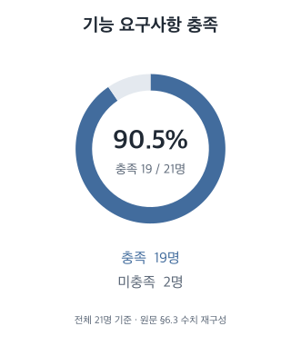
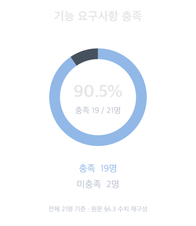
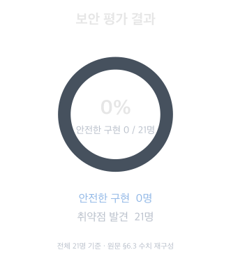

```paper
title: 'Windows plays Jenga: Uncovering Design Weaknesses in Windows File System Security'
institution: KAIST · 성균관대학교
authors: Dong-uk Kim, Junyoung Park, Sanghak Oh, Hyoungshick Kim, Insu Yun
year: 2025
venue: ACM CCS
url: https://doi.org/10.1145/3719027.3765217
```

<div class="paper-review">

<details class="review-outline review-before-reading">
<summary>이 글을 읽기 전 생각들</summary>

**이 논문이 다루는 문제는 무엇인가?**

윈도우 파일 시스템의 설계에 어떤 근본적인 보안 문제가 있는지 다루는 논문이라고 생각했다.

**왜 이 문제가 중요한가?**

파일 시스템의 기반에 문제가 남아 있다면, 개별 취약점을 패치하더라도 장기적으로 비슷한 취약점이 반복될 수 있기 때문이다.

**기존 방식들은 무엇이 부족했는가?**

기존 방식은 발견된 취약점에 개별적으로 패치를 적용하는 데 집중했다. 이 방식만으로는 근본 원인을 해결하기 어려워, 다른 곳에서 비슷한 취약점이 다시 나올 수 있다고 생각했다.

</details>

<details class="review-outline">
<summary>글의 흐름 · 목차 펼치기</summary>

- [배경과 문제의식](#1-배경과-문제의식)
- [핵심 아이디어](#핵심-아이디어)
- [RQ1 · 운영체제의 차이](#rq1-윈도우와-리눅스-파일-시스템은-어떻게-다른가)
- [RQ2 · 실제 프로그램의 취약점](#rq2-이-차이는-실제-프로그램에서-얼마나-심각한가)
- [RQ3 · 호환 계층의 처리](#rq3-호환-계층은-이-차이를-처리해주는가)
- [RQ4 · 개발자들의 인식과 대응](#rq4-실제-개발자들은-이-차이를-알고-대응하는가)
- [RQ5 · 대응책과 남는 문제](#rq5-기존-대응책은-무엇을-해결하고-어디에-한계가-있는가)
- [한계와 아쉬운 점](#3-한계와-아쉬운-점)
- [내가 배운 점과 앞으로 해볼 것](#4-내가-배운-점과-앞으로-해볼-것)

</details>

> **이 논문을 고른 이유**
>
> 가장 먼저 눈길을 끈 건 자극적인 제목이었다. 윈도우를 젠가에 비유한 이유가 궁금해 초록을 읽어봤고, 윈도우 파일 시스템의 근본적인 설계 문제를 다루는 논문이라는 것을 알게 됐다. 특히 개별 취약점이 어떻게 발생하는지만 설명하는 것이 아니라, 비슷한 문제가 반복되는 이유를 파일 시스템의 구조에서 찾는다는 점이 흥미로웠다.
>
> 아직 운영체제와 파일 시스템에 대한 지식이 부족한 만큼, 이런 기반을 다루는 논문이 공부의 뼈대가 될 수 있을 것 같았다. 논문에서 다루는 개념들을 하나씩 찾아보며 읽으면, 이후 다른 취약점이나 보안 문제를 공부할 때도 연결해서 이해할 수 있을 것 같아 이 논문을 골랐다.

## 1. 배경과 문제의식

최근 수년간 윈도우 파일 시스템과 관련된 수많은 취약점이 보고돼 왔다. 저자들은 마이크로소프트가 보안 원칙보다 하위 호환성과 사용자 편의성을 우선하며, 근본적인 설계 변경 대신 개별 패치로 대응해왔다고 평가한다.

이 문제가 중요한 이유는 낮은 권한의 사용자도 높은 권한으로 실행되는 프로그램의 파일 작업에 영향을 줄 수 있기 때문이다. 업데이트 프로그램이나 백신이 예상과 다른 파일을 처리하면, 권한 상승이나 업데이트·검사 방해로 이어질 수 있다.

이는 불안정한 기반 위에 젠가를 쌓는 것과 비슷하다. 이 연구는 개별 패치만으로는 비슷한 문제가 반복될 수 있으므로 ==yellow:윈도우 파일 시스템의 근본적인 변화가 필요하다고 본다.==

비슷한 시기의 관련 연구와 비교하면 이 논문의 분석 범위가 더 분명해진다. 아래에는 윈도우의 파일 조작 취약점뿐 아니라, 안드로이드의 파일 접근 통제를 다룬 연구도 함께 정리했다.

<div class="review-table" role="region" aria-label="2024~2025년 파일 보안 관련 연구 비교" tabindex="0">

| 연구 | 발표 | 대상 | 중심적으로 살펴보는 부분 |
| --- | --- | --- | --- |
| ++Windows plays Jenga++ | ACM CCS 2025 | 윈도우·리눅스 비교 | 링크·잠금·권한의 설계 차이를 실제 취약점, 호환 계층, 개발자, 대응책의 문제와 연결해 분석 |
| [Pig in a Poke](https://www.usenix.org/conference/usenixsecurity25/presentation/xiang-bocheng) | USENIX Security 2025 | 윈도우 | 링크 추적 취약점의 원인 분석과 LinkZard를 통한 탐지·악용 자동화 |
| [File Hijacking Vulnerability: The Elephant in the Room (JERRY)](https://www.ndss-symposium.org/ndss-paper/file-hijacking-vulnerability-the-elephant-in-the-room/) | NDSS 2024 | 윈도우 소프트웨어 | 파일 내용이나 경로를 조작해 보안 경계를 넘는 파일 하이재킹 취약점을 분석하고, JERRY로 실행 중 하이재킹을 시도해 탐지 |
| [Static Detection of Filesystem Vulnerabilities in Android Systems (PathSentinel)](https://arxiv.org/abs/2407.11279) | arXiv 2024 · 공개 논문 | 안드로이드 | 프로그램 정적 분석과 접근 통제 정책 분석을 결합해 경로 탐색, 하이재킹, 유인(luring) 유형의 파일 시스템 취약점을 탐지 |
| [ScopeVerif](https://www.ndss-symposium.org/ndss-paper/scopeverif-analyzing-the-security-of-androids-scoped-storage-via-differential-analysis/) | NDSS 2025 | 안드로이드 | Scoped Storage의 파일 접근 통제가 문서의 보안 속성을 지키는지 검사하고, 버전·제조사별 구현 차이와 취약점을 차등 분석 |

</div>

이들 연구도 특정 취약점 유형이나 파일 접근 통제의 원인과 구현 문제를 분석한다. Windows plays Jenga는 윈도우와 리눅스의 파일 처리 차이에서 출발해, 실제 취약점뿐 아니라 호환 계층과 개발자의 대응, 기존 방어책의 한계까지 연결해 살펴본다는 점에 초점을 맞췄다.

### 핵심 아이디어

이 연구의 핵심은 ==blue:개별 취약점을 찾는 데서 그치지 않고, 비슷한 문제가 반복되는 원인을 운영체제의 파일 처리 방식에서 찾는 것==이다. 리눅스와 비교해 윈도우의 특징을 확인한 뒤, 그 차이가 실제 프로그램의 취약점으로 이어지는지 살펴본다. 여기서 리눅스는 비교 기준이며, 모든 차이가 취약점이라는 뜻은 아니다.

이후에는 호환 계층이 그 차이를 처리하는지, 개발자가 위험을 알고 대응하는지, 기존 대응책으로 충분한지를 차례로 확인한다. 즉 운영체제의 동작부터 라이브러리, 개발자의 구현과 대응책까지 연결해, 안전한 파일 처리가 어디에서 어려워지는지 분석한 연구다. 새로운 방어 시스템을 제안하기보다 기존 설계와 대응 방식의 문제를 드러내는 데 초점을 맞췄다.

## 2. 연구 과정과 결과

아래 RQ1~5에서는 각 질문에 대해 무엇을 비교·조사했고, 어떤 결과가 나왔는지를 함께 정리했다. 공격자는 이미 일반 사용자 계정이나 제한된 샌드박스 안에서 코드를 실행할 수 있다고 가정하며, 구체적인 권한 조건과 영향은 사례마다 다르다.

### RQ1. 윈도우와 리눅스 파일 시스템은 어떻게 다른가?

저자들은 파일 링크 추적, 파일 잠금, 파일 권한을 중심으로 두 운영체제의 동작을 비교했다. 같은 목적의 파일 작업이라도 링크를 처리하거나 접근을 제한하는 방식이 다르면, 개발자가 예상한 것과 다른 결과가 나올 수 있기 때문이다.

#### 파일 링크 추적

링크는 다른 파일이나 디렉터리를 가리키는 연결이다. 저자들은 리눅스 심볼릭 링크, 윈도우의 NTFS 심볼릭 링크, JDSymlink를 대상으로 파일 열기·삭제·이름 변경 작업이 링크를 어떻게 처리하는지 비교했다.

<div class="review-table" role="region" aria-label="링크 종류별 파일 작업 비교" tabindex="0">

| 파일 작업 | 리눅스 심볼릭 링크 | NTFS 심볼릭 링크 | JDSymlink |
| --- | --- | --- | --- |
| 추적 방지 옵션으로 열기 | 대상 추적 안 함 | 대상 추적 안 함 | **대상 추적** |
| 삭제 | 링크 삭제 | 링크 삭제 | **대상 삭제** |
| 이름 변경 | 링크 이동 | 링크 이동 | **대상 이동** |

</div>

<p class="review-caption">옵션의 효과는 경로 전체에 대한 추적 차단을 뜻하지 않는다.</p>

> 여기서 JDSymlink는 ==blue:정션과 DosDevice를 결합한 링크==다. 정션은 디렉터리로 연결하고, DosDevice는 윈도우 내부의 객체 이름 공간에서 다른 장치나 파일 경로로 연결한다. 두 기능을 이어 붙이면 일반 파일 경로에서도 원하는 파일까지 연결할 수 있다. 논문은 이 조합을 일반 사용자 권한으로도 만들 수 있다는 점에 주목했다.
>
> 이 조합 자체는 James Forshaw 등의 기존 연구에서 이미 공개된 기법이다. 이 논문에서는 이를 JDSymlink라고 부르며, 파일 작업에서 어떤 동작 차이가 생기고 다른 설계 특성과 결합할 때 어떤 문제가 발생하는지 분석한다.

비교 결과, JDSymlink에서는 ==orange:링크 추적 방지 옵션을 지정하고 파일을 열어도 대상 파일을 따라갔다.== 삭제와 이름 변경에서도 링크 자체가 아니라 링크가 가리키는 대상 파일에 작업이 적용됐다. 반면 비교한 리눅스 심볼릭 링크와 NTFS 심볼릭 링크에서는 해당 옵션으로 추적을 막거나, 삭제·이름 변경을 링크 자체에 적용할 수 있었다.

다만 리눅스의 `O_NOFOLLOW`도 ==orange:마지막 경로 요소의 링크 추적을 제한==하는 옵션이므로, 중간 디렉터리에 있는 링크까지 모두 차단하는 것은 아니다.

#### 파일 잠금

파일 잠금에서는 리눅스의 ==blue:advisory locks(협력적 잠금)==와 윈도우의 ==blue:mandatory locks(강제적 잠금)==를 비교했다. 핵심은 ==blue:잠금 기능을 사용하지 않는 다른 프로세스의 파일 접근까지 제한하는지==에 있다.

리눅스의 일반적인 로컬 파일에서 사용하는 `flock()`은 프로그램들이 잠금을 획득하고 해제하는 규칙에 참여해야 효과가 있는 협력적 잠금이다. 다른 프로그램이 잠금 기능을 사용하지 않고 읽기나 쓰기를 수행하면, 이 잠금 자체가 그 접근을 막아주지는 않는다. 반면 윈도우의 강제적 잠금은 운영체제가 잠금 조건과 충돌하는 접근을 제한한다.

논문은 윈도우의 ==blue:공유 모드 잠금==과 ==blue:oplock==을 살펴봤다. 공유 모드는 파일을 열어둔 동안 다른 프로세스에 어떤 접근을 허용할지 정하는 설정이다. 이를 제한하면 다른 프로세스의 파일 작업이 오류로 실패할 수 있다. Oplock은 다른 파일 작업을 지연시키는 데 이용될 수 있다. 따라서 낮은 권한의 프로세스도 접근 가능한 파일에 잠금을 설정해 높은 권한의 프로그램에 오류를 일으키거나, 실행 시점을 늦출 수 있다. 이런 동작이 프로그램의 오류 처리나 파일 작업 순서와 결합하면 보안 문제로 이어질 수 있다.

#### 파일 권한: 상속과 역전

파일 권한에서는 권한 상속과 권한 역전이라는 두 가지 차이를 분석했다. ==blue:권한 상속==은 새로 만든 파일이나 디렉터리가 부모 디렉터리의 접근 권한을 물려받는 것이다. 윈도우에서는 기본적으로 이 상속이 적용되므로, 높은 권한의 프로그램이 만든 파일도 위치에 따라 일반 사용자에게 의도보다 넓은 접근을 허용할 수 있다.

저자들은 생성 시 파일 자체의 권한과 소유자를 설정하는 리눅스의 방식과 윈도우의 기본 상속 방식을 비교했다. 특히 임시 디렉터리처럼 일반 사용자에게도 접근이 허용된 위치에서 파일을 만들 때의 위험을 살펴봤다. 중요한 점은 파일을 만든 프로그램의 권한만 볼 것이 아니라, 생성된 파일에 실제로 어떤 접근 권한이 설정되는지도 확인해야 한다는 것이다.

==blue:권한 역전==은 일반 사용자가 접근할 수 있는 파일에 높은 권한의 프로세스는 접근하지 못하도록 설정하는 상황이다. 윈도우는 사용자나 그룹별 접근 허용·거부 항목으로 권한을 관리한다. 이 권한 목록을 변경할 수 있는 사용자는 자신에게는 접근을 허용하면서 SYSTEM의 접근은 거부할 수 있다. 높은 권한으로 실행되는 프로그램도 일반적인 파일 작업에서 이 거부 설정의 영향을 받을 수 있다.

이렇게 확인한 차이는 링크 추적, 파일 잠금, 권한 상속, 권한 역전의 네 가지다. 다음 분석에서는 이 차이가 실제 소프트웨어의 취약점으로도 이어지는지 확인했다.

---

### RQ2. 이 차이는 실제 프로그램에서 얼마나 심각한가?

실제 프로그램 분석에서는 높은 권한으로 파일 작업을 수행하는 소프트웨어를 찾아 대상을 좁혔다. 저자들은 프로그램의 매니페스트에서 UAC 권한 상승 요청을 확인하고, 외부 함수 사용 정보를 담은 IAT를 분석해 관련 파일 작업을 찾았다. 정적으로 연결된 코드 등은 바이너리 분석 도구로 파일 작업을 추적한 뒤 수동으로 분석했다.

그 결과 ==yellow:**25개 소프트웨어**==를 분석해 ==yellow:11개 업체==의 제품에서 ==yellow:**13개의 취약점**==을 발견하고 보고했다. 이 중 ==yellow:**11개**==는 이전에 알려지지 않은 취약점이었다. 논문은 업데이트 프로그램과 백신 등의 사례를 통해 앞에서 확인한 동작 차이가 어떻게 결합하는지 설명한다.

<div class="review-table" role="region" aria-label="실제 취약점 사례 요약" tabindex="0">

| 사례 | 사용된 동작 | 결과 |
| --- | --- | --- |
| Case 1 · Firefox 업데이트 | 링크 변경과 oplock 지연 | 잠근 파일과 다른 대상 삭제 |
| Case 2 · Firefox 샌드박스 | 읽기 접근과 공유 모드 제한 | 업데이트 방해 |
| Case 3 · Chrome 업데이트 | 잠금으로 실패 유도, SYSTEM 재시도 | 높은 권한의 파일 작업 유도 |
| Case 4 · 백신 | SYSTEM 접근 거부 | 파일 검사 방해 |

</div>

<p class="review-caption">아래 네 사례의 흐름을 요약했다. 각 공격의 권한 조건과 세부 영향은 사례별 설명을 따른다.</p>

#### Case 1 - Firefox 업데이트: 잠금과 삭제 대상의 분리

Firefox 업데이트 프로그램은 일반 권한과 SYSTEM 권한의 프로세스를 나눠 사용하고 있었다. 또한 작업용 파일인 `update_elevated.lock`을 제한된 공유 모드로 열어, 다른 프로세스가 수정하거나 삭제하지 못하도록 보호했다. 업데이트가 끝날 때 이 파일을 삭제하는 작업은 SYSTEM 권한으로 수행됐다.

문제는 해당 경로가 부모 디렉터리의 권한을 상속받아 일반 사용자도 링크를 조작할 여지가 있었다는 점이다. 공격은 다음 순서로 진행됐다.

<div class="case-flow llm-example" role="group" aria-label="Case 1 공격 흐름">

**공격 흐름**

1. 공격자가 작업용 경로를 더미 파일에 연결한다.

   `update_elevated.lock` 경로에 JDSymlink를 만들어, 파일을 여는 작업이 공격자가 준비한 더미 파일로 이어지게 한다.

2. 업데이트 프로그램이 더미 파일을 열고 잠근다.

   Firefox 업데이트에선 외부 수정을 막기 위해 `update_elevated.lock`에 공유 모드 잠금을 쓴다. 위 과정을 진행하면, 일반 권한의 업데이트 프로세스는 작업용 경로를 열지만, 실제로 열린 파일은 더미 파일이다. 따라서 공유 모드 잠금도 더미 파일에 걸린다.

3. 공격자가 삭제 작업을 지연시킨다.

   Oplock을 이용해 파일 작업을 지연시키고, 삭제 전에 링크를 바꿀 시간을 확보한다.

4. 링크가 삭제시키려는 대상 파일을 가리키도록 바꾼다.

   작업용 경로의 연결 대상을 바꾸더라도 기존 잠금은 더미 파일에 남아 있다.

5. SYSTEM 프로세스가 바뀐 대상 파일을 삭제한다.

   삭제 작업은 JDSymlink를 따라 새로운 대상에 적용된다. 같은 작업용 경로를 사용했지만, ==orange:잠근 파일과 삭제하는 파일이 달라진 것이다.==

</div>

이 사례에서는 권한 상속이 경로 조작의 여지를 만들고, JDSymlink가 작업 대상을 바꾸며, oplock이 실행 순서를 맞추는 데 사용됐다. 파일을 잠그는 보호 장치가 있어도 처음 파일을 여는 작업부터 다른 대상으로 연결될 수 있다면 충분하지 않았던 것이다.

#### Case 2 - Firefox 샌드박스: 읽기 권한으로 업데이트 방해

두 번째 사례는 공격자가 이미 Firefox의 샌드박스 프로세스 안에서 코드를 실행할 수 있다는 가정에서 출발한다. 샌드박스는 일부 프로세스의 권한을 제한하는 장치인데, 조사한 환경에서는 권한 상속 때문에 일부 샌드박스 프로세스도 업데이트 상태 파일인 `update.status`를 읽을 수 있었다.

<div class="case-flow llm-example" role="group" aria-label="Case 2 공격 흐름">

**공격 흐름**

1. 공격자가 상태 파일을 먼저 열고 공유 모드를 제한한다.

   샌드박스 프로세스에 허용된 읽기 권한으로 `update.status`를 열면서, 다른 프로세스의 쓰기와 충돌하는 공유 제한을 설정한다.

2. 업데이트 프로그램이 상태 파일을 쓰기용으로 열지 못한다.

   업데이트 진행 상황을 기록하려는 작업이 공격자의 공유 제한과 충돌해 `ERROR_SHARING_VIOLATION`으로 실패한다.

3. 업데이트 프로그램이 업데이트를 종료한다.

   상태 파일에 쓰지 못하는 상황을 심각한 내부 오류로 처리해 업데이트를 중단한다.

4. 공격자가 같은 방해를 반복한다.

   새 업데이트 시도도 계속 실패하도록 만들면, 사용자는 업데이트되지 않은 버전에 머물게 된다.

</div>

++파일 내용을 수정할 권한이 없어도++ 공유 제한으로 다른 프로세스의 쓰기를 막을 수 있었다는 점이 이 사례의 핵심이다.

#### Case 3 - Chrome 업데이트: 실패 후 재시도하는 권한의 변화

Chrome 업데이트 프로그램도 파일 작업의 위험을 고려해 사용자 권한으로 작업을 수행하는 impersonation을 적용하고 있었다. ==red:하지만 파일 이동이 실패하면 SYSTEM 권한으로 다시 시도하는 대체 처리가 있었다.==

<div class="case-flow llm-example" role="group" aria-label="Case 3 공격 흐름">

**공격 흐름**

1. 업데이트 프로그램이 Code Red 파일을 내려받는다.

   긴급 업데이트용 파일이 일반 사용자도 접근하고 조작할 수 있는 위치에 저장된다.

2. 공격자가 잠금으로 첫 파일 이동을 실패시킨다.

   파일을 제한된 공유 모드로 열어두면, 업데이트 프로그램이 사용자 권한으로 시도한 이동이 공유 위반 오류로 실패한다.

3. 업데이트 프로그램이 SYSTEM 권한으로 재시도한다.

   실패 시 실행되는 대체 처리에 따라, 같은 파일 작업을 높은 권한으로 다시 수행하려 한다.

4. 공격자가 재시도 작업의 대상을 바꾼다.

   JDSymlink로 경로를 조작해, SYSTEM 권한의 파일 이동 작업이 다른 대상에 적용되도록 유도한다.

5. 높은 권한의 파일 이동이 공격자가 지정한 대상에 적용된다.

   논문은 원래 위치에서 파일을 없애는 이동 작업의 효과를 임의 파일 삭제에 활용해 SYSTEM 권한 상승으로 이어질 수 있음을 보여준다.

</div>

낮은 권한으로 작업하도록 만든 보호 장치가 실패 이후의 처리에서도 유지되는지가 중요했던 사례다.

#### Case 4 - 백신: SYSTEM의 파일 접근을 거부

360 Total Security 백신 사례에서는 권한 역전이 사용됐다. 공격자는 자신의 파일에 대해 접근 권한 목록을 수정할 수 있는 `WRITE_DAC` 권한을 가지고 있었다.


<div class="case-flow llm-example" role="group" aria-label="Case 4 공격 흐름">

**공격 흐름**

1. 공격자가 SYSTEM의 파일 접근을 거부하도록 설정한다.

   자신에게는 접근을 허용하면서 SYSTEM의 접근은 거부하도록 파일의 권한 목록을 바꾼다.

2. 파일에 악성 내용을 기록한다.

   공격자 자신에게는 쓰기가 허용돼 있으므로 내용을 기록할 수 있다.

3. 백신이 해당 파일을 검사하기 위해 읽으려 한다.

   백신은 SYSTEM 권한으로 동작하지만 파일에 설정된 접근 거부의 영향을 받는다.

4. 파일 읽기가 실패해 검사를 방해한다.

   `ERROR_ACCESS_DENIED`가 발생하고, 조사한 백신은 해당 파일을 읽어 검사하지 못한다.

</div>


저자들은 이 권한 설정으로 백신의 파일 검사를 방해할 수 있음을 확인했다.

이 사례들에서는 파일 잠금이나 권한을 낮춘 실행 같은 보호 조치를 적용했더라도, 경로 해석이나 오류 처리와 결합하는 과정에서 예상하지 못한 동작이 나왔다. 그렇다면 개발자가 사용하는 언어의 라이브러리가 이런 차이를 처리해줄 수 있는지 살펴볼 필요가 있다.

---

### RQ3. 호환 계층은 이 차이를 처리해주는가?

==blue:호환 계층==은 운영체제별로 다른 기능을 공통된 방식으로 사용할 수 있도록 중간에서 맞춰주는 코드다. 이 논문에서는 주로 프로그래밍 언어의 라이브러리가 파일 작업의 차이를 어떻게 처리하는지 살펴봤다. 같은 파일 함수를 사용하더라도 내부에서는 리눅스 시스템 호출이나 윈도우 API를 사용하므로, 그 차이를 제대로 다루는지가 중요하다.

저자들은 C, C++, Python, Java, Go, Rust의 여섯 언어에서 파일 열기·생성·삭제·복사·이름 변경을 조사했다. 각 함수의 사양, 즉 어떤 조건에서 어떻게 동작해야 하는지를 먼저 확인하고, 리눅스와 윈도우에서 실제 동작을 비교했다. 링크 추적 방지, 링크 무시, 배타적 생성 옵션도 살펴봤으며, 윈도우에서는 NTFS 심볼릭 링크와 JDSymlink를 구분했다.

결과는 사양 준수, 사양 위반, 동작 불일치로 분류했다. 조사한 함수와 옵션 조합에서 발견한 문제는 다음과 같다.

<div class="review-table" role="region" aria-label="호환 계층의 사양 위반과 동작 불일치" tabindex="0">

| 분류 | 판정 기준 | 발견 건수 |
| --- | --- | ---: |
| 사양 위반 | 명확하게 정해진 사양을 따르지 않음 | ==yellow:**27건**== |
| 동작 불일치 | 사양이 명확하지 않은 부분에서 운영체제별 동작이 다름 | ==yellow:**9건**== |

</div>

<p class="review-caption">언어나 독립적인 취약점의 개수가 아니라 조사한 파일 관련 동작의 집계다.</p>

대표적으로 JDSymlink를 따라가는 윈도우 API의 동작이 호환 계층에도 영향을 줬다. 여기에 호환 계층 자체에서 생긴 문제도 있었다. 윈도우의 C와 Python에서는 ==blue:배타적 생성 옵션==을 줬는데도 NTFS 심볼릭 링크를 따라갔다. 이 옵션은 새 파일을 만들되 주어진 경로가 이미 존재하면 실패하도록 하는 것으로, 사양대로라면 심볼릭 링크가 주어져도 실패해야 한다.

논문에서 조사한 리눅스의 C++ 표준 라이브러리 복사 구현에서도 사양 위반이 확인됐다. 조사한 복사 함수는 목적지의 심볼릭 링크를 따라가야 했지만, 기존 파일을 덮어쓰지 않으려고 내부에서 `open`에 `O_CREAT | O_EXCL`을 사용했다. 이 조합은 심볼릭 링크가 주어지면 실패하므로, 링크가 가리키는 곳에 아직 파일이 없어도 복사가 실패했다. 내부의 `open`은 의도대로 동작했지만 그 옵션을 사용한 결과 복사 함수가 사양을 어긴 것이다. 저자들은 이를 GCC 개발자들에게 보고했고, 개발자들도 결함으로 인정했다.

파일 잠금과 권한에서는 조사한 언어들에 걸쳐 두 운영체제의 차이를 적절히 처리하는 공통 구현을 찾지 못했다. 예를 들어 윈도우의 `chmod`는 읽기·쓰기 관련 설정을 제공하지만, 실제 접근 허용·거부 목록을 변경하지 않고 쓰기에 대해서는 읽기 전용 속성을 조절한다. 따라서 명시적인 접근 거부가 있다면 읽기 옵션만으로 접근을 보장할 수 없고, 권한 상속도 제어하지 못한다.

이 결과는 ==yellow:같은 함수 이름과 사용법이 같은 보안 동작까지 보장하지는 않는다==는 점을 보여준다. 호환 계층에서 처리하지 못한 차이는 개발자가 직접 고려해야 하는 부분으로 남는다. 다음 개발자 조사에서는 실제 개발자들이 이런 차이를 얼마나 알고 대응하는지 확인한다.

---

### RQ4. 실제 개발자들은 이 차이를 알고 대응하는가?

호환 계층에서 처리하지 못하는 차이를 개발자가 직접 고려하려면, 먼저 그 차이와 위험을 알고 있어야 한다. 저자들은 이를 확인하기 위해 전문 개발자 ==yellow:21명==을 대상으로 구현 과제와 인터뷰를 진행했다. 참여자의 평균 프로그래밍 경력은 ==yellow:10.7년==이었다.

<aside class="rq4-task" aria-labelledby="rq4-task-title">
<h4 id="rq4-task-title">개발자들에게 주어진 과제</h4>
<p><strong>구현 내용</strong><br>윈도우와 리눅스에서 높은 권한으로 실행되는 로깅 시스템을 C/C++로 구현한다. 임시 경로에 로그 디렉터리를 만들고, 로그 기록과 백업을 위해 파일 열기·삭제·이름 변경을 구현한다.</p>
<p><strong>진행 조건</strong><br>평소의 개발 방식을 관찰하기 위해 구체적인 보안 위험이나 방어 방법은 미리 알려주지 않았다. 인터넷 검색과 AI 도구 사용은 허용했다.</p>
</aside>

아래 원형 그래프와 비율은 참여자 21명을 기준으로 한다. 백분율은 소수점 첫째 자리까지 반올림했다.

#### 기능이 작동해도 안전한 구현은 아니었다

<div class="rq4-evaluations">

<div class="rq4-chart">





</div>

<div class="rq4-chart">




</div>

</div>

==yellow:21명 중 19명==은 코드가 컴파일되고, 로그를 기록하며, 백업을 두 번 이상 수행한다는 기능 요구사항을 충족했다. 하지만 저자들의 보안 분석에서는 ==orange:모든 참여자의 구현에서 취약점이 발견됐다.== 심볼릭 링크 확인 누락, 높은 권한으로 사용하는 임시 디렉터리의 불안전한 관리, 파일 시스템 API의 안전하지 않은 사용 등이 문제였다.

이 결과는 로그 기록과 백업이 정상적으로 동작하는지 확인하는 것만으로 파일 처리의 안전성까지 확인할 수는 없다는 점을 보여준다. 앞의 RQ2에서도 정상적인 파일 작업이 링크나 잠금과 결합하면서 문제가 됐는데, 구현 과제에서도 이런 위험에 대한 대응이 부족했다.

#### 위험을 아는 것과 대응책을 설명하는 것에도 차이가 있었다

<dl class="rq4-awareness" aria-label="과제 이후 인터뷰 결과, 전체 21명 기준">
<div><dt>심볼릭 링크 위험 인식</dt><dd>47.6%<span>10 / 21명</span></dd></div>
<div><dt>유효한 링크 대응책 설명</dt><dd>4.8%<span>1 / 21명</span></dd></div>
<div><dt>파일 잠금의 동작·위험 이해</dt><dd>0%<span>0 / 21명</span></dd></div>
<div><dt>임시 경로 위험·대응책 설명</dt><dd>42.9%<span>9 / 21명</span></dd></div>
</dl>

심볼릭 링크로 의도하지 않은 파일에 접근할 수 있다는 위험을 알고 있던 참여자는 ==yellow:10명==이었다. 그러나 유효한 대응책을 설명한 참여자는 ==yellow:1명==뿐이었고, 이 참여자는 파일을 연 뒤 inode 번호를 확인하는 방법을 제안했다. 위험을 들어본 것과 실제로 어떻게 막을지 아는 것 사이에도 차이가 있었던 것이다.

파일 잠금에서는 ==orange:공유 모드와 oplock의 동작이나 위험을 이해한 참여자가 없었다.== 반면 높은 권한으로 사용하는 임시 디렉터리의 위험을 인식하고 접근 권한 제어 같은 대응책을 설명한 참여자는 ==yellow:9명==이었다. 따라서 모든 파일 보안 문제를 전혀 몰랐다기보다는, 문제에 따라 알고 있는 범위와 대응 지식이 달랐다고 볼 수 있다. 인터뷰에서 대응책을 설명한 경우도 앞선 구현 과제에서 안전한 코드로 이어지지는 않았다.

이 조사에서는 호환 계층이 처리하지 못한 차이를 개발자 개인의 지식과 판단에 맡기는 방식에도 어려움이 드러났다. 다음 RQ5에서는 이런 위험을 줄일 대응책이 무엇이며, 실제로 적용할 때 어떤 한계가 있는지 살펴본다.

---

### RQ5. 기존 대응책은 무엇을 해결하고, 어디에 한계가 있는가?

앞의 분석에서는 호환 계층이 운영체제의 차이를 충분히 처리하지 못했고, 개발자들도 이를 고려해 안전하게 구현하는 데 어려움을 겪었다. 그렇다면 현재 사용되는 대응책으로는 이런 문제를 얼마나 줄일 수 있을까? 저자들은 분석 대상 프로그램에 적용된 대응책을 커널 수준과 애플리케이션 수준으로 나누어 살펴봤다.

<div class="rq5-countermeasures">

#### 커널 수준의 대응책

##### 정션 추적 제한

<div class="countermeasure-pair">
<div class="countermeasure-effect">

**==blue:해결 방식==**

윈도우는 ==blue:Redirection Trust Mitigation==이라는 보호 기능을 제공한다. 이를 적용한 프로세스는 낮은 권한의 사용자가 만든 정션을 따라가는 것이 제한된다. JDSymlink도 정션을 이용하므로, 이를 통해 의도하지 않은 파일로 연결되는 것을 막을 수 있다.

</div>
<div class="countermeasure-limit">

**==orange:남는 문제==**

하지만 공격에 사용되는 정션만 골라서 막는 방식은 아니다. ==orange:프로그램이 정상적으로 사용하는 정션까지 차단할 수 있다.== 논문은 이 보호 기능 때문에 winget이 정상적인 정션에 접근하지 못해 패키지 업데이트나 제거에 문제가 생긴 사례를 소개한다. 또한 관련 문서가 충분하지 않아 개발자가 기능을 알기 어렵고, 저자들의 조사에서도 일부 마이크로소프트 프로그램 외에는 적용 사례를 찾기 어려웠다.

</div>
</div>

##### 별도의 커널 드라이버

<div class="countermeasure-pair">
<div class="countermeasure-effect">

**==blue:해결 방식==**

일부 백신은 파일 작업을 수행하는 커널 드라이버를 직접 구현한다. 논문에서 소개한 Avast는 일반적인 권한 검사와 잠금의 제약을 우회하는 자체 파일 처리 방식을 사용했다. 악성 프로그램이 파일을 잠그거나 접근을 거부하더라도 백신이 검사와 격리를 수행할 수 있게 하는 것이다. RQ2에서 살펴본 백신의 파일 접근 방해에 대응하는 방식이다.

</div>
<div class="countermeasure-limit">

**==orange:남는 문제==**

문제는 구현 부담이다. 커널과 파일 시스템 내부에 대한 전문 지식이 필요하고, 드라이버의 오류는 시스템 전체의 중단으로 이어질 수 있다. 논문은 드라이버 배포에 필요한 검증·서명 절차에도 비용과 시간이 든다고 설명한다. 따라서 모든 애플리케이션이 쉽게 도입할 수 있는 대응책은 아니다.

</div>
</div>

#### 애플리케이션 수준의 대응책

##### 링크 존재 여부 확인

<div class="countermeasure-pair">
<div class="countermeasure-effect">

**==blue:해결 방식==**

파일 작업 전에 경로에 링크가 있는지 확인하고, 링크가 발견되면 작업을 거부하거나 대상이 적절한지 검사하는 방법이다. Chrome은 원래 경로와 최종적으로 해석된 경로를 비교하고, NVIDIA App은 링크를 구현하는 데 사용되는 reparse point인지 확인하는 방식을 사용했다.

</div>
<div class="countermeasure-limit">

**==orange:남는 문제==**

다만 검사한 시점과 실제 파일 작업을 수행하는 시점이 다르면 문제가 남는다. 검사할 때는 일반 파일이었다가 실제로 사용할 때는 공격자가 링크로 바꿀 수 있기 때문이다. 이런 시간 차이를 이용하는 공격을 ==blue:TOCTOU==라고 한다. 따라서 한 번 경로를 검사했다는 사실만으로 이후 작업의 대상까지 보장할 수는 없다.

</div>
</div>

##### 공유 모드 잠금

<div class="countermeasure-pair">
<div class="countermeasure-effect">

**==blue:해결 방식==**

파일을 사용하는 동안 다른 프로세스가 수정하거나 삭제하지 못하도록 공유 모드를 제한하는 방법이다. Case 1의 Firefox 업데이트 프로그램도 이 방식으로 작업용 파일을 보호했다.

</div>
<div class="countermeasure-limit">

**==orange:남는 문제==**

그러나 잠금을 적용하려고 파일을 여는 작업부터 다른 대상으로 연결되면, 보호하려던 파일과 실제로 잠긴 파일이 달라질 수 있다. Firefox 사례에서는 더미 파일에 잠금이 걸린 채 링크의 대상이 바뀌었고, 이후 삭제 작업은 다른 파일에 적용됐다. 잠금이 있다는 것과 올바른 파일을 보호하고 있다는 것은 별도로 확인해야 했던 것이다.

</div>
</div>

##### 접근 권한을 명시적으로 설정

<div class="countermeasure-pair">
<div class="countermeasure-effect">

**==blue:해결 방식==**

부모 디렉터리의 권한을 그대로 상속받지 않고, 필요한 접근만 허용하도록 권한을 직접 설정하는 방법이다. 논문에서 소개한 Microsoft Office 365는 데이터 디렉터리가 더 넓은 접근을 허용하는 부모 디렉터리의 권한을 상속받지 않도록 설정했다. 이렇게 하면 부모의 설정 때문에 중요한 데이터에 불필요한 접근 권한이 생기는 것을 줄일 수 있다.

</div>
<div class="countermeasure-limit">

**==orange:남는 문제==**

권한을 설정한 경로 외에도 보호가 필요한 파일과 디렉터리가 있다면 빠짐없이 적용해야 한다. 논문은 애플리케이션 수준 대응책 전반에 대해, 보호가 누락된 곳이 없는지 충분히 검증해야 한다고 설명한다.

</div>
</div>

##### 사용자 권한으로 파일 작업 수행

<div class="countermeasure-pair">
<div class="countermeasure-effect">

**==blue:해결 방식==**

==blue:Impersonation==은 높은 권한으로 실행 중인 프로그램이 파일 작업을 수행할 때는 사용자의 권한으로 낮춰 실행하는 방법이다. 공격자가 경로를 다른 파일로 연결하더라도 해당 사용자가 접근할 수 없는 파일이라면 작업이 실패하므로, 높은 권한이 악용되는 것을 줄일 수 있다.

</div>
<div class="countermeasure-limit">

**==orange:남는 문제==**

하지만 권한을 낮추면 정상적인 파일 작업도 실패할 수 있어 기능과 충돌한다. Case 3의 Chrome 업데이트 프로그램은 사용자 권한으로 작업이 실패하면 원래의 SYSTEM 권한으로 재시도했다. 공격자는 이 재시도 처리를 이용해 보호를 우회했다. 권한을 낮추는 조치가 실패 이후의 처리에서도 유지되는지가 중요했던 것이다.

</div>
</div>

</div>

#### 대응책의 한계가 뜻하는 것

이 대응책들은 ==blue:올바르게 적용하면 위험을 줄일 수 있다.== 그러나 ==orange:보호가 필요한 파일 작업에 빠짐없이 적용돼야 하고,== 경로가 바뀌는 시점이나 오류 이후의 처리까지 고려해야 한다. 저자들은 검사 하나를 누락해도 취약점이 생길 수 있어 충분한 검증이 필요하다고 설명한다.

실제 업체들의 반응에서도 구현의 어려움이 드러났다. Firefox 측은 impersonation을 올바르게 적용하기 어렵다고 했고, Docker 보안팀은 보고된 문제의 근본 원인이 윈도우에 있다고 답했다. curl 유지관리자도 여러 접근을 시도했지만 다른 문제와 위험이 생겼으며, 더 나은 해결책을 확신하기 어렵다고 설명했다.

이를 바탕으로 저자들은 ==yellow:대응 부담을 개별 애플리케이션 개발자에게만 맡기는 방식으로는 부족하다==고 주장한다. 마이크로소프트가 파일 시스템의 근본적인 설계 문제를 다루고, 애플리케이션이 안전하게 동작할 기반을 제공해야 한다는 것이다. 논문에 따르면 저자들은 마이크로소프트에 실제 사례와 함께 문제를 보고하고 API 문서의 설명 보완도 요청했지만, 당시 마이크로소프트는 심각도를 낮게 분류하고 즉각적인 수정 계획은 없다고 답했다.

RQ5의 결론은 대응책이 전혀 없다는 것이 아니라, 기존 대응책에도 구현 부담과 기능 충돌, 우회 가능성이 남는다는 것이다. 이는 처음에 제기한 문제의식과 연결된다. 개별 취약점에 패치를 더하는 것과 함께, 왜 비슷한 문제가 계속 발생하는지 그 기반의 설계까지 살펴봐야 한다는 것이 저자들의 주장이다.

---

## 3. 한계와 아쉬운 점

이 연구는 운영체제의 동작 차이를 실제 취약점, 호환 계층, 개발자 조사까지 연결해서 보여준다. 다만 발견한 문제가 어떤 범위에 적용되는지와, 제안한 방향이 어디까지 검증됐는지는 구분해서 볼 필요가 있다.

### 저자들이 밝힌 개발자 조사의 한계

RQ4의 개발자 조사 결과를 ==orange:모든 개발자의 인식 수준으로 일반화하기는 어렵다.== 참여자는 21명이었고, 기존 산업 협력 관계와 개인적인 연락을 통해 모집했다. 또한 과제는 C/C++로 수행했지만 Python을 주로 사용하는 참여자가 많았다. 저자들은 참여자들이 과제를 수행할 수 있는 역량은 갖추고 있었다고 설명하면서도, 표본의 구성이 결과의 일반화에 영향을 줄 수 있다고 밝혔다.

과제 환경과 실제 개발 환경에도 차이가 있었다. 실제 제품 개발에서는 팀 협업, 일정, 조직의 보안 정책 등이 보안에 대한 판단에 영향을 주지만, 이번 과제에는 이런 조건이 충분히 반영되지 않았다. 따라서 과제에서 보인 행동을 실제 회사에서의 개발 방식과 그대로 같다고 보기는 어렵다.

과제의 구성 자체가 취약한 구현을 유도했을 가능성도 있다. 저자들은 평소의 개발 행동을 관찰하기 위해 구체적인 보안 지침을 주지 않았지만, 높은 권한으로 임시 경로에 파일을 다루도록 한 조건이 결과에 영향을 줬을 수 있다고 인정했다. 따라서 안전한 구현이 없었다는 결과는 이 과제의 조건과 함께 읽어야 한다. 보안 요구사항을 명시하거나 코드 리뷰를 거친 뒤에도 같은 문제가 남는지는 추가로 확인할 부분이다.

### 리뷰에서 짚어볼 아쉬운 점

아래 내용은 저자들이 명시한 조사 한계와 별도로, 연구의 범위와 결과를 바탕으로 추가 검증이 필요하다고 본 부분이다.

#### 보충 자료에 접근하기 어려웠다

논문에 제시된 [GitHub 주소](https://github.com/kaist-hacking/Jenga)에 접근할 수 없어, 부록과 구현 자료를 직접 확인하지 못했다. 이 때문에 일부 실험의 세부 조건과 재현 방법을 검토하는 데 어려움이 있었다.

#### 리눅스 권한 모델의 비교 조건이 더 구체적이면 좋겠다

리눅스도 부모 디렉터리에 ==blue:default ACL==이 설정돼 있으면 새 파일에 이를 상속할 수 있다. 다만 생성 시 지정한 권한(`mode`)도 함께 적용되므로, 두 운영체제의 차이를 설명할 때는 비교 조건을 구체적으로 밝힐 필요가 있다.

#### 근본적인 재설계의 효과까지 검증한 것은 아니다

논문은 기존 설계와 대응책의 문제를 보여주지만, 이를 대체할 파일 시스템을 구현해 평가하지는 않았다. 따라서 근본적인 변화가 필요하다는 주장과, 어떤 새 설계가 효과적인지는 구분해야 한다고 생각한다. 새 설계가 공격을 얼마나 막고 기존 프로그램과의 호환성을 얼마나 유지할 수 있는지는 이후 연구에서 확인할 부분이다.

---

## 4. 내가 배운 점과 앞으로 해볼 것

### 이어서 읽어볼 논문

#### [Pig in a Poke: Automatically Detecting and Exploiting Link Following Vulnerabilities in Windows File Operations](https://www.usenix.org/conference/usenixsecurity25/presentation/xiang-bocheng)

이번 논문을 읽으며 링크 추적이 일어나는 시점을 분석해 취약점을 자동으로 찾을 수 있을지 궁금해졌다. LinkZard가 이를 어떤 방식으로 수행하는지 더 알아보고 싶다.

### 다른 분야에 적용할 가능성

AI가 가상머신이나 컨테이너 안에서 코드를 실행하는 환경에도 이 논문의 관점을 적용해볼 수 있을 것 같다. 이런 환경에서는 코드 실행을 격리하는 것과 함께, 사용자가 올린 파일을 전달하고 실행 결과를 외부로 가져오는 과정의 안전성도 살펴봐야 한다.

예를 들어 공유 폴더나 결과물 전달 과정에서 높은 권한의 관리 프로그램이 사용자가 조작할 수 있는 파일 경로를 처리한다면, 링크 때문에 예상하지 못한 파일에 작업이 적용될 가능성을 검토할 수 있다. 이 논문에서 살펴본 것처럼 경로를 검사한 시점과 실제로 사용하는 시점 사이에 대상이 바뀌는지도 확인해야 한다.

이를 확장한다면 ==blue:AI 실행 환경의 파일 전달 기능==을 대상으로 링크 처리 방식과 관리 프로그램의 권한을 비교해볼 수 있을 것이다. 다만 실제 위험은 운영체제와 공유 방식에 따라 달라지므로, 어떤 조건에서 격리 경계 밖의 파일에 영향을 줄 수 있는지는 별도로 검증해야 한다.

### 더 알아보고 싶은 부분

윈도우에서 권한 역전이 가능한 이유를 더 알아보고 싶다. 부모 디렉터리의 권한을 상속하는 방식과 함께, 일반 사용자가 자신의 파일에 대한 SYSTEM의 접근을 거부할 수 있도록 한 권한 구조에는 어떤 설계 의도가 있는지 궁금하다.

### 직접 구현, 재현, 비교해보고 싶은 포인트

Case 1에서 oplock으로 파일 작업을 지연시키고, 그 사이에 링크 대상을 바꾸는 공격에 대한 대응책을 직접 구현해보고 싶다. 실험용 파일로 잠금이 걸린 파일과 실제 삭제 대상이 달라지는 상황을 재현하고, 처음 연 파일을 기준으로 삭제하도록 처리하는 방법을 검토하려 한다. 이후 대응책 적용 전후를 비교해 공격을 막을 수 있는지와 정상적인 파일 처리에도 문제가 없는지 확인해보고 싶다.

### 연구나 프로젝트로 발전시킨다면

Redirection Trust Mitigation이 정상적인 정션까지 차단하는 문제를 개선하는 연구를 해보고 싶다. 정션을 만든 주체와 연결 대상의 권한, 프로그램이 사용하는 경로 등을 함께 확인해 추적 허용 기준을 구체화해보려 한다. 이때 허용된 정션의 대상이 검사 이후 바뀌는 상황에서도 보호가 유지되는지 확인할 필요가 있다.

이를 위해 정상적인 업데이트·설치 작업과 JDSymlink를 이용한 공격 상황을 준비하고, 기존 방식과 개선한 방식을 비교해보고 싶다. ==yellow:공격을 막는 것과 함께 정상 작업이 불필요하게 차단되는 경우도 줄일 수 있는지== 평가하려 한다.

### 마치며

처음 논문을 읽다 보니 이해되지 않는 부분을 많이 찾아봤다. 운영체제의 기초 개념과 윈도우에 특화된 기능·API를 구분하기 어려운 경우도 많았다. 근데 결론적으로 재미있었다.

이 논문이 특별해서인지는 모르겠지만, RQ1~5를 세우고 하나씩 답해 나가는 과정이 재미있었다. 특히 각 질문이 연결돼 있어 무언가를 찾아낼 때마다 다음에는 어떻게 사용될지 기대됐다.

다만 링크나 권한에 관한 내용을 읽으면서 OS에 대한 기본 지식이 부족함을 깨달았다. 추후 OS에 대한 지식을 쌓고 이 논문을 다시 한번 보면 다르게 볼 수 있을 것 같다.

이번에 배운 것은 ==yellow:같은 경로를 쓴다고 해서 검사한 파일, 잠근 파일, 실제 작업 대상이 항상 같지는 않다==는 점이다. 앞으로는 OS의 파일·권한 모델을 더 공부하면서, 먼저 Case 1을 실험용 파일로 재현하고 대응 전후의 동작을 비교해보고 싶다.

</div>
